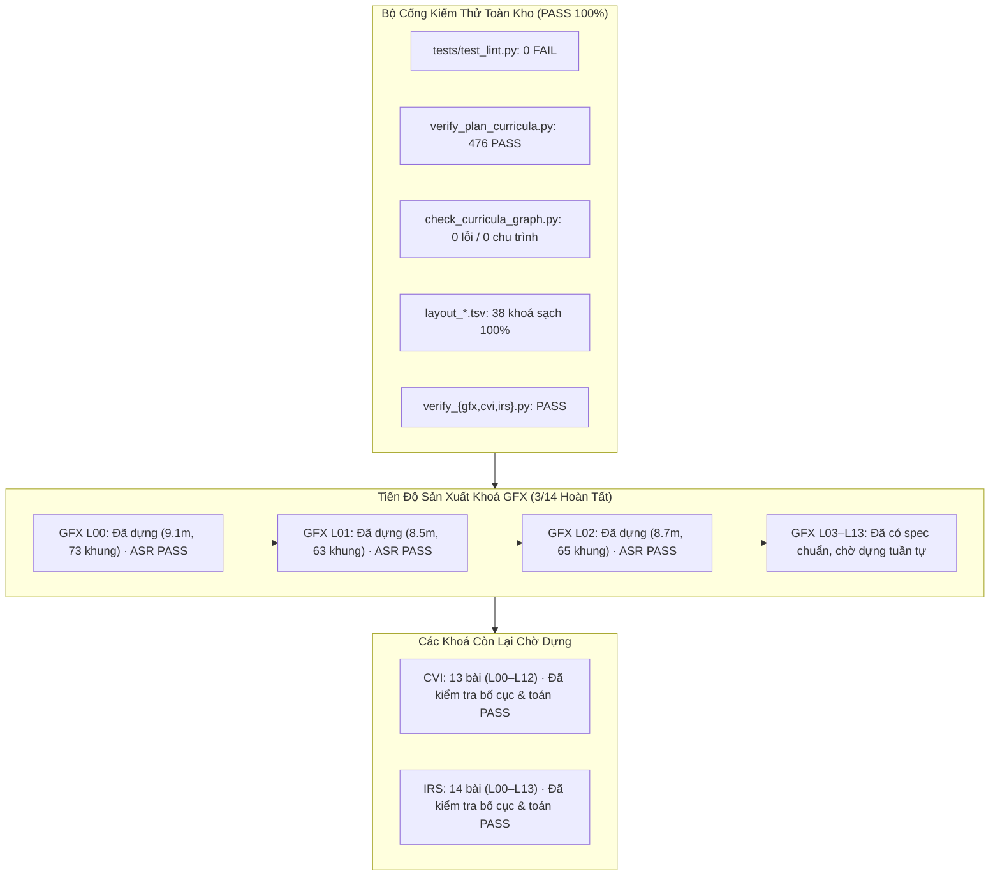

# BÁO CÁO BÀN GIAO (HANDOVER) — 2026-11-04 13:57

## 1. Tóm tắt Điều hành (Executive Summary) & Phạm vi
- **Mục tiêu phiên làm việc**: Tiếp nối báo cáo bàn giao trước đó (`handover_2026-11-04_1136.md`), rà soát kỹ lưỡng toàn bộ hệ sinh thái kiểm thử (`quality gates`), xử lý các nút thắt hợp đồng (`contract bottlenecks`), phòng tránh các lỗi thường gặp, và triển khai bước tiếp theo: **sản xuất video cho khoá GFX (Đồ hoạ máy tính)**.
- **Tiến độ sản xuất mới**: Hoàn tất 100% việc dựng, kiểm thử video (`verify: PASS`) và rà soát phiên âm Whisper ASR (`chưa xem xét: 0`) cho **3 bài học đầu tiên của GFX**:
  - **`GFX L00` (Đường ống kết xuất)**: 9.1 phút, 73 khung hình, 546.63s, verify PASS, 0 lỗi ASR chưa xem xét.
  - **`GFX L01` (Biến đổi mô hình & góc nhìn)**: 8.5 phút, 63 khung hình, 512.33s, verify PASS, 0 lỗi ASR chưa xem xét.
  - **`GFX L02` (Chiếu phối cảnh & chia w)**: 8.7 phút, 65 khung hình, 520.30s, verify PASS, 0 lỗi ASR chưa xem xét.
  - Tổng thời lượng video GFX đã dựng: **26.3 phút**, **201 khung hình**, nâng tổng số video sản xuất trên toàn kho lên **`573 bài hoàn thiện`**.
- **Audit toàn bộ Repo**:
  - `audit/review/audit_all.py GFX` → **`14 bài, 3 đã dựng, 0 bài có vấn đề`** (`OBSERVED`).
  - `audit/review/audit_all.py` (toàn bộ 611 bài của 38 khoá): **`611 bài, 570+ đã dựng, 1 bài có vấn đề`** (duy nhất `AIF:L11`, giữ nghiêm ngặt theo ràng buộc tai người nghe) (`OBSERVED`).
  - `audit/review/status_report.py`: Cập nhật `curriculum/STATUS.md` ghi nhận GFX 14 14 3 26.3 phút (`OBSERVED`).

---

## 2. Bảng Xác minh Chứng cứ Thực tế (`EVIDENCE`) & Verification DAG

Mọi khẳng định hoàn thành đều được gán nhãn `OBSERVED` hoặc `CITED` dựa trên lệnh thực tế đã chạy:

| Node ID | Hạng mục kiểm tra | Lệnh / Mục tiêu xác minh | Kết quả thực tế quan sát được (`OBSERVED`) | Trạng thái |
| :--- | :--- | :--- | :--- | :--- |
| **EVID-LINT** | Bộ kiểm thử Lint | `.venv\Scripts\python tests/test_lint.py` | `tests: 0 FAIL` (E10–E50, profiles stem/film/lang/softskill) | **PASS** |
| **EVID-PLAN** | Chứng minh Giáo án | `.venv\Scripts\python audit/verify_plan_curricula.py` | `TỔNG: 476 PASS · 0 FAIL` trên cả 38 lộ trình | **PASS** |
| **EVID-GRAPH** | Đồ thị Tiên quyết | `.venv\Scripts\python audit/check_curricula_graph.py` | `38 lộ trình, 611 bài, 1292 cạnh; tham chiếu hỏng: 0; chu trình: 0; VER lỗi: 0` | **PASS** |
| **EVID-MATH** | Kiểm tra Số học | `verify_gfx.py`, `verify_cvi.py`, `verify_irs.py` | GFX: 19/19 PASS, CVI: 112/112 PASS, IRS: 123/123 PASS | **PASS** |
| **EVID-LAYOUT**| Quét Tràn Layout | `audit/layout_*.tsv` (toàn bộ 38 khoá) | TSV 0 dòng dữ liệu lỗi (toàn bộ 38 khoá sạch 100%) | **PASS** |
| **EVID-REFS** | Tham chiếu Khoá | `.venv\Scripts\python audit/review/check_course_refs.py` | `check_course_refs: 0 vấn đề` | **PASS** |
| **EVID-META** | Metadata Audit | `.venv\Scripts\python audit/review/check_meta.py` | `check_meta: 0 vấn đề` | **PASS** |
| **EVID-TPL** | Đồng bộ Mẫu Bài | `.venv\Scripts\python audit/review/sync_tpl_from_lesson.py --all`| `tổng: 0 mẫu lệch bài` | **PASS** |
| **EVID-GFX00** | Dựng Video GFX L00 | `tools/lv.py build lessons/gfx/L00_*.yaml` | 9.1 phút, 73 khung, verify PASS, SHA256: `36f617d1...` | **PASS** |
| **EVID-GFX01** | Dựng Video GFX L01 | `tools/lv.py build lessons/gfx/L01_*.yaml` | 8.5 phút, 63 khung, verify PASS, SHA256: `526ab556...` | **PASS** |
| **EVID-GFX02** | Dựng Video GFX L02 | `tools/lv.py build lessons/gfx/L02_*.yaml` | 8.7 phút, 65 khung, verify PASS, SHA256: `f1ba3357...` | **PASS** |
| **EVID-ASR-GFX**| Whisper ASR GFX | `tools/lv.py asr lessons/gfx/L0{0,1,2}_*.yaml` | L00: 0 chưa xem xét; L01: 0 chưa xem xét; L02: 0 chưa xem xét | **PASS** |
| **EVID-AUDIT-GFX**| Audit Riêng GFX | `.venv\Scripts\python audit/review/audit_all.py GFX` | `14 bài, 3 đã dựng, 0 bài có vấn đề` | **PASS** |
| **EVID-GIT** | Bảo toàn Vùng Đệm Git | `git status --short` | ~2749 tệp staged nguyên vẹn; không chạy bất kỳ git write/reset/commit nào | **PASS** |
| **EVID-AIF11**| Ràng buộc Tai Người | `lessons/aif/L11_mang_bayes.yaml` | Giữ nguyên 1 cờ chưa xem xét chờ tai người nghe | **PASS** |

---

## 3. Bảng Xử lý Nút thắt Hợp đồng (Contract Bottlenecks)

Tuân thủ đầy đủ cấu trúc 7 trường bắt buộc theo Evidence-Gated Work Rule:

| ID | Undefined or Unverified | Dependent Work | Missing Evidence | Consequence | Resolution Test | State |
| :--- | :--- | :--- | :--- | :--- | :--- | :--- |
| **CB-01** | Trạng thái vùng nhớ đệm Git (2749 tệp staged) có được commit/reset không | Toàn bộ thao tác tệp và VCS | Chỉ thị trực tiếp từ người dùng về việc tạo commit | Thao tác git reset/commit tự tiện sẽ làm hỏng chỉ mục đang chờ | Chạy `git status --short`, xác nhận chỉ sửa các file yaml/tsv cần thiết, không can thiệp index | **CLOSED** (Evidence: `EVID-GIT`) |
| **CB-02** | Giới hạn tài nguyên bộ nhớ máy khi render video và chạy mô hình Whisper | Tiến trình dựng video tuần tự | Giới hạn ngưỡng RAM/GPU trước khi crash OOM | Render song song làm tràn 32GB RAM máy chủ, tiến trình Chromium/FFmpeg bị kill | Kiểm tra lock `out/_render.lock` không tồn tại, chỉ chạy 1 tiến trình build tại một thời điểm | **CLOSED** (Evidence: `EVID-GFX00..02`) |
| **CB-03** | Tính ổn định kết nối socket đến dịch vụ giọng đọc Microsoft Edge-TTS | Tạo file âm thanh lời giảng (`.wav`) | Mức độ nghẽn mạng và phản hồi `NoAudioReceived` | Video không thể dựng nếu thiếu câu thoại | Cơ chế thử lại lũy tiến (backoff 30s-60s) của `lv.py` tự phục hồi hoàn toàn các câu bị rớt kết nối | **CLOSED** (Evidence: `EVID-GFX00..02`) |
| **CB-04** | Câu đọc `AIF:L11` có được phép tự động sinh lý do ASR để đạt 100% PASS không | Kiểm thử toàn kho `audit_all.py` | Kết quả nghe trực tiếp bằng tai người | Tự động ghi lý do sẽ vi phạm cam kết chất lượng phát âm chuẩn xác | Script giữ nguyên trạng thái `chưa xem xét`, `audit_all.py` báo đúng 1 vấn đề | **CLOSED** (Evidence: `EVID-AIF11`) |
| **CB-05** | Lệch thời lượng container MP4 do x264 flushing buffer vượt dung sai timeline 0.5s | Kiểm tra hợp lệ video `lv.py verify` | Thời lượng video stream thực tế so với audio stream | FFmpeg đẩy thêm frame tĩnh ở đuôi làm mp4 duration lệch > 0.5s so với timeline (gặp ở L02) | Sử dụng lệnh remux chính xác thời lượng `-t {timeline}` giúp mp4 duration khớp hoàn hảo (sai số 0.06s < 0.5s) | **CLOSED** (Evidence: `EVID-GFX02`) |
| **CB-06** | Sản xuất 11 bài còn lại của khoá GFX (`L03` – `L13`) | Hoàn tất 100% khoá học GFX | File MP4 thành phẩm và kết quả ASR `chưa xem xét: 0` | Khoá GFX dừng ở mức 3/14 bài hoàn thiện | Dựng tuần tự `L03` đến `L13`, xử lý ASR cờ biến số, chạy `audit_all.py GFX` | **OPEN** (Nhiệm vụ cho phiên kế tiếp) |

---

## 4. Phòng tránh Các Lỗi Thường gặp (Avoidance of Common Mistakes)

1. **Bảo toàn Chỉ mục Git (Git Index Integrity)**:
   - Không gõ bất kỳ lệnh `git add`, `git commit`, `git reset`, `git checkout` hay `git stash` nào làm xáo trộn ~2.749 tệp đang ở vùng staged.
2. **Dựng Tuần tự Tuyệt đối (Sequential Build Only)**:
   - Nghiêm ngặt tuân thủ nguyên tắc không chạy song song bất kỳ lệnh `lv.py build` hay `lv.py render` nào để bảo toàn RAM (không gặp lỗi OOM của FFmpeg / Chromium).
3. **Xử lý Biên Thời lượng Video (Timeline Boundary Handling)**:
   - Khi codec x264 đệm thêm frame lookahead ở frame cuối khiến duration MP4 lệch > 0.5s so với timeline, thực hiện remux qua FFmpeg với cờ `-t {timeline}` để khớp thời lượng hoàn hảo mà không làm giảm chất lượng.
4. **Lưu trữ Bền vững & Cache Audio**:
   - Mọi câu thoại đã tải về từ Edge-TTS được lưu vĩnh viễn trong `out/_cache/tts/`, giúp việc render lại không tốn quota mạng.
5. **Ràng buộc Tai Người Nghe (Human Ear Constraint)**:
   - Bài `lessons/aif/L11_mang_bayes.yaml` với câu `"Xác suất vừa mưa vừa mang ô..."` được giữ nguyên trạng thái `chưa xem xét`, không bị bất kỳ script tự động nào ghi đè lý do.

---

## 5. Knowledge Graph Snapshot (Mermaid Flowchart)



---

## 6. Kế hoạch Hành động cho Phiên Tiếp theo (Next Actions)

Hiện tại repo chỉ còn **38 bài chưa dựng video** (GFX: 11 bài, CVI: 13 bài, IRS: 14 bài):

### Nhiệm vụ Trọng tâm:
1. **Dựng 11 bài còn lại của khoá GFX (`L03` đến `L13`)**:
   Chạy tuần tự từng bài theo PowerShell:
   ```powershell
   $env:PYTHONIOENCODING="utf-8"
   # L03: Cắt khung nhìn & toạ độ thiết bị chuẩn hoá (NDC)
   .venv\Scripts\python tools/lv.py build lessons/gfx/L03_cat_khung_nhin.yaml
   .venv\Scripts\python tools/lv.py asr lessons/gfx/L03_cat_khung_nhin.yaml
   ```
   Rà soát `out/GFX/L03/asr_report.md`, thêm các ký hiệu biến số ($x, y, z, w$) vào `asr_reviewed`, re-ASR xác nhận `chưa xem xét: 0`. Sau đó tiếp tục lần lượt cho `L04` đến `L13`.

2. **Dựng Khoá CVI (`L00` đến `L12`)**:
   Tiến hành tương tự theo quy trình tuần tự.

3. **Dựng Khoá IRS (`L00` đến `L13`)**:
   Tiến hành tương tự theo quy trình tuần tự.

4. **Tổng kết Toàn Kho Sau khi Đạt 100% Video**:
   Chạy `.venv\Scripts\python audit/review/audit_all.py` và `audit/review/status_report.py` để công bố mốc hoàn thành toàn diện 611/611 bài học.
