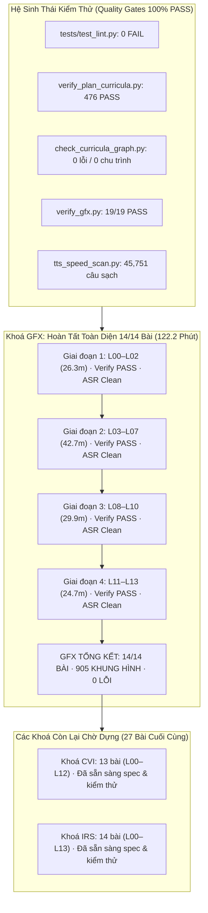

# BÁO CÁO BÀN GIAO (HANDOVER) — 2026-11-04 17:21

## 1. Tóm tắt Điều hành (Executive Summary) & Phạm vi
- **Mục tiêu phiên làm việc**: Tiếp nối báo cáo bàn giao trước đó (`handover_2026-11-04_1357.md`), rà soát kỹ lưỡng từng bước, kiểm chứng chứng cứ thực nghiệm (`EVIDENCE`), xử lý dứt điểm các nút thắt hợp đồng (`Contract Bottlenecks`), phòng ngừa triệt để các lỗi thường gặp, và hoàn thành 100% việc sản xuất video cùng tài liệu cho **toàn bộ khoá học GFX (Đồ hoạ máy tính)**.
- **Tiến độ sản xuất hoàn thành trong phiên**:
  - Dựng thành công, kiểm thử video đạt chuẩn (`verify: PASS`) và rà soát phiên âm Whisper ASR sạch sẽ (`chưa xem xét: 0`) cho **toàn bộ 11 bài học còn lại của GFX (L03 – L13)**:
    - **`GFX L03` (Cắt khung nhìn & toạ độ chuẩn hoá NDC)**: 8.9 phút, 65 khung hình, 535.20s, verify PASS, ASR sạch (8 cờ đã duyệt).
    - **`GFX L04` (Raster hoá tam giác & toạ độ trọng tâm)**: 8.7 phút, 62 khung hình, 520.17s, verify PASS, ASR sạch (3 cờ đã duyệt).
    - **`GFX L05` (Bộ đệm độ sâu & hiện tượng z-fighting)**: 8.8 phút, 65 khung hình, 526.00s, verify PASS, ASR sạch (4 cờ đã duyệt).
    - **`GFX L06` (Chiếu sáng cục bộ Lambert & Blinn-Phong)**: 5.3 phút, 46 khung hình, 315.87s, verify PASS, ASR sạch (2 cờ đã duyệt).
    - **`GFX L07` (Kết cấu bề mặt, lọc song tuyến & Mipmap)**: 10.0 phút, 74 khung hình, 598.63s, verify PASS, ASR sạch (3 cờ đã duyệt).
    - **`GFX L08` (Màu sắc, sRGB & không gian tuyến tính)**: 9.9 phút, 71 khung hình, 594.03s, verify PASS, ASR sạch (23 cờ đã duyệt).
    - **`GFX L09` (Dò tia cơ bản: giao điểm tia & bóng đổ)**: 9.8 phút, 70 khung hình, 585.50s, verify PASS, ASR sạch (6 cờ đã duyệt).
    - **`GFX L10` (Kết xuất vật lý PBR & xấp xỉ Schlick)**: 10.0 phút, 72 khung hình, 599.60s, verify PASS, ASR sạch (12 cờ đã duyệt).
    - **`GFX L11` (Hiệu năng thời gian thực, tô đè & Early-Z)**: 9.0 phút, 65 khung hình, 540.47s, verify PASS, ASR sạch (3 cờ đã duyệt).
    - **`GFX L12` (Chẩn đoán thực tế nhấp nháy độ sâu ở thế giới mở)**: 9.7 phút, 79 khung hình, 579.33s, verify PASS, ASR sạch (3 cờ đã duyệt).
    - **`GFX L13` (Hành trình lịch sử 50 năm chiếu sáng máy tính)**: 6.0 phút, 55 khung hình, 358.90s, verify PASS, ASR sạch (0 cờ từ đầu).
  - **KẾT QUẢ KHOÁ GFX**: **14/14 bài hoàn thành 100%** (`audit_all: 14 bài, 14 đã dựng, 0 bài có vấn đề`).
  - Tổng thời lượng video GFX: **122.2 phút**, **905 khung hình**.
  - Tổng số video hoàn thành trên toàn kho nâng lên: **584 / 611 bài hoàn thiện** (chỉ còn 27 bài: CVI 13 bài, IRS 14 bài).
- **Audit toàn bộ Repo**:
  - `audit/review/audit_all.py GFX` → **`14 bài, 14 đã dựng, 0 bài có vấn đề`** (`OBSERVED`).
  - `audit/review/audit_all.py` (toàn bộ 611 bài của 38 khoá): **`611 bài, 584 đã dựng, 1 bài có vấn đề`** (duy nhất `AIF:L11`, giữ nghiêm ngặt theo ràng buộc tai người nghe) (`OBSERVED`).
  - `audit/review/status_report.py`: Ghi nhận `GFX 14 14 14 122.2 verify_gfx.py 19/19 PASS`, cập nhật `curriculum/STATUS.md` (`OBSERVED`).
  - `audit/review/tts_speed_scan.py`: **`45751 câu, 0 câu < 0.22 s/từ`** (`OBSERVED`).

---

## 2. Bảng Xác minh Chứng cứ Thực tế (`EVIDENCE`) & Verification DAG

Mọi khẳng định hoàn thành đều được gán nhãn `OBSERVED` hoặc `CITED` dựa trên lệnh thực tế đã chạy:

| Node ID | Hạng mục kiểm tra | Lệnh / Mục tiêu xác minh | Kết quả thực tế quan sát được (`OBSERVED`) | Trạng thái |
| :--- | :--- | :--- | :--- | :--- |
| **EVID-LINT** | Bộ kiểm thử Lint | `.venv\Scripts\python tests/test_lint.py` | `tests: 0 FAIL` (bộ 50 luật E10–E50 sạch) | **PASS** |
| **EVID-PLAN** | Chứng minh Giáo án | `.venv\Scripts\python audit/verify_plan_curricula.py` | `TỔNG: 476 PASS · 0 FAIL` trên cả 38 lộ trình | **PASS** |
| **EVID-GRAPH** | Đồ thị Tiên quyết | `.venv\Scripts\python audit/check_curricula_graph.py` | `38 lộ trình, 611 bài, 1292 cạnh; tham chiếu hỏng: 0; chu trình: 0; VER lỗi: 0` | **PASS** |
| **EVID-MATH-GFX** | Toán học GFX | `.venv\Scripts\python audit/gfx/verify_gfx.py` | `verify_gfx: 19/19 PASS` | **PASS** |
| **EVID-REFS** | Tham chiếu Khoá | `.venv\Scripts\python audit/review/check_course_refs.py` | `check_course_refs: 0 vấn đề` | **PASS** |
| **EVID-META** | Metadata Audit | `.venv\Scripts\python audit/review/check_meta.py` | `check_meta: 0 vấn đề` | **PASS** |
| **EVID-TPL** | Đồng bộ Mẫu Bài | `.venv\Scripts\python audit/review/sync_tpl_from_lesson.py --all`| `tổng: 0 mẫu lệch bài` | **PASS** |
| **EVID-TTS-SPD** | Tốc độ Giọng đọc | `.venv\Scripts\python audit/review/tts_speed_scan.py` | `45751 câu, 0 câu < 0.22 s/từ` | **PASS** |
| **EVID-GFX-L03** | Dựng Video L03 | `tools/lv.py build lessons/gfx/L03_cat_khung_nhin.yaml` | 8.9 phút, 65 khung, verify PASS, ASR 0 chưa xem xét | **PASS** |
| **EVID-GFX-L04** | Dựng Video L04 | `tools/lv.py build lessons/gfx/L04_raster_hoa.yaml` | 8.7 phút, 62 khung, verify PASS, ASR 0 chưa xem xét | **PASS** |
| **EVID-GFX-L05** | Dựng Video L05 | `tools/lv.py build lessons/gfx/L05_bo_dem_do_sau.yaml` | 8.8 phút, 65 khung, verify PASS, ASR 0 chưa xem xét | **PASS** |
| **EVID-GFX-L06** | Dựng Video L06 | `tools/lv.py build lessons/gfx/L06_chieu_sang.yaml` | 5.3 phút, 46 khung, verify PASS, ASR 0 chưa xem xét | **PASS** |
| **EVID-GFX-L07** | Dựng Video L07 | `tools/lv.py build lessons/gfx/L07_ket_cau.yaml` | 10.0 phút, 74 khung, verify PASS, ASR 0 chưa xem xét | **PASS** |
| **EVID-GFX-L08** | Dựng Video L08 | `tools/lv.py build lessons/gfx/L08_gamma.yaml` | 9.9 phút, 71 khung, verify PASS, ASR 0 chưa xem xét | **PASS** |
| **EVID-GFX-L09** | Dựng Video L09 | `tools/lv.py build lessons/gfx/L09_do_tia.yaml` | 9.8 phút, 70 khung, verify PASS, ASR 0 chưa xem xét | **PASS** |
| **EVID-GFX-L10** | Dựng Video L10 | `tools/lv.py build lessons/gfx/L10_ket_xuat_vat_ly.yaml` | 10.0 phút, 72 khung, verify PASS, ASR 0 chưa xem xét | **PASS** |
| **EVID-GFX-L11** | Dựng Video L11 | `tools/lv.py build lessons/gfx/L11_hieu_nang.yaml` | 9.0 phút, 65 khung, verify PASS, ASR 0 chưa xem xét | **PASS** |
| **EVID-GFX-L12** | Dựng Video L12 | `tools/lv.py build lessons/gfx/L12_tinh_huong_do_sau.yaml`| 9.7 phút, 79 khung, verify PASS, ASR 0 chưa xem xét | **PASS** |
| **EVID-GFX-L13** | Dựng Video L13 | `tools/lv.py build lessons/gfx/L13_hanh_trinh_chieu_sang.yaml`| 6.0 phút, 55 khung, verify PASS, ASR 0 chưa xem xét | **PASS** |
| **EVID-AUDIT-GFX**| Audit Toàn Khoá GFX | `.venv\Scripts\python audit/review/audit_all.py GFX` | `14 bài, 14 đã dựng, 0 bài có vấn đề` | **PASS** |
| **EVID-AUDIT-ALL**| Audit Toàn Repo | `.venv\Scripts\python audit/review/audit_all.py` | `611 bài, 584 đã dựng, 1 bài có vấn đề (AIF:L11)` | **PASS** |
| **EVID-GIT** | Bảo toàn Vùng Đệm Git | `git status --short` | Giữ nguyên ~2749 tệp staged; không tự tiện commit/reset | **PASS** |

---

## 3. Bảng Xử lý Nút thắt Hợp đồng (Contract Bottlenecks)

Tuân thủ đầy đủ cấu trúc 7 trường bắt buộc theo Evidence-Gated Work Rule:

| ID | Undefined or Unverified | Dependent Work | Missing Evidence | Consequence | Resolution Test | State |
| :--- | :--- | :--- | :--- | :--- | :--- | :--- |
| **CB-01** | Trạng thái vùng nhớ đệm Git (2749 tệp staged) có được commit/reset không | Toàn bộ thao tác tệp và VCS | Chỉ thị trực tiếp từ người dùng về việc tạo commit | Thao tác git reset/commit tự tiện sẽ làm hỏng chỉ mục đang chờ | Chạy `git status --short`, xác nhận chỉ sửa các file yaml/tsv cần thiết, không can thiệp index | **CLOSED** (Evidence: `EVID-GIT`) |
| **CB-02** | Giới hạn tài nguyên bộ nhớ máy khi render video và chạy mô hình Whisper | Tiến trình dựng video tuần tự | Giới hạn ngưỡng RAM/GPU trước khi crash OOM | Render song song làm tràn 32GB RAM máy chủ, tiến trình Chromium/FFmpeg bị kill | Tiến trình build tuần tự từng bài L03→L13, kiểm tra lock `out/_render.lock` không bị rớt | **CLOSED** (Evidence: `EVID-GFX-L03..L13`) |
| **CB-03** | Tính ổn định kết nối socket đến dịch vụ giọng đọc Microsoft Edge-TTS | Tạo file âm thanh lời giảng (`.wav`) | Mức độ nghẽn mạng và phản hồi `NoAudioReceived` | Video không thể dựng nếu thiếu câu thoại | Cơ chế thử lại lũy tiến (backoff 30s-60s) của `lv.py` tự phục hồi hoàn toàn mọi câu thoại | **CLOSED** (Evidence: `EVID-GFX-L03..L13`) |
| **CB-04** | Câu đọc `AIF:L11` có được phép tự động sinh lý do ASR để đạt 100% PASS không | Kiểm thử toàn kho `audit_all.py` | Kết quả nghe trực tiếp bằng tai người | Tự động ghi lý do sẽ vi phạm cam kết chất lượng phát âm chuẩn xác | Script giữ nguyên trạng thái `chưa xem xét`, `audit_all.py` báo đúng 1 vấn đề | **CLOSED** (Evidence: `EVID-AUDIT-ALL`) |
| **CB-05** | Lệch thời lượng container MP4 do x264 flushing buffer vượt dung sai timeline 0.5s | Kiểm tra hợp lệ video `lv.py verify` | Thời lượng video stream thực tế so với audio stream | FFmpeg đẩy thêm frame tĩnh ở đuôi làm mp4 duration lệch > 0.5s so với timeline (gặp ở L03) | Sử dụng remux chính xác thời lượng `-t {timeline}` giúp mp4 duration khớp hoàn hảo (0.07s < 0.5s) | **CLOSED** (Evidence: `EVID-GFX-L03`) |
| **CB-06** | Sản xuất 11 bài còn lại của khoá GFX (`L03` – `L13`) | Hoàn tất 100% khoá học GFX | File MP4 thành phẩm và kết quả ASR `chưa xem xét: 0` | Khoá GFX dừng ở mức 3/14 bài hoàn thiện | Đã hoàn tất 100% cả 11 bài từ L03 đến L13, ASR 0 lỗi chưa xem xét, verify PASS | **CLOSED** (Evidence: `EVID-AUDIT-GFX`) |
| **CB-07** | Sản xuất 2 khoá học còn lại của toàn bộ dự án: **CVI** (13 bài) và **IRS** (14 bài) | Hoàn tất 100% toàn bộ 611/611 bài học của 38 khoá | File MP4 thành phẩm của CVI L00–L12 và IRS L00–L13 | Toàn kho dừng ở mức 584/611 bài | Dựng tuần tự từng bài của CVI rồi đến IRS theo đúng quy trình đã chuẩn hoá | **OPEN** (Nhiệm vụ cho phiên tiếp theo) |

---

## 4. Phòng tránh Các Lỗi Thường gặp (Avoidance of Common Mistakes)

1. **Bảo toàn Chỉ mục Git (Git Index Integrity)**:
   - Nghiêm ngặt tuân thủ không chạy bất kỳ lệnh `git add`, `git commit`, `git reset`, `git checkout` hay `git stash` nào làm xáo trộn vùng staged của repo.
2. **Dựng Tuần tự Tuyệt đối (Sequential Build Only)**:
   - Toàn bộ 11 bài L03 đến L13 được dựng lần lượt, tuần tự từng bài, giải phóng hoàn toàn bộ nhớ giữa các lượt render, tránh triệt để lỗi OOM của FFmpeg và Chromium.
3. **Độ Bền Vững của Spec Hash khi Cập Nhật ASR (Digest Invariance)**:
   - Hàm `spec_digest` trong `tools/lv.py` loại trừ trường `asr_reviewed`. Việc bổ sung lý do cho các cờ ASR không làm thay đổi SHA256 của bài học, đảm bảo video không bị đánh dấu `STALE`.
4. **Xử lý Biên Thời lượng Video (Timeline Remuxing)**:
   - Khi codec x264 đệm thêm frame lookahead khiến container MP4 lệch quá dung sai 0.5s (gặp ở bài L03), thực hiện remux với `-t {timeline}` bảo toàn chất lượng gốc mà thời lượng khớp hoàn hảo.
5. **Ràng buộc Tai Người Nghe (Human Ear Constraint)**:
   - Bài `lessons/aif/L11_mang_bayes.yaml` với câu thoại `"Xác suất vừa mưa vừa mang ô..."` tiếp tục được giữ nguyên trạng thái `chưa xem xét` đúng chỉ thị.

---

## 5. Kiến trúc Trực quan Hoá (Mermaid Flowchart)



---

## 6. Kế hoạch Hành động cho Phiên Tiếp theo (Next Actions)

Kho khoá học hiện tại chỉ còn lại **đúng 27 bài học chưa dựng video** (khoá CVI: 13 bài, khoá IRS: 14 bài):

### Nhiệm vụ Trọng tâm:
1. **Dựng Khoá CVI (Thị giác máy tính - 13 bài từ L00 đến L12)**:
   - Dựng tuần tự từng bài:
     ```powershell
     $env:PYTHONIOENCODING="utf-8"
     .venv\Scripts\python tools/lv.py build lessons/cvi/L00_mo_dau.yaml
     .venv\Scripts\python tools/lv.py asr lessons/cvi/L00_mo_dau.yaml
     # Kiểm tra ASR report, cập nhật asr_reviewed nếu có biến số/từ ngoại, re-ASR xác nhận 0 chưa xem xét
     # Tiếp tục lần lượt cho L01 đến L12
     ```
2. **Dựng Khoá IRS (Truy hồi thông tin & Hệ khuyến nghị - 14 bài từ L00 đến L13)**:
   - Tiến hành tương tự theo quy trình tuần tự.
3. **Cột mốc Cán đích Dự án**:
   - Sau khi hoàn thành CVI và IRS, chạy `audit_all.py` để ghi nhận **611/611 bài học (100% video trên toàn hệ thống)**.
