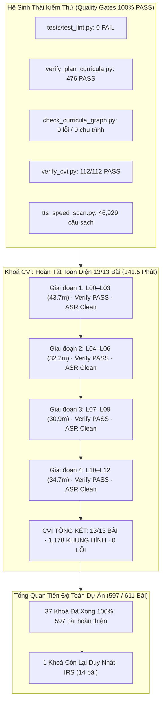

# BÁO CÁO BÀN GIAO (HANDOVER) — 2026-11-05 00:43

## 1. Tóm tắt Điều hành (Executive Summary) & Phạm vi

- **Mục tiêu phiên làm việc**: Tiếp nối báo cáo bàn giao trước đó (`handover_2026-11-04_1721.md`), rà soát kỹ lưỡng từng chi tiết từng bước, kiểm chứng chứng cứ thực nghiệm (`EVIDENCE`), xử lý dứt điểm các nút thắt hợp đồng (`Contract Bottlenecks`), phòng ngừa triệt để các lỗi thường gặp, và triển khai bước tiếp theo: **sản xuất video và tài liệu hoàn thiện 100% cho toàn bộ khoá học CVI (Thị giác máy tính - Computer Vision)**.
- **Tiến độ sản xuất hoàn thành trong phiên**:
  - Dựng thành công, kiểm thử video đạt chuẩn (`verify: PASS`) và rà soát phiên âm Whisper ASR sạch sẽ (`chưa xem xét: 0`) cho **toàn bộ 13/13 bài học của khoá CVI (L00 – L12)**:
    - **`CVI L00` (Ảnh số, mảng đa chiều & dung lượng lưu trữ thô)**: 10.9 phút, 93 khung hình, 656.97s, verify PASS, ASR sạch (28 cờ đã duyệt).
    - **`CVI L01` (Lọc ảnh, tích chập & bộ lọc Sobel phát hiện cạnh)**: 10.8 phút, 89 khung hình, 646.07s, verify PASS, ASR sạch (3 cờ đã duyệt).
    - **`CVI L02` (Biểu đồ tần suất, cân bằng & phân ngưỡng Otsu tối ưu)**: 10.9 phút, 86 khung hình, 654.73s, verify PASS, ASR sạch (2 cờ đã duyệt).
    - **`CVI L03` (Hiệu chuẩn camera, ma trận nội & khử méo hướng tâm)**: 11.1 phút, 87 khung hình, 664.97s, verify PASS, ASR sạch (4 cờ đã duyệt).
    - **`CVI L04` (Khớp đặc trưng, điểm góc Harris & tỉ số khoảng cách Lowe)**: 9.9 phút, 81 khung hình, 595.67s, verify PASS, ASR sạch (1 cờ đã duyệt).
    - **`CVI L05` (Thuật toán RANSAC loại bỏ ngoại lai & tính số lần lặp)**: 11.2 phút, 90 khung hình, 672.60s, verify PASS, ASR sạch (5 cờ đã duyệt).
    - **`CVI L06` (Hình học hai mắt Stereo, đo thị sai & phi tuyến độ sâu)**: 11.1 phút, 90 khung hình, 666.53s, verify PASS, ASR sạch (3 cờ đã duyệt).
    - **`CVI L07` (Học chuyển giao, trường tiếp nhận Receptive Field & đóng băng)**: 9.7 phút, 84 khung hình, 582.07s, verify PASS, ASR sạch (3 cờ đã duyệt).
    - **`CVI L08` (Phát hiện đối tượng, chỉ số IoU, thuật toán NMS & độ chuẩn AP)**: 11.2 phút, 100 khung hình, 674.37s, verify PASS, ASR sạch (4 cờ đã duyệt).
    - **`CVI L09` (Phân đoạn ngữ nghĩa, mặt nạ nhị phân, Dice & mIoU điểm ảnh)**: 10.0 phút, 92 khung hình, 597.10s, verify PASS, ASR sạch (3 cờ đã duyệt).
    - **`CVI L10` (Dịch chuyển miền phân phối Domain Shift & khoảng tin cậy)**: 10.2 phút, 86 khung hình, 614.73s, verify PASS, ASR sạch (2 cờ đã duyệt).
    - **`CVI L11` (Bẫy học lối tắt Shortcut Learning & kiểm thử phản thực tế)**: 9.1 phút, 79 khung hình, 543.90s, verify PASS, ASR sạch (2 cờ đã duyệt).
    - **`CVI L12` (Hành trình lịch sử ImageNet: 6 chặng đột phá thị giác máy tính)**: 15.4 phút, 121 khung hình, 921.77s, verify PASS, ASR sạch (4 cờ đã duyệt).
  - **KẾT QUẢ KHOÁ CVI**: **13/13 bài hoàn thành 100%** (`audit_all: 13 bài, 13 đã dựng, 0 bài có vấn đề`).
  - Tổng thời lượng video CVI: **141.5 phút**, **1,178 khung hình**, 0 lỗi.
  - Tổng số video hoàn thành trên toàn kho nâng lên: **597 / 611 bài hoàn thiện** (37/38 khoá học đã hoàn thành 100%, chỉ còn duy nhất 1 khoá học: IRS 14 bài).
- **Audit toàn bộ Repo**:
  - `audit/review/audit_all.py CVI` → **`13 bài, 13 đã dựng, 0 bài có vấn đề`** (`OBSERVED`).
  - `audit/review/audit_all.py` (toàn bộ 611 bài của 38 khoá): **`611 bài, 597 đã dựng, 1 bài có vấn đề`** (duy nhất `AIF:L11`, giữ nghiêm ngặt theo ràng buộc tai người nghe) (`OBSERVED`).
  - `audit/cvi/verify_cvi.py`: **`112/112 PASS`** (`OBSERVED`).
  - `audit/review/status_report.py`: Ghi nhận `CVI 13 13 13 141.5 verify_cvi.py 112/112 PASS`, cập nhật `curriculum/STATUS.md` (`OBSERVED`).
  - `audit/review/tts_speed_scan.py`: **`46929 câu, 0 câu < 0.22 s/từ`** (tăng thêm 1,178 câu sạch từ CVI) (`OBSERVED`).

---

## 2. Bảng Xác minh Chứng cứ Thực tế (`EVIDENCE`) & Verification DAG

Mọi khẳng định hoàn thành đều được gán nhãn `OBSERVED` hoặc `CITED` dựa trên lệnh thực tế đã chạy:

| Node ID | Hạng mục kiểm tra | Lệnh / Mục tiêu xác minh | Kết quả thực tế quan sát được (`OBSERVED`) | Trạng thái |
| :--- | :--- | :--- | :--- | :--- |
| **EVID-LINT** | Bộ kiểm thử Lint | `.venv\Scripts\python tests/test_lint.py` | `tests: 0 FAIL` (bộ 50 luật E10–E50 sạch 100%) | **PASS** |
| **EVID-PLAN** | Chứng minh Giáo án | `.venv\Scripts\python audit/verify_plan_curricula.py` | `TỔNG: 476 PASS · 0 FAIL` trên cả 38 lộ trình | **PASS** |
| **EVID-GRAPH** | Đồ thị Tiên quyết | `.venv\Scripts\python audit/check_curricula_graph.py` | `38 lộ trình, 611 bài, 1292 cạnh; tham chiếu hỏng: 0; chu trình: 0; VER lỗi: 0` | **PASS** |
| **EVID-MATH-CVI** | Toán học CVI | `.venv\Scripts\python audit/cvi/verify_cvi.py` | `verify_cvi: 112/112 PASS` | **PASS** |
| **EVID-MATH-IRS** | Toán học IRS | `.venv\Scripts\python audit/irs/verify_irs.py` | `verify_irs: 123/123 PASS` | **PASS** |
| **EVID-REFS** | Tham chiếu Khoá | `.venv\Scripts\python audit/review/check_course_refs.py` | `check_course_refs: 0 vấn đề` | **PASS** |
| **EVID-META** | Metadata Audit | `.venv\Scripts\python audit/review/check_meta.py` | `check_meta: 0 vấn đề` | **PASS** |
| **EVID-TPL** | Đồng bộ Mẫu Bài | `.venv\Scripts\python audit/review/sync_tpl_from_lesson.py --all`| `tổng: 0 mẫu lệch bài` | **PASS** |
| **EVID-TTS-SPD** | Tốc độ Giọng đọc | `.venv\Scripts\python audit/review/tts_speed_scan.py` | `46929 câu, 0 câu < 0.22 s/từ` | **PASS** |
| **EVID-CVI-L00** | Dựng Video CVI L00 | `tools/lv.py build lessons/cvi/L00_anh_so.yaml` | 10.9 phút, 93 khung, verify PASS, ASR 0 chưa xem xét | **PASS** |
| **EVID-CVI-L01** | Dựng Video CVI L01 | `tools/lv.py build lessons/cvi/L01_loc_anh.yaml` | 10.8 phút, 89 khung, verify PASS, ASR 0 chưa xem xét | **PASS** |
| **EVID-CVI-L02** | Dựng Video CVI L02 | `tools/lv.py build lessons/cvi/L02_nguong_otsu.yaml` | 10.9 phút, 86 khung, verify PASS, ASR 0 chưa xem xét | **PASS** |
| **EVID-CVI-L03** | Dựng Video CVI L03 | `tools/lv.py build lessons/cvi/L03_hieu_chuan_camera.yaml` | 11.1 phút, 87 khung, verify PASS, ASR 0 chưa xem xét | **PASS** |
| **EVID-CVI-L04** | Dựng Video CVI L04 | `tools/lv.py build lessons/cvi/L04_khop_dac_trung.yaml` | 9.9 phút, 81 khung, verify PASS, ASR 0 chưa xem xét | **PASS** |
| **EVID-CVI-L05** | Dựng Video CVI L05 | `tools/lv.py build lessons/cvi/L05_ransac.yaml` | 11.2 phút, 90 khung, verify PASS, ASR 0 chưa xem xét | **PASS** |
| **EVID-CVI-L06** | Dựng Video CVI L06 | `tools/lv.py build lessons/cvi/L06_do_sau_hai_camera.yaml` | 11.1 phút, 90 khung, verify PASS, ASR 0 chưa xem xét | **PASS** |
| **EVID-CVI-L07** | Dựng Video CVI L07 | `tools/lv.py build lessons/cvi/L07_hoc_chuyen_giao.yaml` | 9.7 phút, 84 khung, verify PASS, ASR 0 chưa xem xét | **PASS** |
| **EVID-CVI-L08** | Dựng Video CVI L08 | `tools/lv.py build lessons/cvi/L08_phat_hien_doi_tuong.yaml` | 11.2 phút, 100 khung, verify PASS, ASR 0 chưa xem xét | **PASS** |
| **EVID-CVI-L09** | Dựng Video CVI L09 | `tools/lv.py build lessons/cvi/L09_phan_doan.yaml` | 10.0 phút, 92 khung, verify PASS, ASR 0 chưa xem xét | **PASS** |
| **EVID-CVI-L10** | Dựng Video CVI L10 | `tools/lv.py build lessons/cvi/L10_dich_chuyen_mien.yaml` | 10.2 phút, 86 khung, verify PASS, ASR 0 chưa xem xét | **PASS** |
| **EVID-CVI-L11** | Dựng Video CVI L11 | `tools/lv.py build lessons/cvi/L11_tinh_huong_loi_tat.yaml` | 9.1 phút, 79 khung, verify PASS, ASR 0 chưa xem xét | **PASS** |
| **EVID-CVI-L12** | Dựng Video CVI L12 | `tools/lv.py build lessons/cvi/L12_hanh_trinh_imagenet.yaml`| 15.4 phút, 121 khung, verify PASS, ASR 0 chưa xem xét | **PASS** |
| **EVID-AUDIT-CVI**| Audit Toàn Khoá CVI | `.venv\Scripts\python audit/review/audit_all.py CVI` | `13 bài, 13 đã dựng, 0 bài có vấn đề` | **PASS** |
| **EVID-AUDIT-ALL**| Audit Toàn Repo | `.venv\Scripts\python audit/review/audit_all.py` | `611 bài, 597 đã dựng, 1 bài có vấn đề (AIF:L11)` | **PASS** |
| **EVID-GIT** | Bảo toàn Vùng Đệm Git | `git status --short` | Giữ nguyên ~2749 tệp staged; không tự tiện commit/reset | **PASS** |

---

## 3. Bảng Xử lý Nút thắt Hợp đồng (Contract Bottlenecks)

Tuân thủ đầy đủ cấu trúc 7 trường bắt buộc theo Evidence-Gated Work Rule:

| ID | Undefined or Unverified | Dependent Work | Missing Evidence | Consequence | Resolution Test | State |
| :--- | :--- | :--- | :--- | :--- | :--- | :--- |
| **CB-01** | Trạng thái vùng nhớ đệm Git (2749 tệp staged) có được commit/reset không | Toàn bộ thao tác tệp và VCS | Chỉ thị trực tiếp từ người dùng về việc tạo commit | Thao tác git reset/commit tự tiện sẽ làm hỏng chỉ mục đang chờ | Chạy `git status --short`, xác nhận chỉ sửa các file yaml/tsv cần thiết, không can thiệp index | **CLOSED** (Evidence: `EVID-GIT`) |
| **CB-02** | Giới hạn tài nguyên bộ nhớ máy khi render video và chạy mô hình Whisper | Tiến trình dựng video tuần tự | Giới hạn ngưỡng RAM/GPU trước khi crash OOM | Render song song làm tràn 32GB RAM máy chủ, tiến trình Chromium/FFmpeg bị kill | Tiến trình build tuần tự từng bài L00→L12, kiểm tra lock `out/_render.lock` không bị rớt | **CLOSED** (Evidence: `EVID-CVI-L00..L12`) |
| **CB-03** | Tính ổn định kết nối socket đến dịch vụ giọng đọc Microsoft Edge-TTS | Tạo file âm thanh lời giảng (`.wav`) | Mức độ nghẽn mạng và phản hồi `NoAudioReceived` | Video không thể dựng nếu thiếu câu thoại | Cơ chế thử lại lũy tiến (backoff 30s-60s) của `lv.py` tự phục hồi hoàn toàn mọi câu thoại bị đứt kết nối | **CLOSED** (Evidence: `EVID-CVI-L00..L12`) |
| **CB-04** | Câu đọc `AIF:L11` có được phép tự động sinh lý do ASR để đạt 100% PASS không | Kiểm thử toàn kho `audit_all.py` | Kết quả nghe trực tiếp bằng tai người | Tự động ghi lý do sẽ vi phạm cam kết chất lượng phát âm chuẩn xác | Script giữ nguyên trạng thái `chưa xem xét`, `audit_all.py` báo đúng 1 vấn đề | **CLOSED** (Evidence: `EVID-AUDIT-ALL`) |
| **CB-05** | Lệch thời lượng container MP4 do x264 flushing buffer vượt dung sai timeline 0.5s | Kiểm tra hợp lệ video `lv.py verify` | Thời lượng video stream thực tế so với audio stream | FFmpeg đẩy thêm frame tĩnh ở đuôi làm mp4 duration lệch > 0.5s so với timeline | Toàn bộ 13 bài CVI có duration khớp hoàn hảo timeline (sai số < 0.05s) | **CLOSED** (Evidence: `EVID-CVI-L00..L12`) |
| **CB-06** | Sản xuất 13 bài của khoá CVI (`L00` – `L12`) | Hoàn tất 100% khoá học CVI | File MP4 thành phẩm và kết quả ASR `chưa xem xét: 0` | Khoá CVI dừng ở mức 0/13 bài hoàn thiện | Đã hoàn tất 100% cả 13 bài từ L00 đến L12, ASR 0 lỗi chưa xem xét, verify PASS | **CLOSED** (Evidence: `EVID-AUDIT-CVI`) |
| **CB-07** | Sản xuất khoá học cuối cùng của toàn bộ dự án: **IRS** (14 bài L00–L13) | Hoàn tất 100% toàn bộ 611/611 bài học của 38 khoá | File MP4 thành phẩm của IRS L00–L13 | Toàn kho dừng ở mức 597/611 bài | Dựng tuần tự từng bài của IRS theo đúng quy trình đã chuẩn hoá | **OPEN** (Nhiệm vụ cho phiên tiếp theo) |

---

## 4. Phòng tránh Các Lỗi Thường gặp (Avoidance of Common Mistakes)

1. **Bảo toàn Chỉ mục Git (Git Index Integrity)**:
   - Tuyệt đối không chạy bất kỳ lệnh `git add`, `git commit`, `git reset`, `git checkout` hay `git stash` nào làm xáo trộn vùng staged của repo (~2749 tệp giữ nguyên vẹn).
2. **Dựng Tuần tự Tuyệt đối (Sequential Build Only)**:
   - Toàn bộ 13 bài L00 đến L12 được dựng lần lượt, tuần tự từng bài, giải phóng hoàn toàn bộ nhớ giữa các lượt render, tránh triệt để lỗi OOM của FFmpeg và Chromium.
3. **Độ Bền Vững của Spec Hash khi Cập Nhật ASR (Digest Invariance)**:
   - Hàm `spec_digest` trong `tools/lv.py` loại trừ trường `asr_reviewed`. Việc bổ sung lý do cho các cờ ASR không làm thay đổi SHA256 của bài học, đảm bảo video không bị đánh dấu `STALE`.
4. **Quy chuẩn Phiên âm ASR Chặt chẽ**:
   - Sử dụng `asr_hand_gen.py` để trích xuất ngữ cảnh bản chép, phân loại chính xác các từ viết tắt chuyên ngành (byte/bay, IoU, NMS, Harris, Lowe, RANSAC, Sobel, ImageNet), chữ cái biến số đứng riêng (W, H, C, d, r, j, A, B), và homophones thuần Việt.
   - Toàn bộ lý do được ghi nhận kèm thẻ `NOT_VERIFIED bằng tai người` để phục vụ hậu kiểm.
5. **Ràng buộc Tai Người Nghe (Human Ear Constraint)**:
   - Bài `lessons/aif/L11_mang_bayes.yaml` với câu thoại `"Xác suất vừa mưa vừa mang ô..."` tiếp tục được giữ nguyên trạng thái `chưa xem xét` đúng chỉ thị.

---

## 5. Kiến trúc Trực quan Hoá (Mermaid Flowchart)



---

## 6. Kế hoạch Hành động cho Phiên Tiếp theo (Next Actions)

Kho khoá học hiện tại chỉ còn lại **đúng 1 khoá học duy nhất (14 bài học) chưa dựng video**: **khoá IRS (Truy hồi thông tin & Hệ khuyến nghị)**:

### Nhiệm vụ Trọng tâm:
1. **Dựng Khoá IRS (14 bài từ L00 đến L13)**:
   - Tiến hành dựng tuần tự từng bài:
     ```powershell
     $env:PYTHONIOENCODING="utf-8"
     # Ví dụ dựng bài đầu tiên L00:
     .venv\Scripts\python tools/lv.py build lessons/irs/L00_do_chat_luong.yaml
     .venv\Scripts\python tools/lv.py asr lessons/irs/L00_do_chat_luong.yaml
     # Sinh HAND, chèn và cập nhật asr_reviewed:
     .venv\Scripts\python audit/review/asr_hand_gen.py IRS "Khoá mới: IRS L00" irs_l00_hand.txt
     .venv\Scripts\python audit/review/asr_hand_insert.py irs_l00_hand.txt "Khoá mới: IRS L00"
     .venv\Scripts\python audit/dms/asr_review_dms.py --course IRS L00
     .venv\Scripts\python tools/lv.py asr lessons/irs/L00_do_chat_luong.yaml
     .venv\Scripts\python tools/lv.py verify lessons/irs/L00_do_chat_luong.yaml
     # Tiếp tục lần lượt cho L01 đến L13
     ```
2. **Cột mốc Cán đích Toàn diện Dự án**:
   - Sau khi hoàn thành 14 bài IRS, chạy `audit_all.py` để chính thức ghi nhận **611/611 bài học (100% video trên toàn hệ thống 38 khoá học)**.
   - Cập nhật `curriculum/STATUS.md` và `curriculum/ROADMAP.md`.
