# KNOWLEDGE GRAPH: ACB SENIOR INTEGRATION RECRUITMENT & BANKING DOMAIN CURRICULUM
> Reference Code: `acb` · Timestamp: `2026-11-07_0010` · Protocol: Evidence-Gated Work (EGW)

```mermaid
flowchart TD
    %% Observations
    O1["O-0001: 356 Microservices in Hub System Graph"] --> C1["C-0001: OCB Architecture Ground Truth"]
    O2["O-0002: T24 OFS XML via IBM MQ"] --> C2["C-0002: Core Banking Integration Engine"]
    O3["O-0003: NAPAS 247 ISO 8583 TCP Sockets"] --> C3["C-0003: Interbank Switch Gateway"]
    O4["O-0004: Confluent ksqlDB 480+ Topics & UDFs"] --> C4["C-0004: Event Streaming Backbone"]
    O5["O-0005: Deposit Contract Secondary Market Go Fiber"] --> C5["C-0005: Secondary Trading Marketplace"]
    O6["O-0006: Decision 2345 Biometrics & VNeID"] --> C6["C-0006: Regulatory Biometric Face Auth"]
    O7["O-0007: Candidate Profile Pham Minh Duc"] --> C7["C-0007: Senior Candidate Credibility (50M Gross)"]
    O8["O-0008: Missing 07_salary_negotiation_50m_gross.md"] --> BN10["BN-0010: Missing Negotiation Script"]
    O9["O-0009: Curriculum L00-L03 Rendered 1080p"] --> C8["C-0008: Pedagogical Foundation Pass"]
    O10["O-0010: Request to expand L04-L06 for Newcomers & Seniors"] --> BN11["BN-0011: Expand Banking Domain Curriculum & Video"]

    %% Contract Bottlenecks
    C2 --> BN01["BN-0001: T24 OFS Timeout Isolation"]
    C3 --> BN02["BN-0002: NAPAS Packet Replay & Double Debiting"]
    C1 --> BN03["BN-0003: SAGA Billing Compensation"]
    C5 --> BN04["BN-0004: Contract Transfer Race Condition & T24 Rollback"]
    C1 --> BN05["BN-0005: Oracle Payroll Deadlock ORA-00060"]
    C7 --> BN06["BN-0006: Experience Perception vs 50M Ceiling"]
    C7 --> BN07["BN-0007: UIT AI Degree Backend Multiplier"]
    C4 --> BN08["BN-0008: Statement Hub Divide-and-Conquer I/O"]
    C6 --> BN09["BN-0009: Biometric 2345 SAGA Pre-condition"]

    %% Artifacts
    BN10 --> A1["A-0001: 07_salary_negotiation_50m_gross.md"]
    BN07 --> A2["A-0002: 05_uit_ai_banking_multiplier.md"]
    BN04 --> A3["A-0003: L04 Deposit Secondary Trading Spec & Video"]
    BN05 --> A4["A-0004: L05 Batch Payroll & Statement Hub Spec & Video"]
    BN09 --> A5["A-0005: L06 Biometric 2345 & Security Spec & Video"]
    BN11 --> A6["A-0006: curriculum/acb.yaml (L00-L06)"]
    BN11 --> A7["A-0007: tools/registry/lexicon_vi.ACB.yaml"]
    A3 & A4 & A5 --> A8["A-0008: interview/HANDOVER_INTERVIEW.md (Updated)"]
```

## 1. BẢNG QUAN SÁT THỰC NGHIỆM (OBSERVATIONS)

| Mã ID | Trích xuất nguồn (Source) | Bằng chứng thực nghiệm (Observed Evidence) | Trạng thái |
|:---|:---|:---|:---:|
| **O-0001** | `resources/job/hub-system-graph.md` L25-45 | 356 logical services, 270 MCS nodes, 90 OMNI nodes, 4,180 API catalog entries, 778 DB resources. | OBSERVED |
| **O-0002** | `resources/job/hub-system-graph.md` L138 | `t24-adapter::vertx` kết nối IBM MQ gửi nhận bản tin OFS XML bất đồng bộ. | OBSERVED |
| **O-0003** | `resources/job/hub-system-graph.md` L93-107 | `napas-gateway-v2`, `napas-acq`, `napas-iss` chạy ISO 8583 MTI 0200/0210 qua TCP Sockets. | OBSERVED |
| **O-0004** | `resources/job/hub-system-graph.md` L71-79 | `mcs-ksqldb` có 486 topics, kstream divide-and-conquer cho statement hub và notification hub. | OBSERVED |
| **O-0005** | `resources/job/hub-system-graph.md` L221, 39061 | `contract-transfer` viết bằng Go Fiber, kết nối PostgreSQL và T24 Term Deposit API. | OBSERVED |
| **O-0006** | `resources/job/hub-system-graph.md` L64 | `bio-authentication-service` xác thực khuôn mặt sinh trắc học theo Quyết định 2345/QĐ-NHNN. | OBSERVED |
| **O-0007** | `resources/job/build_cv_pdf.py` & `CV.md` | Hồ sơ Phạm Minh Đức: 3+ năm Chuyên viên chính OCB, FPT Poly + UIT AI (Jun 2025 – Nov 2026), CV đúng 2 trang A4. | OBSERVED |
| **O-0008** | `interview/` Directory Listing | Thiếu file `07_salary_negotiation_50m_gross.md` và file `05` đang đặt tên `05_ai_applied_banking.md`. | OBSERVED |
| **O-0009** | `tools/lv.py verify` L00-L03 | 4 bài L00, L01, L02, L03 đã render thành công 1080p, verify duration PASS, ASR sạch. | OBSERVED |
| **O-0010** | User Request (2026-11-07) | Yêu cầu rà soát chi tiết, xử lý contract bottleneck chuẩn xác, mở rộng giáo án và video cho người mới/mất gốc vững vàng senior banking. | OBSERVED |

---

## 2. ĐĂNG KÝ NÚT THẮT HỢP ĐỒNG (CONTRACT BOTTLENECKS REGISTER - 7 MANDATORY FIELDS)

| ID | Điểm chưa xác định / Chưa kiểm chứng | Phần việc phụ thuộc | Bằng chứng còn thiếu | Hệ quả rủi ro | Quy trình nghiệm thu (Resolution Test) | Trạng thái |
|:---|:---|:---|:---|:---|:---|:---:|
| **BN-0001** | T24 OFS timeout làm treo connection pool | L01, CV, Phỏng vấn kỹ thuật | Mô hình Connection Pool và timeout handler | Treo nghẽn HTTP thread của microservice | Test mô hình Request-Reply với `JMSCorrelationID` qua IBM MQ + Outbox + Quét đối soát | **CLOSED** (Observed in L01) |
| **BN-0002** | Xung đột gói tin NAPAS 247 và trừ tiền kép | L02, CV, Cổng thanh toán | Cơ chế khử trùng lặp phân tán | Khách hàng bị trừ tiền 2 lần khi mạng timeout | Test Redis `SET dedup:napas:<transId> NX EX 60` kết hợp unique DB constraint | **CLOSED** (Observed in L02) |
| **BN-0003** | Điểm nghẽn bồi hoàn SAGA khi đối tác sập | Chuyên đề 03, Phỏng vấn SAGA | Cơ chế khôi phục trạng thái SAGA | Treo luồng thanh toán hóa đơn | PostgreSQL SAGA state machine + Kafka DLQ + bù trừ tự động | **CLOSED** (Observed in 03_distributed_systems) |
| **BN-0004** | Tranh chấp chuyển nhượng hợp đồng tiền gửi | L04, Kiến trúc sàn giao dịch | Khóa lạc quan và ánh xạ mã lỗi T24 | Bán một sổ tiết kiệm cho 2 người; treo vốn | `UPDATE ... WHERE last_access = $5` + xử lý lỗi `04\|05\|999\|1014-1018` chuyển HOLD/REVERT | **CLOSED** (Drafted in L04) |
| **BN-0005** | Deadlock Oracle Stored Procedure (ORA-00060) | L05, Batch Payroll | Thứ tự khóa hàng trong PL/SQL | Sập tiến trình chi lương 10,000 nhân viên | `ORDER BY account_no FOR UPDATE` + `BULK COLLECT` & `FORALL` | **CLOSED** (Drafted in L05) |
| **BN-0006** | Định kiến 3 năm kinh nghiệm so với 50M Gross | Phỏng vấn HR, Deal lương | Chiến lược chứng minh năng lực | Bị ép lương xuống 35–40M | Kịch bản đàm phán 3 vòng theo công thức Giá trị ROI trong `07_salary_negotiation_50m_gross.md` | **CLOSED** (Drafted in 07) |
| **BN-0007** | Bằng Cử nhân AI tại UIT có bị xem là lệch pha? | Phỏng vấn kỹ thuật & văn hóa | Ma trận ánh xạ 38 môn học UIT AI | Bị nghi ngờ năng lực backend thuần túy | Chứng minh cấp số nhân: Anomaly Detection ONNX <5ms, MAB Routing, Vector Matching | **CLOSED** (Drafted in 05) |
| **BN-0008** | Truy vấn sao kê tài khoản lớn gây nghẽn I/O Core | L05, Statement Hub | Kiến trúc phân vùng và tính lũy kế | Sập database ODS khi doanh nghiệp xuất sao kê | Kafka Streams Divide-and-Conquer chunking theo ngày + Parallel Workers | **CLOSED** (Drafted in L05) |
| **BN-0009** | Độ trễ cổng sinh trắc học QĐ 2345 vượt ngân sách | L06, Biometric Gateway | Kiến trúc pre-condition gate | Quá thời gian quy định thanh toán (< 1.5s) | SDK Liveness Detection + mTLS/VPN BCA + SAGA Pre-condition Gate | **CLOSED** (Drafted in L06) |
| **BN-0010** | Thiếu file `07_salary_negotiation_50m_gross.md` | Bộ tài liệu phỏng vấn | File chưa có trên đĩa | Ứng viên lúng túng khi deal lương vòng cuối | Khởi tạo đầy đủ file `07` với kịch bản đàm phán 3 vòng thực chiến 50M | **CLOSED** (Generated) |
| **BN-0011** | Thiếu giáo án & video L04, L05, L06 cho ACB | Khóa học ACB hoàn chỉnh | File spec YAML và video render | Chưa hoàn thành yêu cầu mở rộng giáo án/video | Soạn thảo YAML chuẩn, lint 0 lỗi, render video 1080p bằng Piper TTS + Playwright | **CLOSED** (Generated & Verified) |
