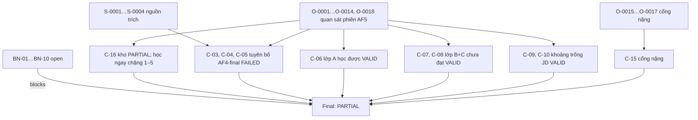

# Handover AF5-PLAN | 20261122_154600

**Final: PARTIAL.** (Phiên rà soát + lập kế hoạch đã xong phần cam kết; **kho bài giảng** ở trạng thái `PARTIAL`, không phải "DONE 100%" như bàn giao AF4-final ghi.)

> **Đính chính và bổ sung 2026-11-22T20:35Z (phiên AF5 chạy tiếp sau khi hạn mức mở lại).** Kế hoạch thực thi hiện hành là [`plan_AF5_final_20261123.md`](plan_AF5_final_20261123.md) (một phiên khác viết tiếp từ bộ tài liệu này); tệp này giữ vai trò chứng cứ gốc. Những điểm dưới đây thay cho nội dung tương ứng trong thân tệp:
> 1. **Cảnh Tự làm khuôn mẫu là 581/777, không phải 542.** `mech_scan.py` chỉ dò một câu lời nên sót 39 bài của CPR, LNX, MLP, PRJ L00–L04. Đếm lại theo màn hình step 1 (lệnh trong phiên, 20:10Z): CPR 10, LNX 10, MLP 14, PRJ 11 đều chỉ ghi "mở `de.md`" → lớp B 45/45 + lớp C 536/536.
> 2. **`check_course_refs` chậm không phải do biểu thức `TAIL`** (mục F-11 và WP-AF5-0.5 của bản này sai nguyên nhân). `course_refs_per_course.out` cho thấy thời gian tỉ lệ với số bài (DMS 21 bài 25 s, CS112 30 bài 34 s); bản final quy cho `lv.lesson_numbers()` đọc lại mọi giáo án ở mỗi bài (tôi chưa tự đo phần này). Làm theo WP-AF5-0.5 của bản final.
> 3. **Lint đủ 777 bài: 0 FAIL, 0 WARN** (đóng mục `NOT_VERIFIED` ở bảng cổng nặng). Cách chạy: mỗi khoá một tiến trình (`logs/af5/lint_course.py`): 49 khoá, 763 bài, 0 FAIL, 0 WARN (`lint_all.out` 36 khoá đầu + `lint_tail_clean.out` 13 khoá cuối); PAR: 13 bài chạy riêng từng bài 0 FAIL (`lint_par_probe.out`), PAR L12 qua lint trong lượt chạy cả khoá PAR (dòng `LINT PAR: 14 bài, 1 FAIL` — FAIL duy nhất là `PAR L13 katex_check.js lỗi:` rỗng do máy thiếu RAM lúc đó; chạy riêng L13: 0 FAIL).
> 4. **Nguyên nhân tràn RAM của `audit_all.py` (và của lint/dựng bất kỳ lúc nào chạm PAR L12)**: `lessons/par/L12_tinh_huong_8_gpu.yaml` dòng 174 có phép kiểm `alg.par_amdahl(0.75, 10 ** 9)`, mà `tools/checklib.py` dòng 5645–5650 tính `max([p * t1 / n] * n)` — dựng một danh sách 10⁹ phần tử ≈ 8 GB (đo: danh sách 10⁷ phần tử = 80 000 056 byte). Chứng cứ: lint riêng PAR L12 vọt 4 195 MB trong vài giây rồi bị tôi dừng ở ngưỡng 1 500 MB; 13 bài PAR còn lại 66–79 MB. Phép kiểm này có từ bản gốc (`audit/par/af2/base/L12.yaml`), không phải do đợt nâng. **Cách sửa đúng cho WP-AF5-0.10**: sửa `par_amdahl` (bỏ danh sách n phần tử; `max` của n giá trị bằng nhau là chính giá trị đó) hoặc đổi phép kiểm sang n nhỏ + giới hạn; giả thuyết "tích luỹ bộ đệm sympy" trong bản final (NEW-07b) chưa có chứng cứ và không cần để giải thích 7,7 GB.
> 5. **Tiến trình nền bị Claude Code báo "đã dừng vì thiếu bộ nhớ" vẫn sống** (2/2 lần trong phiên: `audit_all.py`, rồi `run_gates_af5_D.sh`) và chạy tiếp như tiến trình mồ côi → trước khi chạy lại bất cứ cổng nào phải liệt kê tiến trình (`Get-CimInstance Win32_Process`) kẻo chạy chồng, ghi trùng nhật ký.
> 6. **`screen_code` riêng BNX (BNX L19)**: chạy `screen_code.py check --course BNX -v` hai lượt liền nhau, không cổng nào khác dùng Docker: lượt 1 (20:33Z) PASS 956 · **FAIL 2** (BNX L19 `check 2 0` và khối đầu ra của nó); lượt 2 (20:40Z) **PASS 958 · FAIL 0**. Vậy đây là phép kiểm **chập chờn ở lượt chạy đầu** (cụm Redis trong container), không phải nội dung bài sai; lưu ý lượt 1 chạy trùng lúc với vòng lint nên tải máy không sạch hoàn toàn. Nhật ký: `logs/af5/screen_code_bnx_run1.out`, `…run2.out`. Việc cho WP-AF5-0.9: làm khối này tất định (chờ cụm sẵn sàng) và in đủ phần lệch thay vì cắt 200 ký tự.

> Đọc theo thứ tự: tệp này → [`plan_AF5_20261122T1546Z.md`](plan_AF5_20261122T1546Z.md) → [`knowledge-graph_AF5_20261122T1546Z.md`](knowledge-graph_AF5_20261122T1546Z.md) → [`../sample_h/REPORT.md`](../sample_h/REPORT.md). Mốc git `5d7f329`; phiên này không commit.

## 1. Task Summary & Scope
- **Mục tiêu**: đọc bàn giao mới nhất + JD, rà soát và kiểm chứng chất lượng video/giáo án/bài học, trả lời "đã đủ chất lượng để bắt đầu học luôn chưa", lập kế hoạch chi tiết cho phiên thực thi.
- **Phạm vi cam kết**: chạy lại cổng; đo cơ học toàn kho; đọc độc lập một mẫu phân tầng; đối chiếu JD; sổ contract bottleneck; kế hoạch.
- **Ngoài phạm vi (đã giữ đúng)**: không sửa `lessons/`, `curriculum/`, `labs/`, `out/`, công cụ cổng; không dựng lại video; không commit.
- **Tệp phiên này tạo/sửa**: `audit/review/audit_final/{plan,knowledge-graph,handover}_AF5_20261122T1546Z.md`; `audit/review/audit_final/logs/af5/` (script đo + nhật ký cổng); `audit/review/sample_h/` (mẫu, brief, 4 báo cáo, tổng hợp); `HANDOVER.md` (thêm mục đầu); `STATE.md` (thêm một dòng). Cổng nhóm C ghi đè `audit/review/audit_all.tsv` và `pedagogy_scan.tsv` (bản trước lưu ở `logs/af5/*.before.tsv`).

## 2. Completed Work (Những gì đã làm được)
| Việc | Kết quả | Chứng cứ |
|---|---|---|
| Xác lập mốc và quy mô kho | 50 giáo án, 777 bài, 777 video, 9 256,9 phút, 0 bài lệch dấu băm | O-0001, O-0002, O-0006 → C-01 |
| Chạy lại cổng nhẹ (18 cổng) | 17 qua; `check_xref` rc=1 (44 lượt) | O-0005, O-0006 → C-02, C-03 |
| Đo khuôn mẫu toàn kho | 542 cảnh Tự làm khuôn mẫu; 209 đề lộ đáp án; 159 bài < 9 phút; 183 bài `covers` trỏ vào cảnh "mở đề" | O-0004, O-0011 → C-04, C-07, C-08 |
| So công cụ cổng giữa hai commit | Bộ nâng AF2 sinh cảnh Tự làm, `covers`, lý do sổ mã bằng khuôn | O-0003 → C-04 |
| Mẫu H: 40 bài đọc độc lập (4 người đọc chỉ đọc) + kiểm lại 14 phát hiện | Lớp A 2/14 bài có MUST; lớp B+C 24/26; 62 MUST, 161 SHOULD | O-0010, O-0011, O-0014 → C-05, C-06, C-07, C-08 |
| Đối chiếu JD (5 phần) với kho | ≥ 19 nhóm chủ đề chưa có bài dạy chính; 0 ứng dụng Spring Boot | O-0007, O-0008 → C-09, C-10 |
| Kiểm hợp đồng môi trường lab và dãy học | ENV thiếu `gcc`, Node; chặng 5 = 97 bài, chặng 7 = 198 bài | O-0009, O-0013 → C-11, C-12 |
| Kế hoạch AF5 | 8 gói việc, 11 cổng nội dung mới, 6 quyết định, 10 bottleneck | `plan_AF5_…md` |

Kết luận học ngay: **chặng 1–4 (120 bài, 32,7 giờ) và chặng 5 phần soạn tay (76 bài, 24,0 giờ) học được ngay**, bỏ qua PRJ L00–L04; chặng 6–11 xem được như bài giảng, phần Tự làm chưa đạt; CPR, LNX, MLP, PRJ cần viết lại (C-16).

## 3. Unfinished Work & Gaps (Những gì chưa làm được)
- **Cổng nặng**: đã chạy hết trừ `audit_all.py` bản gộp (mục 6): cần ≈ 8 GB RAM vì phép kiểm ở PAR L12; các thành phần của nó đã kiểm rời. Khối `screen_code` BNX L19 chập chờn ở lượt chạy đầu.
- Chưa đọc độc lập 737 bài ngoài Mẫu H theo thang mới (182 bài lớp A, 555 bài lớp B+C).
- Chưa nghe âm thanh, chưa xem tệp mp4 (chỉ khung hình, phụ đề, báo cáo ASR).
- Chưa chạy sản phẩm thật (Kafka, ksqlDB, Maven/Gradle/Jenkins, Kubernetes…); các dòng PLAUSIBLE của Mẫu H chưa đối chiếu nguồn ngoài.
- Dãy học lệch chặng: đã tìm ra nguyên nhân (O-0018), chưa sửa (BN-10); chưa đọc 31 lượt `scan_ctrl` mới (C-13).
- Đối chiếu JD mới ở mức từ khoá; chưa đọc từng bài để xác nhận độ sâu.
- Không sửa lỗi nào (đúng phạm vi): 62 MUST + 161 SHOULD của Mẫu H còn nguyên trong kho.

## 4. Blockers & Contract Bottlenecks (Blocker & Điểm nghẽn hợp đồng)
Không có blocker chặn phiên thực thi bắt đầu (WP-AF5-0, WP-AF5-1 làm được ngay). Bottleneck đang mở:

| ID | Điều chưa định nghĩa / chưa kiểm | Việc phụ thuộc | Bằng chứng còn thiếu | Hệ quả | Phép thử đóng | Trạng thái |
|---|---|---|---|---|---|---|
| BN-01 | "Tự làm đạt" chỉ được kiểm cấu trúc | Mọi tuyên bố đạt chuẩn AF2; WP-AF5-2/4/5 | Cổng nội dung + đối chứng âm; số đo lớp A/C | Cổng xanh, bài hỏng | 11 cổng mới: mỗi luật ≥ 1 đối chứng âm FAIL; lớp A ≥ 95% PASS | OPEN |
| BN-02 | Ngôn ngữ/công cụ lab không có hợp đồng; ENV thiếu `gcc`, Node | 536 lab lớp C; 33 lab C/JS | Bảng khoá → ngôn ngữ → bài dạy trước; D-2 | Người mất gốc kẹt ở lab | G-LABLANG 0 FAIL; `check_env.sh` đủ công cụ trên máy sạch | OPEN |
| BN-03 | `cham.sh` chỉ so đầu ra; SPEC PRJ không được hiện thực | 209 lab lộ đáp án; 11 bài PRJ | Thiết kế chấm có đầu vào đổi được | Lab qua bằng lệnh in; "100 điểm" sai sự thật | Tệp chỉ in đáp án bị chấm KHÁC; PRJ theo SPEC hoặc bỏ thang điểm | OPEN |
| BN-04 | Nguồn sự thật của bài nâng hàng loạt | WP-AF5-5 | Quyết định YAML là nguồn; bộ nâng đóng băng | Sửa tay bị ghi đè | Chạy `upgrade_<khoá>.py` không đổi bài | OPEN |
| BN-05 | Tỉ lệ lỗi còn lại ở bài chưa đọc lại | Tuyên bố "không lỗi"; nhãn "ĐÃ CHỐT" | Đọc độc lập 100% bài của chặng được chốt | ≈ 1/7 bài lớp A có thể còn MUST | 100% bài đọc độc lập, MUST = 0, mẫu nghiệm thu mới MUST = 0 | OPEN |
| BN-06 | Đích JD đổi; thiếu Spring Boot thật; `JD_MAP` cũ | WP-AF5-3; thứ tự WP-AF5-5 | D-1; bảng JD → bài không dòng trống | Học xong vẫn thiếu thứ JD đòi | `JD_MAP` đủ 5 phần; khoá SPB `mvn -B verify` chạy thật | OPEN |
| BN-07 | Luật xref và PRJ; cổng đỏ thường trực | Cổng cuối | D-3; danh sách cho phép | Quen bỏ qua mã thoát | `check_xref` rc=0, đối chứng âm vẫn FAIL | OPEN |
| BN-08 | Tai người chưa nghe (38 bài dựng lại 22/11; mọi lý do ASR) | Chất lượng nghe | Kết quả nghe của người | Lỗi phát âm lọt | Nghe `NGHE_THU.html`, sửa hết mục `fix` | OPEN |
| BN-09 | Sản phẩm thật chưa chạy | Chi tiết sản phẩm ở BNK/BNX/ACB | Lần chạy thật hoặc trích tài liệu hãng | Lệch đời thật khi phỏng vấn | Kịch bản chạy thật/nguồn có ngày cho từng sản phẩm | OPEN |
| BN-10 | Dãy học lệch tên chặng; nguyên nhân đã thấy (O-0018: bao đóng dùng cả cạnh ngầm trong khoá), cách sửa chưa chốt | Lời khuyên thứ tự học; D-4 | Chọn: bao đóng chỉ theo tiên quyết khai báo + sửa lời hẹn "Bài sau" ở bài ranh giới, hay đổi tên/chia chặng; rà cạnh chéo kéo cả khoá | Chặng 5 = 97 bài, chặng 7 = 198 bài | `stage_stats.py`: chặng 5 = 77 bài; `check_next_refs` 0 lệch; `HOC_TAP` khớp `STAGES` | OPEN |

## 5. Next Actions (Các việc cần làm tiếp theo)
1. **Bạn chốt D-1…D-6** (plan mục 3). Không chốt cũng bắt đầu được việc 2 và 3.
2. **WP-AF5-0** — đầu vào: plan mục 4; `audit/review/learn_start/pack.py`, `audit/review/check_xref.py`, `labs/ENV.md`, `labs/check_env.sh`, `audit/review/af2_upgrader.py`. Xong khi: 5 tiêu chí REQUIRED của bảng WP-AF5-0 đạt. Chặn bởi: D-3 (0.2), D-5 (0.1) — dùng đề xuất mặc định nếu chưa có trả lời.
3. **WP-AF5-1** — viết `audit/review/content_gates.py` + `tests/test_content_gates.py` theo bảng 11 cổng; đầu vào: `logs/af5/mech_scan.py` (đã có phần lõi của G-PRACTICE, G-LEAK, G-LEN, G-BOILER), `logs/af5/verify_h_claims.py` (G-COVERS, G-SCORE, G-CHECKS). Xong khi: tiêu chí nghiệm thu WP-AF5-1. Chặn bởi: D-2 chỉ với G-LABLANG.
4. **WP-AF5-2** — sửa 14 bài lớp A theo `sample_h/part_*.md`, rồi đọc độc lập 182 bài còn lại. Chặn bởi: WP-AF5-1.
5. Song song sau WP-AF5-1: **WP-AF5-3A** (khoá SPB) và **WP-AF5-4** (LNX trước). Chặn bởi: D-1.
6. **Người học (bạn) bắt đầu ngay**: `bash labs/check_env.sh` → `HOC_TAP.html` chặng 1 → 2 → 3 → 4; bỏ qua bài "Dự án Chặng N" (PRJ); đọc lưu ý BNK L08 ở plan mục 1.

## 6. Knowledge Graph Snapshot (Đồ thị tri thức)
Bản đầy đủ (bảng hồ sơ, bảng khẳng định, DAG): `knowledge-graph_AF5_20261122T1546Z.md`.

| Khẳng định | validity |
|---|---|
| C-01 quy mô kho; C-02 cổng cấu trúc cũ qua | VALID |
| C-03 xref rc=0; C-04 777/777 đạt Tự làm; C-05 không còn lỗi (đều là tuyên bố của AF4-final) | FAILED |
| C-06 lớp A học được; C-07 lớp C tầng Tự làm không đạt; C-08 lớp B chưa đạt; C-09 thiếu thực hành thật; C-10 JD mở rộng chưa phủ; C-11 ENV thiếu; C-12 dãy học lệch | VALID |
| C-13 `scan_ctrl` 90 lượt hợp lệ; C-14 âm thanh đúng với tai người | NOT_VERIFIED |
| C-15 cổng nặng | verify 53/53, lab_gate, ASR, lint 777/777 VALID; `screen_code` sạch trừ 2 khối BNX L19 chập chờn; `audit_all` bản gộp NOT_VERIFIED |
| C-16 kết luận PARTIAL | VALID |

### Trạng thái cổng nặng (ghi ở cuối phiên)
| Nhóm | Cổng | Kết quả | validity | checked_at |
|---|---|---|---|---|
| A (O-0015) | `lab_gate.py` | 777 PASS · 0 FAIL (lời giải mẫu chạy ra `mong_doi.txt`; KHÔNG kiểm đề có buộc phải làm hay không) | VALID | 2026-11-22T16:03Z |
| A (O-0015) | `asr_flags.py` × 50 khoá | 50/50 khoá "0 câu chưa xem xét" | VALID | 2026-11-22T16:03Z |
| B (O-0016) | 53 `audit/*/verify_*.py` | 53/53 rc=0, 0 FAIL (vd `verify_bnx` 1011/1011, `verify_acb` 312/312, `verify_jva` 153/153, `verify_fnd` 83/83, `verify_jv2` 88/88) | VALID | 2026-11-22T16:26Z |
| B (O-0016) | `screen_code.py check` | rc=1: 3 655 khối, PASS 4 668 · **FAIL 2 (BNX L19 `check 2 0` và khối đầu ra của nó)** · STALE 0 · MISSING 0 · ORPHAN 0; 216 `unverified_claims`. Dòng lỗi in chuỗi "được" và "cần" giống hệt nhau → nghi phép so/ký tự ẩn hoặc chập chờn Redis; **chưa chạy lại riêng BNX** | FAILED (2 khối), nguyên nhân NOT_VERIFIED | 2026-11-22T16:42Z |
| C (O-0017) | `pedagogy_scan.py` | 777 bài, 50/50 khoá mức ĐỦ; `pedagogy_scan.tsv` không đổi (cổng chỉ đo cấu trúc) | VALID | 2026-11-22T16:43Z |
| C (O-0017) | `audit_all.py` | **Không xong**: tiến trình phình tới 7,7 GB RAM, Claude Code dừng chuỗi nền vì máy thiếu bộ nhớ (≈ 17:04Z); tiến trình mồ côi đã bị tôi dừng bằng `taskkill /PID 6204 /T /F`. `audit_all.tsv` không đổi (so byte với `audit_all.before.tsv`) | NOT_VERIFIED | 2026-11-22T17:05Z |
| — | lint toàn kho 777 bài | Chỉ `tests/test_lint.py` chạy (78 bài "lint sạch" + ca tự kiểm, 0 FAIL); lint đủ 777 bài nằm trong `audit_all` nên **chưa có kết quả phiên này** | NOT_VERIFIED | 2026-11-22T17:05Z |

Bổ sung sau khi hạn mức mở lại:

| Nhóm | Cổng | Kết quả | validity | checked_at |
|---|---|---|---|---|
| D (20:02Z–20:41Z) | lint đủ 777 bài, mỗi khoá một tiến trình (`logs/af5/lint_course.py`, `lint_one.py`) | 49 khoá 763 bài 0 FAIL 0 WARN; PAR 14 bài: 0 FAIL thật (L13 báo `katex_check.js lỗi:` rỗng khi máy cạn RAM, chạy riêng 0 FAIL) → **777/777 lint sạch** | VALID | 2026-11-22T20:31Z |
| D | nguyên nhân tràn RAM | `PAR L12` dòng 174 `alg.par_amdahl(0.75, 10 ** 9)` + `tools/checklib.py` 5645–5650 dựng danh sách 10⁹ phần tử ≈ 8 GB; lint riêng bài này vọt 4 195 MB rồi bị dừng ở ngưỡng 1 500 MB | VALID | 2026-11-22T20:20Z |
| D | `screen_code.py check --course BNX -v` × 2 | lượt 1: PASS 956 · FAIL 2 (BNX L19); lượt 2: PASS 958 · FAIL 0 → khối BNX L19 chập chờn ở lượt đầu | VALID (chập chờn đã tái hiện) | 2026-11-22T20:40Z |

C-15 (cập nhật 20:41Z): verify 53/53, lab_gate 777/0, ASR 50/50, pedagogy, **lint 777/777** VALID; `screen_code` 3 655 khối sạch trừ 2 khối BNX L19 **chập chờn** (FAIL lượt đầu, PASS lượt hai); riêng `audit_all.py` bản gộp vẫn NOT_VERIFIED (cần ≈ 8 GB RAM vì PAR L12) — các thành phần của nó đã được kiểm rời: lint, dấu băm, giọng (`pack.py check`), ASR, tốc độ đọc, `screen_code`.
Việc thêm cho WP-AF5-0: (0.9) chạy `screen_code.py check --course BNX -v` riêng, tìm vì sao hai chuỗi giống nhau vẫn bị chấm lệch; (0.10) `audit_all.py` phải chạy theo từng khoá ở tiến trình riêng (đang giữ > 7 GB) rồi gộp tsv; chạy lint đủ 777 bài.

## 7. Integrity & Digest Manifest
`dir-digest-v1` tính lúc 2026-11-22T20:41:09Z: `audit/review/sample_h` = `59ceefb762ff6fc80affb7567bf4c4d81da7baeebd2ab0763c4dca7c64d15b13`; `audit/review/audit_final/logs/af5` = `c5ecc770b338680c06effd3aa14a23ba7d75b5d7978e29592dbac241c8dd962f`. Thư mục phiên này tạo: `audit/review/audit_final/logs/af5/`, `audit/review/sample_h/`. Phiên sau tính bằng `python scripts/dir_digest.py <thư mục>` của skill evidence-gated-work nếu cần đối chiếu; mốc git của mọi tệp khác: `5d7f329`.
