# Knowledge graph AF4-PLAN | 20261118_071000

Phiên chỉ rà soát (audit) và lập kế hoạch (plan): **không sửa bài học (`lessons/`), không sửa giáo án (`curriculum/`), không sửa lab (`labs/`), không dựng lại video (`out/`)**.
Mốc git đầu phiên (OBSERVED `2026-11-18T06:06:58Z`): commit `a715ac0b7cefd0bff00efb989b1eb7d739c70bea` (`2026-11-18T12:42:35+07:00`, `"update v4"`), cây làm việc sạch (`git status --short` rỗng).

## 1. Hồ sơ xác minh (Verification Records — `O-xxxx` OBSERVED & `S-xxxx` CITED)

| ID | Khẳng định (Claim) | Phương pháp (Method) | Quan sát thực tế (Observed Result) | Basis | Validity | Checked At |
|---|---|---|---|---|---|---|
| **O-0001** | Kho có **46** giáo án (`curriculum/*.yaml`), **732** đặc tả bài học (`lessons/*/*.yaml`), **732** video MP4 kèm `.srt`, `chapters.txt`, `preview.html`, `build_report.json`, `asr_report.md` (tổng **8,203.4 phút = 136.72 giờ**). Chuẩn AF2 (`af2: true` + cảnh `practice` + thư mục `labs/<KHOÁ>/<Lxx>/`) phủ **196/732 bài (26.8%)** ở 11 khoá thuộc trọn Chặng 1–5 (`FND` 11/11, `JVA` 13/13, `JV2` 10/10, `PYT` 14/14, `BNK` 15/15, `BNX` 39/39, `INT` 9/9, `ACB` 9/9, `DMS` 21/21, `CS112` 30/30, `CS115` 25/47 [L00–L21, L44–L46]). 536 bài còn lại (Chặng 6–11, gồm `CS115` L22–L43) ở chuẩn `depth: full` (LF2). | `scan_repo.ps1` + `deep_audit.ps1` + `run_readonly_gates.py` | `CURRICULA_COUNT=46`, `LESSONS_TOTAL=732`, `AF2_TRUE_COUNT=196`, `PRACTICE_SCENE_COUNT=196`, `LABS_DIR_COUNT=196`, `MP4_COUNT=732`, `MISSING_MP4=0`, `MISSING_SRT=0`, `MISSING_PREVIEW=0`, `MISSING_REPORT=0`, `MISSING_ASR=0`, `TOTAL_MINUTES=8203.4` (`136.72` giờ). | OBSERVED | VALID | `2026-11-18T05:57:58Z` |
| **O-0002** | Toàn bộ **732/732** bài đạt lint 0 FAIL, 0 WARN; video khớp 100% dấu băm đặc tả (`STALE_SPEC=0`) và lời đọc/lexicon (`STALE_TTS=0`); 100% bài dùng đúng 1 giọng `vi-VN-NamMinhNeural` (`BAD_VOICE=0`); 0 khung âm thanh cụt đuôi (`CUT_AUDIO=0`); 0 câu ASR gắn cờ chưa xem xét và 0 báo cáo ASR lỗi thời (`ASR_UNREV=0`, `ASR_STALE=0`). | Kiểm trực tiếp trong tiến trình bằng `lv.lint`, `lv.spec_digest`, `lv.tts_digest`, `lv.tts_truncated`, đối chiếu `out/*/*/build_report.json` và `asr_report.md` trong `run_readonly_gates.py` | `TOTAL=732 BUILT=732 LINT_FAIL=0 LINT_WARN=0 STALE_SPEC=0 STALE_TTS=0 BAD_VOICE=0 CUT_AUDIO=0 ASR_UNREV=0 ASR_STALE=0` | OBSERVED | VALID | `2026-11-18T06:56:59Z` |
| **O-0003** | Cổng đóng gói `pack.py check` và đồng bộ video phỏng vấn `interview_sync_video.py --check` đạt 100% trên 732 bài và 99 cặp tệp phỏng vấn. | `.venv/Scripts/python.exe -B audit/review/learn_start/pack.py check` và `audit/review/interview_sync_video.py --check` | `pack_check: rc=0 -> 732 bài có video · có vấn đề 0 · chưa có video 0 · tổng 8203.4 phút`; `interview_sync_video: rc=0 -> 99 pairs, 99 identical, 0 mismatched` | OBSERVED | VALID | `2026-11-18T06:55:00Z` |
| **O-0004** | Các cổng cấu trúc, siêu dữ liệu, đồ thị lộ trình, số học, mẫu `.tpl.yaml` và bộ kiểm thử công cụ đều PASS (`rc=0`). | Chạy `check_meta.py`, `check_next_refs.py`, `arith_scan.py`, `check_curricula_graph.py`, `verify_plan_curricula.py`, `tests/test_lint.py`, `tests/test_e52.py`, `sync_tpl_from_lesson.py` | `check_meta: 0 vấn đề`; `check_next_refs: 550 lời hẹn, 0 lệch dãy học`; `arith_scan: 260 phép tính kiểm được, 0 FAIL`; `check_curricula_graph: 46 lộ trình, 732 bài, 1621 cạnh tiên quyết, tham chiếu hỏng 0, chu trình 0, VER không PASS 0`; `verify_plan_curricula: 587 PASS · 0 FAIL`; `test_lint: 0 FAIL`; `test_e52: 0 FAIL`; `sync_tpl_from_lesson: 0 mẫu lệch bài` | OBSERVED | VALID | `2026-11-18T06:12:30Z` |
| **O-0005** | Phát hiện **D-NEW-1 (ReDoS trong `check_course_refs.py`)**: biểu thức chính quy `TAIL` ở `audit/review/check_course_refs.py` dòng 19 lồng bộ lặp `((?:\s*(?:,|và|hoặc)...)+)` gây quay lui cấp số nhân (treo > 50 phút khi chạy toàn kho). Khi thay bằng biểu thức không quay lui `TAIL_SAFE`, toàn bộ 732 bài đạt **0 vấn đề** (R1–R5 đều sạch) trong < 15 giây. | Theo dõi `task-91` treo ở `check_course_refs.py`, đọc dòng 19 `audit/review/check_course_refs.py`, chạy bản `CHECK_COURSE_REFS FAST` trong `run_readonly_gates.py` | `COURSE_REFS_ISSUES=0: []` (0 lỗi R1–R5 trên 732 bài). Bản gốc `check_course_refs.py` cần sửa dòng 19 ở phiên thực thi. | OBSERVED | VALID | `2026-11-18T07:09:38Z` |
| **O-0006** | Phát hiện **D-NEW-2 (Dương tính giả `WEB-INF` trong `check_xref.py`)**: `check_xref.py` trả `rc=1` với `16 lượt ở 2 tệp` (`lessons/bnx/L33_he_cu_servlet_jsp_tomcat.yaml` 14 lượt, `curriculum/bnx.yaml` 2 lượt). Cả 16 lượt đều là tên thư mục chuẩn của gói `.war` Java Servlet (`WEB-INF/web.xml`, `WEB-INF/classes/Chao.class`), bị bắt nhầm thành mã khoá `WEB`. Không có tham chiếu chéo thật nào trên toàn bộ 732 bài. | `.venv/Scripts/python.exe -B audit/review/check_xref.py --list` | `BNX: 16 lượt ở 2 tệp` — tất cả đều khớp chuỗi `WEB-INF`. Cần thêm loại trừ `WEB-INF` trong `audit/review/check_xref.py`. | OBSERVED | VALID | `2026-11-18T06:07:32Z` |
| **O-0007** | Phát hiện **D-NEW-3 & D-NEW-4 (Lệch pháp lý `23/2025/NĐ-CP` và cụm `thấu chi lương` trong tài liệu chữ `interview/`)**: `check_legal.py` chế độ thường đạt `0 FAIL` (`117 lượt dẫn, 22 văn bản, 8 CHUA_KIEM`), nhưng `check_legal.py --strict` báo `FAIL 23/2025/NĐ-CP [CHUA_KIEM] dẫn trơn` tại `interview/06_interview_qa_bank_100.md` (dòng 605, 635), `interview/04_banking_domain_t24_napas.md` (dòng 74) và `interview/MASTER_CURRICULUM_INDEX.md` (dòng 328). Ngoài ra, cụm `"thấu chi lương"` đã bỏ khỏi bài `ACB L08` (vì không có nguồn) nhưng vẫn còn trong `interview/HANDOVER_INTERVIEW.md`, `interview/README.md`, `interview/MASTER_CURRICULUM_INDEX.md` và `interview/06_interview_qa_bank_100.md`. | `check_legal.py --strict` + `Select-String -Path "D:\research-video\interview\*.md" -Pattern "23/2025"` | `check_legal` thường: `0 FAIL`; `check_legal --strict`: `1 FAIL` (`23/2025/NĐ-CP` ở `interview/06` và `MASTER_CURRICULUM_INDEX`); `Select-String` xác nhận vị trí dòng. | OBSERVED | VALID | `2026-11-18T06:09:41Z` |
| **O-0008** | Phát hiện **D-NEW-5 (Độ phủ `af2_cover.py` đếm gộp `CS115` ở Chặng 5 và `pack.py` thiếu `CS115:L45-L46` trong mục tiêu `S05`)**: `af2_cover.py` lấy `g.split(":")[0]` nên đếm cả 47 bài `CS115` vào `S05` (báo `76/98 = 77.6%`), và `pack.py` dòng 70 ghi `["DMS", "CS112", "CS115:L00-L21", "CS115:L44"]` (chưa thêm `L45`, `L46` là hai bài mới tách từ phần đầu `CS115`). Thực tế cả 25 bài `CS115` (L00–L21, L44–L46) đã nâng AF2 100%. | Chạy `audit/review/af2_cover.py` + đọc `audit/review/af2_cover.py` dòng 29–35 và `audit/review/learn_start/pack.py` dòng 70 | `S01 48/48 (100%)`, `S02 15/15 (100%)`, `S03 39/39 (100%)`, `S04 18/18 (100%)`, `S05 76/98 (77.6% do đếm cả CS115 L22–L43)`. | OBSERVED | VALID | `2026-11-18T06:12:26Z` |
| **O-0009** | Phát hiện **D-NEW-6 (6 tệp tổng hợp sinh tự động và bàn giao gốc đang STALE)**: (1) `audit/review/audit_all.tsv` (từ `2026-11-13T17:23Z`, ghi 366 lỗi cũ); (2) `curriculum/STATUS.md` (`722 bài, 672 hoàn thiện`); (3) `curriculum/TRACKS.md` & `tracks.yaml` (`nen-tang` thiếu `FND, JVA, JV2, PYT`); (4) `audit/review/pedagogy_scan.tsv` (`701` dòng); (5) `interview/MASTER_CURRICULUM_INDEX.md` (chưa chạy `master_sections.py`, ghi `702` bài, `BNX 31`, `INT 8`, dòng 6 ghi `656 bài`); (6) `HANDOVER.md` & `STATE.md` ở gốc kho. | Đọc trực tiếp các tệp và kiểm thời gian sửa (`LastWriteTime`) | `audit_all.tsv` `2026-11-13T17:23:57Z`; `STATUS.md` `672/722`; `MASTER_CURRICULUM_INDEX.md` `702 bài`. | OBSERVED | VALID | `2026-11-18T05:57:13Z` |
| **O-0010** | Sổ `screen_code` (`2,521` khối mã trên màn hình của 46 khoá): **44/46 khoá khớp 100%** (`MISSING=0, STALE=0, ORPHAN=0`). Chỉ còn 2 khoá lệch sổ: `ACB` (`total=62, missing=28, stale=16, orphan=28` — `CB-ACB-LEDGER`) và `BNX` (`total=712, missing=0, stale=0, orphan=304` — `CB-BNX-ORPHAN`). | Kiểm toàn bộ 46 sổ `audit/review/screen_code/*.yaml` bằng `screen_code.all_blocks` và `screen_code.digest` trong `run_readonly_gates.py` | `total_blocks=2521`, `COURSES_WITH_DIFFS=2`: `ACB` và `BNX`. 44 khoá còn lại (gồm `FND, JVA, JV2, PYT, BNK, INT, DMS, CS112, CS115`...) đạt `0 missing, 0 stale, 0 orphan`. | OBSERVED | VALID | `2026-11-18T06:57:34Z` |
| **O-0011** | Cổng `lab_gate.py`: chạy thật lời giải qua `bash labs/cham.sh` kèm đối chứng âm trên toàn bộ **196/196** lab của Chặng 1–5: **194 PASS · 2 FAIL**. Hai lab FAIL duy nhất là `labs/FND/L00` và `labs/FND/L10` do máy thiếu `sqlite3.exe` chính thức trên `PATH` (`CB-SQLITE`). | `.venv/Scripts/python.exe -B audit/review/lab_gate.py` | `lab_gate: 194 PASS · 2 FAIL (196 lab được bài tham chiếu)` (`labs/FND/L00` và `labs/FND/L10` báo `THIEU sqlite3`). | OBSERVED | VALID | `2026-11-18T06:23:30Z` |
| **O-0012** | Kiểm tra trực quan 6 khung hình PNG của các bài vừa dựng lại (`FND L00 00132.png`, `PYT L11 00090.png`, `CS115 L08 00076.png`, `INT L08 00050.png`, `BNX L24 00050.png`, `DMS L03 00043.png`): bố cục rõ, không tràn bảng, không đè chữ, quy tắc Sarrus 3 màu đi lên ở `CS115 L08` và cột 1 nowrap ở `FND L00` hiển thị đúng, phụ đề khớp lời đọc. | Mở trực tiếp 6 tệp PNG bằng `read_file` | 6/6 khung hình đạt chuẩn hiển thị 1920×1080. | OBSERVED | VALID | `2026-11-18T06:03:23Z` |
| **O-0013** | Độ dài lời đọc (`say`) của 196 bài AF2: **184/196 bài ≤ 2,300 từ**. Có 12 bài vượt nhẹ từ đợt AF2/S01 (`FND:L00` 3,131 từ [ngoại lệ `CB-L00` vì gộp cảnh cài đặt công cụ]; `JVA:L00` 2,506; `JVA:L12` 2,584; `JVA:L01,L10,L11` 2,320–2,345; `JV2:L01,L03,L04,L05,L07,L09` 2,356–2,458). Tốc độ nói thực tế 173–180 âm tiết/phút, người đọc độc lập vòng 3 (`S01c_JVA.md`, `S01c_JV2.md`) xác nhận không bị rã. | Đếm từ `say` của 732 bài trong `run_readonly_gates.py` + đối chiếu `S01c_JVA.md`, `S01c_JV2.md` | `AF2_WORDS_OVER_2300=12` (chỉ ở `FND L00`, `JVA`, `JV2`; toàn bộ `PYT, BNK, BNX, INT, ACB, DMS, CS112, CS115` đều ≤ 2,300 từ). | OBSERVED | VALID | `2026-11-18T06:56:59Z` |
| **S-0001** | Kết quả đọc độc lập và kiểm mục (item-verifier) Chặng 1–5 (196 bài AF2): **MUST = 0 ở 11/11 khoá**; **P8 = 2 (thực nghiệm) ở 196/196 bài (100%)**; **P9 = 2 (quy mô/thời gian) ở 100% bài đã đo**. Điểm P1=2 (chắc+vừa) và xác nhận sửa mục chưa giảng: `JVA` R3 12/13 (92%); `JV2` R3 10/10 (100%); `FND` R6 10/11 (91%) + đã sửa `fix8_FND`; `PYT` R7 13/14 (93%) + verifier 8/10 + đã sửa 3 điểm còn lại ở `fix11_PYT`; `BNK` R7 10/15 + verifier 14/16 + đã sửa `fix11_BNK`; `INT` R7 + verifier 17/20 + đã sửa `fix10_INT`; `ACB` R7 + verifier 5/5 vừa + đã sửa `fix9_ACB`; `CS112` A R7 14/15 (93%) + B R7 (sửa Git Bash + 5 vừa) + verifier 30/30 + đã sửa `fix11_CS112_A`; `DMS` R8 A+B + verifier 21/21 + đã sửa `fix13_DMS_A`; `CS115` R8 A+B + verifier 25/25 + đã sửa `fix13_CS115_A/B`; `BNX` R4 A/B/C (MUST 0) + đã sửa toàn bộ 39 bài ở `fix6_BNX_A/B/C` và dựng lại (`stale=0`), nhưng `BNX` **chưa có lượt đọc/verifier sau `fix6_BNX`**. | Đọc hệ thống báo cáo trong `audit/review/audit_final/reports/` và `audit/review/audit_final/STATE.md` | Toàn bộ 11 khoá Chặng 1–5 có MUST=0, P8=100%. 10/11 khoá đã qua vòng đọc/item-verifier sau sửa; riêng `BNX` (39 bài) mới xong `fix6_BNX` + dựng lại, cần 1 lượt item-verifier/reader xác nhận sau sửa. | CITED (`2026-11-14` → `2026-11-18`) | VALID | `2026-11-18T06:02:52Z` |
| **S-0002** | Trạng thái 536 bài Chặng 6–11: đã qua đọc chốt toàn bộ 537 bài ở đợt LF2 (`handover_LF2_20261112T1620Z.md`, MUST=0) và đã sửa 26 bài của Mẫu F ở đợt AF2 (`reports/fixf_A.md`, `fixf_B.md`), đạt chuẩn **nghe hiểu** (`depth: full`, 100% có video MP4 khớp đặc tả, 0 lỗi lint/ASR), nhưng **chưa nâng lên chuẩn AF2 ("Tự làm" + `practice` + `labs/`)** và chưa có 4 khoá mới (`CPR`, `LNX`, `MLP`, `PRJ`). | Đọc `HANDOVER.md`, `plan_AF3_20261113T1240Z.md`, `reports/fixf_A.md`, `fixf_B.md` | 536/732 bài chưa có `af2: true` và `labs/` (khớp `O-0001`). | CITED (`2026-11-13`) | VALID | `2026-11-18T06:00:00Z` |

## 2. Bảng khẳng định (Claims Table)

| Claim | Basis | validity | Grounded in | Depends on |
|---|---|---|---|---|
| **C-01**: Toàn bộ 732 bài học và 46 giáo án khớp 1:1 với 732 video MP4 (136.72 giờ), đạt 0 lỗi lint, 0 video STALE, 1 giọng duy nhất, 0 câu ASR chưa xem xét, 0 liên kết chết trên `HOC_TAP.html`. | OBSERVED | VALID | O-0001, O-0002, O-0003, O-0004, O-0012 | - |
| **C-02**: Chặng 1–5 (196 bài thuộc 11 khoá: `FND, JVA, JV2, PYT, BNK, BNX, INT, ACB, DMS, CS112, CS115 [25 bài đầu]`) đã hoàn thành nâng cấp chuẩn AF2 ("Tự làm" + `practice` + `labs/`), đạt MUST=0, P8=100%, sẵn sàng để **bắt đầu học ngay từ Chặng 1, Chặng 2, Chặng 4, Chặng 5** (và học Chặng 3 `BNX` song song khi chạy item-verifier `BNX`). | OBSERVED | VALID | O-0001, O-0002, O-0011, O-0012, O-0013, S-0001 | BN-01 open, BN-02 open, BN-03 open, BN-04 open, BN-06 open, BN-07 open |
| **C-03**: Chặng 6–11 (536 bài thuộc 35 khoá còn lại + `CS115 L22–L43`) đã đạt chuẩn "nghe hiểu" (`depth: full`, 100% có video sạch cổng kỹ thuật), nhưng chưa nâng lên chuẩn AF2 ("Tự làm" + `labs/`) và chưa có các khoá thực hành hệ thống/AI (`CPR`, `LNX`, `MLP`, `PRJ`). | OBSERVED | VALID | O-0001, O-0002, O-0008, S-0002 | BN-08 open, BN-09 open |
| **C-04**: Còn 6 điểm lệch kỹ thuật/đồng bộ nhỏ (D-NEW-1..6: ReDoS trong `check_course_refs.py`, dương tính giả `WEB-INF` trong `check_xref.py`, dẫn trơn `23/2025/NĐ-CP` và sót chữ `thấu chi lương` trong `interview/*.md`, `af2_cover.py`/`pack.py` ở `CS115 L45–L46`, và 6 tệp tổng hợp sinh tự động `audit_all.tsv`/`STATUS.md`/`TRACKS.md`/`pedagogy_scan.tsv`/`MASTER_CURRICULUM_INDEX.md`/`HANDOVER.md` chưa làm tươi sau commit `a715ac0`). | OBSERVED | VALID | O-0005, O-0006, O-0007, O-0008, O-0009, O-0010 | - |

## 3. Đồ thị tri thức và kiểm chứng (Verification DAG)

```mermaid
flowchart TD
    O0001["O-0001: 732 bài, 46 giáo án, 732 MP4 (136.7h), 196 bài AF2"] -->|grounded_in| C01["C-01: 732/732 video khớp đặc tả, 0 lỗi lint/ASR/link"]
    O0002["O-0002: In-process lint 0/0, STALE 0, ASR unrev 0"] -->|grounded_in| C01
    O0003["O-0003: pack.py check 732/0, interview_sync 99/99"] -->|grounded_in| C01
    O0004["O-0004: meta/next_refs/arith/graph/VER 587/0 PASS"] -->|grounded_in| C01
    O0012["O-0012: Xem trực quan 6 khung PNG mới"] -->|grounded_in| C01

    O0001 -->|grounded_in| C02["C-02: Chặng 1-5 (196 bài) đạt chuẩn AF2, sẵn sàng học ngay Chặng 1"]
    O0002 -->|grounded_in| C02
    O0011["O-0011: lab_gate 194/196 PASS (2 thiếu sqlite3 CLI)"] -->|grounded_in| C02
    O0013["O-0013: Số từ lời đọc AF2 kiểm soát"] -->|grounded_in| C02
    S0001["S-0001: Đọc độc lập & item-verifier R3-R8 Chặng 1-5 MUST=0"] -->|grounded_in| C02

    BN01["BN-01: CB-P1-CODE (quy tắc chốt P1)"] -->|blocks| C02
    BN02["BN-02: CB-ACB-LEDGER (sổ screen_code ACB)"] -->|blocks| C02
    BN03["BN-03: CB-BNX-ORPHAN & BNX R5 verifier"] -->|blocks| C02
    BN04["BN-04: CB-SQLITE (sqlite3 CLI chính thức)"] -->|blocks| C02
    BN06["BN-06: CB-LEGAL (8 văn bản CHUA_KIEM)"] -->|blocks| C02
    BN07["BN-07: CB-EAR (tai người nghe thử)"] -->|blocks| C02

    O0001 -->|grounded_in| C03["C-03: Chặng 6-11 (536 bài) đạt nghe hiểu, chờ nâng AF2 (WP6-WP9)"]
    O0008["O-0008: af2_cover S01-S04 100%, S05 76 bài AF2, S06-S11 0%"] -->|grounded_in| C03
    S0002["S-0002: LF2 đọc chốt 537 bài + sửa Mẫu F"] -->|grounded_in| C03
    BN08["BN-08: CB-DOCKER-SIM (sản phẩm mô phỏng vs Docker)"] -->|blocks| C03
    BN09["BN-09: CB-NEW-COURSES (CPR, LNX, MLP, PRJ)"] -->|blocks| C03

    O0005["O-0005: D-NEW-1 ReDoS check_course_refs.py"] -->|grounded_in| C04["C-04: 6 điểm lệch công cụ/tài liệu/tệp tổng hợp cần dọn ở đầu phiên tới"]
    O0006["O-0006: D-NEW-2 WEB-INF false positive check_xref.py"] -->|grounded_in| C04
    O0007["O-0007: D-NEW-3/4 23/2025/NĐ-CP & thấu chi lương ở interview/"] -->|grounded_in| C04
    O0008 -->|grounded_in| C04
    O0009["O-0009: D-NEW-6 6 tệp sinh tự động/bàn giao STALE"] -->|grounded_in| C04
    O0010["O-0010: screen_code 44/46 khoá sạch, ACB/BNX lệch sổ"] -->|grounded_in| C04

    C01 -->|depends_on| Final["Final: PARTIAL (Sẵn sàng học ngay Chặng 1-5; Chặng 6-11 nghe hiểu, chờ nâng AF2)"]
    C02 -->|depends_on| Final
    C03 -->|depends_on| Final
    C04 -->|depends_on| Final
```

