# Knowledge graph AF5-PLAN | 20261122_154600

> **Đính chính và bổ sung 2026-11-22T20:35Z (phiên AF5 chạy tiếp sau khi hạn mức mở lại).** Kế hoạch thực thi hiện hành là [`plan_AF5_final_20261123.md`](plan_AF5_final_20261123.md) (một phiên khác viết tiếp từ bộ tài liệu này); tệp này giữ vai trò chứng cứ gốc. Những điểm dưới đây thay cho nội dung tương ứng trong thân tệp:
> 1. **Cảnh Tự làm khuôn mẫu là 581/777, không phải 542.** `mech_scan.py` chỉ dò một câu lời nên sót 39 bài của CPR, LNX, MLP, PRJ L00–L04. Đếm lại theo màn hình step 1 (lệnh trong phiên, 20:10Z): CPR 10, LNX 10, MLP 14, PRJ 11 đều chỉ ghi "mở `de.md`" → lớp B 45/45 + lớp C 536/536.
> 2. **`check_course_refs` chậm không phải do biểu thức `TAIL`** (mục F-11 và WP-AF5-0.5 của bản này sai nguyên nhân). `course_refs_per_course.out` cho thấy thời gian tỉ lệ với số bài (DMS 21 bài 25 s, CS112 30 bài 34 s); bản final quy cho `lv.lesson_numbers()` đọc lại mọi giáo án ở mỗi bài (tôi chưa tự đo phần này). Làm theo WP-AF5-0.5 của bản final.
> 3. **Lint đủ 777 bài: 0 FAIL, 0 WARN** (đóng mục `NOT_VERIFIED` ở bảng cổng nặng). Cách chạy: mỗi khoá một tiến trình (`logs/af5/lint_course.py`): 49 khoá, 763 bài, 0 FAIL, 0 WARN (`lint_all.out` 36 khoá đầu + `lint_tail_clean.out` 13 khoá cuối); PAR: 13 bài chạy riêng từng bài 0 FAIL (`lint_par_probe.out`), PAR L12 qua lint trong lượt chạy cả khoá PAR (dòng `LINT PAR: 14 bài, 1 FAIL` — FAIL duy nhất là `PAR L13 katex_check.js lỗi:` rỗng do máy thiếu RAM lúc đó; chạy riêng L13: 0 FAIL).
> 4. **Nguyên nhân tràn RAM của `audit_all.py` (và của lint/dựng bất kỳ lúc nào chạm PAR L12)**: `lessons/par/L12_tinh_huong_8_gpu.yaml` dòng 174 có phép kiểm `alg.par_amdahl(0.75, 10 ** 9)`, mà `tools/checklib.py` dòng 5645–5650 tính `max([p * t1 / n] * n)` — dựng một danh sách 10⁹ phần tử ≈ 8 GB (đo: danh sách 10⁷ phần tử = 80 000 056 byte). Chứng cứ: lint riêng PAR L12 vọt 4 195 MB trong vài giây rồi bị tôi dừng ở ngưỡng 1 500 MB; 13 bài PAR còn lại 66–79 MB. Phép kiểm này có từ bản gốc (`audit/par/af2/base/L12.yaml`), không phải do đợt nâng. **Cách sửa đúng cho WP-AF5-0.10**: sửa `par_amdahl` (bỏ danh sách n phần tử; `max` của n giá trị bằng nhau là chính giá trị đó) hoặc đổi phép kiểm sang n nhỏ + giới hạn; giả thuyết "tích luỹ bộ đệm sympy" trong bản final (NEW-07b) chưa có chứng cứ và không cần để giải thích 7,7 GB.
> 5. **Tiến trình nền bị Claude Code báo "đã dừng vì thiếu bộ nhớ" vẫn sống** (2/2 lần trong phiên: `audit_all.py`, rồi `run_gates_af5_D.sh`) và chạy tiếp như tiến trình mồ côi → trước khi chạy lại bất cứ cổng nào phải liệt kê tiến trình (`Get-CimInstance Win32_Process`) kẻo chạy chồng, ghi trùng nhật ký.
> 6. **`screen_code` riêng BNX (BNX L19)**: chạy `screen_code.py check --course BNX -v` hai lượt liền nhau, không cổng nào khác dùng Docker: lượt 1 (20:33Z) PASS 956 · **FAIL 2** (BNX L19 `check 2 0` và khối đầu ra của nó); lượt 2 (20:40Z) **PASS 958 · FAIL 0**. Vậy đây là phép kiểm **chập chờn ở lượt chạy đầu** (cụm Redis trong container), không phải nội dung bài sai; lưu ý lượt 1 chạy trùng lúc với vòng lint nên tải máy không sạch hoàn toàn. Nhật ký: `logs/af5/screen_code_bnx_run1.out`, `…run2.out`. Việc cho WP-AF5-0.9: làm khối này tất định (chờ cụm sẵn sàng) và in đủ phần lệch thay vì cắt 200 ký tự.

> Phiên **chỉ rà soát + lập kế hoạch** (không sửa `lessons/`, `curriculum/`, `labs/`, `out/`, công cụ cổng). Mốc git: `5d7f329` ("update v5", 2026-11-22 21:16 +07); cây làm việc lúc mở phiên: chỉ `resources/job/JD.md` đã sửa (đã `git add`, chưa commit).
> Bộ ba: `plan_AF5_20261122T1546Z.md` · `handover_AF5_20261122T1546Z.md` · tệp này. Nhật ký và script đo: `audit/review/audit_final/logs/af5/`. Mẫu đọc độc lập: `audit/review/sample_h/`.
> Quy ước: `O-` = quan sát trong phiên này (lệnh đã chạy, kết quả đã đọc); `S-` = nguồn trích (tệp trong kho, bản commit `5d7f329`); `C-` = khẳng định; `BN-` = contract bottleneck; `D-` = quyết định chờ người dùng. Múi giờ: UTC.

## 1. Hồ sơ quan sát (`O-`) và nguồn trích (`S-`)

| ID | Điều quan sát | Method (lệnh/cách làm) | Observed | validity | checked_at |
|---|---|---|---|---|---|
| O-0001 | Mốc kho | `git log --oneline -8`; `git status --short`; `git diff --cached --stat` | HEAD `5d7f329`; `M  resources/job/JD.md` (57 dòng thêm: phần "JD AI Vingroup") | VALID | 2026-11-22T15:17Z |
| O-0002 | Quy mô kho | `ls curriculum/*.yaml`; `find lessons -name 'L*.yaml'`; `find out -maxdepth 3 -name 'L*.mp4'`; `mech_scan.py` | 50 giáo án (+ `tracks.yaml`); 777 đặc tả; 777 MP4; 777 bài có cảnh `practice` trỏ lab; tổng 9 256,9 phút; ổ D trống 501 GB | VALID | 2026-11-22T15:21Z |
| O-0003 | Công cụ cổng đổi gì giữa `a715ac0` và `5d7f329` | `git diff a715ac0 HEAD -- audit/review/*.py tools/lv.py …`; đọc `audit/review/af2_upgrader.py` | `lv.py` E51 bỏ qua mục tiêu bắt đầu "giải thích"; `lab_gate.py` thêm dò `sqlite3`/`gcc` ngoài PATH và đối chứng âm `.c`/`.js`; **`af2_upgrader.py` dòng 124–145 sinh cảnh `practice` khuôn mẫu, dòng 218–228 gán `covers` theo vị trí (`pool = [ex_s, chk_s, "practice", "formula", "sym"]`), dòng 249–327 tự ghi lý do sổ `screen_code` ("Kiểm trực tiếp theo nội dung bài.")** | VALID | 2026-11-22T15:19Z |
| O-0004 | Mức khuôn mẫu toàn kho | `.venv/Scripts/python -B audit/review/audit_final/logs/af5/mech_scan.py` → `mech_scan.tsv`, `mech_dups.tsv` | `af2: true` 777/777; cảnh Tự làm khuôn mẫu **542/777**; đề lab chép sẵn mọi dòng đáp án **209/777**; bài < 9 phút **159** (CPR 10/10, LNX 10/10, MLP 14/14, PRJ 11/11, SDP 17/18, SWF 13/14, SEC 13/16, CLC 11/13, DVO 11/14); bài > 16 phút 153 (gồm thời gian dừng); 164 câu lặp ở ≥ 5 bài; MLP 25–32% số từ là câu lặp | VALID | 2026-11-22T15:21Z |
| O-0005 | Cổng `check_xref` | `python -B audit/review/check_xref.py [--list]` → `check_xref.out`, `check_xref_list.out` | **rc=1**, 44 lượt/16 tệp: PRJ 34 (bảng "mảnh ghép từ khoá X" — cố ý), CS115 5 (chữ "MLP" = perceptron, báo nhầm vì trùng mã khoá mới), MLP 3 (bảng nền dẫn `PYT:L09`, `CS115:L22/L23`), CPR 2 ("khoá lập trình" báo nhầm) | VALID | 2026-11-22T15:22Z |
| O-0006 | Cổng nhẹ (nhóm A) | `bash audit/review/audit_final/logs/af5/run_gates_af5.sh A` → `summary_A.txt` + một `.out` mỗi cổng | `check_meta` 0 vấn đề; `check_course_refs` 0 vấn đề **nhưng chạy 15 phút 13 giây** (BNX, CS115 > 40 s mỗi khoá); `check_next_refs` 572/0; `check_legal` 114 lượt, 22 văn bản, 0 CHUA_KIEM, 0 FAIL; `arith_scan` 1478/0; đồ thị 50/777/1683, 0 hỏng, 0 chu trình; `verify_plan_curricula` 612 PASS/0 FAIL; `test_lint` 0 FAIL; `test_e52` 0 FAIL; `scan_ctrl` hits 90 (mốc ghi lại gần nhất 59 — xem C-13); `sync_tpl --all` 0 lệch; `interview_sync` 99/99; `af2_cover` 11/11 chặng 100%; `find_stale_all` TOTAL_STALE=0; `pack.py check` 777 bài, 0 vấn đề, 9256.9 phút; `tts_speed_scan 0.22` 75 129 câu, 0 câu cụt | VALID | 2026-11-22T15:47Z |
| O-0007 | Phủ JD theo từ khoá | `python -B logs/af5/jd_cover.py` → `jd_cover.out` (77 nhóm từ khoá × 777 bài; đếm tiêu đề/mục tiêu và thân bài) | Không bài nào dạy chính: GraphQL, TDD, kiểm thử tích hợp/thành phần, Azure, sơ đồ kiến trúc (C4/UML), Thrift, workflow engine, dead letter queue, cache stampede, distributed tracing, audit trail, AI coding tools, model registry, điều phối ML pipeline, Edge/IoT, test automation UI/API, AI governance, Speech AI, Agile/Scrum. Một bài duy nhất: RabbitMQ/ActiveMQ, Elasticsearch, Couchbase, gRPC, OpenAPI, JPA/Hibernate, ELK/Prometheus/Grafana, SOAP/SFTP, MongoDB/MySQL/PostgreSQL (bài so sánh). Từ khoá là **manh mối**, không phải phán quyết nội dung | VALID (phép đếm) | 2026-11-22T15:27Z |
| O-0008 | Thực hành Spring Boot / công cụ JD | Grep `@RestController\|@SpringBootApplication\|SpringApplication\.run` trong `lessons/`; Grep chú thích Spring; đếm đuôi `labs/<KHOÁ>/*/loi_giai.*` (`verify_h_claims.py` mục C) | **0** bài có ứng dụng Spring Boot (0 lượt 3 mẫu trên); chú thích Spring chỉ ở 7 tệp (37 lượt); lab BNX 33 `py`/3 `java`/2 `sh`/1 `md`; ACB 9 `py`; INT 9 `md`; BNK 8 `java`/4 `sql`/3 `py`; không lab nào dùng `springframework` trong thư mục bài | VALID | 2026-11-22T15:30Z |
| O-0009 | Hợp đồng môi trường lab | `grep -n "gcc\|node\|Node" labs/ENV.md labs/check_env.sh`; đếm đuôi lời giải | 0 dòng nhắc `gcc`/Node; trong khi có 17 lab `.c` (CPR 10, CSA 6, OSY 1) và 16 lab `.js` (WEB) | VALID | 2026-11-22T15:44Z |
| O-0010 | Mẫu H đọc độc lập 40 bài | 4 tác tử chỉ đọc theo `audit/review/sample_h/BRIEF.md`; `python -B audit/review/sample_h/tally.py` → `tally.out` | Bài có MUST: toàn mẫu 26/40; **lớp A soạn tay 2/14 (Wilson 4,0–39,9%)**; **lớp B+C 24/26 (75,9–97,9%)**; tầng NEW 12/12; tầng MASS 11/13. Tổng 62 MUST, 161 SHOULD. Mất gốc: ĐỦ 27, GẦN 4, CHƯA 9 (cả 9 thuộc CPR/LNX/MLP/PRJ). 40/40 `mong_doi.txt` khớp khi chạy lại/dò tay | VALID | 2026-11-22T15:46Z |
| O-0011 | Người điều phối kiểm lại phát hiện Mẫu H + độ lan | `python -B logs/af5/verify_h_claims.py` → `verify_h_claims.out`; Grep `đường ống[^.]{0,80}tách` ở LNX L03 | 14/14 phát hiện trọng yếu đúng nguyên văn; "Hai mức quy mô" 380 tệp; bảng lời giải tham khảo 375 tệp; dòng `round` khuôn 215 tệp; dòng `math` khuôn 60 tệp; "(-Nđ)" 25 tệp; `1 + 1 == 2` 15 tệp; `covers` 3 226 dòng, 362 trỏ vào `practice`, **183 bài có mục tiêu trỏ vào cảnh "mở đề"**; dãy `example > check > practice` ở 158 bài; `labs/cham.sh` chỉ `diff`, không có thang điểm | VALID | 2026-11-22T15:44Z |
| O-0012 | Khung hình | Read `out/NET/L03/frames/00096.png`, `out/MLP/L05/frames/00030.png`; người đọc Mẫu H mở 179 khung | Hai khung người điều phối mở: chữ rõ, không tràn/đè; cảnh Tự làm NET L03 đúng là bảng "Mở labs/NET/L03/de.md". Người đọc: không khung nào tràn/đè; SVG nhỏ ở CPR/LNX/MLP; hộp chồng mép JV2 L09; viền chạm công thức OSY L02 | VALID | 2026-11-22T15:43Z |
| O-0013 | Số liệu theo chặng và lớp bài | `python -B logs/af5/stage_stats.py` → `stage_stats.out`; `grep -n "^## " HOC_TAP.md` | Lớp A 196 bài/56,7 giờ (0 khuôn mẫu, 14 đề lộ đáp án); lớp B 45 bài/4,3 giờ (45/45 < 9 phút); lớp C 536 bài/93,3 giờ (536/536 khuôn mẫu). Dãy học thật: S01 49, S02 16, S03 40, S04 19, **S05 97 (CS115 45 bài)**, S06 70, **S07 198 (có RBM 15, ESY 14, TOC 8, PLC 13, DSC 12, DSY 15, CLD 14, SAR 10)**, S08 48, S09 161, S10 46, S11 33 | VALID | 2026-11-22T15:47Z |
| O-0014 | Nhật ký tác tử | `ls -la` 4 tệp `tasks/*.output`; `extract_h.py` | 3/4 nhật ký 0 byte ngay sau khi tác tử trả báo cáo; phần 1 trích từ nhật ký, phần 2–4 do chính tác tử ghi lại nguyên văn vào `part_<N>.md` (28 748 / 24 864 / 28 322 ký tự) | VALID | 2026-11-22T15:46Z |
| O-0018 | Nguyên nhân dãy học lệch chặng | Đọc `pack.py` dòng 157–206; script in cạnh `pre` (lệnh ghi ở `logs/af5/stage_cause.out`) | `stages()` thêm cạnh ngầm L(k)→L(k+1) trong mỗi khoá (dòng 165–168, chú thích ghi "CHỈ để xếp dãy") **trước khi** tính bao đóng (dòng 178–185) → một cạnh sang bài Lk của khoá khác kéo cả L00…Lk. Chặng 5: mục tiêu `CS115:L44` kéo L22–L43. Chặng 7: `DVO:L06 ← CLD:L13`, `WEB:L12 ← ESY:L13`, `SDP:L12 ← PLC:L12`, `SEC:L13 ← DSC:L11`, `WEB:L13 ← DSY:L02`, `WEB:L06 ← SAR:L09`, `SWF:L08 ← TOC:L01`, `WEB:L01 ← TOC:L06` kéo gần trọn CLD, ESY, PLC, DSC, SAR… | VALID | 2026-11-22T15:55Z |
| O-0015 | Cổng `lab_gate`, `asr_flags` 50 khoá (cuối nhóm A) | `run_gates_af5.sh A` | xem mục 5 (cập nhật khi chạy xong) | xem mục 5 | xem mục 5 |
| O-0016 | Cổng nặng nhóm B (53 `verify_*.py`, `screen_code.py check`) | `run_gates_af5.sh B` → `summary_B.txt` | xem mục 5 | xem mục 5 | xem mục 5 |
| O-0017 | Cổng nặng nhóm C (`pedagogy_scan.py`, `audit_all.py`) | `run_gates_af5.sh C` → `summary_C.txt` | xem mục 5 | xem mục 5 | xem mục 5 |
| S-0001 | Tuyên bố của bàn giao trước | `audit/review/audit_final/handover_AF4_final.md` @ `5d7f329` | "DONE 100% … 777/777 … chuẩn AF2 Tự làm"; `check_xref … (rc=0)`; "Mẫu G … sửa sạch 6 bài MUST" | CITED | 2026-11-22T15:18Z |
| S-0002 | Kết quả Mẫu G | `audit/review/audit_final/STATE.md` dòng 539–543 @ `5d7f329` | 50 bài, 4 phần: 6 bài có MUST (AIF L03, CLC L01, CLD L04, MLP L13, PRJ L09, TOC L14) = 12%; chỉ sửa các bài trong mẫu + 61 tệp recap; không đo lại | CITED | 2026-11-22T15:25Z |
| S-0003 | JD | `resources/job/JD.md` (bản cây làm việc): ACB (dòng 1–106), VPBank (107–229), NAB (230–265), Vingroup backend (266–321), Vingroup AI (322–377) | `JD_MAP` trong `pack.py` dòng 89–135 chỉ đối chiếu ACB + VPBank + CV | CITED | 2026-11-22T15:26Z |
| S-0004 | Chuẩn bài AF2 | `audit/review/audit_final/BRIEF_AF2.md` @ `5d7f329` | mục 2: cảnh Tự làm 3 step (đề + dừng; kết quả + lệnh chấm; gợi ý), "số liệu của lab KHÁC số của ví dụ"; mục 10: 9–16 phút, 1 300–2 300 từ | CITED | 2026-11-22T15:19Z |

## 2. Bảng khẳng định

| Claim | Basis | validity | Grounded in | Depends on |
|---|---|---|---|---|
| C-01 Kho có 50 giáo án, 777 bài, 777 video (9 256,9 phút), 0 bài lệch dấu băm, một giọng đọc | OBSERVED | VALID | O-0002, O-0006 | - |
| C-02 Các cổng cấu trúc cũ đều qua (meta, next_refs, legal, arith, đồ thị, plan, lint tự kiểm, sync, pack, tốc độ đọc) | OBSERVED | VALID | O-0006 | - |
| C-03 "check_xref rc=0" của bàn giao AF4-final | OBSERVED | FAILED | O-0005, S-0001 | BN-07 open |
| C-04 "777/777 bài đạt chuẩn AF2 Tự làm" của bàn giao AF4-final | OBSERVED | FAILED | O-0003, O-0004, O-0010, O-0011, S-0004 | BN-01 open, BN-02 open, BN-03 open |
| C-05 "Kho không còn lỗi" (DONE 100%) | OBSERVED | FAILED | O-0010, S-0002 | BN-05 open |
| C-06 Lớp A (196 bài soạn tay chặng 1–5) học được ngay cho người mất gốc; còn lỗi lẻ | OBSERVED | VALID | O-0004, O-0010, O-0013 | BN-05 open (tỉ lệ lỗi còn lại chưa chặn dưới 40%) |
| C-07 Lớp C (536 bài nâng hàng loạt): phần giảng gốc theo được (12/13 ĐỦ), tầng "Tự làm" + `covers` + phần chèn thêm không đạt | OBSERVED | VALID | O-0004, O-0010, O-0011 | BN-01 open |
| C-08 Lớp B (CPR, LNX, MLP, PRJ — 45 bài) chưa đạt chuẩn bài (0/12 ĐỦ, 45/45 < 9 phút) | OBSERVED | VALID | O-0004, O-0010 | - |
| C-09 Lộ trình JD (chặng 1–4) thiếu thực hành sản phẩm thật: không có ứng dụng Spring Boot chạy được; lab chủ yếu Python/mô phỏng | OBSERVED | VALID | O-0008 | BN-06 open, BN-09 open |
| C-10 JD đã mở rộng (NAB, Vingroup, Vingroup AI) nhưng bản đối chiếu JD của kho chưa cập nhật; ≥ 19 nhóm chủ đề chưa có bài dạy chính | OBSERVED + CITED | VALID (phép đếm); nội dung từng bài NOT_VERIFIED | O-0007, S-0003 | BN-06 open |
| C-11 Môi trường lab công bố không đủ cho 33 lab (C, Node) | OBSERVED | VALID | O-0009 | BN-02 open |
| C-12 Dãy học trên `HOC_TAP` lệch tên chặng (S05 97 bài, S07 198 bài gồm toán robot, nhúng); nguyên nhân: bao đóng tính trên cả cạnh ngầm trong khoá | OBSERVED | VALID | O-0013, O-0018 | BN-10 open |
| C-13 `scan_ctrl` 90 lượt đều là TAB có chủ đích | INFERRED | NOT_VERIFIED | - | (mốc cũ 59; 31 lượt mới chưa ai đọc) |
| C-14 Âm thanh đúng với tai người | INFERRED | NOT_VERIFIED | - | BN-08 open |
| C-15 Cổng nặng (verify 50 khoá, screen_code, audit_all, lab_gate, ASR) vẫn qua ở `5d7f329` | xem mục 5 | xem mục 5 | O-0015, O-0016, O-0017 | - |
| C-16 Kết luận cuối: kho `PARTIAL`; học ngay được chặng 1–5 (trừ PRJ L00–L04) | OBSERVED | VALID | C-01, C-02, C-06, C-07, C-08 | BN-01…BN-10 |

## 3. Sổ contract bottleneck (7 trường)

| ID | Điều chưa định nghĩa / chưa kiểm | Việc phụ thuộc | Bằng chứng còn thiếu | Hệ quả nếu để mở | Phép thử đóng | Trạng thái |
|---|---|---|---|---|---|---|
| BN-01 | "Bài Tự làm đạt" chỉ được cổng kiểm **cấu trúc** (có cảnh `practice`, có thư mục lab, lời giải chạy ra `mong_doi.txt`); không cổng nào kiểm đề có trên video, đề không lộ đáp án, số liệu khác ví dụ, có gợi ý, `covers` đúng nghĩa | Mọi tuyên bố "đạt chuẩn AF2"; nhãn "ĐÃ CHỐT"; WP-AF5-2, -4, -5 | Bộ luật kiểm nội dung + đối chứng âm; số đo trên lớp A (phải gần sạch) và lớp C (phải FAIL) | Sửa xong vẫn không biết đạt chưa; lặp lại vòng "cổng xanh, bài hỏng" | Cổng mới (WP-AF5-1) chạy: mỗi luật có ≥ 1 đối chứng âm FAIL; lớp A ≥ 95% PASS; lớp C hiện trạng FAIL ≥ 90% | OPEN |
| BN-02 | Ngôn ngữ/công cụ lab của từng khoá không có hợp đồng: lab đòi C/Python/SQL/Node khi dãy học chưa dạy; `ENV.md`/`check_env.sh` thiếu `gcc`, Node | 536 lab lớp C; 17 lab C; 16 lab JS; thứ tự chặng 6–11 | Bảng "khoá → ngôn ngữ lab → bài dạy ngôn ngữ đó đứng trước trong dãy"; quyết định D-2 | Người mất gốc kẹt ngay ở lab (CSA L00, DBS L01, OSY L02 đã thấy) | Cổng G-LABLANG: mọi lab có ngôn ngữ thuộc tập đã dạy trước bài đó theo dãy `pack.stages`; `check_env.sh` kiểm đủ công cụ; chạy trên máy sạch | OPEN |
| BN-03 | `labs/cham.sh` chỉ so đầu ra chuẩn; `labs/PRJ/SPEC.md` hứa thang 100 điểm, ca biên, ba cỡ dữ liệu nhưng không có bộ chấm nào làm vậy | Giá trị của mọi lab có đề in sẵn đáp án (209); 11 bài PRJ | Thiết kế chấm có dữ liệu vào ẩn/đổi được, hoặc quy ước đề không chứa giá trị đáp án | Lab qua được bằng vài lệnh in; lời "chấm 100 điểm" trên video là sai sự thật | Đối chứng: tệp chỉ `print` các dòng đáp án phải bị chấm KHÁC ở ≥ 1 ca; PRJ chấm đủ 4 nhóm tiêu chí của SPEC hoặc SPEC/bài bỏ thang điểm | OPEN |
| BN-04 | Nguồn sự thật của bài nâng hàng loạt: bài được sinh bởi `audit/<khoá>/af2/upgrade_*.py` + script một lần trong `scratch/` (182 tệp) từ `af2/base/`; chạy lại bộ nâng sẽ ghi đè mọi sửa tay | WP-AF5-5 (sửa 536 bài) | Quyết định: YAML là nguồn (đóng băng bộ nâng) hay sửa trong bộ nâng | Sửa tay bị mất khi ai đó chạy lại bộ nâng; hoặc sửa hai nơi lệch nhau | Chạy `upgrade_<khoá>.py` trên bản sao phải bị từ chối (đã đóng băng) hoặc cho ra đúng từng byte bài hiện tại | OPEN |
| BN-05 | Tỉ lệ lỗi còn lại ở bài chưa vào mẫu: Mẫu G 6/50, Mẫu H lớp A 2/14 (cận trên 40%); chỉ bài trong mẫu được sửa | Mọi tuyên bố "không lỗi"; nhãn "ĐÃ CHỐT" chặng 1–4 | Đọc độc lập 100% bài của chặng được chốt, sau khi sửa, với thang H | Người học gặp lỗi kiến thức chưa biết ở khoảng 1/7 bài lớp A (ước lượng điểm 14%) | Mỗi chặng chốt: 100% bài được đọc độc lập bằng `BRIEF.md` của Mẫu H, MUST = 0 sau sửa, rồi mẫu nghiệm thu mới (hạt giống mới) MUST = 0 | OPEN |
| BN-06 | Đích nghề nghiệp đã đổi: JD thêm NAB, Vingroup backend, Vingroup AI; `JD_MAP` chưa cập nhật; chưa có bài cho ≥ 19 nhóm chủ đề; không có dự án Spring Boot chạy thật | WP-AF5-3 (soạn bài mới); thứ tự ưu tiên WP-AF5-5 | Quyết định D-1 (đích nào trước); bảng JD → bài sau khi cập nhật, 0 dòng trống | Học xong lộ trình vẫn thiếu thứ JD đòi (Spring Boot thực hành, kiểm thử tích hợp, GraphQL, workflow, tracing…) | `pack.py page` với `JD_MAP` đủ 5 phần JD: mọi dòng có ≥ 1 bài dạy chính; khoá Spring Boot có `mvn -B verify` chạy thật trong cổng | OPEN |
| BN-07 | Luật "bài không dựa khoá khác" va chạm với khoá dự án PRJ (cố ý ghép khoá) và bảng nền của MLP; cổng `check_xref` không có danh sách cho phép, trả rc=1; 7 lượt báo nhầm (chữ "MLP", "khoá lập trình") | Cổng cuối; mọi lần chạy `final_gates` | Quyết định D-3; danh sách cho phép có lý do | Cổng đỏ thường trực → người chạy quen bỏ qua mã thoát (đã xảy ra: bàn giao ghi "rc=0") | `check_xref.py` rc=0 với danh sách cho phép ghi trong mã kèm lý do; đối chứng âm ("như đã học ở khoá X") vẫn FAIL | OPEN |
| BN-08 | Tai người: mọi lý do ASR ghi "NOT_VERIFIED bằng tai người"; 38 bài dựng lại âm thanh ngày 22/11 chưa ai nghe; PRJ L05 có 8 lý do khẳng định "TTS giữ nguyên chính xác" không kèm nhãn | Chất lượng nghe của 777 video | Kết quả nghe của người (tệp `nghe_thu_ket_qua.json` mới) | Lỗi phát âm chỉ tai người bắt được (đợt trước tai người bắt 12 mục máy bỏ sót) | Người dùng nghe `NGHE_THU.html` (176 câu mẫu + 38 bài mới); mọi mục `fix` được sửa và dựng lại | OPEN |
| BN-09 | Sản phẩm thật chưa chạy: Kafka, ksqlDB, RabbitMQ, Elasticsearch, Couchbase, Kubernetes, GitLab CI, Maven/Gradle/Jenkins (nội dung kiểm bằng mô phỏng/đọc tài liệu); tình trạng hiện hành của ksqlDB chưa đối chiếu | Độ đúng của BNK/BNX/ACB ở chi tiết sản phẩm; C-09 | Lần chạy thật trên container cho từng sản phẩm, hoặc trích dẫn tài liệu hãng theo phiên bản | Chi tiết phiên bản/cú pháp có thể lệch đời thật khi đi phỏng vấn | Mỗi sản phẩm: một kịch bản chạy thật trong `audit/bnx/` (Docker) hoặc mục `sources` có URL + ngày đọc; kết quả ghi vào sổ `screen_code` | OPEN |
| BN-10 | Dãy học sinh tự động lệch khai báo chặng (S05 97 bài, S07 198 bài). Nguyên nhân đã thấy (O-0018): bao đóng dùng cả cạnh ngầm L(k)→L(k+1). Điều chưa định: bỏ cạnh ngầm khỏi bao đóng thì lời hẹn "Bài sau (bài N)" ở bài ranh giới (vd CS115 L21) lệch dãy học; và một số cạnh chéo đáng ngờ (`WEB:L12 ← ESY:L13`) | Lời khuyên "học theo thứ tự"; D-4; thứ tự WP-AF5-5 | Quyết định: (a) bao đóng chỉ theo tiên quyết khai báo + sửa lời hẹn ở bài ranh giới, hay (b) giữ dãy, đổi tên/chia chặng; rà các cạnh chéo kéo cả khoá | Người học chặng 5 phải qua 45 bài CS115 (27 giờ); chặng 7 dài 31 giờ lẫn toán robot | In lý do xếp chặng từng bài (cạnh kéo) và sửa cạnh sai hoặc đổi tên/chia chặng; `af2_cover`/`pack` khớp bảng `STAGES` | OPEN |

## 4. DAG

```mermaid
flowchart TD
  O1["O-0001 mốc git 5d7f329"] --> C01["C-01 quy mô kho đúng"]
  O2["O-0002 đếm kho"] --> C01
  O6["O-0006 cổng nhẹ A"] --> C01
  O6 --> C02["C-02 cổng cấu trúc qua"]
  O5["O-0005 check_xref rc=1"] -->|invalidates| C03["C-03 xref rc=0 FAILED"]
  S1["S-0001 handover AF4-final"] --> C03
  O3["O-0003 bộ nâng sinh khuôn"] --> C04["C-04 777/777 AF2 FAILED"]
  O4["O-0004 mech_scan"] --> C04
  O10["O-0010 Mẫu H"] --> C04
  O11["O-0011 kiểm lại + độ lan"] --> C04
  S4["S-0004 BRIEF_AF2"] --> C04
  O10 --> C05["C-05 không còn lỗi FAILED"]
  S2["S-0002 Mẫu G 6/50"] --> C05
  O4 --> C06["C-06 lớp A học được"]
  O10 --> C06
  O13["O-0013 số liệu chặng"] --> C06
  O4 --> C07["C-07 lớp C tầng Tự làm không đạt"]
  O10 --> C07
  O11 --> C07
  O4 --> C08["C-08 lớp B chưa đạt"]
  O10 --> C08
  O8["O-0008 Spring/lab"] --> C09["C-09 thiếu thực hành thật"]
  O7["O-0007 jd_cover"] --> C10["C-10 JD mở rộng chưa phủ"]
  S3["S-0003 JD.md"] --> C10
  O9["O-0009 ENV thiếu gcc/node"] --> C11["C-11 môi trường lab thiếu"]
  O13 --> C12["C-12 dãy học lệch chặng"]
  O18["O-0018 nguyên nhân: cạnh ngầm trong bao đóng"] --> C12
  O12["O-0012 khung hình"] --> C07
  O14["O-0014 nhật ký tác tử rỗng"] --> O10
  O15["O-0015 lab_gate + ASR"] --> C15["C-15 cổng nặng"]
  O16["O-0016 verify + screen_code"] --> C15
  O17["O-0017 pedagogy + audit_all"] --> C15
  BN1["BN-01 chuẩn Tự làm chỉ kiểm cấu trúc"] -->|blocks| C04
  BN2["BN-02 ngôn ngữ lab"] -->|blocks| C11
  BN3["BN-03 cham.sh so đầu ra"] -->|blocks| C04
  BN4["BN-04 nguồn sự thật bài nâng"] -->|blocks| C07
  BN5["BN-05 tỉ lệ lỗi còn lại"] -->|blocks| C05
  BN6["BN-06 đích JD đổi"] -->|blocks| C10
  BN7["BN-07 luật xref"] -->|blocks| C03
  BN8["BN-08 tai người"] -->|blocks| C14["C-14 âm thanh NOT_VERIFIED"]
  BN9["BN-09 sản phẩm thật"] -->|blocks| C09
  BN10["BN-10 dãy học lệch"] -->|blocks| C12
  C13["C-13 scan_ctrl 90 NOT_VERIFIED"] --> F
  C01 --> C16["C-16 kho PARTIAL, học ngay chặng 1-5"]
  C02 --> C16
  C06 --> C16
  C07 --> C16
  C08 --> C16
  C03 --> F["Final: PARTIAL"]
  C04 --> F
  C05 --> F
  C09 --> F
  C10 --> F
  C11 --> F
  C12 --> F
  C14 --> F
  C15 --> F
  C16 --> F
```

Lan truyền lỗi thời: sửa bất kỳ tệp `lessons/`, `labs/`, `curriculum/` nào → O-0004, O-0006, O-0010, O-0011, O-0013 và mọi C phụ thuộc thành STALE cho bài đó; chạy lại đúng `method` ghi ở mục 1.

## 5. Kết quả cổng nặng (ghi khi `run_gates_af5.sh` chạy xong)

| Nhóm | Cổng | Kết quả | validity | checked_at |
|---|---|---|---|---|
| A (O-0015) | `lab_gate.py` | 777 PASS · 0 FAIL (lời giải mẫu chạy ra `mong_doi.txt`; KHÔNG kiểm đề có buộc phải làm hay không) | VALID | 2026-11-22T16:03Z |
| A (O-0015) | `asr_flags.py` × 50 khoá | 50/50 khoá "0 câu chưa xem xét" | VALID | 2026-11-22T16:03Z |
| B (O-0016) | 53 `audit/*/verify_*.py` | 53/53 rc=0, 0 FAIL (vd `verify_bnx` 1011/1011, `verify_acb` 312/312, `verify_jva` 153/153, `verify_fnd` 83/83, `verify_jv2` 88/88) | VALID | 2026-11-22T16:26Z |
| B (O-0016) | `screen_code.py check` | rc=1: 3 655 khối, PASS 4 668 · **FAIL 2 (BNX L19 `check 2 0` và khối đầu ra của nó)** · STALE 0 · MISSING 0 · ORPHAN 0; 216 `unverified_claims`. Dòng lỗi in chuỗi "được" và "cần" giống hệt nhau → nghi phép so/ký tự ẩn hoặc chập chờn Redis; **chưa chạy lại riêng BNX** | FAILED (2 khối), nguyên nhân NOT_VERIFIED | 2026-11-22T16:42Z |
| C (O-0017) | `pedagogy_scan.py` | 777 bài, 50/50 khoá mức ĐỦ; `pedagogy_scan.tsv` không đổi (cổng chỉ đo cấu trúc) | VALID | 2026-11-22T16:43Z |
| C (O-0017) | `audit_all.py` | **Không xong**: tiến trình phình tới 7,7 GB RAM, Claude Code dừng chuỗi nền vì máy thiếu bộ nhớ (≈ 17:04Z); tiến trình mồ côi đã bị tôi dừng bằng `taskkill /PID 6204 /T /F`. `audit_all.tsv` không đổi (so byte với `audit_all.before.tsv`) | NOT_VERIFIED | 2026-11-22T17:05Z |
| — | lint toàn kho 777 bài | Chỉ `tests/test_lint.py` chạy (78 bài "lint sạch" + ca tự kiểm, 0 FAIL); lint đủ 777 bài nằm trong `audit_all` nên **chưa có kết quả phiên này** | NOT_VERIFIED | 2026-11-22T17:05Z |

Bổ sung sau khi hạn mức mở lại:

| Nhóm | Cổng | Kết quả | validity | checked_at |
|---|---|---|---|---|
| D (20:02Z–20:41Z) | lint đủ 777 bài, mỗi khoá một tiến trình (`logs/af5/lint_course.py`, `lint_one.py`) | 49 khoá 763 bài 0 FAIL 0 WARN; PAR 14 bài: 0 FAIL thật (L13 báo `katex_check.js lỗi:` rỗng khi máy cạn RAM, chạy riêng 0 FAIL) → **777/777 lint sạch** | VALID | 2026-11-22T20:31Z |
| D | nguyên nhân tràn RAM | `PAR L12` dòng 174 `alg.par_amdahl(0.75, 10 ** 9)` + `tools/checklib.py` 5645–5650 dựng danh sách 10⁹ phần tử ≈ 8 GB; lint riêng bài này vọt 4 195 MB rồi bị dừng ở ngưỡng 1 500 MB | VALID | 2026-11-22T20:20Z |
| D | `screen_code.py check --course BNX -v` × 2 | lượt 1: PASS 956 · FAIL 2 (BNX L19); lượt 2: PASS 958 · FAIL 0 → khối BNX L19 chập chờn ở lượt đầu | VALID (chập chờn đã tái hiện) | 2026-11-22T20:40Z |

C-15 (cập nhật 20:41Z): verify 53/53, lab_gate 777/0, ASR 50/50, pedagogy, **lint 777/777** VALID; `screen_code` 3 655 khối sạch trừ 2 khối BNX L19 **chập chờn** (FAIL lượt đầu, PASS lượt hai); riêng `audit_all.py` bản gộp vẫn NOT_VERIFIED (cần ≈ 8 GB RAM vì PAR L12) — các thành phần của nó đã được kiểm rời: lint, dấu băm, giọng (`pack.py check`), ASR, tốc độ đọc, `screen_code`.
Việc thêm cho WP-AF5-0: (0.9) chạy `screen_code.py check --course BNX -v` riêng, tìm vì sao hai chuỗi giống nhau vẫn bị chấm lệch; (0.10) `audit_all.py` phải chạy theo từng khoá ở tiến trình riêng (đang giữ > 7 GB) rồi gộp tsv; chạy lint đủ 777 bài.
