# Knowledge graph AF5 | 20261123_011000

> Lượt rà lần 2 của AF5: kiểm lại bản `plan_AF5_final_20261123.md`, mô phỏng thiết kế, hoàn thiện kế hoạch. Chỉ đọc và đo; không sửa `lessons/`, `curriculum/`, `labs/`, `out/`, công cụ cổng; không commit. Mốc git `5d7f329`.
> Bộ ba: `plan_AF5_20261123T0110Z.md` · `handover_AF5_20261123T0110Z.md` · tệp này. Script và nhật ký của lượt này: `audit/review/audit_final/logs/af5r2/`.
> Tệp này **nối tiếp** `knowledge-graph_AF5_20261122T1546Z.md`: các hồ sơ `O-0001…O-0018`, `S-0001…S-0004`, `C-01…C-16` ở đó vẫn dùng, được trích lại ở đây với nền `CITED` (mã hồ sơ + ngày). Số thứ tự mới bắt đầu từ `O-0019`, `S-0005`, `C-17`.
> Quy ước: `O-` quan sát trong phiên này (lệnh đã chạy, kết quả đã đọc); `S-` nguồn trích; `C-` khẳng định; `BN-` bottleneck. Giờ UTC, lấy từ `date -u`. Runtime: Claude Code trên Windows 11, Git Bash, `.venv/Scripts/python` 3.11.9.

## 1. Hồ sơ quan sát và nguồn trích

| ID | Việc | Lệnh (nguyên văn hoặc tệp script) | Kết quả đọc được | checked_at |
|---|---|---|---|---|
| O-0019 | Mô phỏng thiết kế dãy chặng của bản `final` (`WP-0.4`: bao đóng chỉ bằng cạnh thật, S05 thêm `CS115:L45-L46`, `DVO` sang S08, hạ 7 cạnh) | `.venv/Scripts/python -B audit/review/audit_final/logs/af5r2/stage_sim.py planF` → `stage_sim_planF.out`; đối chứng `cur` → `stage_sim_cur.out`, `real` → `stage_sim_real.out` | `planF`: S05 77, S07 121, S08 70, S09 183, S10 72, S11 60; "vi phạm cạnh ngầm: 21"; "next_refs: 572 lời hẹn, **51 lệch**"; 10 khoá nằm ở > 1 chặng (`DSC` ở 3 chặng, `ESY` ở 3 chặng). `cur` tái hiện đúng hiện trạng: S05 97, S07 198, 0 lệch | 2026-11-23T00:53Z |
| O-0020 | Mô phỏng thiết kế "thành viên chặng tường minh" | `stage_explicit.py add=S05/CS115:L45-L46 rm=S09/CS115 add=S09/CS115:L22-L43` → `stage_explicit_base.out` | Cỡ chặng 49/16/40/19/77/70/97/87/165/81/76; **23 cạnh thật trỏ sang chặng sau** (liệt kê trong tệp); 1 cạnh ngầm ngược (`CS115 L44` trước `L43`, chủ ý); `next_refs` 1 lệch (`CS115:L21`) | 2026-11-23T00:55Z |
| O-0021 | Mô phỏng phương án cuối: dời `DVO` sang S08, hạ 19 cạnh, `prefer` xếp theo khối | `stage_explicit.py … "move=DVO:S07>S08" drop=…(19 cạnh) prefer=…` → `stage_explicit_final.out`; kiểm xếp nguyên khối: `stage_blocks.py` → `stage_blocks.out` | Cỡ chặng 49/16/40/19/77/70/83/101/165/81/76 = 777; "cạnh THẬT trỏ sang chặng sau: **0**"; đổi khoá S07 5, S08 7, S09 11 lần; `next_refs` 1 lệch (`CS115:L21`); mọi chặng "xếp nguyên khối được" | 2026-11-23T01:09Z |
| O-0022 | Kiểm 4/25 kết luận của tác tử đọc cạnh | `grep -n` trên `lessons/web/L03_*`, `aif/L02_*`, `dvo/L05_*`, `cas/L01_*` (lệnh trong phiên) | `WEB L03` dòng 111 có `setTimeout(() => console.log(2), 0)` và 0 dòng chứa "hàm mũi tên"/"arrow"; `AIF L02` tự nêu Manhattan và "chấp nhận được" (dòng 14–18); `DVO L05` dòng 55 "Nhắc lại từ đầu: vòng điều khiển là…"; `CAS L01` dòng 45, 70 cảnh "Nhắc lại từ đầu" định nghĩa số dấu phẩy tĩnh | 2026-11-23T01:09Z |
| O-0023 | `audit_all.py` với `par_amdahl` vá tạm trong bộ nhớ | `.venv/Scripts/python -B audit/review/audit_final/logs/af5r2/audit_all_patched.py par` (in ra màn hình); trọn kho: cùng lệnh không đối số → `audit_all_patched.out`, `audit_all.patched.tsv` | Khoá `PAR`: "audit_all: 14 bài, 14 đã dựng, 0 bài có vấn đề", `PEAK_WORKING_SET_MB=137`, `ELAPSED_S=68`. Trọn kho (00:57Z → 02:14Z): "audit_all: 777 bài, 777 đã dựng, 0 bài có vấn đề", `PEAK_WORKING_SET_MB=176 PEAK_COMMIT_MB=548 ELAPSED_S=4643`, `rc=0`; `git status --short` sau lượt chạy không có tệp lạ ngoài thư mục kiểm toán | 2026-11-23T02:14Z |
| O-0024 | Máy và công cụ | `java -version`, `mvn --version`, `docker --version`, `node --version`, `gcc --version`, `sqlite3 --version`, `df -h`, `Get-CimInstance Win32_OperatingSystem`, `docker ps` | JDK 21.0.13; **`mvn` không có**; `gradle` không có; Docker 28.3.2, container `bnx-ora` (gvenzl/oracle-free:23-slim), `bnx-mss` đang chạy; Node 25.8.0; gcc 16.2.0; `sqlite3` không có trong PATH (`cham.sh` lùi sang `sqlrun.py`); RAM 31,9 GB, trống 16,0 GB; ổ D trống 501 GB; i7-9750H 6 nhân | 2026-11-23T00:52Z |
| O-0025 | Cách lab nhận dữ liệu | Script trong phiên: đếm đuôi `labs/*/L*/loi_giai.*`; dò `sys.stdin`, `input(`, `sys.argv`, `Scanner(System.in`, `args[`, `scanf`… trong 767 lời giải mã; `grep -l` các mẫu đó trong `lessons/{pyt,jva,jv2,fnd,cpr}` | Đuôi: py 655, java 33, sql 23, sh 23, c 17, js 16, md 10 (= 777). Lời giải có đọc stdin/đối số: **3/767** (`FND` 2, `JVA` 1). Bài dạy: `input(` chỉ ở `PYT L00`; `sys.stdin`, `sys.argv` 0 bài; `Scanner`/`args[` ở `JVA L03, L04`, `JV2 L01`; `scanf` 0 bài | 2026-11-23T01:00Z |
| O-0026 | Tốc độ dựng | Script trong phiên: đọc `built_at` của 777 `build_report.json`, lấy khoảng cách giữa hai lần dựng liên tiếp trong (20 s, 1 500 s) | 725 khoảng; trung vị **188 s/bài**, tứ phân vị 114,5–278 s; thời gian dựng ≈ 0,26 × thời lượng video; 557 tệp `audit/*/af2/base/L*.yaml` | 2026-11-23T01:02Z |
| O-0027 | Tính lại số liệu `NEW-02` và phân lớp | Script trong phiên trên `logs/af5/mech_scan.tsv` | A 196 (56,7 giờ), B 45 (4,3 giờ), C 536 (93,3 giờ); lớp A: 29 bài > 2 300 từ, 14 bài `CS112` cảnh Tự làm 2 bước, 14 đề lộ đáp án; lớp C: 114 bài < 9 phút, 161 đề lộ đáp án, 536 cảnh khuôn mẫu | 2026-11-23T00:58Z |
| O-0028 | Nhãn trang học và chỉ mục | `grep -o 'tag lock">[^<]*' HOC_TAP.html`; `grep -o 'AF2 [0-9]*/[0-9]*' HOC_TAP.html`; `grep -c "? PASS" curriculum/STATUS.md`; `grep -n "ét kiu eo\|ét quy eo" tools/registry/lexicon_vi*.yaml`; `sed -n 712,722p audit/review/screen_code.py`; `grep -n "732\|JDK 22" interview/MASTER_CURRICULUM_INDEX.md` | 8 thẻ "ĐÃ CHỐT"; 14 thẻ "AF2 n/n" (7 giá trị × 2); 3 dòng "? PASS"; 12 tệp lexicon có một trong hai cách đọc; dòng 718 `got[:200]!r`; `MASTER_INDEX` dòng 6 "732 bài", dòng 110 "JDK 22" | 2026-11-23T01:01Z |
| O-0029 | Mã nguồn các điểm bản `final` trích | Đọc `labs/cham.sh` (63 dòng), `tools/lv.py` dòng 228–250, 610–700, 355–385, `pack.py` dòng 1–206, `check_next_refs.py`, `audit_all.py` | `cham.sh`: mọi nhánh chạy tệp không đối số, không stdin, rồi `diff` với `mong_doi.txt`; `lesson_numbers()` duyệt và nạp mọi `curriculum/*.yaml` mỗi lần gọi; mã `E51` dùng ở dòng 618 (svg) và dòng 653–673 (`covers`); `LAB_SOLUTIONS` (dòng 634) chỉ gồm tên tệp `loi_giai.<đuôi>`; `E24` so với `cur_no + 1`; `pack.stages()` thêm cạnh ngầm (165–168) trước khi tính bao đóng (178–185) | 2026-11-23T00:51Z |
| S-0005 | Vòng đời Spring Boot | https://endoflife.date/spring-boot và https://spring.io/blog/2026/11/19/spring-boot-4-2-0-available-now/ (đọc qua tìm kiếm web 2026-11-23, hai lượt; no revision given) | 3.5: hết hỗ trợ mã nguồn mở 2026-06-30; 4.0: tới 2026-12-31; 4.1: phát hành 2026-06-30, tới 2027-07-31, bản vá 4.1.3; **4.2.0 phát hành 2026-11-19, tới 2027-12-31** (lượt tìm đầu 01:04Z chưa thấy 4.2; người phản biện báo, lượt tìm thứ hai 01:46Z xác nhận) | 2026-11-23T01:46Z |
| S-0006 | Báo cáo tác tử đọc 25 cạnh | `logs/af5r2/edges_report.md` (130 dòng; tác tử `af5r2-edges`, sổ `logs/af5r2/AGENTS.md`) | 25/25 `HA`, 0 `GIU`, 0 `KHONG_RO`; giới hạn tự khai: bài được trỏ tới chỉ đọc mục tiêu + tiêu đề cảnh | 2026-11-23T01:08Z |
| S-0009 | Báo cáo phản biện kế hoạch | `logs/af5r2/plan_review.md` (135 dòng; tác tử `af5r2-planreview`, 01:14Z → 01:40Z, 89 lượt công cụ) | 7 phát hiện mức cao, 21 mức vừa, 18 mức thấp trên bản nháp 01:10Z; mục 4 của báo cáo liệt kê các số đã kiểm thấy đúng (cỡ lớp, cỡ chặng, 20 mã bài `requires_ext` của `SPB`, mọi mã bài cột "hiện có" của ma trận JD) | 2026-11-23T01:40Z |
| O-0030 | Kiểm lại 9 phát hiện của S-0009 | Lệnh trong phiên: `sed -n 398,406p tools/lv.py`; `sed -n 56,64p audit/review/check_course_refs.py`; `sed -n 328,329p lessons/cs115/L44_*.yaml`; `sed -n 299p lessons/cs115/L43_*.yaml`; `grep -l -E "100 điểm…" lessons/*/*.yaml`; `grep -n "E50\|E54" tools/lv_profile.py audit/review/arith_scan.py`; `ls audit/verify_*.py`; `grep -c 'tag lock' HOC_TAP.html`; `git config --get core.autocrlf`; `ls audit/*/gen.py audit/*/fill_all.py audit/*/gen_curriculum.py \| wc -l` | `E37` (lv.py 403–405) và R3 (check_course_refs 60–63) báo lỗi "bài sau" ở bài không có số bài + 1; `L44` dòng 328–329 "chuyển sang bài 22"; `L43` dòng 299 "Bài 45 là tình huống chuyên gia kết thúc lộ trình"; chuỗi điểm có ở `bnx` 1, `cs115` 1, `cvi` 2, `hci` 2, `mlp` 14, `prj` 11, `rln` 1, `rob` 1 tệp; `E50` ở `lv_profile.py:142`, `E54` ở `arith_scan.py:1`, mã đang dùng `E10…E55`; 3 tệp `audit/verify_cs115_*.py`; `grep -c` = 2 (đếm dòng); `core.autocrlf=true`, không có `.gitattributes`; 22 tệp bộ sinh + 15 `upgrade_*.py`. Cả 9 khớp báo cáo | 2026-11-23T01:44Z |
| O-0031 | Tái hiện mô phỏng bằng script cố định | `bash audit/review/audit_final/logs/af5r2/run_final_sim.sh`, `diff` với `stage_explicit_final.out` | Giống từng byte; "cạnh THẬT trỏ sang chặng sau: 0" | 2026-11-23T01:51Z |
| S-0007 | JD | `resources/job/JD.md` (377 dòng, đọc trọn trong phiên; bản trong cây làm việc, đã `git add`) | 5 phần: ACB 1–106, VPBank 107–229, NAB 230–265, Vingroup backend 266–321, Vingroup AI 322–377 | 2026-11-23T00:57Z |
| S-0008 | Độ phủ JD theo tiêu đề và mục tiêu | `logs/af5/jd_cover.out` (hồ sơ phiên AF5 trước, 2026-11-22) | 0 bài dạy chính cho: GraphQL, TDD, kiểm thử thành phần/tích hợp, Azure, serverless, sơ đồ kiến trúc, mentoring/code review, Thrift, điều phối quy trình, hàng thư chết, vết phân tán, vết kiểm toán, công cụ lập trình AI, sổ mô hình, biên/IoT, nhận ý định/hội thoại, kiểm thử tự động UI/API, quản trị AI, Speech AI, Agile/Scrum | 2026-11-22 (trích) |

## 2. Bảng khẳng định

| Khẳng định | Nền | validity | Dựa trên | Ghi chú |
|---|---|---|---|---|
| C-16 (trích) Kho `PARTIAL`; học ngay được Chặng 1–5 trừ `PRJ` | CITED (`C-16`, 2026-11-22) | VALID | KG trước; O-0027 tính lại số lớp, khớp | Không tệp bài nào đổi từ mốc đó (`git status`: chỉ tệp kiểm toán và `JD.md`) |
| C-17 "Thiết kế `WP-0.4` của bản `final` đạt `check_next_refs` 0 lệch" | OBSERVED | **FAILED** | O-0019 | 51 lệch, 21 cặp đảo, 10 khoá bị xé |
| C-18 Thiết kế thành viên chặng tường minh + dời `DVO` + hạ 19 cạnh cho dãy 11 chặng nguyên khoá, 0 cạnh thật trỏ sang chặng sau, còn 1 lời hẹn lệch (`CS115 L21`) | OBSERVED | VALID (trên mô phỏng; chưa cài vào `pack.py`) | O-0020, O-0021, C-19 | Lời hẹn còn lại hết khi có `next:` — phần này `INFERRED` cho tới khi cài |
| C-19 25 bài có cạnh trỏ sang chặng sau đều tự giảng lại khái niệm cần dùng | CITED (S-0006) + OBSERVED 4/25 | VALID có giới hạn | S-0006, O-0022 | 21 cạnh còn lại chỉ dựa trên báo cáo tác tử; bài được trỏ tới chưa đọc trọn |
| C-20 `audit_all.py` tràn RAM do `PAR L12` gọi `par_amdahl(0.75, 10 ** 9)`, không do bộ đệm sympy | OBSERVED | VALID | O-0023; KG trước O-(bổ sung 20:20Z) | Sau vá: `PAR` 137 MB |
| C-21 Spring Boot 3.5 đã hết hỗ trợ mã nguồn mở; dòng nên dạy chọn theo quy tắc `D-11` (hôm nay: 4.1.3, hoặc 4.2.x khi có bản vá) | CITED | VALID tới ngày đọc 2026-11-23 | S-0005 | Bản nháp ghi cứng "4.1.x là dòng hỗ trợ dài nhất": sai từ 2026-11-19, đã sửa. Kiểm lại ở đầu `WP-3A` |
| C-22 Máy hiện tại không có Maven; có JDK 21, Docker, Node, gcc | OBSERVED | VALID | O-0024 | `SPB` dùng Maven Wrapper |
| C-23 Ca ẩn kiểu "dữ liệu vào" không dùng được đại trà: 764/767 lời giải không đọc dữ liệu vào; Python chưa dạy đọc stdin | OBSERVED | VALID | O-0025 | Dẫn tới 3 kiểu ca ẩn + miễn lớp A (`D-7`) |
| C-24 Dựng lại không phải nút thắt: ≈ 188 s/bài | OBSERVED | VALID | O-0026 | Tốc độ soạn/sửa bài: NOT_VERIFIED |
| C-25 Số liệu `NEW-01…NEW-04`, `NEW-06`, `NEW-07(a)`, `NEW-08`, `NEW-09` của bản `final` đúng | OBSERVED | VALID | O-0027, O-0028, O-0029 | `NEW-06`: đã đọc mã, chưa đo thời gian sau khi đệm |
| C-26 `SPB` đặt trước `BNX` vi phạm tiên quyết; `cham.sh`/`E53` chưa chấm được dự án nhiều tệp | OBSERVED | VALID | O-0029, giáo án `bnk.yaml`, `bnx.yaml` (tiêu đề bài, đọc trong phiên) | → `BN-13`, `WP-3A` |
| C-27 JD 5 phần còn 20 nhóm yêu cầu chưa có bài dạy chính | CITED | VALID | S-0007, S-0008 | Đếm theo tiêu đề và mục tiêu, không theo thân bài |
| C-29 Bản kế hoạch đã qua một vòng phản biện độc lập và cả 46 phát hiện đã được xử trong bản sửa 02:00Z | CITED (S-0009) + OBSERVED 9/46 | VALID có giới hạn | S-0009, O-0030, O-0031; bảng đối chiếu ở plan mục 2.2 | 37 phát hiện còn lại nhận theo báo cáo (có tệp:dòng); bản sửa chưa được phản biện lần hai |
| C-28 Trạng thái cổng tại `5d7f329` như bảng mục 5 | CITED (KG trước mục 5, 2026-11-22) + OBSERVED (O-0023) | VALID trừ dòng `audit_all` nguyên bản: NOT_VERIFIED | KG trước | Cây bài không đổi từ lúc đo |

## 3. Sổ contract bottleneck

Bản đầy đủ 7 trường + cột "Áp dụng cho": `plan_AF5_20261123T0110Z.md` mục 4 (`BN-01…BN-15`, đều `OPEN`). So với KG trước: thêm `BN-11`, `BN-12` (bản `final` nêu, đã kiểm), `BN-13` lab dự án, `BN-14` phiên bản công cụ `SPB`, `BN-15` quyền commit; `BN-10` mở rộng thêm 25 cạnh và `next:`.

## 4. DAG

```mermaid
flowchart TD
  O19[O-0019 mô phỏng planF] --> C17[C-17 thiết kế final: FAILED]
  O20[O-0020 tường minh, 23 cạnh] --> C18[C-18 thiết kế mới: VALID trên mô phỏng]
  O21[O-0021 phương án cuối] --> C18
  S6[S-0006 báo cáo 25 cạnh] --> C19[C-19 25 bài tự đủ]
  O22[O-0022 kiểm 4/25] --> C19
  C19 --> C18
  O23[O-0023 audit_all vá tạm] --> C20[C-20 nguyên nhân PAR L12]
  S5[S-0005 endoflife.date] --> C21[C-21 Spring Boot 4.1]
  O24[O-0024 công cụ máy] --> C22[C-22 không có Maven]
  O25[O-0025 lab không đọc dữ liệu vào] --> C23[C-23 ca ẩn 3 kiểu]
  O26[O-0026 tốc độ dựng] --> C24[C-24 dựng không là nút thắt]
  O27[O-0027] --> C25[C-25 số liệu NEW đúng]
  O28[O-0028] --> C25
  O29[O-0029] --> C25
  O29 --> C26[C-26 SPB: vị trí và chấm]
  S7[S-0007 JD] --> C27[C-27 20 nhóm thiếu]
  S8[S-0008 jd_cover] --> C27
  S9[S-0009 phản biện] --> C29[C-29 kế hoạch đã qua phản biện]
  O30[O-0030 kiểm 9/46] --> C29
  O31[O-0031 tái hiện mô phỏng] --> C18
  C29 --> P
  C17 --> P[plan_AF5_20261123T0110Z]
  C18 --> P
  C20 --> P
  C21 --> P
  C22 --> P
  C23 --> P
  C24 --> P
  C25 --> P
  C26 --> P
  C27 --> P
  C16[C-16 kho PARTIAL, trích] --> P
```

Gốc của mọi nút `C-` là `O-` hoặc `S-`. Hai chỗ còn `INFERRED`, không dùng để tuyên bố xong: (1) `next:` sẽ xoá lời hẹn lệch cuối cùng; (2) số phiên ở lộ trình.

## 5. Trạng thái cổng tại `5d7f329`

Trích từ KG `20261122T1546Z` mục 5 (đo 2026-11-22T15:19Z–20:41Z; cây bài không đổi từ đó):

| Cổng | Kết quả | validity |
|---|---|---|
| `check_xref` | `rc=1`, 44 lượt / 16 tệp | VALID (cổng đang đỏ, `BN-07`) |
| `check_meta`, `check_course_refs` (15 phút 13 giây), `check_next_refs` 572/0, `check_legal` 114/22/0, `arith_scan` 1478/0, `check_curricula_graph` 50/777/1683, `verify_plan_curricula` 612/0, `test_lint`, `test_e52`, `sync_tpl` 0, `interview_sync` 99/99, `af2_cover`, `find_stale_all` 0, `pack.py check` 777/0, `tts_speed_scan` 0 cụt, `lab_gate` 777/0, `asr_flags` 50/50 | PASS | VALID |
| 53 `verify_*.py` | 53/53 `rc=0` | VALID |
| `screen_code.py check` | 3 655 khối sạch trừ 2 khối `BNX L19` (lượt 1 FAIL 2, lượt 2 PASS 958/0) | VALID (chập chờn đã tái hiện, `BN-11`) |
| lint 777 bài (mỗi khoá một tiến trình) | 0 FAIL, 0 WARN | VALID |
| `audit_all.py` nguyên bản | chưa chạy trọn (tràn RAM ở `PAR L12`) | NOT_VERIFIED |
| `audit_all.py` vá tạm `par_amdahl` | 777 bài, 0 bài có vấn đề, đỉnh RAM 176 MB, 77 phút (bản vá chỉ nằm trong bộ nhớ) | VALID cho bản vá tạm (O-0023) |
