# Đồ thị tri thức AF6 — 2026-11-27T16:08Z

- Ref `AF6` · mốc git `a3039c1f` · cùng mốc với `plan_AF6_20261127T1608Z.md`, `handover_AF6_20261127T1608Z.md`
- Thư mục chứng cứ: `audit/review/audit_final/logs/af6/` (viết tắt `af6/`). Runtime: Claude Code, Windows 11, Git Bash, Python của kho `.venv`.
- Quy ước: `O-` quan sát trong lượt này · `S-` nguồn trích · `C-` nút khẳng định. Số thứ tự nối tiếp đồ thị AF5 (`O-0031`, `S-0009`, `C-29`).

## 1. Quan sát (OBSERVED)

| ID | Khẳng định | Phương pháp (lệnh đã chạy) | Kết quả | Tệp | checked_at (UTC) |
|---|---|---|---|---|---|
| O-0032 | HEAD là `a3039c1f`, cây làm việc sạch lúc bắt đầu; 5 862 tệp đổi so với `5d7f329` | `git log -8`, `git status --short`, `git diff --stat 5d7f329 HEAD` | khớp | — | 2026-11-27T15:35Z |
| O-0033 | Bộ cổng `nhanh` AF5 tại HEAD: 0 cổng trượt | `bash audit/review/audit_final/final_gates_af5.sh nhanh` | `0 cổng FAIL`, `rc=0`; `TOTAL_STALE=0`; `806 bài có video · có vấn đề 0`; `86102 câu, 0 câu < 0.22 s/từ`; `content_gates ratchet: 806 bài, 0 FAIL nền` | `af6/gates_nhanh.out` | 15:38Z bắt đầu |
| O-0034 | 806 báo cáo `read_af5`: 0 dòng MUST, 1 607 dòng SHOULD, 422 báo cáo điểm tối đa, 806 nội dung khác nhau | `python af6/p1_read_reports.py` | như cột trái | `af6/p1_read_reports.out` | 15:4xZ |
| O-0035 | Câu lặp giữa các bài: 9 câu ở ≥ 100 bài; cảnh Tự làm ≥ 50% từ nằm trong câu lặp ≥ 20 bài: 378 bài (≥ 30%: 523; ≥ 80%: 221); toàn bài trung vị 4,6% | `python af6/p2_repeat_sentences.py` | như cột trái | `af6/p2_repeat_sentences.out`, `p2_repeat_per_lesson.tsv` | 15:4xZ |
| O-0036 | 806 lab: 671 `.py`, 33 `.java`, 23 `.sql`, 23 `.sh`, 17 `.c`, 16 `.js`, 13 dự án, 10 `.md`; 597 có `ca_an/`, 13 có `kiem/`, 196 không có ca thêm; lời giải trung vị 9 dòng; 290 lab ra 1 dòng; `pandas` 2 lab, `torch` 3, `numpy` 7, `sklearn` 52 | `python af6/p3_labs.py` | như cột trái | `af6/p3_labs.out`, `p3_labs.tsv` | 15:4xZ |
| O-0037 | So với `5d7f329`: 120 bài không đổi lời đọc, 657 đổi, 29 mới; tổng từ 1 423 905 → 1 694 169; lớp A đổi 76/196 (trung vị +32 từ); lớp B trung vị 977 → 2 030 từ; lớp C 1 674 → 2 020; trước có 80 bài < 1 300 từ, nay 0 bài < 1 600 | `git archive 5d7f329 lessons … \| tar -x`; `python af6/p4_before_after.py <thư mục cũ>` | như cột trái | `af6/p4_before_after.out`, `.tsv` | 15:4xZ |
| O-0038 | Bộ chấm: 179/179 lời giải mẫu đạt, 179/179 bài in cứng trượt (mẫu 1/3 số lab Python có ca ẩn) | `python af6/p5_mutation.py 3` | `{'sol_pass': 179, 'hard_fail': 179}` | `af6/p5_mutation.out` | ≈15:5xZ |
| O-0039 | 443 lab là Python ≤ 12 dòng chỉ thư viện chuẩn; theo chặng 1→11: 2, 2, 3, 0, 5, 30, 33, 90, 141, 69, 68; 166 lab dùng ngôn ngữ/công cụ thật | đoạn Python ghi ở `af6/p6_lab_by_stage.out` | như cột trái | `af6/p6_lab_by_stage.out` | ≈15:5xZ |
| O-0040 | `asr_reviewed`: 5 706 mục, 5 359 mang lý do sinh sẵn "NOT_VERIFIED bằng tai người" ở 738 bài; độ giống < 0,70: 161; 0,70–0,79: 1 271 | đoạn Python ghi ở `af6/p7_asr_whitelist.out` | như cột trái | `af6/p7_asr_whitelist.out` | ≈16:0xZ |
| O-0041 | Câu thêm sau `5d7f329` ngoài cảnh Tự làm: 7 934 câu, 198 664 từ, 614 bài; ≥ 10 câu: 343 bài; cuối đoạn + không chung từ với màn hình: 1 490 câu ở 336 bài; 153 có từ tuyệt đối | `python af6/p8_tail_sentences.py <thư mục cũ>` | như cột trái | `af6/p8_tail_sentences.out`, `p8_tail_candidates.tsv` | ≈16:05Z |
| O-0042 | `HOC_TAP.html` có tích bài, lịch ôn 1-3-7-14-30-60-120, chuỗi ngày, thanh 11 chặng, lưu `localStorage` khoá `hoc_tap_v2`; không có bản đồ, bước trong bài, điểm, huy hiệu | đọc script trong tệp; chụp màn hình bằng Playwright `channel="msedge"` | như cột trái | ảnh ở thư mục tạm của phiên (không lưu vào kho) | ≈15:5xZ |
| O-0043 | Máy có Node v25.8.0, OpenJDK 21.0.13, Docker 28.3.2, gcc 16.2.0; không có `mvn` toàn cục; Chromium kèm Playwright không khớp phiên bản, Edge chạy được | `node -v; java -version; mvn -v; docker version; gcc --version`; chạy Playwright | như cột trái | — | ≈15:5xZ |
| O-0044 | `nghe_thu_ket_qua.json` đổi lúc 22:53:49 +07 và nằm trong chỉ mục git, không do lượt này; 15 phán quyết mới, 5 `fix` (`ORA` ×3, `PostgreSQL`, tên cờ ở `FND L07`); tổng 191 mục | `git diff --cached --stat`; so với `git show HEAD:…` | như cột trái | — | 15:58Z |
| O-0045 | 7 lỗi của Mẫu K kiểm lại đúng: 4 câu sai chỉ có ở HEAD, không có ở `5d7f329` (`OSY L02`, `CLD L02`, `SEC L04`, `EVT L03`); `BCH L08` ca ẩn `21000 25` rơi điểm giữa; `LNX L08` lời giải 0 lệnh `docker`; `BEP L06` dòng `tamper_detected` luôn bằng 1 và "Singleflight" là `len(set())` | `grep -c` trên hai cây; `cat` lab; tính lại bằng Python | khớp báo cáo tác tử | — | 16:0x–16:12Z |
| O-0046 | `boiler_deny.txt` 45 dòng chỉ chứa câu của khuôn cũ; `content_gates_baseline.tsv` 806 dòng toàn PASS; `quality.yaml` 54 lần "ĐÃ CHỐT" với một câu chứng cứ chung | `wc`, `head`, `grep -c` | như cột trái | — | ≈15:5xZ |
| O-0047 | Kiểm lại bản phản biện kế hoạch: 593 đoạn mà mọi câu đều là câu thêm; 486 câu thêm là bản sửa câu cũ (độ giống ≥ 0,6); 5 326 câu thêm nằm trong đoạn có `focus`; 2 793 đoạn đổi màn hình; `gcc -fsanitize=address` không liên kết được; không có valgrind, tcpdump, kind, crontab, psql; có gdb, kubectl; `pack.py:1051` đã có nút xuất/nhập tệp sao lưu | `python af6/p9_review_checks.py <thư mục cũ>`; `gcc -fsanitize=address a.c`; `command -v …`; `grep -n` | khớp các phát hiện PR-01, 02, 07, 15 về thực chất (số của bản phản biện: 591, 555, 4 971, 1 522 theo cách đếm khác) | `af6/p9_review_checks.out` | 16:3xZ |

## 2. Nguồn trích (CITED)

| ID | Nguồn | Nội dung dùng | Ghi chú |
|---|---|---|---|
| S-0010 | `af6/sample_k/K1.md` (tác tử đọc K1, 2026-11-27) | 8 bài lớp C chặng 6–8: 7 lỗi bắt buộc sửa ở 6 bài | 4 lỗi đã kiểm lại (O-0045) |
| S-0011 | `af6/sample_k/K2.md` | 8 bài lớp C chặng 9–11: 6 lỗi ở 5 bài; 8/8 lab là tính công thức | 1 đã kiểm lại |
| S-0012 | `af6/sample_k/K3.md` | 8 bài lớp B: 18 lỗi ở 8 bài; 6/8 lab đạt với bài làm né kỹ năng | 1 đã kiểm lại |
| S-0013 | `af6/sample_k/K4.md` | 7 bài khoá mới: 17 lỗi ở 7 bài; `JV2 L09`: 0 lỗi; Spring Boot 4.1.3 | 1 đã kiểm lại; phiên bản khớp `labs/SPB/VERSIONS.md` |
| S-0014 | `handover_AF5_final_20261127.md`, `HANDOVER.md` (bản 2026-11-27) | Tuyên bố 26/26 cổng, 806/806 đọc 0 MUST, 53/53 ĐÃ CHỐT | là ĐỐI TƯỢNG kiểm, không phải chứng cứ |
| S-0015 | `repo_review_20261127.md` | Tốc độ dựng: 526 bài trong 56 840 s; tệp rác 39,7 GiB sinh do chạy lời giải ở gốc kho | dùng cho ước lượng và bẫy số 6 |
| S-0016 | `BRIEF_AF5.md` mục D | Hợp đồng "1 300–2 300 từ, ≥ 9,0 phút" của đợt thực thi | căn cứ của RC-1 |
| S-0017 | `plan_AF5_20261123T0110Z.md` mục WP-1 | Cổng `G-LEN` do kế hoạch trước đặt | căn cứ của RC-1 |
| S-0018 | `af6/plan_review.md` (tác tử phản biện, 2026-11-27) | 22 phát hiện về bản đầu của kế hoạch (10 cao, 8 vừa, 4 thấp); các số: 193 bài có đoạn chờ > 10%, 147 đoạn `G-SHOW`, 168 bài lớp A, độ bắt 7/21 của `p8`, 9/31 dòng lỗi có từ trước | 5 phát hiện đã kiểm lại (O-0047); phần còn lại chưa tự đo |

## 3. Nút khẳng định

| ID | Khẳng định | Basis | Phụ thuộc | Validity |
|---|---|---|---|---|
| C-30 | "53/53 khoá ĐÃ CHỐT; đọc độc lập 806/806 = 0 lỗi bắt buộc sửa" (S-0014) | CITED + OBSERVED | S-0010…S-0013, O-0045, O-0034 | **FAILED** (48 lỗi ở 26/31 bài mẫu lớp B, C, mới; 7 lỗi tự kiểm lại đúng) |
| C-31 | Bộ cổng nhanh AF5 đạt tại HEAD; video tươi | OBSERVED | O-0033 | VALID |
| C-32 | Bộ cổng đầy đủ `day_du` đạt tại HEAD | CITED (S-0014) | — | NOT_VERIFIED lượt này |
| C-33 | 196 bài soạn tay Chặng 1–5 học ngay được | OBSERVED + CITED | O-0037, S-0013 (`JV2 L09`), các lượt rà AF5 trước (`handover_AF5_20261122T1546Z.md`) | VALID với phạm vi: 120 bài không đổi; 76 bài đổi nhỏ mới có 1 bài được đọc lại |
| C-34 | Sàn độ dài dẫn tới câu độn (RC-1) | INFERRED về nhân quả; OBSERVED về số đo | O-0037, O-0041, O-0047, S-0016, S-0017 | Số đo VALID; quan hệ nhân quả NOT_VERIFIED |
| C-45 | Bản đầu của kế hoạch AF6 có 22 lỗi; bản sửa đã xử lý cả 22 (bảng mục 12 của kế hoạch) | CITED + OBSERVED | S-0018, O-0047 | Việc xử lý: VALID theo đối chiếu của tôi; bản sửa chưa được phản biện lần hai → hiệu quả NOT_VERIFIED |
| C-35 | Cảnh Tự làm bị thay khuôn mới, cổng cấm câu mẫu không bắt được | OBSERVED | O-0035, O-0046 | VALID |
| C-36 | 443 lab là bài tính công thức, tập trung ở chặng 8–11 | OBSERVED (theo quy tắc dò) | O-0036, O-0039 | VALID cho quy tắc dò; phân loại từng lab NOT_VERIFIED (S-0011: 8/8 mẫu chặng 9–11 khớp) |
| C-37 | Bộ chấm chống in cứng tốt nhưng không kiểm kỹ năng; ca ẩn có lỗi làm tròn và dòng hằng | OBSERVED + CITED | O-0038, O-0045, S-0011, S-0012, S-0013 | VALID |
| C-38 | Cổng phát âm không còn giá trị chứng cứ | OBSERVED | O-0040, O-0044 | VALID |
| C-39 | Hồ sơ `read_af5` chấm nhẹ hệ thống | OBSERVED + CITED | O-0034, S-0010…S-0013 | VALID trên mẫu 32 bài; tỉ lệ toàn kho NOT_VERIFIED |
| C-40 | Lớp B (45 bài) và ba khoá mới (29 bài) chưa nên học | CITED | S-0012, S-0013, O-0045 | VALID trên mẫu 15/74 bài |
| C-41 | Lớp C: thân bài giảng đúng số liệu, lỗi nằm ở câu thêm và lab | CITED | S-0010, S-0011 | VALID trên mẫu 16/536 bài |
| C-42 | Thiết kế web mục 6 khả thi trên máy này | INFERRED | O-0042, O-0043 | NOT_VERIFIED (chưa có mã) |
| C-43 | Ma trận năng lực mục 8 và ba lỗ hổng khoá (thống kê suy diễn, học sâu thực hành, SQL phân tích) | INFERRED | O-0036, danh sách tên bài | NOT_VERIFIED |
| C-44 | Trạng thái kho | — | C-30, C-38, C-40 | `PARTIAL` |

## 4. Đồ thị phụ thuộc

```mermaid
graph TD
  O0033[O-0033 cổng nhanh 0 trượt] --> C31[C-31 VALID]
  O0034[O-0034 hồ sơ read_af5] --> C39[C-39 đọc nhẹ]
  S10[S-0010..13 Mẫu K] --> C39
  S10 --> C30[C-30 '100% đã chốt' FAILED]
  O0045[O-0045 kiểm lại 7 lỗi] --> C30
  O0037[O-0037 trước/sau] --> C34[C-34 sàn độ dài -> câu độn]
  O0041[O-0041 câu thêm] --> C34
  O0035[O-0035 câu lặp] --> C35[C-35 khuôn mới]
  O0046[O-0046 danh sách cấm cũ] --> C35
  O0036[O-0036/39 hồ sơ lab] --> C36[C-36 lab tính công thức]
  O0038[O-0038 thử đột biến] --> C37[C-37 bộ chấm]
  S10 --> C37
  O0040[O-0040 duyệt tự động] --> C38[C-38 phát âm]
  O0044[O-0044 người dùng nghe] --> C38
  C30 --> C44[C-44 kho PARTIAL]
  C38 --> C44
  S10 --> C40[C-40 lớp B + khoá mới] --> C44
  O0037 --> C33[C-33 lớp A học được]
  C34 --> P[plan AF6: D-2, G-TAIL]
  C35 --> P
  C36 --> P
  C37 --> P
  C38 --> P
  C39 --> P
  O0042[O-0042 trang hiện có] --> C42[C-42 web: NOT_VERIFIED] --> P
```

## 5. Bảng trạng thái cổng (lượt này)

| Cổng / phép kiểm | Kết quả | Căn cứ |
|---|---|---|
| `final_gates_af5.sh nhanh` (17 cổng chạy) | PASS | O-0033 |
| `final_gates_af5.sh day_du` | NOT_VERIFIED | chỉ có nhật ký của đợt thực thi |
| Thử đột biến bộ chấm (mẫu 179 lab) | PASS | O-0038 |
| Mẫu K đọc độc lập (32 bài) | FAIL (26/32 bài có lỗi bắt buộc sửa) | S-0010…S-0013 |
| Nghe bằng tai người | NOT_VERIFIED (đang làm, 191 mục) | O-0044 |
