# Plan AF5 — bản hợp nhất (thay mọi bản AF5 trước) | ref `AF5` | 2026-11-23T01:10Z, sửa sau phản biện 02:00Z

> **Đây là kế hoạch thực thi DUY NHẤT còn hiệu lực.** Nó thay `plan_AF5_20261122T1546Z.md` và `plan_AF5_final_20261123.md` (giữ làm lịch sử; chỗ nào khác bản này thì bản này đúng).
> Bộ ba cùng mốc: `knowledge-graph_AF5_20261123T0110Z.md` (chứng cứ, DAG) · tệp này · `handover_AF5_20261123T0110Z.md`.
> **Phạm vi phiên lập kế hoạch**: chỉ rà soát, đo, mô phỏng và viết kế hoạch. Không sửa `lessons/`, `curriculum/`, `labs/`, `out/`, `tools/`, `audit/review/*.py`, `HOC_TAP.html`; không dựng video; không commit. Mốc git: `5d7f329`.
> **Thẩm quyền quyết định**: ngày 2026-11-23 người dùng giao "toàn quyền quyết định hướng đi có giá trị lâu dài, hiệu quả, best practices". `D-1…D-13` ở mục 3 là quyết định đã chốt theo uỷ quyền đó; phiên thực thi không hỏi lại. Còn hai việc cần người dùng: cho phép `git commit` (`BN-15`) và nghe thử bằng tai (`BN-08`).
> **Bản này đã qua một vòng phản biện độc lập** (`logs/af5r2/plan_review.md`: 7 lỗi mức cao, 21 mức vừa, 18 mức thấp trên bản nháp 01:10Z). Người điều phối kiểm lại 9 phát hiện chính bằng lệnh, đều đúng; cả 46 phát hiện đã được xử trong bản này (bảng đối chiếu ở mục 2.2).
> Nhãn chứng cứ: `OBSERVED` = lệnh đã chạy, có nhật ký; `CITED` = nguồn ngoài kèm ngày đọc; `INFERRED` = suy luận, chưa kiểm.

---

## 1. Trả lời câu hỏi: đã bắt đầu học được chưa?

**Toàn kho (777 bài · 50 giáo án · 154,3 giờ): `PARTIAL`.** Tuyên bố "DONE 100% / 777/777 chuẩn Tự làm / không lỗi" của AF4-final đã bị bác bằng số đo (`handover_AF5_20261122T1546Z.md`).

| Phần | Bài | Giờ | Học ngay? | Căn cứ (`OBSERVED`) |
|---|---:|---:|---|---|
| Chặng 1–4: `FND` `JVA` `JV2` `PYT` `BNK` `BNX` `INT` `ACB` | 120 | 32,7 | **Học được** (`ALLOW_WITH_CONDITIONS`) | Mẫu H: 12/12 bài đạt mức "mất gốc ĐỦ", lab có đề thật; 2/12 có lỗi MUST (`BNK L08`, `JVA L04`); 14 đề lab chép sẵn đáp án |
| Chặng 5 phần soạn tay: `DMS`, `CS112`, `CS115 L00–L21 + L44–L46` | 76 | 24,0 | **Học được** (`ALLOW_WITH_CONDITIONS`) | Mẫu H: 2/2 sạch MUST. Trang `HOC_TAP.html` đang xếp nhầm `CS115 L22–L43` vào chặng này: bỏ qua các bài đó |
| Dự án chặng `PRJ L00–L10` | 11 | 1,0 | **Bỏ qua** | 11/11 dài 5,3–6,0 phút, đề chép đáp án, hứa "100 điểm" không tồn tại |
| Chặng 6–11, 536 bài nâng hàng loạt | 536 | 93,3 | **Chỉ xem phần giảng**; phần Tự làm chưa đạt | 536/536 cảnh Tự làm khuôn mẫu; 11/13 bài mẫu có MUST do đoạn chèn máy |
| `CPR`, `LNX`, `MLP` | 34 | 3,3 | **Chưa đạt, viết lại** | 34/34 dài ≤ 6,6 phút; 12/12 bài mẫu có MUST |

Việc người học làm ngay hôm nay, không chờ phiên thực thi:
1. `bash labs/check_env.sh` (cần Git Bash, JDK 21, Python 3.11+, `sqlite3`).
2. Học theo `HOC_TAP.html` Chặng 1 → 4, rồi Chặng 5 nhưng chỉ `DMS`, `CS112`, `CS115 L00–L21`, `L44`, `L45`, `L46`. Bỏ mọi bài `PRJ` và `CS115 L22–L43`. Không tin 8 thẻ "ĐÃ CHỐT" trên trang.
3. Sau `CS115 L21` học tiếp `L44` (câu kết của `L21` còn chỉ sang bài 22, sẽ sửa ở `WP-0.5`).
4. `BNK L08`: tin màn hình (đếm bước từ 0), không tin lời đọc đếm từ 1.
5. 14 lab lớp A có đề chép đáp án (`FND L01/04/07/09`, `JVA L00`, `JV2 L00/04/05/07/08`, `BNK L01/06/12/13`): tự viết chương trình tính ra, đừng in cứng.

---

## 2. Rà soát: bản `final` sai ở đâu, và bản nháp của chính kế hoạch này sai ở đâu

### 2.1. So với `plan_AF5_final_20261123.md`

**Giữ** (đã kiểm lại, `OBSERVED`): `NEW-01` (`cham.sh` chạy 0 đối số, 0 stdin), `NEW-02` (lớp A: 29 bài > 2 300 từ, 14 bài `CS112` cảnh Tự làm 2 bước), `NEW-03` (581/777 cảnh Tự làm khuôn mẫu), `NEW-04` (8 thẻ "ĐÃ CHỐT", 14 thẻ "AF2 n/n"), `NEW-06` (`lesson_numbers()` nạp lại mọi giáo án cho mỗi bài), `NEW-07(a)` (`screen_code.py` dòng 718 cắt 200 ký tự), `NEW-08` (`SQL` đọc hai kiểu), `NEW-09`, thứ tự 4 đợt lớp C.

**Sửa**:

| Mã | Bản `final` ghi | Số đo / nguồn | Bản này quyết |
|---|---|---|---|
| `R-1` | `WP-0.4`: tính bao đóng chỉ bằng cạnh thật; nghiệm thu "`check_next_refs` 0 lệch" | Mô phỏng đúng thiết kế đó: **51 lời hẹn "Bài sau" lệch**, 21 cặp bài k+1 đứng trước bài k, 10 khoá bị xé qua 2–3 chặng (`logs/af5r2/stage_sim_planF.out`) | Thành viên chặng khai tường minh (mục 5.1). Mô phỏng: 11 chặng nguyên khoá, 0 cạnh thật trỏ sang chặng sau (`stage_explicit_final.out`) |
| `R-2` | `audit_all.py` tràn RAM do bộ đệm sympy; sửa bằng tách tiến trình | `PAR L12` dòng 174 gọi `alg.par_amdahl(0.75, 10 ** 9)`, hàm dựng danh sách 10⁹ phần tử. Vá tạm trong bộ nhớ: khoá `PAR` 14 bài, 0 vấn đề, đỉnh RAM 137 MB | Sửa `par_amdahl`; không cần tách tiến trình (mục 8.3) |
| `R-3` | `SPB` dạy "Spring Boot 3" | 3.5 hết hỗ trợ mã nguồn mở 2026-06-30; 4.1 tới 2027-07-31; 4.2.0 phát hành 2026-11-19, tới 2027-12-31 (`CITED` endoflife.date/spring-boot và spring.io/blog, đọc 2026-11-23, no revision given) | Chọn theo quy tắc ở `D-11`, không ghi cứng số |
| `R-4` | `SPB` đặt "sau `BNK L02`, trước `BNX`" | `SPB` dùng Kafka (`BNK L07`), Redis (`BNK L06`), JPA (`BNX L24`), giao dịch (`BNX L25`), Maven (`BNX L26`), bảo mật (`BNX L17`), JUnit (`BNX L18`) | `SPB` đứng sau `BNX` trong Chặng 3 |
| `R-5` | `SPB` kiểm bằng `mvn -B verify` | `cham.sh` chỉ chấm một tệp; `lv.py` dòng 634 chỉ nhận `loi_giai.<đuôi>`; máy không có `mvn`; `BNX L13`, `L26` là mô phỏng Python nên người học chưa từng chạy Docker hay Maven | "Lab dự án" (mục 5.2), Maven Wrapper, và `SPB L00` dạy cài đặt, chạy thử |
| `R-6` | Thêm `ca_an/` cho mọi lab mã của lớp A | 764/767 lời giải không đọc dữ liệu vào; `PYT` chỉ nhắc `input(` ở `L00`; Mẫu H chấm lab lớp A đạt | Ba kiểu ca thêm theo ngôn ngữ; 196 lab lớp A được miễn (`D-7`) |
| `R-7` | JD mới nối vào `BNX L39–L48`, `MLO L15–L19`, `LLM L15` | Nối dài làm `BNX`/`MLO`/`LLM` không chốt được tới khi viết xong phần mới; `MLO L14`, `LLM L14` là bài tình huống tổng kết | Ba khoá bổ sung riêng `SPB`, `BEP`, `AIP` (`D-10`) |
| `R-8` | Gỡ "deadlock" `CS115 L21` bằng ngoại lệ trong `check_next_refs.py` | Bốn chỗ cùng giả định "bài sau = số bài + 1": `E24`, `E37` (`lv.py` 363–405), `check_course_refs` R3 (dòng 60–63), `check_next_refs` | Trường `next:` và một hàm dùng chung cho cả bốn (mục 5.1) |
| `R-9` | `G-LABLANG` xét theo dãy `pack.stages()` | Lộ trình nghề chỉ gồm bao đóng tiên quyết (lộ trình AI không có `JVA`); Mẫu H báo `OSY L02`, `CSA L00`, `DBS L01` dùng ngôn ngữ chưa học | Khai `lab:` ở cấp khoá (mục 5.2) |
| `R-10` | Đối chứng âm của cổng là bài thật | Bài đó sẽ được sửa; phép thử "phải FAIL" tự gãy | Bộ đối chứng cố định trong `tests/fixtures/` |
| `R-11` | `BN-05` đòi đọc 100%; `WP-5` nghiệm thu ≥ 30% | Mâu thuẫn; mẫu 4 bài sạch vẫn để cận trên Wilson ≈ 49% | Đọc độc lập 100% cho mọi khoá muốn chốt (`D-13`) |
| `R-12` | "`D-1…D-8` LOCKED" | Không có câu trả lời nào của người dùng trong hai phiên trước | Nay chốt theo uỷ quyền 2026-11-23 |

### 2.2. Vòng phản biện trên bản nháp 01:10Z của kế hoạch này

`logs/af5r2/plan_review.md`, 46 phát hiện. Cách xử:

| Phát hiện (số trong báo cáo) | Xử ở |
|---|---|
| #1, #2 `next:` chưa nối `E37`, R3; câu kết `L44`, `L43` cũng sai | Mục 5.1 điểm 4; `WP-0.3`, `0.5` |
| #3 `G-BOILER` trần 15 câu làm 151/196 bài lớp A FAIL; #4 `G-SCORE` đánh trượt "100 điểm ảnh"; #5 `G-LABDATA` đánh trượt chính ca dương | `WP-1`: ba luật viết lại |
| #6 quy tắc "còn bottleneck thì không chốt" mâu thuẫn lịch chốt | Mục 4 thêm cột "Áp dụng cho"; mục 5.3 |
| #7 `./mvnw -q` không in dòng để so; #12 lab dự án mẫu cần Maven ở phiên đầu; #28 cổng `SPB` chạy trùng | Mục 5.2 (chấm bằng báo cáo kiểm thử; mẫu thử không dùng Maven); mục 8.1 (hai nhóm cổng) |
| #8, #41 `SPB`/`BEP` trong Chặng 3 so với lịch chốt và "đường nhanh" | `BEP` chuyển sang Chặng 8 (mục 5.4); nhãn chặng hiện "n/m khoá" |
| #9 thứ tự `WP-0` không chạy được | `WP-0` đánh số lại theo thứ tự chạy |
| #10 mã `E50`, `E54` đã có chủ; đo giờ không chặn được tràn RAM | Dùng `E56`, `E57`; `E57` là luật tĩnh |
| #11, #22, #27, #38, #39 nghiệm thu không đo được | Mỗi dòng nghiệm thu của `WP-0` nay có lệnh |
| #13 Spring Boot 4.2 đã phát hành | `D-11` thành quy tắc |
| #14 106 tệp bộ sinh của 6 khoá lớp A có thể ghi đè bài | `BN-04` mở rộng; `WP-0.10` |
| #15 danh sách cổng thiếu | Mục 8.1 |
| #16 khoá mới phải khai nhiều nơi hơn | Mục 5.4 |
| #17 hợp đồng ngôn ngữ thiếu Java, Bash, SQL, giấy | Mục 5.2 có bảng lớp A |
| #18 Docker, Maven chưa từng chạy trước `SPB` | `SPB L00`; `WP-0.8` |
| #19 bài mới không có sản phẩm mã | Mục 5.4: 5 bài dùng lab giấy có bảng kiểm |
| #20 "chỉ được giảm" theo tổng | So theo cặp (bài, cổng) |
| #21 mẫu 30% quá yếu | `D-13` |
| #23 bản chép bài + lab không đủ làm đối chứng | `WP-1`: bộ đối chứng có giáo án, sổ lab và kho câu rút gọn |
| #24 so bằng tuyệt đối sai với số thực; ca thêm không "ẩn" | Mục 5.2: trường `sai_so`; đổi tên "ca thêm" |
| #25 ma trận JD thiếu 19 nhóm và 9 dòng CV | Mục 10 |
| #26 `core.autocrlf=true`, không có `.gitattributes` | `WP-0.12` |
| #29–#46 số lệch và diễn đạt | Đã sửa tại chỗ |

Ba nghi vấn của người phản biện chưa kiểm được, chuyển thành việc có nghiệm thu: hạ 19 cạnh có làm `lv.py curriculum` của 41 giáo án còn lại báo thiếu ký hiệu không (`WP-0.5`); bài lớp A hiện có còn trùng đầu ra của bộ sinh không (`WP-0.10`); 9 lab giấy của `INT` có qua `G-PRACTICE` không (`WP-1`).

---

## 3. Quyết định đã chốt (`D-1…D-13`)

| Mã | Quyết định | Lý do |
|---|---|---|
| `D-1` | Thứ tự sản xuất theo JD: (a) backend ngân hàng Java/Spring (ACB, VPBank, NAB) → (b) backend nền tảng và quy trình (Vingroup, NAB) → (c) AI/MLOps/chất lượng AI (Vingroup) | Lỗ lớn nhất là 0 ứng dụng Spring Boot chạy thật, mà mọi JD pha (a) bắt buộc Spring Boot |
| `D-2` | Ngôn ngữ lab khai ở cấp khoá (`lab:` trong giáo án). Lớp C mặc định Python, cần `PYT:L04`; C cần `CPR`; SQL trong `DBS` từ `L02`; JavaScript trong `WEB` từ `L03` | Người mất gốc không kẹt vì cú pháp chưa học; lộ trình nghề tự kéo bài ngôn ngữ cần thiết |
| `D-3` | `check_xref.py` giữ kỷ luật bài độc lập; thêm danh sách cho phép có lý do cho bảng mảnh ghép `PRJ`; sửa 7 ca báo nhầm | Hết cổng đỏ thường trực |
| `D-4` | Đợt 4 (141 bài, 26,1 giờ, các khoá chuyên ngành của Chặng 10–11) làm sau cùng, mang nhãn "Phần giảng dùng được · Tự làm đang làm lại" trong lúc chờ | Dừng sau Đợt 3 thì kho vẫn nhất quán |
| `D-5` | Gỡ ngay mọi thẻ "ĐÃ CHỐT"; nhãn là dữ liệu có chứng cứ, gắn theo khoá (mục 5.3) | Nhãn sai làm người học tin bài lỗi |
| `D-6` | Commit theo mốc: một commit nền trước `WP-0`, một commit sau mỗi mục `WP` đạt nghiệm thu. **Cần người dùng cho phép một lần ở đầu phiên thực thi.** Chưa được phép thì vẫn làm, mỗi mục lưu `git diff --stat` vào nhật ký | Mỗi mục có điểm quay lui |
| `D-7` | `labs/cham.sh` bản 2: thêm "ca thêm" (ba kiểu) và lab dự án, tương thích ngược 777 lab cũ. Lab mã của `PRJ`, khoá mới, khoá viết lại và lớp C làm lại **bắt buộc** có ca thêm; lab giấy bắt buộc có bảng kiểm kèm đáp án. **196 lab lớp A miễn** ca thêm, chỉ phải hết lộ đáp án | Đóng lỗ "in cứng là ĐÚNG" ở nơi có lợi nhất; không dựng lại 196 bài đang tốt vì việc này |
| `D-8` | `PRJ` chấm Đạt/Chưa đạt bằng ca thêm theo 4 nhóm (chức năng và bất biến, biên và lỗi, ba cỡ dữ liệu, tất định); xoá mọi thang điểm | Không hứa thang điểm mà máy chấm không có |
| `D-9` | Chặng = danh sách khoá khai tường minh; mọi cạnh tiên quyết thật phải trỏ về bài đứng trước, sai thì cổng đỏ; `next:` cho chỗ thứ tự học khác thứ tự đánh số | Dãy học đoán trước được; lỗi giáo án lộ ở cổng thay vì bị bao đóng nuốt |
| `D-10` | Nội dung JD mới vào khoá riêng: `SPB` (Chặng 3), `BEP` (Chặng 8), `AIP` (Chặng 9). Khoá mới là **thực hành công cụ thật**, không giảng lại khái niệm đã có bài | Khoá cũ chốt độc lập; JD đổi thì thêm khoá, không mở lại khoá đã chốt; không trùng nội dung |
| `D-11` | `SPB` dùng dòng Spring Boot **có ngày hết hỗ trợ mã nguồn mở xa nhất và đã có ít nhất một bản vá** tại lúc bắt đầu `WP-3A` (hôm nay: 4.1.3, hoặc 4.2.x khi có 4.2.1), Java 21, Maven Wrapper, ảnh Docker ghim digest; ghi phiên bản thật đã tải và ngày vào `labs/SPB/VERSIONS.md` | Tái lập được; không dạy dòng sắp hết hỗ trợ; không dạy bản `.0` vừa ra |
| `D-12` | **YAML trong `lessons/`, `labs/`, `curriculum/` là nguồn sự thật duy nhất cho mọi khoá.** Mọi bộ sinh ghi vào ba thư mục đó bị khoá. Lớp C sửa thẳng YAML, dùng `audit/<khoá>/af2/base/Lxx.yaml` (557 tệp) làm mốc so để tìm đoạn máy chèn | Bộ nâng hàng loạt là nguồn của 11/13 bài mẫu có MUST; 26 tệp bộ sinh còn ghi đè được bài đã sửa tay |
| `D-13` | Một khoá chỉ được "ĐÃ CHỐT" khi **100% bài của khoá** đã có người đọc độc lập và hết MUST. Không chốt bằng mẫu | Đọc nhanh (40 bài trong 17 phút với 4 tác tử, đã đo), còn chốt nhầm thì người học trả giá |

---

## 4. Sổ contract bottleneck

Bảy trường theo chuẩn, thêm cột "Áp dụng cho" để biết bottleneck nào chặn việc chốt khoá nào. Mọi mục đang `OPEN`.

| ID | Chưa định nghĩa / chưa kiểm | Việc phụ thuộc | Chứng cứ còn thiếu | Hệ quả nếu để nguyên | Phép thử đóng | Đóng ở | Áp dụng cho (chặn chốt) |
|---|---|---|---|---|---|---|---|
| `BN-01` | Chuẩn "Tự làm đạt" và `covers` chỉ được kiểm cấu trúc | `WP-2…5` | Luật có ca âm, ca dương; bảng nền 777 bài | Bài yếu qua cổng như ở AF4 | `tests/test_content_gates.py` trên bộ đối chứng cố định: mọi ca âm FAIL, mọi ca dương PASS; bảng nền đủ 777 dòng | `WP-1` | Mọi khoá |
| `BN-02` | Chưa có hợp đồng ngôn ngữ lab; `ENV.md`/`check_env.sh` thiếu `gcc`, `node`, Docker | Lab lớp C, `SPB` | `lab:` ở 50 giáo án | Kẹt ở ngôn ngữ chưa dạy (`CSA L00`, `DBS L01`, `OSY L02`) | `G-LABLANG` 0 FAIL trên khoá đang xét; `check_env.sh` in đủ 5 nhóm | `WP-0.4`, `0.8`, `WP-1` | Mọi khoá |
| `BN-03` | `cham.sh` chỉ so đầu ra tĩnh; `labs/PRJ/SPEC.md` hứa "100 điểm" | 209 đề lộ đáp án; `PRJ`; lab làm mới | Bản 2 + đối chứng "tệp chỉ in đáp án bị chấm KHÁC" | "Tự làm" không buộc phải làm | `tests/test_cham.sh`: 6 ngôn ngữ, lời giải thật PASS, tệp in cứng FAIL; `lab_gate.py` 777/777 | `WP-0.12`; riêng `PRJ` ở `WP-4` | `PRJ`, lớp B, lớp C, khoá mới (lớp A: chỉ phần `G-LEAK-DE`) |
| `BN-04` | Nguồn sự thật: YAML hay bộ sinh (`af2_upgrader`, `fill_all` + mẫu, `gen.py`, `gen_curriculum.py`, `labkit.write_lab`, bộ dựng `PRJ`/`MLP`, `scratch/`) | Mọi việc sửa bài | Danh sách bộ sinh và phép thử "chạy bị từ chối" | Một lần chạy bộ sinh ghi đè bài đã sửa tay (đã xảy ra 2026-10-31) | `tests/test_frozen.py`: chạy từng bộ sinh trong danh sách → thoát khác 0 trước khi ghi; `git status --short lessons labs curriculum` không đổi | `WP-0.10` | Mọi khoá |
| `BN-05` | Tỉ lệ lỗi ở bài chưa có người đọc (lớp A: 2/14 có MUST, cận trên Wilson 39,9%) | Nhãn "ĐÃ CHỐT" | Báo cáo đọc 100% từng khoá | Chốt khoá còn lỗi kiến thức | Mức khoá: `read_af5/` có báo cáo cho 100% bài, MUST = 0 sau sửa. Mức kho (cho chữ `DONE`): mẫu cuối ≥ 60 bài MUST = 0 | Từng khoá ở `WP-2…5`; mức kho ở `WP-7` | Từng khoá theo phần của nó |
| `BN-06` | JD nay 5 phần; 0 ứng dụng Spring Boot chạy thật; `JD_MAP`, `tracks.yaml` chỉ có ACB + VPBank + CV | `WP-3` | `SPB` chạy thật; ma trận mục 10 | Học xong vẫn không làm được việc số 1 của JD | `verify_spb.py` PASS; `JD_MAP` đủ 5 phần + 9 dòng CV, `pack.py page` 0 mã bài lạ | `WP-3` | Không chặn khoá cũ |
| `BN-07` | `check_xref.py` luôn `rc=1` (44 lượt) | Mọi lần chạy cổng | Danh sách cho phép + ca âm | Quen bỏ qua cổng đỏ | `rc=0`; `tests/test_check_xref.py` ca âm `rc=1` | `WP-0.7` | Mọi khoá |
| `BN-08` | Tai người chưa nghe video dựng mới; `SQL` đọc hai kiểu | Chất lượng âm | Kết quả nghe của người dùng | Lỗi phát âm chỉ tai người bắt được | Người dùng nghe `NGHE_THU.html`; mọi mục `fix` đã sửa | Cuốn chiếu; **cần người dùng** | Không chặn chốt; hiện thành dòng phụ trên nhãn |
| `BN-09` | Công cụ thật chưa chạy trong bài; 2 văn bản pháp lý `SECONDARY`, 2 chỗ `CHUA_KIEM` | `SPB`, lab Oracle | Nhật ký chạy thật; nguồn Công báo | Bài nói về công cụ chưa từng chạy | `verify_spb.py`; lab Oracle trên `bnx-ora`; `grep -c "SECONDARY\|CHUA_KIEM" audit/legal/registry.yaml` giảm từ 4, mục còn lại ghi "đã tìm, không có" | `WP-0.14`, `3A`, `3C` | `SPB`; 5 bài có lab Oracle. Không chặn `BNK`/`BNX` (bài ghi rõ "mô phỏng") |
| `BN-10` | Dãy học lệch chặng (S05 = 97, S07 = 198); 19 cạnh tiên quyết sẽ trỏ sang chặng sau; `CS115` chia hai nửa; `nen-tang` kéo cả `BNK`/`BNX`/`INT`/`ACB` | `HOC_TAP.html`, `TRACKS.md` | Giáo án đã sửa; `pack.py list` | Người học bị dẫn sang bài chưa đủ nền | Cỡ chặng đúng mục 5.1; `pack.stages()` không ném lỗi; `check_next_refs` 0 lệch | `WP-0.5` | Mọi khoá |
| `BN-11` | Cổng nền hỏng kỹ thuật: `audit_all.py` tràn RAM, `screen_code` cắt thông báo và `BNX L19` chập chờn, `check_course_refs` 15 phút, mã `E51` dùng cho hai lỗi, `STATUS.md` "? PASS", `CSA`/`OSY` thiếu `verify_*.py` | Độ tin của mọi cổng | Lượt `audit_all.py` nguyên bản chạy trọn | Không chạy được bộ cổng trong một lệnh | `audit_all.py` (không vá) 777 bài; 2 khối `BNX L19` chạy 10 lượt 0 FAIL; `check_course_refs` < 60 giây; `grep -c "? PASS" curriculum/STATUS.md` = 0; có `verify_csa.py`, `verify_osy.py` | `WP-0.2`, `0.3`, `0.11`, `0.13` | Mọi khoá (riêng `verify_csa/osy`: `CSA`, `OSY`) |
| `BN-12` | `HOC_TAP.html` gắn nhãn giả; các tệp chỉ mục lệch số nhau | Lòng tin của người học | Trang sinh lại từ `quality.yaml` | Người học tin "ĐÃ CHỐT" | `pack.py page` in "nhãn chốt: n khoá" = số mục `ĐÃ CHỐT` trong `quality.yaml` (lúc đầu 0); `grep -o 'tag lock' HOC_TAP.html \| wc -l` = 2 × n | `WP-0.6`, `0.14` | Mọi khoá |
| `BN-13` | Chưa có hợp đồng "lab dự án"; `cham.sh`, `E53`, `lab_gate.py` chỉ hiểu lab một tệp | `SPB`, `PRJ` nhiều tệp | Mục 5.2 được cài và thử | Không chấm được, không qua lint | Dự án mẫu trong `tests/fixtures/` (không dùng Maven): lời giải PASS, dự án khung FAIL | `WP-0.12` | `SPB`, `PRJ` |
| `BN-14` | Phiên bản công cụ `SPB` chưa ghim; máy chưa có Maven; ảnh Docker chưa ghim | `WP-3A` | `labs/SPB/VERSIONS.md` + nhật ký `./mvnw -B verify` đầu tiên | Lệnh trong bài không chạy được sau vài tháng | `./mvnw -v` và `docker image inspect` khớp `VERSIONS.md` | `WP-3A` bước 0 | `SPB` |
| `BN-15` | Quyền commit ở phiên thực thi | Điểm quay lui | Câu trả lời của người dùng | Không có mốc quay lui theo mục | Có câu trả lời; nếu "không" thì mỗi mục lưu `git diff --stat` + bản sao tệp đổi | Đầu phiên thực thi; **cần người dùng** | Không chặn chốt |

---

## 5. Kiến trúc đích (cài ở `WP-0` trước khi sửa bài)

### 5.1. Dãy học: chặng khai tường minh

1. `pack.stages()`: mỗi chặng gồm đúng các bài khai trong `STAGES` (cả khoá hoặc đoạn `KHOÁ:Lxx-Lyy`). **Không kéo bao đóng.** Bài không thuộc chặng nào → lỗi. Trong một chặng sắp tô pô theo cạnh thật (`requires`, `requires_ext`, `lab.requires`) cộng cạnh ngầm bài k → bài k+1 cùng khoá; phá hoà theo `prefer`. Giữ nguyên dạng trả về (bộ 5 phần tử) vì `af2_cover.py`, `check_next_refs.py`, `nghe_thu.py`, `learn_full/master_sections.py`, `learn_final/batches.py` cùng gọi hàm này.
2. Kiểm cứng: mọi cạnh thật trỏ về bài đứng trước trong dãy toàn cục. Cạnh trỏ sang chặng sau là lỗi giáo án, xử bằng: dời khoá, giảng lại tại chỗ, hoặc hạ xuống `see_also` (12 giáo án đã dùng trường này).
3. Sửa `STAGES`: S05 thêm `CS115:L45-L46`; S09 đổi `CS115` thành `CS115:L22-L43`; `DVO` chuyển từ S07 sang S08. Khoá mới thêm khi có giáo án: S03 += `SPB`; S08 += `BEP`; S09 += `AIP`.
4. Thứ tự học khác thứ tự đánh số (chỉ `CS115`: … `L21` → `L44` → `L45` → `L46` ở Chặng 5; `L22` … `L43` ở Chặng 9):
   - Giáo án thêm trường `next:` ở mục bài; chỉ `CS115 L21` cần (`next: L44`).
   - `tools/lv.py` thêm hàm `next_lesson(spec)` trả số bài kế tiếp theo thứ tự học (`next:` nếu có, không thì số bài + 1 nếu tồn tại, không thì không có). **Bốn chỗ cùng gọi hàm này**: `E24`, `E37`, `check_course_refs.py` R3, `check_next_refs.py`. Giữ nguyên dạng trả về của `lesson_numbers()` (2 giá trị) vì `check_course_refs.py` dòng 44 đang nhận đúng 2 giá trị.
   - `check_next_refs.py` bắt thêm mẫu "chuyển sang bài N".
   - Sửa lời: `L21` (hẹn bài 44, nói rõ bài 22 mở đầu phần học sâu ở Chặng 9); `L44` (đang bảo "chuyển sang bài 22" → bài 45). `L46` không thêm câu "bài sau". `L43` đang ghi "Bài 45 là tình huống chuyên gia kết thúc lộ trình": sửa khi `L43` vào Đợt 3; tới lúc đó ghi thành lỗi đã biết trong `quality.yaml`. Sửa chú thích "THỨ TỰ HỌC" trong `cs115.yaml`.
   - Dựng lại và chạy ASR cho `L21`, `L44` (2 bài).
5. `prefer` trong `tracks.yaml` viết lại nguyên dòng để mỗi chặng đi hết khoá này mới sang khoá kia: `FND, JVA, JV2, PYT, BNK, BNX, SPB, INT, ACB, DMS, CS112, CS115, CPR, LNX, CSA, OSY, NET, SWF, SDP, DBS, SEC, WEB, DSY, CLD, DVO, SAR, DEN, EVT, CLC, BEP, AIF, DSC, DAN, MLP, MLO, LLM, AGT, RLN, IRS, CVI, AIP, TOC, PLC, PAR, HCI, SEP, CAS, RBM, ESY, ROB, GFX, BCH, PRJ` (`SPB`, `BEP`, `AIP` thêm vào khi khoá có giáo án).
6. `tracks.yaml`: bỏ `PRJ:L00-L04` khỏi `nen-tang`, thêm `CS115:L45`.

Cỡ chặng phải đạt sau `WP-0.5` (`OBSERVED` trên mô phỏng): S01 49 · S02 16 · S03 40 · S04 19 · S05 77 · S06 70 · S07 83 · S08 101 · S09 165 · S10 81 · S11 76 = 777. Sau khi thêm khoá mới: S03 = 53, S08 = 111, S09 = 171, tổng 806. Số lần đổi khoá trong chặng: S07 5, S08 7, S09 11 (hiện 8, 25, 24). "Đường nhanh phỏng vấn" (Chặng 1–4) tăng từ 124 lên 137 bài vì có `SPB`; cập nhật câu chữ tương ứng trong `pack.py` và `MASTER_CURRICULUM_INDEX.md` ở `WP-3E`.

#### 5.1.1. Cạnh tiên quyết trỏ sang chặng sau

Khi `DVO` còn ở S07 có 23 cạnh như vậy. Dời `DVO` sang S08 thì 6 cạnh `DVO ← CLD` hết lệch và phát sinh 2 cạnh mới (`SEC:L14 ← DVO:L10`, `WEB:L14 ← DVO:L07`); còn 19 cạnh phải xử. Một tác tử đọc độc lập đã đọc cả 25 bài cần tiên quyết (`logs/af5r2/edges_report.md`): **25/25 tự giảng lại khái niệm tại chỗ**, không bài nào có câu trỏ về khoá kia. Người điều phối kiểm lại 4 cạnh bằng lệnh, khớp cả 4. Giới hạn: với bài được trỏ tới, tác tử chỉ đọc mục tiêu và tiêu đề cảnh.

| Cách xử | Cạnh | Số |
|---|---|---:|
| **Giữ, dời `DVO` sang S08 sau `CLD`** | `DVO:L04←CLD:L02`, `DVO:L05←CLD:L05`, `DVO:L06←CLD:L13`, `DVO:L07←CLD:L08`, `DVO:L10←CLD:L12`, `DVO:L11←CLD:L11` | 6 |
| **Hạ xuống `see_also`** | `DVO:L07←DSC:L08`, `SDP:L12←PLC:L07`, `SDP:L12←PLC:L12`, `SEC:L13←DSC:L11`, `SWF:L08←TOC:L01`, `WEB:L01←TOC:L06`, `WEB:L03←PLC:L07`, `WEB:L06←SAR:L09`, `WEB:L08←SAR:L04`, `WEB:L12←ESY:L13`, `WEB:L13←DSY:L02`, `DEN:L12←DSC:L02`, `AIF:L02←RBM:L15`, `CVI:L03←ROB:L11`, `CVI:L12←PAR:L13`, `CAS:L01←ESY:L06`, `CAS:L04←ESY:L10`, `SEC:L14←DVO:L10`, `WEB:L14←DVO:L07` | 19 |

Việc kèm: (a) `WEB L03` thêm một câu chú giải cú pháp `() => …` ở cảnh ví dụ đầu, làm khi `WEB` vào Đợt 1; (b) sửa chú thích "Thứ tự học" đầu `dvo.yaml`, `sdp.yaml`, `swf.yaml`, `web.yaml`, `den.yaml`, `cvi.yaml`; (c) chạy `tools/lv.py curriculum` cho cả 50 giáo án trước và sau khi hạ cạnh, kết quả phải như nhau (người phản biện mới chạy 9 giáo án, đều không đổi).

### 5.2. Lab và chấm (`cham.sh` bản 2)

Sổ trung tâm `labs/CONTRACT.yaml`, mỗi lab một mục: `mode` (`tep` | `du_an` | `giay`), `ca_them` (`bat_buoc` | `mien: <lý do>`), `lang`. Lý do miễn thuộc danh sách đóng: `lop_A_da_dat` (196 lab chặng 1–5), `truoc_bai_nhap_lieu`, `lenh_moi_truong` (kết quả là trạng thái máy: Docker, quyền tệp).

**Chế độ `tep`** (một tệp): ca công khai giữ nguyên (chạy không đối số, so `mong_doi.txt`, khớp `E53`). Nếu có thư mục `ca_an/` thì chạy thêm các ca trong đó; chỉ in "ĐÚNG" khi mọi ca khớp. Ca thêm nằm cạnh `de.md` nên người học đọc được: mục đích là buộc chương trình tính thật, không phải giấu đáp án.

| Kiểu | Tệp trong `ca_an/` | Dùng cho | Người học phải biết gì |
|---|---|---|---|
| Gọi hàm | `ham.json`: danh sách `{goi, bang, sai_so?}`; `labs/kiem_ham.py` nạp bài làm như một mô-đun (cùng trình Python mà `cham.sh` đã chọn cho tệp đó), so `eval(goi)` với `bang`, số thực so trong `sai_so` | Python (655/777 lab; mặc định cho lớp C) | Viết hàm (`PYT L02`); phần in đặt dưới `if __name__ == "__main__":` (đề cho sẵn khung 2 dòng) |
| Dữ liệu vào | `in_k.txt` (+ `args_k.txt`) → `out_k.txt` | Java từ `JVA L03` (đã dạy `Scanner`, `args`), C sau bài `scanf` của `CPR`, JavaScript, Bash | Đọc stdin hoặc đối số; đề cho sẵn khung đọc nếu bài không dạy việc đó |
| Dữ liệu gốc khác | `seed_k.sql` → `out_k.txt`; lab có `khoi_tao.sql`, bài làm chỉ chứa truy vấn | SQL | Không thêm gì |

**Chế độ `du_an`** (nhiều tệp, có công cụ dựng): thư mục lab có `de.md`, `mong_doi.txt`, `loi_giai/` (dự án đầy đủ), `kiem/` (ca kiểm của máy chấm); mục trong `CONTRACT.yaml` khai `chay:` (lệnh dựng và kiểm, ví dụ `./mvnw -B verify`, không dùng `-q`) và `bao_cao:` (`surefire` | `unittest`). `bash labs/cham.sh SPB L03 <thư mục dự án>` chép `kiem/` vào dự án, chạy lệnh, rồi **đọc báo cáo của riêng các lớp trong `kiem/`** (`target/surefire-reports/TEST-*.xml`) và in mỗi lớp một dòng `<Tên lớp>: <n> ca, 0 hỏng`. Các dòng đó so với `mong_doi.txt`. Ca kiểm người học tự viết không ảnh hưởng kết quả chấm. `lv.py` (`E53`) nhận `loi_giai/` là lời giải hợp lệ. Bộ thử ở `WP-0.12` dùng một dự án Python nhỏ (`bao_cao: unittest`) trong `tests/fixtures/`, không cần Maven; phần Maven thử ở `WP-3A` bước 0.

**Chế độ `giay`**: `loi_giai.md` + `bang_kiem.md` (bảng kiểm từng ý kèm đáp án); `mong_doi.txt` là các dòng kết luận người học phải tự đối chiếu.

`lab_gate.py`: với mọi lab có `ca_an/`, tự sinh tệp chỉ in nguyên `mong_doi.txt`, chấm, **bắt buộc bị KHÁC**; thêm `--root` để chạy trên `tests/fixtures/labs`; bỏ qua lab `du_an` trừ khi có `--du-an` (chỉ chạy ở nhóm cổng đầy đủ).

**Ngôn ngữ lab** (`D-2`): giáo án thêm ở cấp khoá `lab: {lang: […], requires: […]}`; `tracks.py` và `pack.py` cộng `lab.requires` vào tiên quyết của mọi bài trong khoá; `audit/check_curricula_graph.py` đưa `lab.requires` vào đồ thị kiểm chu trình và kiểm `next:` trỏ tới bài có thật. `G-LABLANG`: đuôi `loi_giai.*` thuộc `lab.lang`; lời giải Python dùng `open(` cần `PYT:L05`, `class` cần `L06`, `try`/`raise` cần `L07`, `numpy` cần `L09`, `pandas` cần `L10`, `matplotlib` cần `L11` trong bao đóng của bài.

Khai báo cho lớp A (theo đuôi lời giải hiện có, `OBSERVED`); khoá tự dạy ngôn ngữ của nó thì không cần `requires`:

| Khoá | `lab.lang` | `lab.requires` |
|---|---|---|
| `FND` | `sh`, `sql` | — |
| `JVA` | `java` | — |
| `JV2` | `java`, `sh` | `FND:L04` |
| `PYT` | `py` | — |
| `BNK` | `java`, `sql`, `py` | `JVA:L12`, `FND:L08`, `PYT:L04` |
| `BNX` | `py`, `java`, `sh`, `md` | `PYT:L04`, `JVA:L12`, `FND:L04` |
| `INT` | `md` | — |
| `ACB`, `DMS`, `CS112`, `CS115` | `py` | `PYT:L04` |

Lớp C và lớp B: `py` + `PYT:L04` mặc định; `CPR` `c`; `LNX` `sh`; `CSA`, `OSY` `py` (lab C hiện có chuyển sang Python hoặc khai thêm `c` + `CPR:L03`, quyết từng lab khi làm lại); `DBS` `sql` từ `L02`, `L00–L01` giấy hoặc Python; `WEB` `js` từ `L03`, `L00–L02` giấy hoặc Python. Bảng đầy đủ 50 khoá được ghi ra `logs/af5_exec/lab_lang.tsv` ở `WP-0.4`.

### 5.3. Nhãn chất lượng và quy tắc chốt

`audit/review/learn_start/quality.yaml`: mỗi khoá (hoặc đoạn bài) một mục `{label, evidence, date, known_issues}`. `pack.py` chỉ đọc tệp này để vẽ nhãn; bỏ hằng `LOCKED`. `pack.py page` in dòng "nhãn chốt: n khoá".

| Nhãn | Lúc bắt đầu thực thi |
|---|---|
| `ĐÃ CHỐT` | 0 khoá |
| `Học được (còn lỗi nhỏ đã biết)` | `FND JVA JV2 PYT BNK BNX INT ACB DMS CS112`, `CS115 L00–L21, L44–L46` |
| `Phần giảng dùng được · Tự làm đang làm lại` | 35 khoá lớp C + `CS115 L22–L43` |
| `Đang viết lại — tạm bỏ qua` | `CPR LNX MLP PRJ` |

Một khoá được `ĐÃ CHỐT` khi đủ cả 5:
1. Mọi cổng cũ 0 FAIL và mọi cổng nội dung (mục `WP-1`) 0 FAIL trên 100% bài của khoá.
2. 100% bài của khoá có báo cáo đọc độc lập (`D-13`); người đọc không tham gia sửa.
3. Mọi MUST đã sửa và người điều phối đã chạy lại phép kiểm của từng MUST.
4. Video dựng lại khớp dấu băm; ASR không còn cờ chưa xem; `pack.py check --decode` 0 lỗi cho các bài đó.
5. Không còn bottleneck nào có khoá đó trong cột "Áp dụng cho" đang `OPEN`.

`BN-08` (tai người) không chặn chốt; nhãn mang dòng phụ "âm thanh: máy đã kiểm, tai người chưa nghe" tới khi người dùng nghe. Tiêu đề chặng hiện "n/m khoá đã chốt"; chặng chỉ hiện "ĐÃ CHỐT" khi n = m.

Đọc độc lập: ≤ 4 tác tử cùng lúc, 10 bài mỗi tác tử, tác tử tự ghi báo cáo ra `audit/review/read_af5/`. Mẫu nghiệm thu bằng người đọc mới: Mẫu I-a (10 bài Chặng 1–4) và I-b (10 bài Chặng 5) sau `WP-2`; mẫu cuối ≥ 60 bài ở `WP-7`. Mẫu có MUST: sửa, dò cùng loại lỗi trên cả lớp bằng lệnh, rút mẫu mới; tối đa 2 vòng, vòng 3 vẫn có MUST thì ghi `PARTIAL` và báo người dùng.

### 5.4. Ba khoá bổ sung

| Khoá | Tên | Bài | Chặng | Phục vụ | Khác gì bài đã có |
|---|---|---:|---|---|---|
| `SPB` | Spring Boot thực chiến: một dịch vụ chuyển khoản chạy thật | 13 | S03, sau `BNX` | ACB, VPBank, NAB | `BNK`/`BNX` giảng khái niệm bằng mô phỏng; `SPB` chạy Spring Boot, PostgreSQL, Redis, Kafka thật |
| `BEP` | Backend nền tảng và dẫn dắt kỹ thuật | 10 | S08, cuối chặng | NAB, Vingroup backend, VPBank | `EVT`, `CLD`, `SAR` giảng nguyên lý; `BEP` làm công cụ và quy trình cụ thể mà JD gọi tên |
| `AIP` | AI trong sản xuất: MLOps thực hành, kiểm thử và quản trị AI | 6 | S09, cuối chặng | Vingroup AI | `MLO L04–L09` giảng khái niệm; `AIP` dựng đường ống chạy được |

Quy tắc cho cả ba: mỗi bài mở bằng một cảnh ôn ≤ 90 giây và khai `requires_ext` tới bài khái niệm; không giảng lại; ít nhất 60% thời lượng là chạy công cụ thật có đầu ra đối chiếu. `BEP` được sản xuất ở pha (b) của `D-1` dù đứng ở Chặng 8 trong dãy học: các bài nó cần (`EVT`, `CLD`, `SAR`, `CLC`) đã tồn tại.

Bài dùng lab giấy có bảng kiểm (không có sản phẩm mã tự nhiên): `BEP L02`, `L03`, `L08`, `L09`, `AIP L05` (nửa quản trị AI). Mọi bài còn lại có lab mã với ca thêm.

Khai một khoá mới: chạy `tools/lv.py new-course` (tạo giáo án, lexicon, sổ ký hiệu, nhắc mã `VER` trong `audit/verify_plan_curricula.py`), rồi thêm: `lab:` trong giáo án, `tracks.yaml` (`prefer` + lộ trình), `pack.py` (`STAGES`, `JD_MAP`), `audit/review/screen_code/<KHOÁ>.yaml` (khối mã chưa đăng ký là `MISSING`), `audit/<khoá>/verify_<khoá>.py`, `labs/CONTRACT.yaml`, `quality.yaml`, nhóm tương ứng trong `labs/check_env.sh` và `labs/ENV.md`.

---

## 6. Gói việc

```mermaid
flowchart LR
  W0["WP-0 hợp đồng + cổng nền"] --> W1["WP-1 cổng nội dung + nền 777 bài"]
  W1 --> W2a["WP-2 lớp A Chặng 1–4 + PRJ L00, L01, L03"]
  W2a --> W3A["WP-3A SPB + PRJ L02 + 3C Oracle"]
  W3A --> W2b["WP-2 lớp A Chặng 5 + PRJ L04"]
  W2b --> W3B["WP-3B BEP"]
  W3B --> W4b["WP-4b LNX, CPR"]
  W4b --> D1["WP-5 Đợt 1 + PRJ L05, L06"]
  D1 --> D2["Đợt 2 + PRJ L07"]
  D2 --> D3["WP-4d MLP + Đợt 3 + WP-3D AIP + PRJ L08"]
  D3 --> D4["Đợt 4 + PRJ L09, L10"]
  D4 --> W7["WP-3E hoàn tất + WP-7 mẫu cuối, bàn giao"]
```

`WP-6` (dựng, ASR, nghe thử) chạy cuốn chiếu sau mỗi lô bài. `WP-3E` (`JD_MAP`, lộ trình) cập nhật dần mỗi khi một khoá mới xong.

### `WP-0` — Hợp đồng và cổng nền

Đánh số theo **thứ tự phải chạy** (mục sau cần mục trước). Chỉ sửa nội dung 2 bài (`CS115 L21`, `L44`).

| # | Tệp | Việc | Nghiệm thu (`REQUIRED`, có lệnh) |
|---|---|---|---|
| 0.1 | — | Hỏi quyền commit (`BN-15`). Liệt kê tiến trình sót. `bash labs/check_env.sh`. Lưu `git status --short` vào `logs/af5_exec/` | Câu trả lời được ghi vào `logs/af5_exec/commit_decision.txt`; `Get-CimInstance Win32_Process` lọc `audit_all\|screen_code\|lv.py\|rebuild` cho 0 dòng |
| 0.2 | `tools/checklib.py`, `tools/lv.py`, `tests/test_lint.py` | `par_amdahl` dùng công thức đóng `1 / ((1 − p) + p / n)`. Luật lint tĩnh `E57`: trong `checks`, lời gọi `alg.<hàm>` có đối số nguyên ≥ 10⁸ chỉ hợp lệ khi `<hàm>` thuộc tập `checklib.BIG_N_SAFE` (điền sau khi đọc mã từng hàm đang được gọi như vậy; đã thấy `bnk_btree_levels(10**9, 100)`) | `audit_all.py par` chạy xong, RAM < 500 MB; lint 777 bài 0 FAIL; ca thử `E57` âm và dương trong `test_lint.py` |
| 0.3 | `tools/lv.py`, `audit/review/check_course_refs.py`, `check_next_refs.py`, `tests/test_lint.py` | (a) Đệm giáo án và sổ ký hiệu ở cấp mô-đun cho `lesson_numbers()`, `registry()`, có `clear_caches()`. (b) Lỗi "công thức trong svg" (dòng 618) đổi mã sang `E56`. (c) Hàm `next_lesson()` và nối vào `E24`, `E37`, R3, `check_next_refs` (mục 5.1 điểm 4) | `check_course_refs.py` < 60 giây, 0 vấn đề; `test_lint.py` 0 FAIL, có ca thử cho `next:` ở cả `E24` và `E37`; `grep -c "E51" tools/lv.py` giảm đúng 1 |
| 0.4 | 50 tệp `curriculum/*.yaml`, `audit/check_curricula_graph.py`, `audit/review/tracks.py`, `pack.py` | Thêm `lab:` cấp khoá (mục 5.2); bộ kiểm đồ thị kiểm `lab.requires` và `next:`; ghi `logs/af5_exec/lab_lang.tsv` | `check_curricula_graph.py` 0 lỗi và in số cạnh `lab.requires`; `.venv/Scripts/python -B audit/review/tracks.py` rồi `grep -c "PYT" curriculum/TRACKS.md` tăng so với trước (lộ trình AI có `PYT`) |
| 0.5 | `pack.py`, `tracks.yaml`, 9 giáo án có cạnh bị hạ ở mục 5.1.1 (`dvo`, `sdp`, `sec`, `swf`, `web`, `den`, `aif`, `cvi`, `cas`), `cs115.yaml`, `lessons/cs115/L21_*`, `L44_*` | Cài mục 5.1 và 5.1.1; dựng lại + ASR 2 bài | `pack.py list` in cỡ chặng 49/16/40/19/77/70/83/101/165/81/76; `check_next_refs.py` 0 lệch; `tools/lv.py curriculum` trên 50 giáo án: kết quả trước = sau; `tracks.py` rồi `grep -c "BNK\|BNX\|INT\|ACB"` trong đoạn "Nền tảng chung" của `TRACKS.md` = 0; `af2_cover.py --require S01 … S11` `rc=0`; `audit_all.py cs115` 0 vấn đề |
| 0.6 | `pack.py`, `learn_start/quality.yaml` (mới) | Bỏ `LOCKED`; nhãn đọc từ `quality.yaml`; bỏ câu "777 bài có phần Tự làm" và thẻ "AF2 n/n"; tiêu đề chặng hiện "n/m khoá đã chốt" | `pack.py page` `rc=0`, 0 liên kết chết, in "nhãn chốt: 0 khoá"; `grep -o 'tag lock' HOC_TAP.html \| wc -l` = 0 |
| 0.7 | `check_xref.py`, `tests/test_check_xref.py` (mới) | Danh sách cho phép có lý do cho bảng mảnh ghép `PRJ`; `MLP` chỉ bắt khi đi sau "khoá/bài" hoặc kèm `Lxx`; "khoá lập trình C" không khớp `JVA`; 3 lượt `MLP L00/L10` ghi `TODO_WP4` | `check_xref.py` `rc=0`; ca âm "như đã học ở khoá DBS" → `rc=1` |
| 0.8 | `labs/ENV.md`, `labs/check_env.sh`, chú thích `labs/cham.sh` | Thêm `gcc`, `node`, Docker; bỏ lệnh PowerShell; ghi `.venv-pyt`; `check_env.sh` in 5 nhóm (nền · C · JS · Docker và `SPB` · ML), chỉ nhóm nền là bắt buộc; sửa câu "Docker chỉ từ chặng 7" thành "từ khoá `SPB` (Chặng 3)" | `bash labs/check_env.sh` in đủ 5 tiêu đề nhóm; `grep -c -i powershell labs/ENV.md` = 1 |
| 0.9 | `scan_ctrl.py` | `rc=1` khi gặp byte điều khiển khác TAB | `rc=0`, dòng tổng "90 tab, 0 lỗi" |
| 0.10 | `audit/_frozen.py` (mới), mọi bộ sinh ghi vào `lessons/`, `labs/`, `curriculum/`; `scratch/find_stale_all.py` → `audit/review/` | Lập danh sách bộ sinh: `grep -rlE "write_lab\|write_text" audit --include=*.py` rồi lọc tệp có đích là ba thư mục trên (ước lượng ban đầu: 22 tệp `gen.py`/`fill_all.py`/`gen_curriculum.py`, 15 tệp `upgrade_*.py`, bộ dựng `PRJ`, `MLP`, `labkit.write_lab`). Dòng đầu mỗi tệp `import _frozen` (thoát "FROZEN — BN-04" trừ khi đặt biến môi trường `AF5_ALLOW_GEN=1`). Trước khi khoá: chạy từng `gen.py` của 6 khoá lớp A vào thư mục tạm và so với bài hiện có, ghi khác biệt vào `logs/af5_exec/gen_drift.tsv` (để biết bài nào đã sửa tay). Dời `find_stale_all.py`; phần còn lại của `scratch/` vào `archive/` | `tests/test_frozen.py`: mỗi bộ sinh trong danh sách thoát khác 0; sau đó `git status --short lessons labs curriculum` không thêm dòng nào; `grep -rn "scratch/" audit tools tests --include=*.py --include=*.sh` trừ `audit/review/audit_final/` và `sample_h/` = 0; `find_stale_all.py` in `TOTAL_STALE=0` |
| 0.11 | `screen_code.py`, `screen_code/BNX.yaml` | In số dòng và dòng lệch đầu tiên thay cho `got[:200]`; khối `BNX L19` chờ cụm Redis báo sẵn sàng rồi mới chạy | Riêng 2 khối `BNX L19` chạy 10 lượt liền 0 FAIL; `screen_code.py check` toàn kho 0 FAIL · 0 STALE · 0 MISSING · 0 ORPHAN |
| 0.12 | `labs/cham.sh`, `labs/kiem_ham.py` (mới), `labs/CONTRACT.yaml` (mới), `lab_gate.py`, `tools/lv.py` (`E53`), `audit/labkit.py`, `.gitattributes` (mới), `tests/test_cham.sh`, `tests/fixtures/labs/` | Cài mục 5.2. `CONTRACT.yaml` cho 777 lab: 196 lab lớp A `mien: lop_A_da_dat`; còn lại `bat_buoc`. `.gitattributes`: `*.sh`, `mvnw`, `labs/**/*.txt`, `labs/**/*.sql` dùng `eol=lf` | `bash tests/test_cham.sh`: 6 ngôn ngữ + 1 dự án mẫu `unittest`, lời giải thật PASS, tệp in cứng FAIL, có ca số thực dùng `sai_so`; `lab_gate.py` 777/777; `git ls-files --eol labs/cham.sh` cho `w/lf`; `git status --short` không có tệp đổi chỉ vì xuống dòng |
| 0.13 | `status_report.py`, `audit/csa/verify_csa.py`, `audit/osy/verify_osy.py` (mới) | Sửa biểu thức chính quy cho `verify_dms`, `verify_int`, `verify_l12_screen`; viết hai bộ kiểm còn thiếu | `audit_all.py` nguyên bản chạy trọn 777 bài, 0 bài có vấn đề; `grep -c "? PASS" curriculum/STATUS.md` = 0; hai `verify` mới `rc=0` |
| 0.14 | `curriculum/{ROADMAP,STATUS,TRACKS}.md`, `interview/MASTER_CURRICULUM_INDEX.md`, `learn_full/master_sections.py`, `README.md`, `audit/legal/registry.yaml` | Đồng bộ số liệu; `README` ghi hiện trạng `PARTIAL`; tìm nguồn Công báo cho 2 mục `SECONDARY`, 2 chỗ `CHUA_KIEM` | `grep -c "732 bài\|L00–L23\|JDK 22" interview/MASTER_CURRICULUM_INDEX.md` = 0; `STATUS.md` và `MASTER_CURRICULUM_INDEX.md` cùng ghi 777; `grep -c "SECONDARY\|CHUA_KIEM" audit/legal/registry.yaml` < 4 hoặc mỗi mục còn lại có dòng "đã tìm ngày …, không có" |
| 0.15 | `audit_final/final_gates_af5.sh` (mới) | Hai chế độ theo bảng mục 8.1: `nhanh` và `day_du`; mỗi cổng một dòng tổng + `rc` riêng; cổng dùng Docker chạy nối tiếp | `final_gates_af5.sh nhanh` và `day_du` chạy trọn; số dòng kết quả = số cổng trong bảng 8.1; mọi `rc=0` |

### `WP-1` — Cổng nội dung và bảng nền

Viết `audit/review/content_gates.py`, `tests/test_content_gates.py`, `audit/review/audit_final/BRIEF_AF5.md` (= `BRIEF_AF2.md` + thang lab `L1–L5` của Mẫu H + danh sách cấm + hợp đồng mục 5.2).

**Bộ đối chứng cố định** `tests/fixtures/content_gates/`: bản chép bài và lab của các ca dưới đây tại mốc `5d7f329`, kèm một giáo án rút gọn (có `lab:`), một `CONTRACT.yaml` rút gọn và một tệp danh sách câu khuôn. Cổng chạy trên bộ này bằng `--root`. Trước khi chốt danh sách ca, chạy luật trên 777 bài và kiểm rằng ca dương thật sự PASS, ca âm thật sự FAIL; ca nào không đúng thì đổi ca, không sửa luật cho vừa ca.

| Cổng | Mức | Luật | Ca âm | Ca dương |
|---|---|---|---|---|
| `G-PRACTICE` | FAIL | Cảnh Tự làm: bước 1 nêu đề và dữ liệu vào trên màn hình (không chỉ "mở `de.md`"); có `pause`; có bước kết quả mong đợi; có bước gợi ý riêng (≥ 3 bước); không chiếu nguyên `loi_giai.*` | `NET L03`, `CPR L00`, `LNX L00`, `MLP L00`, `PRJ L00` | `BNX L26`, `JVA L04`, `ACB L03` |
| `G-LEAK-DE` | FAIL | `de.md` không chứa nguyên văn mọi dòng của `mong_doi.txt` | `LNX L06`, `PRJ L04`, `BNK L12` | `BNX L26`, `ACB L03` |
| `G-ANTI-PRINT` | FAIL | Lab `ca_them: bat_buoc` phải có `ca_an/` hoặc `kiem/`, và tệp in cứng bị chấm KHÁC | lab `bat_buoc` chưa có `ca_an/` | lab mẫu bản 2 |
| `G-LABLANG` | FAIL | Mục 5.2 | bài giả: khoá khai `lang: [py]`, lab `.c` | `JVA L04`, `PYT L04` |
| `G-COVERS` | FAIL | Không mục tiêu nào trỏ vào cảnh Tự làm khuôn mẫu hay `hook`; mục tiêu động từ LÀM trỏ cảnh có mã hoặc phép tính | `CSA L00`, `MLP L04`, `LNX L06` | `BNX L26`, `PYT L04` |
| `G-LEN` | FAIL | Lời đọc ≥ 1 300 từ và, với bài đã dựng, ≥ 9,0 phút không kể `pause`. (Lớp A: 0 bài vi phạm.) WARN: > 2 300 từ ngoài bài `case: journey`; tổng `pause` > 300 giây | `CPR L04`, `LNX L05`, `PRJ L04` | `BNX L09`, `JVA L04` |
| `G-PAD` | FAIL | Một bước > 120 từ trên màn hình không đổi `focus`; hoặc `recap` > 25% số từ của bài | `AIF L10`, `LLM L10`, `PLC L03`, `CS115 L43` | `BNX L26`, `DMS L18` |
| `G-BOILER` | FAIL | **Danh sách cấm**, không phải trần số câu: 0 lần xuất hiện các câu và dấu hiệu do máy chèn (lấy từ chuỗi trong `af2_upgrader.py`, câu rỗng của `MLP`, ghi chú "Hai mức quy mô"). Danh sách nằm trong tệp `audit/review/boiler_deny.txt`, lập ở bước này từ `logs/af5/mech_dups.tsv` sau khi người điều phối phân loại từng câu. Câu ≥ 8 từ lặp ở ≥ 5 bài ngoài cảnh Tự làm mà không thuộc danh sách: chỉ WARN | `MLP L08`, `CLC L05` | `DMS L18`, `JVA L04` |
| `G-CHECKS` | FAIL | Mỗi biểu thức `checks` dùng ít nhất một giá trị của bài; cấm hằng đẳng thức (`1 + 1 == 2`) | `LNX L05`, `MLP L12` | `CS112 L08`, `DMS L18` |
| `G-SCORE` | FAIL | Cấm chữ chấm điểm: `(-Nđ)`, "thang … điểm", "chấm … điểm", "được … điểm" trong cảnh Tự làm, `de.md` và `labs/PRJ/SPEC.md`. Không cấm chuỗi "100 điểm" ở nơi khác ("100 điểm ảnh", thang SUS, dữ liệu) | `PRJ L04`, `PRJ L07`, `MLP L08` | `BNX L09` (có "100 điểm" là dữ liệu), `CS115 L05` |
| `G-CODETABLE` | FAIL | Bảng "viết trong mã": mọi mục cột trái có trong mã cùng cảnh | `CLC L05`, `CLD L15`, `LLM L10`, `TOC L10` | `JVA L04`, `BNX L26` |
| `G-LABDATA` | WARN | Tỉ lệ số của `mong_doi.txt` trùng số ở cảnh ngoài Tự làm. Không chặn, vì máy không phân biệt được trùng dữ liệu với trùng ngẫu nhiên (`BNX L26` tốt mà 8/8 số trùng). Việc này do người đọc chấm theo tiêu chí `L2` của thang lab | — | — |

Nghiệm thu: mọi ca âm FAIL, mọi ca dương PASS trên bộ đối chứng; `logs/af5_exec/content_gates_baseline.tsv` đủ 777 dòng × 11 cổng FAIL; số FAIL nền của `G-PRACTICE` trong 581 ± 5% và của `G-LEAK-DE` trong 209 ± 5%, lệch hơn thì dừng xem lại luật; xuất danh sách FAIL của 196 bài lớp A và báo riêng 9 lab giấy `INT` ở `G-PRACTICE`.

**Chế độ "chỉ được giảm"**: `content_gates.py --ratchet <bảng nền>` trả `rc=1` khi có cặp (bài, cổng) đang FAIL mà không nằm trong bảng nền, hoặc khi một khoá `ĐÃ CHỐT` còn FAIL. Bảng nền được ghi lại (bớt dòng) sau mỗi khoá chốt.

### `WP-2` — Chốt lớp A (196 bài): Chặng 1–4 trước, Chặng 5 sau

1. Sửa 14 bài lớp A đã có báo cáo Mẫu H (`sample_h/part_1..4.md`): 4 MUST (`BNK L08` ×3, `JVA L04` ×1), 46 SHOULD.
2. Sửa mọi FAIL của cổng nội dung trên lớp A: 14 đề lộ đáp án; bước gợi ý cho `CS112 L00, L02–L14`. Bài > 2 300 từ và `pause` dài chỉ là WARN: sửa khi bài đằng nào cũng dựng lại.
3. Đọc độc lập 182 bài còn lại theo `BRIEF_AF5.md`: `BNK → BNX → INT → ACB → JVA → JV2 → FND → PYT` (108 bài), rồi `DMS → CS112 → CS115` (74 bài).
4. Sửa mọi MUST và SHOULD thẳng trong YAML; người điều phối chạy lại phép kiểm của từng MUST; dựng lại; ASR.
5. Mẫu I-a, I-b theo mục 5.3.
6. Cập nhật `quality.yaml` cho từng khoá đạt 5 điều kiện.

### `WP-3` — Lấp JD (ma trận ở mục 10)

Mọi bài mới soạn tay theo `BRIEF_AF5.md`, qua mọi cổng, đọc độc lập 100%, `MUST = 0`. Không đưa số lương trong `JD.md` vào bài.

**3A. `SPB` (13 bài).** Bước 0 (đóng `BN-14`): chọn phiên bản theo `D-11`; tạo dự án bằng Maven Wrapper; ghim digest ảnh `postgres`, `redis`, `kafka`; chạy `./mvnw -B verify` lần đầu có nhật ký; ghi `labs/SPB/VERSIONS.md`. Một dự án lớn dần; lab của bài k bắt đầu từ `loi_giai/` của bài k−1. `audit/spb/verify_spb.py` chạy `./mvnw -B verify` cho cả 13 mốc và là nơi duy nhất chạy Maven trong bộ cổng. Yêu cầu máy người học ghi trong `ENV.md`: Docker Desktop, 8 GB RAM.

| Bài | Nội dung | `requires_ext` |
|---|---|---|
| `L00` | **Cài và chạy thử**: JDK 21, `./mvnw -v`, Docker Desktop (`docker run hello-world`), mỗi lệnh có đầu ra đối chiếu; tạo dự án, cấu trúc gói, đọc nhật ký khởi động; khác biệt chính 2.x → 3.x → 4.x | `BNK:L02`, `BNX:L26`, `BNX:L13` |
| `L01` | `@RestController`, DTO, kiểm dữ liệu vào, lỗi theo Problem Details (RFC 9457) | `BNK:L03` |
| `L02` | Tầng dịch vụ, tiêm phụ thuộc, `@Transactional`: lan truyền, cô lập, hoàn tác | `BNX:L25` |
| `L03` | Spring Data JPA + PostgreSQL trên Docker + Flyway; bắt và sửa N+1 | `BNX:L24`, `BNX:L28` |
| `L04` | Bút toán kép, khoá bi quan và lạc quan, bảng `Idempotency-Key` | `BNK:L09`, `BNK:L05` |
| `L05` | Redis: cache-aside, TTL, vô hiệu, chống dồn tải khi cache hết hạn | `BNK:L06`, `BNX:L19` |
| `L06` | Kafka: gửi và nhận, Outbox, thử lại, hàng thư chết; so với RabbitMQ và ActiveMQ (JMS) | `BNK:L07`, `BNK:L08`, `BNX:L10` |
| `L07` | OpenAPI sinh từ mã (springdoc), thiết kế API theo tài nguyên, phiên bản hoá | `BNX:L01` |
| `L08` | Spring Security: JWT, phân quyền theo vai trò, 5 lỗi OWASP hay gặp ở backend Java | `BNX:L03`, `BNX:L04`, `BNX:L17` |
| `L09` | Kiểm thử đơn vị (JUnit 5, Mockito) và tầng web (`MockMvc`) | `BNX:L18` |
| `L10` | Kiểm thử tích hợp với PostgreSQL, Redis, Kafka thật qua Testcontainers | (trong khoá) |
| `L11` | Quan sát: nhật ký JSON, mã tương quan, vết OpenTelemetry, chỉ số Actuator/Prometheus | `BNX:L31` |
| `L12` | Dockerfile nhiều tầng, JVM trong container, đường ống CI chạy `./mvnw -B verify` | `BNX:L26` |

`PRJ L02` (dự án Chặng 3) viết lại sau `SPB` để mở rộng chính dịch vụ của `SPB`.

**3B. `BEP` (10 bài).** `L00` GraphQL: lược đồ, resolver, N+1 và DataLoader, supergraph/subgraph · `L01` TDD và các tầng kiểm thử: đơn vị, thành phần, hợp đồng, tích hợp · `L02` Hợp nhất microservice; sơ đồ C4, sơ đồ tuần tự, ADR; viết tài liệu kỹ thuật (giấy) · `L03` Đám mây AWS, Azure, OCI, GCP ở mức đọc hiểu; serverless/FaaS; NATS (giấy) · `L04` Hợp đồng dữ liệu và tiến hoá lược đồ: Protobuf, Avro, tương thích ngược/xuôi, Thrift so với gRPC; nhận luồng sự kiện từ đội dữ liệu · `L05` Điều phối quy trình: máy trạng thái, Temporal/Camunda, vòng đời tác vụ, định tuyến, ưu tiên, leo thang, thử lại có lùi, hàng thư chết, webhook và thông báo đẩy · `L06` Vết phân tán, vết kiểm toán bất biến, gỡ lỗi sự cố trực tiếp, RCA và họp rút kinh nghiệm · `L07` Nhiều loại kho dữ liệu: chọn RDBMS/MongoDB/Redis/Elasticsearch theo tải; vô hiệu cache; cân bằng tải; độ trễ và thông lượng · `L08` Dùng công cụ lập trình AI có kiểm soát: xem xét một bản sửa do AI sinh có lỗi cài sẵn (giấy) · `L09` Agile/Scrum, xem xét mã, hướng dẫn kỹ sư mới, DevSecOps trong quy trình nhóm (giấy).

**3C. Oracle thật.** Nhánh lab tuỳ chọn chạy trên container `bnx-ora` (ghim digest) cho `BNK L05`, `BNX L06/L07/L37/L38`; lab SQLite hiện có là đường lùi. Làm cùng phiên với `SPB`.

**3D. `AIP` (6 bài, công cụ Python để lộ trình AI không cần `JVA`).** `L00` Đường ống huấn luyện tự động + theo dõi thí nghiệm và sổ mô hình bằng công cụ thật (phiên bản, thăng hạng) · `L01` Kho đặc trưng: nối theo thời điểm, nhất quán huấn luyện và suy luận trực tuyến · `L02` Phục vụ mô hình gắn vào backend: độ trễ, hết giờ, cầu dao, phương án lùi, A/B, thử tải · `L03` Giám sát: phát hiện trôi, kích hoạt huấn luyện lại; đa đám mây, biên và IoT, dữ liệu thời gian thực qua Kafka · `L04` Kiểm thử trợ lý hội thoại: nhận ý định, ngữ cảnh nhiều lượt, an toàn; tổng quan ASR/TTS · `L05` Kiểm thử tự động UI/API bằng Playwright và `pytest` (nêu tương đương: Selenium, Cypress, Postman, REST Assured); quản trị AI và dữ liệu (phần giấy).

**3E.** `JD_MAP`: **giữ nguyên mọi dòng đang có** (gồm 9 dòng CV), thêm các dòng NAB, Vingroup backend, Vingroup AI theo mục 10; `tracks.yaml` thêm `backend-ngan-hang-java`, `backend-nen-tang`, `ai-mlops`; cập nhật câu "đường nhanh".

### `WP-4` — Viết lại lớp B (45 bài)

Chuẩn: 9–16 phút có lời, 1 300–2 300 từ, giảng từng dòng mã, thuật ngữ giảng tại chỗ, điều tên bài hứa phải được chạy thật, lab mã có ca thêm.
- **4a `PRJ L00`, `L01`, `L03`** (cùng `WP-2` Chặng 1–4); `PRJ L02` sau `SPB`. `labs/PRJ/SPEC.md` bỏ thang điểm theo `D-8`. `curriculum/prj.yaml`: thay xích "bài k cần bài k−1" bằng `requires_ext` tới các bài then chốt của chặng tương ứng.
- **4b `LNX` (10) rồi `CPR` (10)**, trước Đợt 1. `LNX L03` lọc nhật ký thật theo phút; `L05` gọi dịch vụ từ ngoài container, `127.0.0.1` so với `0.0.0.0`; `L06` `ssh-keygen`, `authorized_keys`, `crontab` thật. `CPR L00` cài `gcc`; có bài dạy `scanf` để lab sau dùng ca thêm kiểu dữ liệu vào.
- **4c `PRJ L04`** (cùng Chặng 5): sửa mâu thuẫn "Gradient Descent" trong `SPEC.md` so với công thức đóng trong bài.
- **4d `MLP` (14)**, trước Đợt 3: bỏ câu rỗng và nhãn PyTorch giả; sửa `L04` (5 000, không phải 20 000), `L12`; đo độ trễ thật bằng `timeit`; bảng `cv_results_` có trung bình ± độ lệch.
- **4e `PRJ L05–L10`**: mỗi bài viết lại ngay sau khi các khoá của chặng tương ứng xong.

Nghiệm thu: 45/45 qua mọi cổng; đọc độc lập 45/45, `MUST = 0`, "mất gốc ĐỦ" ≥ 90%.

### `WP-5` — Làm lại lớp C (536 bài, 4 đợt)

Công cụ chỉ đọc viết trước: `audit/review/af2_inserted.py` so từng bài với `audit/<khoá>/af2/base/Lxx.yaml`, liệt kê bước và cảnh do máy chèn. Đầu ra là danh sách việc cho từng bài.

Với từng bài:
1. Xử mọi đoạn máy chèn: xoá nếu chỉ là độn; thay bằng nội dung đúng nếu bài cần (cảnh quy mô có ≥ 2 mức số tính được và một đánh đổi).
2. Viết mới cảnh Tự làm và lab bản 2: đề và dữ liệu trên màn hình, `pause`, kết quả ca công khai, bước "Nếu kẹt"; số liệu khác ví dụ trong bài; ngôn ngữ theo `lab:`; có `ca_an/`.
3. Sửa `covers` theo nội dung thật; sửa mục tiêu thì sửa cả giáo án.
4. Bài < 9 phút (114 bài): thêm ví dụ làm tay hoặc giải thích cơ chế; cấm độn `recap`.
5. `sync_tpl_from_lesson.py <khoá> --write` (để cổng "mẫu khớp bài" của `audit_all.py` còn xanh); dựng lại; ASR.
6. Đọc độc lập 100% bài của khoá; sửa; chốt.

Việc kèm Đợt 1: thống nhất `lexicon_vi.{DBS,DAN,DSY}.yaml` ("ét kiu eo").

| Đợt | Khoá | Bài | Giờ | Chặng có thể chốt trọn sau đợt |
|---|---|---:|---:|---|
| 1 | `NET DBS SEC WEB DVO OSY CSA SWF SDP` | 145 | 22,5 | S06 (với `CPR`, `LNX`, `PRJ L05`), S07 (với `PRJ L06`) |
| 2 | `DSY EVT DEN CLD CLC SAR` | 86 | 13,9 | S08 (với `DVO`, `BEP`, `PRJ L07`) |
| 3 | `MLO LLM AGT AIF DSC DAN IRS`, `CS115 L22–L43`, `RLN CVI PAR` | 164 | 30,8 | S09 (với `MLP`, `AIP`, `PRJ L08`) |
| 4 | `TOC PLC HCI SEP CAS RBM ESY ROB GFX BCH` | 141 | 26,1 | S10 (với `PAR`, `PRJ L09`), S11 (với `PRJ L10`) |

### `WP-6` — Dựng, ASR, nghe thử (sau mỗi lô bài)

- Hàng dựng 2 luồng; sau mỗi lô `grep "FAIL sau"` trong nhật ký. Không chạy cổng dùng Docker cùng lúc với dựng.
- `asr_flags.py` → viết lại câu bị gắn cờ; lý do `asr_reviewed` trích bản chép thật.
- `tts_speed_scan.py 0.22` 0 câu cụt; `pack.py check --decode --course <khoá>` 0 lỗi.
- `pack.py preview && pack.py page && pack.py check`; `nghe_thu.py` sinh `NGHE_THU.html` cho lô vừa dựng, báo người dùng nghe (`BN-08`).

### `WP-7` — Nghiệm thu cuối

1. `final_gates_af5.sh day_du`, mọi dòng `rc=0`.
2. Mẫu cuối: hạt giống mới, phân tầng đủ 11 chặng, ≥ 60 bài, người đọc mới. Chỉ ghi `DONE` khi `MUST = 0` và mọi bottleneck đã đóng; `BN-08` chưa đóng thì ghi `PARTIAL` kèm đúng phần còn thiếu.
3. Sinh lại mọi chỉ mục; viết bộ ba bàn giao, mỗi con số kèm đường dẫn nhật ký.

---

## 7. Lộ trình phiên và điểm dừng an toàn

Số đo dùng để ước lượng: dựng trung vị **188 giây/bài** khi chạy 2 luồng (`OBSERVED`, 725 khoảng giữa các `built_at`); đọc độc lập **40 bài trong 17 phút** với 4 tác tử (`OBSERVED`, sổ `sample_h/AGENTS.md`). Đọc 100% cả 806 bài vì thế vào khoảng 21 lượt 4 tác tử. Tốc độ soạn và sửa bài chưa có số đo (`NOT_VERIFIED`): đo ở lô đầu của `WP-2` rồi chia lại số phiên. Cột "phiên" là thứ tự, không phải cam kết thời gian.

| Phiên | Việc | Kho ở trạng thái nào khi dừng tại đây |
|---|---|---|
| E1 | `WP-0` (0.1 → 0.15) | Bộ cổng chạy một lệnh, xanh; trang học hết nhãn giả; dãy chặng đúng |
| E2 | `WP-1` + `BRIEF_AF5.md` | Có bảng nền 777 bài; chưa bài nào bị sửa nội dung |
| E3–E5 | `WP-2` Chặng 1–4 (đọc 108 bài) + `PRJ L00, L01, L03` | 8 khoá `FND JVA JV2 PYT BNK BNX INT ACB` chốt; Chặng 1, 2, 4 chốt; Chặng 3 hiện "1/2 khoá" |
| E6–E7 | `WP-3A` `SPB` + `PRJ L02` + `WP-3C` Oracle | Chặng 3 chốt; JD pha (a) đủ |
| E8 | `WP-2` Chặng 5 (đọc 74 bài) + `PRJ L04` | Chặng 5 chốt |
| E9 | `WP-3B` `BEP` | Khoá `BEP` chốt; JD pha (b) đủ |
| E10 | `WP-4b` `LNX`, `CPR` | Hai khoá chốt |
| E11–E14 | Đợt 1 + `PRJ L05`, `L06` | Chặng 6, 7 chốt |
| E15–E16 | Đợt 2 + `PRJ L07` | Chặng 8 chốt |
| E17–E20 | `WP-4d` `MLP` + Đợt 3 + `WP-3D` `AIP` + `PRJ L08` | Chặng 9 chốt; JD pha (c) đủ |
| E21–E24 | Đợt 4 + `PRJ L09`, `L10` | Chặng 10, 11 chốt |
| E25 | `WP-7` | `DONE` hoặc `PARTIAL` có lý do |

Quy tắc mọi phiên: (1) đầu phiên đọc `HANDOVER.md`, liệt kê tiến trình sót, chạy `final_gates_af5.sh nhanh`; (2) trước khi chốt một khoá chạy `final_gates_af5.sh day_du`; (3) cuối phiên cập nhật `quality.yaml`, sinh lại `HOC_TAP.html`, viết handover; (4) không để dở một khoá qua phiên: khoá chưa xong giữ nhãn cũ.

---

## 8. Cổng và lệnh kiểm

### 8.1. Bảng cổng của `final_gates_af5.sh`

`PY=.venv/Scripts/python`. Chạy từng cổng riêng, đọc dòng tổng của nó; không tin mã thoát của lệnh gộp.

| # | Cổng | Lệnh | `nhanh` | `day_du` |
|---|---|---|:-:|:-:|
| 1 | Tham chiếu chéo | `$PY -B audit/review/check_xref.py` | ✓ | ✓ |
| 2 | Siêu dữ liệu | `$PY -B audit/review/check_meta.py` | ✓ | ✓ |
| 3 | Tham chiếu bài trong khoá | `$PY -B audit/review/check_course_refs.py` | ✓ | ✓ |
| 4 | Lời hẹn bài sau | `$PY -B audit/review/check_next_refs.py` | ✓ | ✓ |
| 5 | Pháp lý | `$PY -B audit/review/check_legal.py` | ✓ | ✓ |
| 6 | Số học trên màn hình | `$PY -B audit/review/arith_scan.py` | ✓ | ✓ |
| 7 | Đồ thị giáo án | `$PY -B audit/check_curricula_graph.py` | ✓ | ✓ |
| 8 | Kế hoạch giáo án | `$PY -B audit/verify_plan_curricula.py` | ✓ | ✓ |
| 9 | Từng giáo án (50 lượt) | `$PY tools/lv.py curriculum curriculum/<khoá>.yaml` | | ✓ |
| 10 | Thử lint | `$PY -B tests/test_lint.py`; `$PY -B tests/test_e52.py` | ✓ | ✓ |
| 11 | Thử cổng mới | `tests/test_check_xref.py`, `tests/test_content_gates.py`, `tests/test_frozen.py`, `bash tests/test_cham.sh` | ✓ | ✓ |
| 12 | Ký tự điều khiển | `$PY -B audit/review/scan_ctrl.py` | ✓ | ✓ |
| 13 | Mẫu khớp bài | `$PY -B audit/review/sync_tpl_from_lesson.py --all` | ✓ | ✓ |
| 14 | Đồng bộ phỏng vấn | `$PY -B audit/review/interview_sync_video.py --check` | ✓ | ✓ |
| 15 | Độ phủ mục tiêu | `$PY -B audit/review/af2_cover.py --require S01 … S11` | ✓ | ✓ |
| 16 | Dấu băm lỗi thời | `$PY -B audit/review/find_stale_all.py` | ✓ | ✓ |
| 17 | Gói học | `$PY -B audit/review/learn_start/pack.py check` (`--decode` ở `day_du`) | ✓ | ✓ |
| 18 | Tốc độ đọc | `$PY -B audit/review/tts_speed_scan.py 0.22` | ✓ | ✓ |
| 19 | Cờ ASR (50 khoá) | `$PY -B audit/review/asr_flags.py <KHOÁ>` | | ✓ |
| 20 | Cổng nội dung | `$PY -B audit/review/content_gates.py --ratchet …` | ✓ | ✓ |
| 21 | Lab một tệp | `$PY -B audit/review/lab_gate.py` | | ✓ |
| 22 | Bộ kiểm từng khoá | `for v in audit/*/verify_*.py audit/verify_cs115_*.py; do $PY -B $v; done` (trừ `verify_spb.py`) | | ✓ |
| 23 | Mã trên màn hình | `$PY -B audit/review/screen_code.py check` | | ✓ |
| 24 | Rà sư phạm | `$PY -B audit/review/pedagogy_scan.py` | | ✓ |
| 25 | Toàn kho (lint + dấu băm + giọng + ASR) | `$PY -B audit/review/audit_all.py` | | ✓ |
| 26 | `SPB` chạy thật (cần Docker, mạng) | `$PY -B audit/spb/verify_spb.py` | | ✓ (khi có `SPB`) |

Tái hiện mô phỏng dãy chặng (chỉ đọc): `bash audit/review/audit_final/logs/af5r2/run_final_sim.sh` → phải in "cạnh THẬT trỏ sang chặng sau: 0".

### 8.2. Trạng thái cổng tại mốc `5d7f329`

Bảng đầy đủ: knowledge graph mục 5. Tóm tắt: 53/53 `audit/*/verify_*.py` PASS; lint 777/777 0 FAIL 0 WARN; `lab_gate` 777/0; `pack.py check` 777/0; `check_xref` `rc=1` (44 lượt); `screen_code` sạch trừ 2 khối `BNX L19` chập chờn. Chưa chạy trong hai lượt AF5: 3 tệp `audit/verify_cs115_*.py`, `tools/lv.py curriculum` cho 41 giáo án (9 giáo án đã chạy, 0 lỗi) → chạy ở `WP-0.15`.

### 8.3. `audit_all.py` trọn kho

Đo ngày 2026-11-23 (00:57Z → 02:14Z) bằng `logs/af5r2/audit_all_patched.py`: chạy `audit_all.py` nguyên văn, chỉ thay `checklib.par_amdahl` bằng công thức đóng **trong bộ nhớ** và ghi kết quả ra `logs/af5r2/audit_all.patched.tsv` (không tệp nào của kho bị đổi; `git status` sau lượt chạy không có dòng lạ).

Kết quả (`OBSERVED`): **777 bài, 777 đã dựng, 0 bài có vấn đề**; đỉnh RAM 176 MB (đỉnh cam kết 548 MB); 4 643 giây (77 phút); `rc=0`. Lượt này gồm lint theo bộ luật hiện hành, dấu băm đặc tả và lời đọc, giọng, âm thanh cụt, cờ ASR, mẫu khớp bài và `screen_code` của cả 50 khoá (lần này 2 khối `BNX L19` qua).

Ý nghĩa: (1) nguyên nhân tràn RAM đúng là một lời gọi ở `PAR L12`; sửa `par_amdahl` là đủ, không cần tách tiến trình; (2) ngoài lỗi đó, bộ cổng gộp của kho đang xanh trên cả 777 bài tại mốc `5d7f329`; (3) lượt `audit_all.py` **nguyên bản** vẫn `NOT_VERIFIED` cho tới `WP-0.2`, vì bản vá chưa nằm trong kho. Thời gian 77 phút là chi phí của cổng 25 trong nhóm `day_du`; `WP-0.3` (đệm giáo án) dự kiến rút ngắn phần lint, chưa đo.

---

## 9. Bẫy phải tránh ở phiên thực thi

1. Không sửa tệp bằng heredoc khi nội dung có `\`, dấu nháy lồng nhau; dùng công cụ sửa tệp. Chạy `scan_ctrl.py` sau mỗi đợt.
2. Tiến trình nền bị báo "đã dừng vì thiếu bộ nhớ" có thể vẫn sống (2/2 lần ở phiên AF5): liệt kê tiến trình trước khi chạy lại cổng.
3. Không chạy `screen_code`, `verify_bnx`, `verify_spb`, `audit_all` cùng lúc với nhau hoặc với dựng video.
4. Không chạy bất kỳ bộ sinh nào (`gen.py`, `fill_all.py`, `upgrade_*.py`, bộ dựng `PRJ`/`MLP`). Trước `WP-0.10` chúng chưa bị khoá: tuyệt đối không gọi.
5. Sau khi sửa bài của khoá có `audit/<khoá>/src/*.tpl.yaml`: `sync_tpl_from_lesson.py <khoá> --write`.
6. Không chạy `audit_all.py <một khoá>` rồi `status_report.py`: `STATUS.md` sẽ chỉ còn khoá đó.
7. Không sửa luật cổng để bài yếu qua, và không sửa luật cho vừa ca đối chứng. Đổi luật phải có lý do viết ra và ca âm kèm theo.
8. Không tuyên bố 100% sau khi chỉ sửa bài trong mẫu: lỗi tìm thấy phải được dò lại trên toàn lớp bằng lệnh.
9. Tác tử: ≤ 4 cùng lúc; ghi sổ trước khi mở; tác tử tự ghi báo cáo ra tệp; tác tử bị ngắt thì tiếp tục bằng SendMessage. Kết luận của tác tử phải được người điều phối kiểm lại một phần bằng lệnh trước khi dùng.
10. Kho đặt `core.autocrlf=true`: tệp `.sh`, `mvnw`, tệp dữ liệu lab phải có `eol=lf` trong `.gitattributes` trước khi tạo.
11. `SPB`: lần chạy `./mvnw` đầu cần mạng; ghi phiên bản thật đã tải vào `VERSIONS.md`.
12. Mã lỗi lint mới lấy từ `E56` trở lên (`E10…E55` đã dùng hết, kể cả ở `lv_profile.py` và `arith_scan.py`).

---

## 10. Ma trận JD → bài (đầu vào của `WP-3E`)

Cột "hiện có" lấy từ `logs/af5/jd_cover.out` và giáo án (`OBSERVED`; người phản biện đã đối chiếu mọi mã bài ở cột này: tồn tại và đúng chủ đề). "(C)" = khoá lớp C, phần Tự làm còn làm lại ở `WP-5`. `N/A` kèm lý do = ngoài phạm vi kho. **Chín dòng CV đang có trong `JD_MAP` (`pack.py` dòng 112–121) giữ nguyên, không liệt kê lại ở đây.**

| JD | Yêu cầu | Hiện có | Thiếu → bài mới |
|---|---|---|---|
| ACB | Java/Spring Boot ≥ 2 năm | `JVA`, `JV2`, `BNK L00–L02`, `BNX L16–L18, L24–L26` | Chưa có ứng dụng chạy thật → `SPB L00–L12` |
| ACB, Vingroup | Giải thuật, cấu trúc dữ liệu, OOP, tối ưu mã và hệ thống | `CS112 L00–L07, L12, L18, L23, L24`, `JVA`, `JV2`, `DMS` | — |
| ACB | Stored procedure Oracle/MS SQL ≥ 3 năm; Oracle là lợi thế lớn | `BNK L04–L05`, `BNX L06, L07, L37`, `DBS L08–L15` (C) | Chạy trên Oracle thật → `WP-3C` |
| ACB | Tính năng Oracle mới: Sharding, Queue, In-Memory, JSON | `BNX L07`, `L38` | `WP-3C` |
| ACB | REST, Swagger/OpenAPI; API-First | `BNK L03`, `BNX L01` | `SPB L01`, `L07` |
| ACB | PostgreSQL, Couchbase, Elasticsearch | `BNX L28`, `L09`, `L08` | `SPB L03` |
| ACB 2022 | CouchDB | — | `N/A`: tin 2022, tin 2026 đã thay bằng Couchbase |
| ACB | Kafka, RabbitMQ; Redis | `BNK L06–L07`, `BNX L10`, `L19` | `SPB L05`, `L06` |
| ACB | ActiveMQ | 0 bài nhắc tên | `SPB L06` (đoạn so sánh JMS) |
| ACB | Microservice/SOA; giao dịch nhất quán (lũy đẳng, thử lại) | `BNK L03`, `L08`, `BNX L14`, `L30` | `SPB L04`, `L06` |
| ACB | TCP/IP, DNS, TLS, HTTP, gRPC | `NET` (C), `BNX L02`, `L05` | — |
| ACB | Git, Docker, Kubernetes, GitLab CI | `BNX L00`, `L13`, `LNX L07–L09` (viết lại) | `SPB L00`, `L12` |
| ACB | Nghiệp vụ: tài khoản, chuyển khoản, thanh toán quốc tế, ví, thuế | `BNK L09–L12`, `BNX L11–L12`, `ACB L00–L08` | — |
| ACB | Python, Golang (điểm cộng) | `PYT`, `BNX L20` | — |
| ACB 2026 | GraphQL, NATS, đám mây OCI/AWS/Azure/GCP | `BNX L32` (AWS tối thiểu) | `BEP L00`, `L03` |
| ACB | Agile/Scrum | 0 bài dạy chính | `BEP L09` |
| ACB Lead | Hiệu năng, mở rộng, sẵn sàng cao, DDD, API Gateway, Open Banking, Cloud-Native | `SAR`, `CLD L10–L12`, `SEC L11–L14` (C), `BNX L14` | — |
| ACB Lead | DevSecOps | `DVO L12` (C) | `BEP L09` |
| VPBank | Spring Core/MVC, Spring Cloud, Security, Data, giao dịch và AOP, JPA/Hibernate | `BNK L02`, `BNX L17`, `L24`, `L25` | `SPB L02`, `L03`, `L08` |
| VPBank | DDD, CQRS, Event Sourcing, Saga, Circuit Breaker, API Gateway | `BNX L14`, `L29`, `L30`, `BNK L08` | — |
| VPBank | ELK, Prometheus, Grafana; GitOps (ArgoCD, Vault); Jenkins, Maven, Gradle | `BNX L31`, `L32`, `L26` | `SPB L11`, `L12` |
| VPBank | REST/SOAP, SFTP; JSP/Servlet, JBoss/Tomcat | `BNX L27`, `L33` | — |
| VPBank | MS SQL Server nâng cao; MySQL, MongoDB | `BNX L37`, `L28` | `BEP L07` |
| VPBank | Phê duyệt tín dụng, lịch sử tín dụng; nghiệp vụ Core, Thẻ, thanh toán | `BNX L34`, `L21`, `ACB L08`, `BNK L10–L13` | — |
| VPBank | Hỗ trợ mức 3, SLA/OLA; tài liệu thiết kế, kịch bản kiểm thử | `BNX L35` | `BEP L02` |
| VPBank | SOLID, Clean Code, mẫu thiết kế; chuẩn hoá 3NF | `SDP L05–L07`, `DBS L05` (C) | — |
| VPBank | Cân bằng tải; ECM/BPM; đào tạo người mới | `BNX L30`, `CLD L09` (C) | `BEP L05`, `L07`, `L09` |
| VPBank | Quản lý môi trường kiểm thử, quản lý nhà cung cấp | `BNX L35` (một phần) | `N/A`: việc quản lý, không phải kỹ năng dạy bằng lab |
| VPBank | .NET (lợi thế) | — | `N/A`: chỉ là lợi thế |
| NAB | API theo tài nguyên; hướng sự kiện, hàng đợi | `BNK L03`, `EVT` (C) | `SPB L07` |
| NAB | Hợp nhất microservice; GraphQL supergraph/subgraph | 0 | `BEP L00`, `L02` |
| NAB | Kiểm thử đơn vị, thành phần, tích hợp; TDD | `BNX L18`, `JV2 L06` | `BEP L01`, `SPB L09–L10` |
| NAB | AWS hoặc Azure; container; serverless/FaaS; CI/CD tự viết | `BNX L13`, `L32`, `CLC L06` (C) | `BEP L03`, `SPB L12` |
| NAB | Lập trình an toàn, bảo mật ứng dụng | `SEC L06` (C) | `SPB L08` |
| NAB | Gỡ lỗi và xử lý sự cố trực tiếp | `JV2 L07`, `PYT L07` | `BEP L06` |
| NAB | Viết tài liệu kỹ thuật, vẽ sơ đồ kiến trúc | 0 | `BEP L02` |
| NAB | Dẫn dắt, huấn luyện kỹ sư; Agile | 0 | `BEP L09` |
| NAB | Node.js, React.js (lợi thế); Groovy | `WEB L03–L05` (C), `BNX L26` (Groovy trong Jenkins) | — |
| NAB, Vingroup | TypeScript | — | `N/A`: JD cho chọn một trong nhiều ngôn ngữ; kho chọn Java, Python, Go |
| NAB | Tiếng Anh nghe nói | `BNX L36` (đọc) | `N/A`: video giảng không luyện nói được |
| Vingroup BE | System design, microservices, mẫu kiến trúc; đồng thời | `SAR` (C), `BNX L36`, `BNK L14`, `BNK L01`, `BNX L16` | — |
| Vingroup BE | MySQL, PostgreSQL, Redis, MongoDB, Elasticsearch: chọn khi nào | `BNX L28`, `L08`, `L19` | `BEP L07` |
| Vingroup BE | Tải cao, bất đồng bộ, thử lại, chịu lỗi | `BNX L30`, `DSY`, `EVT` (C) | `BEP L05`, `SPB L06` |
| Vingroup BE | gRPC/Thrift; hợp đồng dữ liệu, phiên bản lược đồ | `BNX L02`, `EVT L01` (C) | `BEP L04` |
| Vingroup BE | Đường ống nạp dữ liệu; nhận luồng sự kiện từ đội dữ liệu, phát cho hệ sau | `DEN` (C), `FND L10` | `BEP L04` |
| Vingroup BE | Điều phối quy trình, vòng đời tác vụ, định tuyến, leo thang, webhook, thông báo đẩy | `ACB L07` (webhook), `ACB L03` | `BEP L05` |
| Vingroup BE | Nhật ký, vết kiểm toán, vết phân tán, cảnh báo; RCA | `BNX L31`, `CLD L11` (C) | `BEP L06`, `SPB L11` |
| Vingroup BE | Bảo mật ứng dụng: xác thực, phân quyền, kiểm soát truy cập, bảo vệ dữ liệu | `BNX L03–L05`, `SEC L03–L05` (C) | `SPB L08` |
| Vingroup BE | Công cụ lập trình AI (Cursor, Claude Code) | 0 | `BEP L08` |
| Vingroup BE | Gắn kết quả suy luận AI/ML vào backend | `MLO L06` (C), `BNX L23` | `AIP L02` |
| Vingroup BE | Xem xét mã, tài liệu, hướng dẫn kỹ sư trẻ | 0 | `BEP L09` |
| Vingroup AI | Phát triển mô hình (Senior ML Engineer) | `CS115`, `MLP` (viết lại), `DSC`, `CVI` (C) | — |
| Vingroup AI | Đường ống huấn luyện tự động, phiên bản, phục vụ mô hình | `MLO L06` (C) | `AIP L00`, `L02` |
| Vingroup AI | Theo dõi thí nghiệm, sổ mô hình, kho đặc trưng | `MLO L04`, `L05` (C) | `AIP L00`, `L01` |
| Vingroup AI | Giám sát, trôi dữ liệu, huấn luyện lại, A/B | `MLO L07–L09` (C) | `AIP L03` |
| Vingroup AI | Đa đám mây, biên, IoT, Kafka thời gian thực | 0 | `AIP L03` |
| Vingroup AI | Linux, Python, Bash, AWS/Azure | `FND`, `PYT`, `LNX` (viết lại) | `BEP L03` |
| Vingroup AI | Kiểm thử hội thoại: ý định, nhiều lượt, an toàn; Speech AI | 0 | `AIP L04` |
| Vingroup AI | Kiểm thử tự động UI/API (Selenium, Cypress, Playwright, Postman, REST Assured); quản trị AI và dữ liệu | 0 | `AIP L05` |
| Vingroup AI | Agentic AI | `AGT` (C) | — |
| Vingroup AI | Quản lý dự án giải pháp AI | — | `N/A`: vai trò quản lý dự án |
