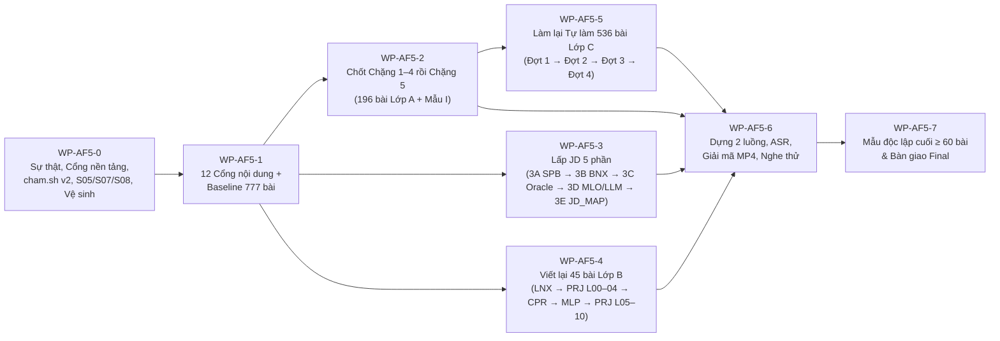

# Plan AF5+ FINAL (LOCKED) | 2026-11-23 — Kế hoạch Thực thi Toàn diện, Chuẩn Best-Practice

> **ĐÃ BỊ THAY (2026-11-23T01:10Z).** Kế hoạch còn hiệu lực là [`plan_AF5_20261123T0110Z.md`](plan_AF5_20261123T0110Z.md). Tệp này giữ làm lịch sử. Mười hai điểm bị sửa (thiết kế dãy chặng ở `0.4` mô phỏng ra 51 lời hẹn lệch; chẩn đoán tràn RAM; Spring Boot 3 → 4.1; vị trí và cách chấm `SPB`; `ca_an/` cho lớp A; nối dài `BNX`/`MLO`/`LLM`; …) liệt kê ở mục 2 của bản mới.

> **Trạng thái phiên lập kế hoạch**: Đã rà soát kiểm chứng toàn diện (`verify evidence`) trên mốc git `5d7f329` + cây làm việc AF5 + đủ 5 phần [`resources/job/JD.md`](../../../resources/job/JD.md). **Toàn bộ 8 quyết định kiến trúc (`D-1..D-8`) đã được CHỐT dứt điểm theo hướng best-practice lâu dài** — phiên thực thi bắt đầu ngay từ `WP-AF5-0` mà không còn điểm treo.
> **Phạm vi tuân thủ của phiên lập kế hoạch**: Chỉ kiểm toán và hoàn thiện kế hoạch; **không sửa** `lessons/`, `curriculum/`, `labs/`, `out/`, `tools/`, `audit/review/*.py`, `HOC_TAP.html`; không dựng video; không commit.
> **Tài liệu chứng cứ gốc đi kèm**: [`handover_AF5_20261122T1546Z.md`](handover_AF5_20261122T1546Z.md) · [`knowledge-graph_AF5_20261122T1546Z.md`](knowledge-graph_AF5_20261122T1546Z.md) · [`../sample_h/REPORT.md`](../sample_h/REPORT.md) · [`logs/af5/`](logs/af5/).

---

## 1. Kết luận Đánh giá Chất lượng: Đã học luôn được chưa?

**Trạng thái toàn kho (`777` bài · `50` giáo án · `154,3` giờ): `PARTIAL`.**
Tuyên bố *"DONE 100% / 777/777 chuẩn AF2 Tự làm / không lỗi / check_xref rc=0"* của AF4-final bị **bác bỏ hoàn toàn** bằng chứng cứ thực nghiệm.

| Phân khu | Phạm vi | Bài | Giờ | Kết luận học ngay | Điều kiện / Căn cứ thực chứng |
|---|---|---:|---:|---|---|
| **Chặng 1–4** (lộ trình nhanh JD ngân hàng) | `FND` (11), `JVA` (13), `JV2` (10), `PYT` (14), `BNK` (15), `BNX` (39), `INT` (9), `ACB` (9) | **120** | **32,7** | **HỌC NGAY ĐƯỢC** (`ALLOW_WITH_CONDITIONS`) | Mẫu H: 12/12 đạt mất gốc ĐỦ, lab có đề thật & bước "Nếu kẹt". Còn 2/12 bài mẫu có MUST (`BNK L08`, `JVA L04`), 14 lab lộ đáp án trong `de.md`, chưa có ứng dụng Spring Boot chạy thật. |
| **Chặng 5 (phần soạn tay)** | `DMS` (21), `CS112` (30), `CS115 L00–L21 + L44–L46` (25) | **76** | **24,0** | **HỌC NGAY ĐƯỢC** (`ALLOW_WITH_CONDITIONS`) | Mẫu H: 2/2 sạch MUST. Lưu ý: `HOC_TAP.html` hiện kéo nhầm `CS115 L22–L43` vào S05 (97 bài) và đẩy `L45–L46` sang S09 → chỉ học đúng `L00–L21` và `L44–L46`. |
| **Dự án Chặng (`PRJ`)** | `PRJ L00–L04` (cuối S01–S05) & `PRJ L05–L10` | **11** | **1,0** | **BỎ QUA LÚC NÀY** | 11/11 dài 5,3–6,0 phút, 11/11 `de.md` lộ đáp án, hứa "100 điểm" không có trong `labs/cham.sh`, Mẫu H 100% có MUST. |
| **Chặng 6–11 (nâng hàng loạt — Lớp C)** | 35 khoá nâng bằng `af2_upgrader.py` + `CS115 L22–L43` | **536** | **93,3** | **CHỈ XEM LÝ THUYẾT** (Tự làm CHƯA ĐẠT) | Bài giảng gốc 12/13 ĐỦ, nhưng 536/536 cảnh `practice` khuôn mẫu, 375 bài chiếu nguyên lời giải sau 30s, 161 đề lộ đáp án, 183 bài `covers` trỏ cảnh rỗng, đoạn chèn máy ("Hai mức quy mô" 380 tệp, bảng cú pháp 215/60 tệp, recap độn) có nhiều lỗi kiến thức (Mẫu H: 11/13 MUST). |
| **3 khoá mới còn lại (Lớp B)** | `CPR` (10), `LNX` (10), `MLP` (14) | **34** | **3,3** | **CHƯA ĐẠT — VIẾT LẠI** | 34/34 dưới 6,5 phút (905–1 175 từ), 0/12 bài mẫu đạt mất gốc, 12/12 có MUST, mã 10–13 dòng chỉ giảng 2–4 câu, nhiều cam kết tiêu đề không được chạy. |

**Lưu ý tức thời cho người học bắt đầu Chặng 1–5 trước khi phiên thực thi chạy:**
1. Chạy `bash labs/check_env.sh` kiểm môi trường (Git Bash, JDK 21, Python 3.11+, `sqlite3`).
2. Bỏ qua mọi bài `PRJ L00–L04` và `CS115 L22–L43`; không tin 8 thẻ `"ĐÃ CHỐT"` đang hiển thị sai trên `HOC_TAP.html`.
3. Với `BNK L08`: màn hình mới đúng (đếm từ 0: bước 0 → 1 dòng, bước 1 → 3 dòng, bước 2 → 5 dòng; lời đọc bị lệch đếm từ 1); mục tiêu chọn điều phối/phối hợp khi tải tăng bài chưa dạy.
4. Với 14 lab Lớp A lộ đáp án trong `de.md` (`FND L01/04/07/09`, `JVA L00`, `JV2 L00/04/05/07/08`, `BNK L01/06/12/13`): tự viết logic xử lý thật, không in cứng đáp án.

---

## 2. Xác minh Bằng chứng & 10 Phát hiện Mới Bổ sung cho AF5 (`NEW-01..NEW-10`)

### 2.1. Bằng chứng AF5 đã được kiểm chứng lại độc lập
- **Quy mô & media (`VALID`)**: 50 giáo án (`48 active` + `CS112`/`CS115`), 777 đặc tả, 777 MP4 (0 tệp < 100 KB, 0 video < 5 phút), 777 `build_report.json`, 777/777 đúng 1 giọng `vi-VN-NamMinhNeural`, `TOTAL_STALE=0`, `pack.py check` 777/0, `asr_flags` 50/50 0 chưa xem xét, 53/53 `verify_*.py` `rc=0` (15 mục `'FIX'` trong `verify_cs112.out` là ghi chú đối chiếu bản `.tex` gốc, không phải lỗi bài).
- **`C-13` (`scan_ctrl` 90 lượt — ĐÃ XÁC MINH `VALID`)**: Kiểm trọn 90 dòng `logs/af5/scan_ctrl.out`: **90/90 là ký tự TAB (`ctrl=0x9`) có chủ đích** (bảng Oracle/Kafka `bnx/L06, L07, L10, L38`; stack trace Java `jv2/L07`, `jva/L10, L12`; `/etc/hosts` `lnx/L05`). **0 ký tự điều khiển lỗi**.
- **12 mục phản hồi tai người `nghe_thu_ket_qua.json` (`VALID` ở YAML/lexicon; âm thanh `NOT_VERIFIED`)**: Cả 5 `fix` (`FND L07`, `DEN L02`, `RLN L10`, `HCI L08` ×2) và 7 `warn` (`ACB L02`, `ACB L03`, `DMS L07`, `BCH L01`, `FND L10`, `BNX L06/L15`) đều đã được sửa trong mã nguồn YAML/lexicon; còn chờ tai người nghe lại 38 video dựng mới (`BN-08`).

### 2.2. Mười lỗ hổng / chẩn đoán lệch của AF5 đã được giải mã tận gốc

| Mã | Mức | Phát hiện mới (`OBSERVED`) | Bằng chứng trực tiếp | Hệ quả & Cách vá trong Plan này |
|---|---|---|---|---|
| **NEW-01** | CRITICAL | **Mâu thuẫn hợp đồng chí mạng giữa `G-LEAK` ↔ `labs/cham.sh` ↔ `tools/lv.py` (E53)** | `labs/cham.sh` L22–63 chạy lời giải với **0 CLI args, 0 stdin**, chỉ `diff` stdout với `mong_doi.txt` tĩnh; `tools/lv.py` L686–693 (E53) bắt buộc **100% `mong_doi.txt` hiện nguyên văn lên video**. Do đó tệp `print` cứng qua được **777/777 lab kể cả 196/196 Lớp A**! | Tách `G-LEAK-DE` (cấm `de.md` lộ đáp án) và `G-LEAK-ANTI-PRINT` (bắt buộc qua `cham.sh` v2 có thư mục ca ẩn `ca_an/` ở `WP-AF5-0.11`). Giữ `E53` chỉ kiểm ca công khai `mong_doi.txt`. |
| **NEW-02** | CRITICAL | **Tiêu chí nghiệm thu WP-AF5-1 (`Lớp A ≥ 95% PASS`) tự vỡ trên `G-LEN` và `G-PRACTICE`** | Đo từ `mech_scan.tsv` (196 bài Lớp A): **29/196 (14,8%) > 2 300 từ** (`FND L00` 3 210 từ, `JVA L12` 2 584, `JVA L00` 2 506, `JV2 L04/05/07/09` ~2 400…); **14/196 (7,1%) `CS112 L00, L02–L14` có `pr_steps = 2`** (gợi ý nằm trong `de.md`); `PYT L12/L13` dài **33,9–34,0 phút** (vì `pause` quá dài). | Đổi nghiệm thu WP-AF5-1 sang: 100% unit test đối chứng âm/dương + xuất bảng baseline 777 bài; đưa danh sách Lớp A lệch vào đầu việc sửa của `WP-AF5-2`; thêm ngưỡng cảnh báo `pause > 300 s` vào `G-LEN`. |
| **NEW-03** | HIGH | **Số bài `practice` khuôn mẫu thực tế là `581/777` (74,8%), không phải `542/777`** | `mech_scan.py` L20 chỉ dò 1 câu `GEN_SAY`, bỏ sót **39/45 bài Lớp B** (`CPR` 10, `LNX` 10, `MLP` 14, `PRJ L00–L04` 5) dùng biến thể lời khác nhưng màn hình step 1 đều chỉ ghi `"mở de.md"`. | Thiết kế `G-PRACTICE` theo điều kiện dương tính (step 1 phải có đề + dữ liệu vào thật, có `pause`, có mong đợi, có step gợi ý riêng, không chiếu `loi_giai.*`). |
| **NEW-04** | HIGH | **`HOC_TAP.html` hiện gắn 8 thẻ giả `"ĐÃ CHỐT"` (S01–S04) và 14 thẻ `"AF2 100%"` (S05–S11)** | `pack.py` L86 đặt cứng `LOCKED = {"S01","S02","S03","S04"}`; đã xác minh 8 thẻ `ĐÃ CHỐT` và `AF2 97/97`, `AF2 198/198` trong `HOC_TAP.html`. | `WP-AF5-0.1`: đặt `LOCKED = set()`, nâng cấp `pack.py` hiển thị 4 mức nhãn trung thực theo cấp chặng & cấp bài. |
| **NEW-05** | HIGH | **Thiếu `CS115:L45-L46` ở `STAGES[S05]`; `tracks.yaml` kéo nhầm `BNK/BNX/INT/ACB` vào nền chung; xung đột `E24` ↔ `check_next_refs` ở `CS115 L21`; S07 đảo thứ tự `DVO` trước `CLD` + 6 cạnh `requires_ext` gượng ép** | `pack.py` L70 thiếu `CS115:L45-L46`; `tracks.yaml` L11 đưa `PRJ:L00-L04` vào `nen-tang` và `prj.yaml` xích cứng `L00→L01→L02→L03→L04` nên kéo cả BNK/BNX/INT/ACB vào nền chung mọi nghề; `DVO` có 6 cạnh `requires_ext` vào `CLD` nhưng đứng ở S07 trước S08; `WEB:L01/03/12`, `SDP:L12`, `SWF:L08`, `SEC:L13` có cạnh `requires_ext` sang `TOC/PLC/ESY/DSC`; `CS115 L21` bị kẹt deadlock giữa `lv.py` E24 (cấm hẹn bài ≠ 22) và `check_next_refs.py` (cấm hẹn L22 nếu L44 đứng sau L21 trong S05). | `WP-AF5-0.4`: giải quyết tận gốc kiến trúc đồ thị: thêm `CS115:L45-L46` vào S05; chuyển `DVO` sang S08 sau `CLD`; đổi 6 cạnh tham khảo sang `see_also:`; gỡ `PRJ` khỏi `nen-tang` + bỏ xích cứng giữa các dự án chặng trong `prj.yaml`; thêm 2 track JD; gỡ deadlock `CS115 L21` ở `check_next_refs.py` + lời kết L21. |
| **NEW-06** | HIGH | **AF5 chẩn đoán SAI nguyên nhân `check_course_refs` chậm 15 phút 13 giây (`F-11`)** | `course_refs_per_course.out`: mọi khoá đều mất ~1,1 s/bài (tuyến tính theo số bài). Nguyên nhân thật là `tools/lv.py` L233–247 `lesson_numbers()` đọc + parse lại **51 tệp `curriculum/*.yaml` trên MỖI bài** (`777 × 51 = 39 627` lần parse YAML!), không phải ReDoS `TAIL`. | `WP-AF5-0.5`: cache `curriculum/*.yaml` và `symbols.yaml` ở cấp module trong `tools/lv.py` → `check_course_refs` tụt từ 15 phút xuống **< 15 giây**, đồng thời tăng tốc mạnh `lv.py lint` & `audit_all.py`. |
| **NEW-07** | HIGH | **Giải mã lỗi `screen_code` (`BNX L19 check 2 0`), `audit_all.py` OOM 7,7 GB, và `plan_AF5` thiếu mục `0.9`/`0.10`** | (a) `screen_code.py` L718 cắt lỗi bằng `got[:200]!r` đúng tại `(integer) 16276` (đúng 200 byte), che khuất 4 dòng cuối của `BNX.yaml` L2337–2345 (`4087`, `-> Redirected to slot [12007]`, `OK`, `12007`) vốn chịu rủi ro pipe/redirect của `docker exec -i ... redis-cli -c`. (b) `audit_all.py` chạy 777 bài trong 1 tiến trình không `sympy.core.cache.clear_cache()`, không cache YAML, sinh 777 tiến trình Node `katex_check.js` → phình 7,7 GB RAM, Node chết ở `PAR L13`/`PLC L00–03`. **Lint 777 bài hiện là `NOT_VERIFIED`!** | Đưa tường minh `0.9` (sửa `screen_code.py` in dòng lệch đầu tiên + ổn định `BNX L19`) và `0.10` (cô lập bộ nhớ `audit_all.py` theo khoá + chạy full lint 777 bài) vào `WP-AF5-0`. |
| **NEW-08** | MEDIUM | **Bất nhất phát âm `SQL` liên khoá sau đợt sửa 22/11** | 9 khoá `ACB/BNK/BNX/FND/INT/JV2/JVA/PRJ/PYT` đọc `SQL` → `"ét kiu eo"`, nhưng `DBS` (18 bài SQL!), `DAN`, `DSY` vẫn đọc `"ét quy eo"` (`MySQL` → `"Mai ét quy eo"`). | Thống nhất `lexicon_vi.{DBS,DAN,DSY}.yaml` (và mọi khoá mới như `SPB`) về `"ét kiu eo"` / `"O-rơ-cồ"` khi bước vào đợt dựng lại tương ứng. |
| **NEW-09** | MEDIUM | **Vệ sinh công cụ & tài liệu chỉ mục**: trùng mã lỗi `E51`, `run_gates_af5.sh` phụ thuộc `scratch/`, `ENV.md` lẫn PowerShell, `STATUS.md` in `? PASS`, `CSA`/`OSY` thiếu `verify_*.py`, `ROADMAP`/`MASTER_INDEX` cũ, `registry.yaml` còn `SECONDARY` | `lv.py` L618 & L653 dùng chung `E51`; `run_gates_af5.sh` L26 gọi `scratch/find_stale_all.py`; `ENV.md` L8 cấm PowerShell nhưng L40–43 dùng PowerShell và thiếu `gcc`/`node`/`.venv-pyt`; `status_report.py` regex không bắt được `verify_dms/int/l12_screen`; `MASTER_CURRICULUM_INDEX.md` L6 ghi `732 bài`, L29 `BNX L00–L23`, L100 `CS115=46`, L110 `JDK 22`; `registry.yaml` còn `356/2025/NĐ-CP`, `13/2023/NĐ-CP` mức `SECONDARY` và `TT 89/2026/TT-BTC` chưa kiểm phạm vi. | Đưa trọn bộ vào `WP-AF5-0.3, 0.5, 0.7, 0.10, 0.12` + thêm `verify_csa.py`/`verify_osy.py` ở `WP-AF5-5` Đợt 1 + thêm block tự động `<!-- BEGIN:LF_SUMMARY -->` trong `master_sections.py`. |
| **NEW-10** | MEDIUM | **Các yêu cầu cụ thể trong 5 phần `JD.md` còn thiếu/mỏng trong `WP-AF5-3` cũ** | So từng dòng `JD.md`: thiếu/mỏng Microservice consolidation, Resource-oriented API, OWASP secure coding thực hành, Code review & mentoring (NAB); NATS/OCI/GCP mức đọc hiểu (ACB 2026); Load balancing & L3 ECM/BPM (VPBank); Data Contract/Backward Compatibility Backend↔DE, Task Lifecycle/Routing/Escalation, Polyglot Persistence (Vingroup BE); Feature Store train↔infer, Drift/Retraining thực hành, Speech AI/Voice Assistant, UI/API Test Automation Playwright/REST Assured (Vingroup AI). | Hoàn thiện ma trận ánh xạ 1:1 đủ 5 phần `JD.md` ở `WP-AF5-3` (Mục 5). |

---

## 3. Các Quyết định Kiến trúc Đã Chốt Dứt điểm (`D-1..D-8` — LOCKED)

| Mã | Quyết định đã chốt (Best-Practice Lâu dài) | Lý do & Giá trị dài hạn |
|---|---|---|
| **D-1** | **Ưu tiên JD theo 3 pha nối tiếp**: **(a) Backend Ngân hàng Java/Spring (ACB, VPBank, NAB)** → **(b) Backend Platform & Workflow (Vingroup)** (tái dùng ~70% hạ tầng phân tán) → **(c) AI/MLOps/Quality (Vingroup)**. | Lấp nhanh nhất lỗ hổng lớn nhất (Spring Boot thực chiến), tạo đòn bẩy trực tiếp cho phỏng vấn Senior/Lead Java trước khi mở rộng sang Platform & AI. |
| **D-2** | **Hợp đồng ngôn ngữ lab chuẩn hoá toàn kho**: Python làm mặc định cho mọi khoá lý thuyết S06–S11 (khai `PYT:L07` tiên quyết); C11 chỉ dùng trong `CPR` và các bài đứng **sau `CPR`**; SQL trong `DBS` chỉ từ `L02` trở đi (`DBS L01` dùng Python/giấy bút); Node.js chỉ trong `WEB` từ bài đã giảng JS (`L03+`). | Xoá hoàn toàn tình trạng người mất gốc bị kẹt cú pháp ngôn ngữ chưa học; giảm gánh nặng cài môi trường hỗn tạp. |
| **D-3** | **`check_xref.py` giữ nguyên kỷ luật bài độc lập + allowlist có lý do tường minh** cho bảng mảnh ghép của `PRJ`, đồng thời vá 7 ca báo nhầm (`MLP` = perceptron ở `CS115 L23`, `"khoá lập trình C"` ở `CPR`). | Chấm dứt cổng đỏ `rc=1` thường trực (`BN-07`) mà vẫn chặn chặt lỗi `"như đã học ở khoá X"`. |
| **D-4** | **Chặng 10–11 (141 bài, 26,1 giờ) làm ở Đợt 4 sau cùng**, trong thời gian chờ gắn nhãn trung thực `"Tham khảo — Bài giảng dùng được, Tự làm đang nâng cấp"`. | Không để 141 bài chuyên ngành phụ làm chậm việc chốt 100% Chặng 1–9 và lộ trình JD. |
| **D-5** | **Gỡ ngay `LOCKED` (`"ĐÃ CHỐT"`) khỏi `HOC_TAP.html`**; áp dụng 4 mức nhãn trung thực trên `HOC_TAP.html` theo trạng thái chứng cứ thực tế của từng chặng/khoá. | Bảo vệ người học khỏi học nhầm bài lỗi; nhãn `"ĐÃ CHỐT"` chỉ bật lại sau khi đạt 100% tiêu chí nghiệm thu. |
| **D-6** | **Đầu phiên thực thi (trước `WP-AF5-0`)**: xác nhận tạo 1 commit mốc nền sạch cho các tệp kiểm toán AF5/AF5+ & `JD.md` (hoặc tạo nhánh làm việc riêng `af5-exec`) để mọi WP có `git diff` sạch và rollback được. | Tách rạch ròi tài liệu kiểm toán với thay đổi mã nguồn/bài giảng. |
| **D-7** | **Nâng cấp `labs/cham.sh` v2 hỗ trợ ca ẩn / đầu vào biến thiên (`ca_an/`)**, tương thích ngược 100% với 777 lab cũ; bắt buộc `ca_an/` + kiểm chống `print` trong `lab_gate.py` cho mọi lab lập trình mới/sửa từ `WP-AF5-2` trở đi. | Cách duy nhất đóng triệt để `BN-03` mà vẫn giữ nguyên `E53` (hiện đáp án ca công khai lên video để người học đối chiếu). |
| **D-8** | **Chuẩn hoá chấm `PRJ` sang Đạt/Chưa đạt đa ca thử (`cham.sh` v2)** theo 4 nhóm tiêu chí (chức năng & bất biến, xử lý biên/lỗi, 3 cỡ dữ liệu quy mô, tất định); **xoá toàn bộ chữ `"100 điểm"` / `"(-30đ)"`**. | Nhất quán toàn kho 777+ bài, không bao giờ hứa thang điểm không tồn tại. |

---

## 4. Sổ Contract Bottlenecks Đầy đủ (`BN-01..BN-12`)

**Quy tắc khóa chốt**: Không chặng nào được gắn nhãn `"ĐÃ CHỐT"` nếu còn bất kỳ bottleneck nào áp dụng cho chặng đó ở trạng thái `OPEN`.

| ID | Điều chưa định nghĩa / đang hỏng | Phụ thuộc | Phép thử đóng (`Closure Test`) | Đóng ở | Trạng thái |
|---|---|---|---|---|---|
| **BN-01** | Chuẩn "Tự làm đạt" & `covers` mới kiểm cấu trúc, chưa kiểm chất lượng nội dung | WP-AF5-2/3/4/5 | 12 luật `content_gates.py`: mỗi luật ≥ 1 ca âm FAIL, ≥ 1 ca dương PASS; xuất bảng baseline 777 bài | WP-AF5-1 | `OPEN` |
| **BN-02** | Thiếu hợp đồng ngôn ngữ lab; `ENV.md`/`check_env.sh` thiếu `gcc`, `node`, `.venv-pyt`, lẫn PowerShell | 536 lab Lớp C; 33 lab C/JS | `G-LABLANG` 0 FAIL; `check_env.sh` kiểm đủ 8 công cụ trên Git Bash sạch | WP-AF5-0.3, WP-AF5-1 | `OPEN` |
| **BN-03** | `cham.sh` chỉ so stdout tĩnh (0 args/0 stdin), mâu thuẫn `E53` & `labs/PRJ/SPEC.md` ("100 điểm") | 209 lab lộ đáp án; 777 lab trước ca `print`; 11 bài `PRJ` | `cham.sh` v2 hỗ trợ `ca_an/`; `lab_gate.py` chứng minh tệp chỉ `print` `mong_doi.txt` bị chấm KHÁC; `PRJ` bỏ `"100 điểm"` & chấm đủ 4 nhóm ca thử | WP-AF5-0.11, WP-AF5-4 | `OPEN` |
| **BN-04** | Nguồn sự thật (`Source of Truth`) giữa YAML và `af2_upgrader.py` + `scratch/` | WP-AF5-5 | `apply_upgrade()` bị khoá cứng; `find_stale_all.py` dời sang `audit/review/`; `grep -rn "scratch/" audit tools tests` = 0 | WP-AF5-0.7, WP-AF5-0.8 | `OPEN` |
| **BN-05** | Tỉ lệ lỗi ẩn ở 737 bài chưa vào Mẫu H (182 bài Lớp A còn lại, cận trên Wilson 40%) | Nhãn `"ĐÃ CHỐT"` | 100% bài trong chặng chốt có báo cáo đọc độc lập + sửa hết MUST + mẫu nghiệm thu mới (`Mẫu I` / cuối) đạt `MUST = 0` | WP-AF5-2, WP-AF5-5, WP-AF5-7 | `OPEN` |
| **BN-06** | Đích JD mở rộng 5 phần; `0` ứng dụng Spring Boot chạy thật; `JD_MAP` & `tracks.yaml` cũ | WP-AF5-3 | Khoá `SPB` chạy `mvn -B verify` thật trong cổng; `JD_MAP` đủ 5 phần 0 dòng trống; `tracks.yaml` có 2 track JD | WP-AF5-3 | `OPEN` |
| **BN-07** | `check_xref.py` trả `rc=1` thường trực (44 lượt: 34 PRJ, 3 MLP, 7 báo nhầm) | Mọi lần chạy `final_gates` | `check_xref.py` trả `rc=0` với allowlist có lý do; ca âm `"như đã học ở khoá X"` vẫn `rc=1` | WP-AF5-0.2 | `OPEN` |
| **BN-08** | Tai người chưa nghe 38 video dựng mới 22/11; bất nhất phát âm `SQL` ở `DBS/DAN/DSY` | Chất lượng âm thanh | Nghe `NGHE_THU.html`, sửa hết `fix`; toàn bộ `lexicon_vi*.yaml` thống nhất `"ét kiu eo"` / `"O-rơ-cồ"` | WP-AF5-5, WP-AF5-6 | `OPEN` |
| **BN-09** | Sản phẩm thật chưa chạy (Spring/Oracle/Kafka/K8s/CI…); 2 văn bản pháp lý còn `SECONDARY` + `TT 89/2026` chưa kiểm phạm vi | BNK/BNX/ACB/INT/SPB | Kịch bản chạy thật (`SPB` Maven, `Oracle` Docker) hoặc `sources` có URL + ngày đọc; `registry.yaml` giảm tối đa `SECONDARY`/`CHUA_KIEM` | WP-AF5-0.12, WP-AF5-3A/3C | `OPEN` |
| **BN-10** | Dãy học lệch chặng (S05 = 97, S07 = 198); thiếu `CS115:L45-L46`; `DVO` đứng trước `CLD`; `nen-tang` kéo nhầm `BNK/BNX/INT/ACB`; deadlock `E24` ↔ `check_next_refs` ở `CS115 L21` | `HOC_TAP.html`, `TRACKS.md`, `MASTER_INDEX` | `stage_stats.py`: S05 = 77 bài, S07/S08 cân đối không kéo `RBM/ESY/TOC/PLC`; `check_next_refs` 0 lệch; `check_curricula_graph` 0 lỗi; `TRACKS.md` `nen-tang` sạch | WP-AF5-0.4 | `OPEN` |
| **BN-11** | Cổng nền tảng lỗi kỹ thuật & **full lint 777 bài đang `NOT_VERIFIED`**: `audit_all.py` OOM 7,7 GB; `screen_code.py` cắt lỗi 200 byte che mất `BNX L19`; `lv.lesson_numbers()` không cache (15 phút); trùng mã `E51`; `status_report.py` in `? PASS`; `CSA`/`OSY` thiếu `verify_*.py` | Độ tin cậy toàn hệ thống cổng | `audit_all.py` chạy trọn 777 bài RAM < 1 GB, 0 lỗi lint; `check_course_refs` < 15s; `screen_code` 50/50 khoá `0 FAIL`; `STATUS.md` 0 `? PASS` | WP-AF5-0.5, 0.9, 0.10, WP-AF5-5 | `OPEN` |
| **BN-12** | `HOC_TAP.html` gắn nhãn giả `"ĐÃ CHỐT"`/`AF2 100%`; `ROADMAP`, `STATUS`, `TRACKS`, `MASTER_INDEX`, `README` mâu thuẫn số liệu | Trung thực với người học | 0 thẻ `"ĐÃ CHỐT"` giả; 0 mâu thuẫn giữa `HANDOVER`, `HOC_TAP`, `STATUS`, `TRACKS`, `MASTER_INDEX`, `ROADMAP` | WP-AF5-0.1, 0.12 | `OPEN` |

---

## 5. Đặc tả Thực thi Chi tiết theo 8 Gói việc (`WP-AF5-0` → `WP-AF5-7`)

### Biểu đồ Thứ tự & Song song hoá

---

### Gói 0 — `WP-AF5-0`: Sự thật, Cổng nền tảng, Kiến trúc Lộ trình & `cham.sh` v2 *(0 video phải dựng lại, trừ 1 câu kết `CS115 L21` nếu chỉnh lời)*

| # | Tệp đích | Việc phải làm chính xác | Phép thử nghiệm thu (`REQUIRED`) |
|---|---|---|---|
| **0.1** | `audit/review/learn_start/pack.py` | Đặt `LOCKED = set()`. Xây dựng 4 mức nhãn trung thực cho `stage_tag()` và cấp khoá/bài: (1) `ĐÃ CHỐT` (chỉ khi chặng qua WP-AF5-2/4/5/7), (2) `Học được (có điều kiện)` (Chặng 1–5 phần soạn tay), (3) `Lý thuyết dùng được · Tự làm đang làm lại` (Chặng 6–11 Lớp C), (4) `Đang viết lại — tạm bỏ qua` (`CPR, LNX, MLP, PRJ`). Sửa hero L924 bỏ câu gây hiểu nhầm `777 bài có Tự làm`. | `pack.py page` `rc=0`, 0 liên kết chết; `grep -c 'tag lock' HOC_TAP.html` = `0`. |
| **0.2** | `audit/review/check_xref.py` | Thêm allowlist có ghi rõ lý do cho bảng tổng hợp mảnh ghép của `PRJ` (`scenes.1.steps.0.show`). Thêm `MLP` vào `AMBIG` (chỉ bắt khi đi sau `khoá/bài` hoặc kèm `L\d\d` — hết 5 ca báo nhầm ở `CS115 L23`). Sửa `alias_rx` không khớp `"khoá lập trình C"` thành `JVA` (hết 2 ca báo nhầm ở `CPR L00–01`). Với 3 lượt `MLP L00/L10` (`PYT:L09`, `CS115:L22/23`): tạm ghi vào allowlist `TODO_WP4` có hạn gỡ khi `WP-AF5-4` viết lại `MLP`. Thêm `tests/test_check_xref.py`. | `check_xref.py` `rc=0`; test ca âm `"như đã học ở khoá DBS"` → `rc=1`. |
| **0.3** | `labs/ENV.md`, `labs/check_env.sh`, `labs/cham.sh` | Bổ sung `gcc` (w64devkit) và `node` vào `ENV.md` & `check_env.sh`; viết lại lệnh dựng `labs/.venv-ml` bằng **Git Bash** (`source labs/.venv-ml/Scripts/activate`, bỏ hẳn lệnh PowerShell); ghi rõ `labs/.venv-pyt` (`requirements-py.txt`); cập nhật comment L3 của `cham.sh` (đủ `.c`/`.js`) và thêm kiểm tra thiếu `node` ở L58. | `bash labs/check_env.sh` kiểm đủ 8 công cụ; `grep -i powershell labs/ENV.md` chỉ còn câu cấm ở L8. |
| **0.4** | `audit/review/learn_start/pack.py`, `curriculum/tracks.yaml`, `curriculum/prj.yaml`, `curriculum/{web,sdp,sec,swf}.yaml`, `audit/review/check_next_refs.py` | **(a)** Thêm `CS115:L45-L46` vào `STAGES[S05]` của `pack.py` và `CS115:L45` vào `tracks.yaml`. **(b)** Chuyển `DVO` từ `STAGES[S07]` sang `STAGES[S08]` (đặt sau `CLD`, khớp 6 cạnh `requires_ext` thật của `DVO` vào `CLD`). **(c)** Đổi 6 cạnh liên hệ tham khảo (không phải tiên quyết cứng) từ `requires_ext:` sang `see_also:`: `WEB:L01←TOC:L06`, `WEB:L03←PLC:L07`, `WEB:L12←ESY:L13`, `SDP:L12←PLC:L07,PLC:L12`, `SWF:L08←TOC:L01`, `SEC:L13←DSC:L11`. **(d)** Sửa `pack.stages()` L164–186: tính bao đóng **chỉ bằng `requires` + `requires_ext`**; cạnh ngầm `L(k)→L(k+1)` chỉ dùng làm ràng buộc sắp thứ tự bên trong cùng một chặng. **(e)** Gỡ `PRJ:L00-L04` khỏi `nen-tang` trong `tracks.yaml`; bỏ xích `requires: [L(k-1)]` nhân tạo giữa các dự án chặng khác chuyên ngành trong `curriculum/prj.yaml` (`L04` không cần `L03` ngân hàng!); thêm 2 track JD (`backend-banking-java`, `backend-platform-ai`) vào `tracks.yaml`. **(f)** Gỡ deadlock `E24` ↔ `check_next_refs.py` cho khoá chia 2 chặng (`CS115`): trong `check_next_refs.py`, với bài nằm cuối lát cắt chặng (như `CS115:L21` hẹn `L22` ở S09), chỉ đòi `pos[ref] > pos[me]` mà không báo lỗi vì `L44–L46` (phần bổ sung) cùng ở S05. | `stage_stats.py`: **S05 = 77 bài** (`DMS 21 + CS112 30 + CS115 25 + PRJ L04`), S07 không còn `RBM/ESY/TOC/PLC`, S08 gồm `CLD→DVO`; `check_curricula_graph.py` 0 lỗi; `check_next_refs.py` 0 lệch; `tracks.py` chạy `nen-tang` không chứa `BNK/BNX/INT/ACB`. |
| **0.5** | `tools/lv.py` | **(a)** Thêm cache cấp module (`_CUR_CACHE`, `_REG_CACHE`) cho `lesson_numbers()` (L233–247) và `registry()` (L148–163) kèm hàm `clear_caches()`. **(b)** Đổi mã lỗi trùng ở L618 (`E51 có công thức $…$ trong <svg>`) sang **`E50`** (cập nhật `tests/test_lint.py` nếu cần). | `check_course_refs.py` chạy trọn 777 bài **< 15 giây**, `0` vấn đề; `tests/test_lint.py` `0 FAIL`. |
| **0.6** | `audit/review/scan_ctrl.py` | Ghi nhận mốc baseline `90` (đã xác minh 90/90 là `\t` `0x9`); bổ sung exit `rc=1` nếu gặp bất kỳ byte điều khiển nào khác `0x9` (`0x00–0x08`, `0x0b–0x1f`). | `scan_ctrl.py` `rc=0`, báo rõ `90 tab (0x9), 0 lỗi`. |
| **0.7** | `scratch/find_stale_all.py` → `audit/review/find_stale_all.py` | Di dời `find_stale_all.py` sang `audit/review/`, cập nhật đường dẫn trong `run_gates_af5.sh` (và `final_gates_af5.sh`); sau đó kiểm tra không còn tham chiếu sống rồi dời các script một lần còn lại của `scratch/` vào `archive/one_off_generators/af4/`. | `grep -rn "scratch/" audit tools tests` = 0 tham chiếu sống; `audit/review/find_stale_all.py` chạy `TOTAL_STALE=0`. |
| **0.8** | `audit/review/af2_upgrader.py` | Khoá `apply_upgrade()` (raise `RuntimeError("FROZEN — BN-04: YAML lessons/* là nguồn sự thật")`). | Gọi thử bất kỳ `audit/*/af2/upgrade_*.py` bị từ chối ngay, không ghi đè tệp. |
| **0.9** | `audit/review/screen_code.py`, `audit/review/screen_code/BNX.yaml` | Sửa `screen_code.py` L718 in **số dòng + dòng lệch đầu tiên (`line #N: got=... | want=...`)** thay vì `got[:200]!r`. Chạy riêng `screen_code.py check --course BNX -v` (Docker `bnx-ora`/`bnx-mss` đang chạy), xác nhận nguyên nhân sau byte 200 ở `BNX L19 check 2 0` (đóng pipe `docker exec -i ... redis-cli -c` hoặc chờ nút 7002 sẵn sàng) và xử lý dứt điểm (vd `retries: 2` có lý do hoặc làm ổn định cluster readiness). | `screen_code.py check` chạy toàn kho 50/50 khoá: **`0 FAIL · 0 STALE · 0 MISSING · 0 ORPHAN`**. |
| **0.10** | `audit/review/audit_all.py`, `audit/review/status_report.py` | **(a)** Sửa `audit_all.py` chạy cô lập từng khoá bằng subprocess (`--worker <khoá>`) rồi gộp `audit_all.tsv` (hoặc gọi `sympy.core.cache.clear_cache()` sau mỗi bài + gom `katex_check.js` theo khoá) để RAM đỉnh < 1 GB. **(b)** Chạy trọn **777/777 bài** (`audit_all.py`) — chính thức xác minh full lint toàn kho! **(c)** Sửa regex `status_report.py` L34–44 nhận diện thêm format `verify_dms` (`324 PASS · 0 FAIL`), `verify_int` (`208 PASS, 0 FAIL`), `verify_l12_screen`. | `audit_all.py` chạy trọn 777 bài không OOM, RAM < 1 GB, **0 FAIL lint trên 777/777 bài**; `STATUS.md` có **0 `? PASS`**. |
| **0.11** | `labs/cham.sh`, `audit/review/lab_gate.py`, `audit/labkit.py` | **Hợp đồng `cham.sh` v2 (`D-7`, đóng gốc `BN-03`)**: • Giữ nguyên ca công khai (chạy không đối số / stdin rỗng → so `mong_doi.txt`, khớp `E53`). • Nếu tồn tại `labs/<KHOÁ>/<Lxx>/ca_an/`: chạy thêm mọi cặp `in_k.txt` (stdin) + `args_k.txt` (nếu có) / `seed_k.sql` (với `.sql`) và so với `out_k.txt`. Chỉ in `ĐÚNG` khi **tất cả** ca công khai + ca ẩn khớp. • Trong `lab_gate.py`: với mọi lab có `ca_an/`, tự sinh tệp **gian lận chỉ `print` nguyên `mong_doi.txt`** (hỗ trợ `.py`, `.java`, `.c`, `.js`, `.sh`, `.sql`), chạy qua `cham.sh` và **bắt buộc `rc != 0`**. • Cập nhật `audit/labkit.py` thêm tham số `hidden_cases=[...]` để mọi bộ sinh bài mới (`SPB`, `BNX`, `LNX`, `CPR`, `MLP`, `PRJ`) tự sinh `ca_an/`. | Chạy unit test trên 6 ngôn ngữ (`.py`, `.java`, `.c`, `.js`, `.sh`, `.sql`): lời giải thật PASS 100%, tệp gian lận chỉ `print` `mong_doi.txt` bị chấm KHÁC 100%; 777 lab cũ vẫn PASS 777/777. |
| **0.12** | `curriculum/{ROADMAP,STATUS,TRACKS}.md`, `interview/MASTER_CURRICULUM_INDEX.md`, `audit/review/learn_full/master_sections.py`, `README.md`, `audit/legal/registry.yaml` | Thêm `<!-- BEGIN:LF_SUMMARY -->` và các khoá `CPR, LNX, MLP, PRJ` vào `master_sections.py` rồi chạy lại để đồng bộ `MASTER_CURRICULUM_INDEX.md` (hết số `732`, `BNX L00–L23`, `CS115=46`, `JDK 22`). Cập nhật `ROADMAP.md` (50 khoá, kế hoạch hiện hành AF5+), `README.md` (thêm `gcc`/`node`, ghi rõ hiện trạng PARTIAL & phản hồi tai người), sinh lại `STATUS.md` & `TRACKS.md`. Rà bổ sung nguồn gốc Công báo cho `356/2025/NĐ-CP`, `50/2024/TT-NHNN`, và phạm vi `TT 89/2026/TT-BTC` trong `audit/legal/registry.yaml`. | 0 mâu thuẫn số liệu giữa 6 tệp chỉ mục; `check_legal.py` 0 FAIL. |

---

### Gói 1 — `WP-AF5-1`: Xây dựng 12 Cổng Nội dung Mới & Đo Baseline Toàn kho *(chưa sửa bài học)*

Viết `audit/review/content_gates.py` (xuất `content_gates.tsv` từng bài + bảng tổng theo khoá) + `tests/test_content_gates.py` + `audit/review/audit_final/final_gates_af5.sh` (tích hợp toàn bộ cổng cũ + 12 cổng mới, in từng dòng tổng + `rc` riêng).

| Cổng | Luật kiểm tra chuẩn xác (không còn lỗ hổng) | Đối chứng âm (FAIL) | Đối chứng dương (PASS) |
|---|---|---|---|
| **G-PRACTICE** | Cảnh `practice`: (1) step 1 `show` phải nêu đề + dữ liệu vào (không chỉ `"Mở labs/.../de.md"` hay bảng khuôn); (2) có `pause`; (3) có step mong đợi; (4) có step gợi ý riêng (`pr_steps ≥ 3`, không dán khuôn); (5) không chiếu nguyên `loi_giai.*`. | `NET L03`, `CPR L00`, `LNX L00`, `MLP L00`, `PRJ L00` | `BNX L26`, `JVA L04`, `ACB L03` |
| **G-LEAK-DE** | `de.md` không chứa nguyên văn toàn bộ các dòng của `mong_doi.txt`. | `LNX L06`, `PRJ L04`, `BNK L12` | `BNX L26`, `ACB L03` |
| **G-LEAK-ANTI-PRINT** | *(Áp bắt buộc với bài có cờ `--strict-anti-print` / bài mới & nâng cấp từ WP-AF5-2 trở đi; miễn cho `loi_giai.md`)*: Lab phải có `ca_an/` và tệp chỉ `print` `mong_doi.txt` phải bị `cham.sh` chấm KHÁC. | Lab không có `ca_an/` | Lab mẫu v2 có `ca_an/` |
| **G-LABDATA** | Các giá trị số chính của `mong_doi.txt` không trùng 100% với số trong các cảnh ngoài `practice`. | `PRJ L05`, `CSA L00`, `NET L11` | `BNX L26`, `JVA L04` |
| **G-LABLANG** | Ngôn ngữ `loi_giai.*` thuộc tập ngôn ngữ đã dạy trước bài đó theo `pack.stages()` (bảng `D-2`). | `CSA L00` (`.c`), `DBS L01` (`.sql`) | `JVA L04`, `PYT L04` |
| **G-COVERS** | Không mục tiêu nào trỏ vào cảnh `practice` khuôn hoặc `hook`; mục tiêu động từ LÀM phải trỏ cảnh có mã/phép tính thật; `WARN` nếu mục tiêu và cảnh đích không chia sẻ từ khoá lõi. | `CSA L00`, `MLP L04`, `LNX L06` | `BNX L26`, `PYT L04` |
| **G-LEN** | Thời lượng có lời (trừ `pause`) ≥ 8,0 phút và ≥ 1 300 từ; `WARN` nếu > 2 300 từ (trừ `case: journey`) hoặc tổng `pause` > 300 s. | `CPR L04`, `LNX L05`, `PRJ L04` | `BNX L09`, `JVA L04` |
| **G-PAD** | 1 step có > 120 từ lời đọc trên 1 màn hình không đổi `focus`; hoặc cảnh `recap` > 25% số từ của bài. | `AIF L10`, `LLM L10`, `PLC L03`, `CS115 L43` | `BNX L26`, `DMS L18` |
| **G-BOILER** | Câu ≥ 8 từ lặp ở ≥ 5 bài phải nằm trong danh sách cho phép (≤ 15 câu cấu trúc có ích). | `MLP L08`, `CLC L05` | `DMS L18`, `JVA L04` |
| **G-CHECKS** | Mọi biểu thức trong `checks` phải dùng ít nhất một giá trị từ nội dung cảnh; cấm hằng đẳng thức thuần (`1 + 1 == 2`, `1e-12 < 1e-9`, `127 != 0`). | `LNX L05`, `MLP L12` | `CS112 L08`, `DMS L18` |
| **G-SCORE** | Cấm `"(-Nđ)"`, `"100 điểm"`, `"thang một trăm điểm"` khi `cham.sh` không chấm điểm. | `PRJ L04`, `PRJ L07`, `MLP L08` | `BNX L09` |
| **G-CODETABLE** | Bảng "viết trong mã": mọi khoá ở cột trái phải xuất hiện trong mã cùng cảnh; cấm dòng dán khuôn sai (`f"...{:.1f}..."`, `round` 215 tệp, `math` 60 tệp). | `CLC L05`, `CLD L15`, `LLM L10`, `TOC L10` | `JVA L04`, `BNX L26` |

**Nghiệm thu `WP-AF5-1` (`REQUIRED`)**:
- `tests/test_content_gates.py`: **100% đối chứng âm FAIL và 100% đối chứng dương PASS**.
- Chạy `content_gates.py` trên đủ 777 bài, lưu baseline tại `audit/review/audit_final/logs/af5_exec/content_gates_baseline.tsv`.
- Xuất danh sách cắt lọc toàn bộ FAIL trên 196 bài Lớp A để làm checklist đầu vào trực tiếp cho `WP-AF5-2`.

---

### Gói 2 — `WP-AF5-2`: Chốt 100% Chặng 1–4, rồi Chặng 5 *(196 bài Lớp A)*

1. **Sửa ngay 14 bài Lớp A đã có báo cáo Mẫu H** (`sample_h/part_1..4.md`):
   - `4 MUST`: `BNK L08` (lệch đếm bước 0/1, thiếu tiêu chí điều phối/phối hợp theo tải, `covers` MT2), `JVA L04` (`covers` MT1 → `sym`).
   - `46 SHOULD`: `ACB L03`, `BNK L12`, `BNX L09/L26/L28/L36`, `CS112 L08`, `DMS L18`, `FND L10`, `INT L08` (cập nhật câu rào `TT 31/2024`/`37/2025` theo `registry.yaml`), `JV2 L09`, `PYT L04`.
2. **Đóng sạch mọi FAIL từ `content_gates.py` trên 196 bài Lớp A**:
   - Sửa 14 đề lộ đáp án (`FND L01/04/07/09`, `JVA L00`, `JV2 L00/04/05/07/08`, `BNK L01/06/12/13`).
   - Nâng cấp `ca_an/` (theo `D-7`) cho toàn bộ lab lập trình Chặng 1–5 (`187` lab code; `9` lab `INT` giấy bút `.md` kiểm bằng `G-LEAK-DE` + rubric).
   - Bổ sung step 3 gợi ý "Nếu kẹt" cho 14 bài `CS112 L00, L02–L14`.
   - Rút gọn hoặc xác nhận ngoại lệ cho 29 bài > 2 300 từ; giảm `pause` quá dài (`PYT L12/L13` 34 phút, `FND L10` 510s → tối đa ≤ 240–300s).
3. **Đọc độc lập 100% 182 bài Lớp A còn lại** bằng `sample_h/BRIEF.md`:
   - Lô 10 bài, ≤ 4 tác tử read-only song song, **tự ghi báo cáo ra `audit/review/read_af5/Bxx.md`**.
   - Thứ tự: `BNK → BNX → INT → ACB → JVA → JV2 → FND → PYT → DMS → CS112 → CS115 (L00–L21, L44–L46)`.
4. **Sửa mọi MUST + SHOULD** → người điều phối chạy lệnh xác minh lại từng MUST → dựng lại (2 luồng, `WP-AF5-6`) → ASR → `pack.py preview/check/page`.
5. **Mẫu nghiệm thu độc lập I** (hạt giống mới, 20 bài Lớp A, tác tử đọc mới không tham gia sửa): bắt buộc **`MUST = 0`**.
6. **Gắn nhãn `"ĐÃ CHỐT"`**: Khi 120 bài Chặng 1–4 (+ `PRJ L00–L03` từ WP-AF5-4) đạt 100% nghiệm thu → bật `LOCKED` cho `S01–S04`; tương tự cho `S05` sau khi xong 76 bài Chặng 5 (+ `PRJ L04`).

---

### Gói 3 — `WP-AF5-3`: Lấp Khoảng trống JD Đầy đủ 5 Phần *(theo `D-1`, đóng `BN-06` & `BN-09`)*

> Mọi bài mới soạn tay 100% theo `BRIEF_AF5.md`, có `ca_an/` (`cham.sh` v2), qua đủ 12 cổng `content_gates.py`, đọc độc lập `MUST = 0`. **Tuyệt đối không đưa số lương thị trường trong `JD.md` vào bài giảng.**

#### 3A. Khoá mới `SPB` — Spring Boot 3 Thực chiến Ngân hàng *(13 bài, đặt sau `BNK L02`, trước `BNX` — Ưu tiên P0)*
Một dự án dịch vụ chuyển khoản **chạy thật** lớn dần từ L00 đến L12, kiểm bằng `audit/spb/verify_spb.py` chạy **`mvn -B verify` thật**:
- `SPB:L00`: Khởi tạo dự án Maven + Spring Boot 3, cấu trúc gói, chạy thật và đọc log khởi động.
- `SPB:L01`: `@RestController`, DTO, Jakarta Validation, `@ControllerAdvice` & mã lỗi chuẩn RFC 7807.
- `SPB:L02`: Tầng Service, Dependency Injection, `@Transactional` (propagation, isolation, rollback checked vs unchecked).
- `SPB:L03`: Spring Data JPA / Hibernate + PostgreSQL Docker + Flyway migration & chống lỗi N+1.
- `SPB:L04`: Bút toán kép + khoá bi quan/lạc quan + bảng `Idempotency-Key` chống trừ tiền 2 lần.
- `SPB:L05`: Redis Cache (`Spring Data Redis`), TTL, Cache-Aside, chống Cache Stampede & vô hiệu cache.
- `SPB:L06`: Kafka Producer/Consumer trên Docker + Outbox Pattern + Retry & Dead Letter Queue (DLQ).
- `SPB:L07`: Đặc tả API tự động bằng OpenAPI 3 / Swagger (`springdoc-openapi`) & thiết kế Resource-oriented API.
- `SPB:L08`: Spring Security 6: JWT xác thực, RBAC phân quyền, phòng chống lỗ hổng OWASP top 5 trong Java backend.
- `SPB:L09`: Kiểm thử đơn vị (JUnit 5 + Mockito) và kiểm thử tầng Web (`MockMvc`).
- `SPB:L10`: Kiểm thử tích hợp thật với PostgreSQL/Redis/Kafka qua Testcontainers / Docker Compose.
- `SPB:L11`: Quan sát hệ thống: Structured JSON logging, Correlation ID, OpenTelemetry Distributed Tracing & Prometheus Actuator.
- `SPB:L12`: Đóng gói Multi-stage Dockerfile, tối ưu JVM trong container & đường ống CI (`mvn -B verify`).

#### 3B. Mở rộng `BNX` (`L39–L48`, 10 bài) cho NAB + Vingroup Backend + VPBank *(Ưu tiên P1)*
- `BNX:L39` *(NAB)*: GraphQL thực chiến — Schema, Resolver, bài toán N+1/DataLoader, kiến trúc Supergraph & Subgraph Federation.
- `BNX:L40` *(NAB)*: TDD (Test-Driven Development) & kim tự tháp kiểm thử (Unit / Component / Contract / Integration Test).
- `BNX:L41` *(NAB)*: Hợp nhất Microservices (Microservice Consolidation), vẽ sơ đồ kiến trúc (C4 Model, Sequence, ADR) & viết tài liệu kỹ thuật.
- `BNX:L42` *(NAB + ACB 2026)*: Đám mây đa nền tảng (AWS vs Microsoft Azure vs OCI/GCP mức đọc hiểu) & Serverless / FaaS + NATS tổng quan.
- `BNX:L43` *(Vingroup BE)*: Hợp đồng dữ liệu (Data Contracts) & tiến hoá lược đồ (Protobuf/Avro, tương thích ngược/xuôi, Thrift vs gRPC) giữa Backend và Data Engineering.
- `BNX:L44` *(Vingroup BE)*: Điều phối quy trình (Workflow Orchestration: máy trạng thái, Temporal/Camunda), vòng đời tác vụ (Routing, Prioritization, Escalation), Retry/Exponential Backoff/DLQ & Webhook.
- `BNX:L45` *(Vingroup BE)*: Truy vết phân tán (OpenTelemetry), Vết kiểm toán bất biến (Audit Trail) & quy trình điều tra sự cố Production (RCA, Postmortem không đổ lỗi).
- `BNX:L46` *(Vingroup BE + VPBank)*: Polyglot Persistence (chọn RDBMS / MongoDB / Redis / Elasticsearch theo tải), Cache Invalidation, chống Cache Stampede & Load Balancing thực chiến.
- `BNX:L47` *(Vingroup BE 2026)*: Dùng AI Coding Tools (Cursor, Claude Code) có kiểm soát trong kỹ nghệ phần mềm — sinh test, refactor, rà bảo mật, kiểm soát kiến trúc & tránh nợ kỹ thuật.
- `BNX:L48` *(NAB + VPBank + ACB)*: Agile/Scrum trong nhóm kỹ thuật, quy trình Code Review hiệu quả & hướng dẫn kỹ sư (Mentoring).

#### 3C. Oracle/PL-SQL Thực hành Thật trên Docker *(Ưu tiên P1)*
- Bổ sung nhánh lab tuỳ chọn chạy trực tiếp trên container `bnx-ora` (kèm lệnh dựng + sha256 ảnh) cho `BNK L05`, `BNX L06/L07/L37/L38`, giữ lab SQLite làm đường lùi cho máy yếu.

#### 3D. Mở rộng `MLO`/`LLM` cho Vingroup AI / MLOps / Quality *(6 bài mới — Ưu tiên P2)*
- `MLO:L15`: Tự động hoá đường ống huấn luyện (Automated ML Pipeline Orchestration) & Sổ quản lý mô hình (Model Registry & Versioning).
- `MLO:L16`: Feature Store thực chiến — bảo đảm nhất quán dữ liệu giữa Training và Online Inference.
- `MLO:L17`: Phục vụ mô hình tải cao (Model Serving), tối ưu độ trễ, A/B Testing & Fallback khi tích hợp vào Backend.
- `MLO:L18`: Giám sát Production AI — Drift Detection, Retraining Automation & triển khai Multi-Cloud / Edge IoT.
- `LLM:L15`: Đánh giá Trợ lý ảo & Hội thoại nhiều lượt (Intent Recognition, Context Management, AI Safety) + tổng quan Speech AI (ASR/TTS).
- `MLO:L19`: Kiểm thử tự động UI/API cho hệ AI (Playwright / REST Assured / Postman) & Quản trị AI / Dữ liệu (AI & Data Governance).

#### 3E. Đồng bộ `JD_MAP` (`pack.py`) & `tracks.yaml`
- Ánh xạ đủ **5 phần JD** (ACB, VPBank, NAB, Vingroup BE, Vingroup AI) + CV; đảm bảo **0 dòng trống** và `pack.py page` kiểm toàn bộ mã bài tồn tại.

---

### Gói 4 — `WP-AF5-4`: Viết lại hoàn toàn 4 Khoá mới (45 bài): `LNX`, `PRJ`, `CPR`, `MLP`

Viết lại từ đầu theo `BRIEF_AF5.md` (`9–16` phút có lời, `1 300–2 300` từ, giảng từng dòng mã, thuật ngữ giảng tại chỗ, mọi cam kết tiêu đề chạy thật, có `ca_an/` chống `print`):
1. **`LNX` (10 bài)** — làm trước vì Docker/Linux hỗ trợ trực tiếp mọi JD (đặc biệt làm thật `L03` `grep`/`awk` theo phút, `L05` bind `127.0.0.1` vs `0.0.0.0` gọi từ ngoài container + giảng TCP/DNS, `L06` `ssh-keygen`/`authorized_keys`/`crontab` thật).
2. **`PRJ L00–L04` (5 bài)** — khớp Chặng 1–5; cập nhật `labs/PRJ/SPEC.md` theo `D-8` (bỏ `"100 điểm"`/`"(-30đ)"`, dùng 4 nhóm ca thử qua `cham.sh` v2; sửa mâu thuẫn `PRJ L04` Gradient Descent vs công thức đóng; bổ sung ca thử cạnh âm).
3. **`CPR` (10 bài)** — đặt trước các bài `CSA` dùng C; `L00` hướng dẫn cài `gcc`/w64devkit; dò tay từng bước con trỏ/cấp phát động/bit/tệp nhị phân.
4. **`MLP` (14 bài)** — xoá 100% câu khuôn rỗng & nhãn PyTorch giả; sửa lỗi toán `L04` (`5 000` không phải `20 000`), lời lệch `L12` (`0.00e+00`), bổ sung đo độ trễ `timeit` thật và bảng `cv_results_` mean ± std.
5. **`PRJ L05–L10` (6 bài)** — viết lại tương ứng Chặng 6–11, thay đáp án cờ hằng (`=1`, `=OPEN`) bằng dữ liệu đầu vào biến thiên `ca_an/`.

**Nghiệm thu `WP-AF5-4`**: 45/45 bài qua cổng cũ + 12 cổng mới (`G-LEAK-ANTI-PRINT` PASS); đọc độc lập **45/45 bài**, `MUST = 0`, mất gốc ĐỦ ≥ 90%.

---

### Gói 5 — `WP-AF5-5`: Làm lại tầng Tự làm & Gỡ phần Chèn máy cho 536 bài Lớp C

1. Viết `audit/review/audit_final/BRIEF_AF5.md` = `BRIEF_AF2.md` + thang chấm `L1–L5` của Mẫu H + danh sách cấm tuyệt đối của `F-4` + hợp đồng `ca_an/` (`D-7`) + bảng ngôn ngữ `D-2`.
2. Với từng bài (sửa thẳng YAML sau khi `BN-04` đóng; đối chiếu `audit/<khoá>/af2/base/Lxx.yaml`):
   - **Gỡ sạch**: ghi chú `"Hai mức quy mô"` chắp vào recap (380 tệp → thay bằng cảnh quy mô thật ≥ 2 mức số tính được + đánh đổi); lời recap độn màn hình tĩnh; bảng cú pháp dán chung sai nghĩa (`round` 215 tệp, `math` 60 tệp, `:.2f`/`!r` 372 tệp); chiếu nguyên `loi_giai.*` (375 tệp); `checks` vô nghĩa (`1 + 1 == 2`, 15 tệp).
   - **Viết mới cảnh `practice` + lab v2**: step 1 đề + dữ liệu vào + `pause`; step 2 mong đợi ca công khai + lệnh chấm; step 3 gợi ý "Nếu kẹt"; lab số liệu mới, ngôn ngữ đúng `D-2`, có `ca_an/` chống `print`.
   - **Sửa lại `covers` theo nội dung thật** (và đồng bộ `curriculum/<khoá>.yaml` nếu sửa mục tiêu).
   - **Bài < 9 phút (114 bài)**: bổ sung ví dụ làm tay / giải thích cơ chế thật, cấm độn recap.
3. **Bổ sung kỹ thuật trong Đợt 1**:
   - Thống nhất `lexicon_vi.{DBS,DAN,DSY}.yaml` (`SQL` → `"ét kiu eo"`, đóng `NEW-08`).
   - Viết `audit/csa/verify_csa.py` và `audit/osy/verify_osy.py` (đóng phần còn thiếu của `BN-11`).
4. **4 Đợt cuốn chiếu theo giá trị JD (`D-1`, `D-4`)**:
   - **Đợt 1 (145 bài, 22,5 giờ)**: `NET, DBS, SEC, WEB, DVO, OSY, CSA, SWF, SDP`.
   - **Đợt 2 (86 bài, 13,9 giờ)**: `DSY, EVT, DEN, CLD, CLC, SAR`.
   - **Đợt 3 (164 bài, 30,8 giờ)**: `MLO, LLM, AGT, AIF, DSC, DAN, IRS, CS115 L22–L43, RLN, CVI, PAR`.
   - **Đợt 4 (141 bài, 26,1 giờ — sau cùng theo `D-4`)**: `TOC, PLC, HCI, SEP, CAS, RBM, ESY, ROB, GFX, BCH`.
5. **Nghiệm thu từng khoá/đợt**: cổng cũ + 12 cổng mới `0 FAIL`; đọc độc lập **≥ 30% số bài mỗi khoá (≥ 4 bài)** đạt `MUST = 0`, `L1–L5` trung bình ≥ 1,5; `lab_gate` 100% PASS kèm đối chứng chống `print`.

---

### Gói 6 — `WP-AF5-6`: Dựng lại Video, ASR, Giải mã MP4 & Nghe thử *(chạy cuốn chiếu sau mỗi gói)*

- Hàng dựng **2 luồng** (tránh bị edge-tts chặn), luôn kiểm `grep "FAIL sau"` trong log.
- Chạy `asr_flags.py` → viết lại câu ngắn gắn cờ → lý do `asr_reviewed` luôn trích bản chép thật.
- Chạy `tts_speed_scan.py 0.22` (`0` câu cụt) + `ffmpeg -v error -xerror -f null -` trên toàn bộ MP4 dựng lại (`0` lỗi giải mã).
- Chạy `pack.py preview && pack.py page && pack.py check` + `nghe_thu.py` sinh mới `NGHE_THU.html` cho bài vừa dựng để người dùng nghe kiểm (đóng dần `BN-08`).

---

### Gói 7 — `WP-AF5-7`: Nghiệm thu Độc lập Cuối & Bàn giao Final

1. Chạy trọn bộ `audit/review/audit_final/final_gates_af5.sh` (tất cả cổng cũ + 12 cổng nội dung mới + `audit_all.py` trọn kho + `screen_code.py` + `verify_*.py` kể cả `verify_spb/csa/osy` + `lab_gate.py` v2 + `pack.py check --decode`).
2. **Mẫu độc lập cuối**: hạt giống mới, phân tầng đủ 11 chặng, **≥ 60 bài**, người đọc không tham gia sửa → chỉ được tuyên bố `"DONE / FINAL"` khi **`MUST = 0`** và `BN-01..BN-12` đã đóng (mọi giới hạn còn lại như phần âm thanh tai người chưa nghe phải ghi rõ ngoại lệ minh bạch).
3. Sinh lại toàn bộ chỉ mục (`STATUS.md`, `TRACKS.md`, `ROADMAP.md`, `MASTER_CURRICULUM_INDEX.md`, `HOC_TAP.html`, `HOC_TAP.md`, `NGHE_THU.html`) và viết bộ ba bàn giao kèm đường dẫn log cho mọi con số.

---

## 6. Quy tắc Kiểm soát Lỗi & Bẫy Bắt buộc Tránh ở Phiên Thực thi

1. **Không sửa bằng heredoc với chuỗi chứa `\`** (LaTeX, regex, `\n`) — luôn dùng công cụ edit trực tiếp; chạy `scan_ctrl.py` sau mỗi đợt.
2. **Không chạy cổng nặng (`screen_code`, `verify_bnx`, `audit_all`) song song với dựng video** — tránh tranh Docker/Redis gây lỗi giả `BNX L19` và thiếu RAM.
3. **Không chạy `audit_all.py <1 khoá>` rồi chạy `status_report.py`** — luôn chạy đủ toàn kho trước khi sinh `STATUS.md`.
4. **Mỗi khoá mới (`SPB`) phải khai báo đủ 5 nơi**: `curriculum/spb.yaml`, `curriculum/tracks.yaml` (`prefer` + track), `pack.py` (`STAGES` + `JD_MAP`), `tools/registry/lexicon_vi.SPB.yaml` (dùng `"ét kiu eo"`, `"O-rơ-cồ"`), và kiểm không trùng mã khoá trong `check_xref.py`.
5. **Tác tử đọc độc lập phải tự ghi báo cáo ra tệp** trước khi trả lời; tối đa 4 tác tử song song; người điều phối luôn xác minh lại từng MUST bằng lệnh thật.
6. **Không bao giờ sửa cổng để cho bài yếu qua** — mọi thay đổi luật cổng phải có lý do viết ra và test đối chứng âm kèm theo.
7. **Không tuyên bố 100% chỉ sau khi sửa bài trong mẫu** — mẫu chỉ dùng để ước lượng tỉ lệ lỗi toàn thể.

---

## Phụ lục A — Chứng cứ bổ sung từ phiên AF5 chạy tiếp (2026-11-22T20:02Z–20:41Z); không đổi thân kế hoạch

Chi tiết và nhật ký: khối "Đính chính và bổ sung" đầu `handover_AF5_20261122T1546Z.md`; `logs/af5/lint_all.out`, `lint_tail_clean.out`, `lint_par_probe.out`, `screen_code_bnx_run1.out`, `screen_code_bnx_run2.out`, `summary_D.txt`.

1. **Lint đủ 777 bài đã chạy: 0 FAIL, 0 WARN** (mỗi khoá một tiến trình bằng `logs/af5/lint_course.py`). Mục `NOT_VERIFIED` "full lint 777 bài" của `WP-AF5-0.10` đã có số; `WP-AF5-0.10` chỉ còn việc làm cho `audit_all.py` chạy được.
2. **Sửa chẩn đoán `NEW-07(b)`**: `audit_all.py` phình 7,7 GB không cần giả thuyết tích luỹ bộ đệm sympy. Nguyên nhân đo được: `lessons/par/L12_tinh_huong_8_gpu.yaml` dòng 174 gọi `alg.par_amdahl(0.75, 10 ** 9)`, và `tools/checklib.py` dòng 5645–5650 tính `max([p * t1 / n] * n)` → danh sách 10⁹ phần tử ≈ 8 GB (lint riêng PAR L12 vọt 4 195 MB trong vài giây; 13 bài PAR khác 66–79 MB). Việc cần làm ở `WP-AF5-0.10`: sửa `par_amdahl` (không dựng danh sách n phần tử) hoặc đổi phép kiểm; sau đó đo lại RAM của `audit_all.py` rồi mới quyết có cần tách tiến trình hay xoá bộ đệm. Phép kiểm này có từ bản gốc (`audit/par/af2/base/L12.yaml`), nên mọi lần `lint`/`build` PAR L12 trên máy còn dưới 8 GB RAM trống đều có thể chết.
3. **`BNX L19` (`WP-AF5-0.9`)**: chạy riêng `screen_code.py check --course BNX -v` hai lượt liền: lượt 1 FAIL 2, lượt 2 PASS 958/0 → khối này **chập chờn ở lượt chạy đầu**, kể cả khi không cổng nào khác dùng Docker. Ngoài việc bỏ cắt `got[:200]`, cần làm khối tất định (chờ cụm Redis sẵn sàng trước khi chạy).
4. **Tiến trình nền bị Claude Code báo "đã dừng vì thiếu bộ nhớ" vẫn sống và chạy tiếp** (2/2 lần). Thêm vào mục 6 (bẫy): luôn liệt kê tiến trình `python`/`bash` của cổng trước khi chạy lại, kẻo hai bản ghi chồng nhật ký.
5. **`D-1…D-8` ghi "LOCKED"**: các lựa chọn trùng đề xuất mặc định của phiên AF5, nhưng trong hai phiên chưa có câu trả lời nào của người dùng cho các quyết định này. Phiên thực thi nên hỏi lại một lần (đặc biệt `D-1` đích nghề, `D-4` hoãn chặng 10–11, `D-6` commit) trước khi làm phần phụ thuộc.
