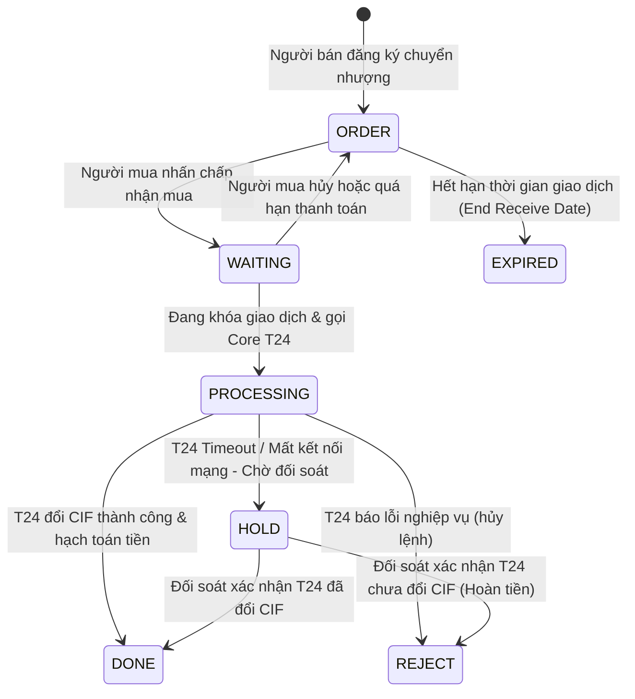

# CHUYÊN ĐỀ 4: NGHIỆP VỤ NGÂN HÀNG LÕI, TEMENOS T24 & CỔNG NAPAS 247

> **Mục tiêu**: Nắm vững nghiệp vụ ngân hàng cốt lõi và các phân hệ tích hợp huyết mạch.  
> **Căn cứ thực nghiệm**: Phân tích chuyên sâu từ kiến trúc Core Banking T24 OFS Adapter, NAPAS Interbank Switch Gateway, Online Deposit Contract Marketplace, và Billing Orchestration Engine theo chuẩn tuyển dụng ACB 2026.

---

## 1. TỔNG QUAN NGHIỆP VỤ NGÂN HÀNG BÁN LẺ & DOANH NGHIỆP

| Phân hệ nghiệp vụ | Khái niệm & Nghiệp vụ cốt lõi | Các trường thông tin quan trọng | Rủi ro kỹ thuật cần kiểm soát |
|:---|:---|:---|:---|
| **Tài khoản thanh toán (CASA)** | Tiền gửi không kỳ hạn, phục vụ thanh toán hàng ngày, thấu chi (Overdraft), tính lãi hàng ngày theo phương pháp tích luỹ. | `account_no`, `cif_id`, `balance`, `available_balance`, `hold_amount`, `currency`, `status`. | Không bao giờ được đọc `balance` thuần túy mà phải kiểm tra `available_balance = balance - hold_amount + hạn mức thấu chi còn được dùng`. |
| **Tiền gửi tiết kiệm (Term Deposit - AZ)** | Sổ tiết kiệm có kỳ hạn (1, 3, 6, 12 tháng), trả lãi cuối kỳ, trả lãi hàng tháng hoặc trả lãi trước; tất toán trước hạn hưởng lãi không kỳ hạn. | `contract_no`, `principal_amount`, `interest_rate`, `open_date`, `maturity_date`, `rollover_type`. | Tính toán tiền lãi chính xác đến từng đồng theo số ngày thực tế trong năm (365 ngày); xử lý quay vòng vốn gốc/lãi tự động (Rollover). |
| **Tài chính tiêu dùng & Cho vay (Consumer Finance - LOS/LMS)** | Vay tiêu dùng tín chấp/thế chấp, phê duyệt hồ sơ vay (LOS), quản lý hợp đồng vay (LMS), giải ngân (Disbursement) qua tài khoản/thẻ, trích nợ tự động thu nợ gốc/lãi (Mirae Asset Finance domain). | `application_id`, `loan_id`, `cif`, `approved_amount`, `interest_rate`, `tenor_months`, `emi_amount`, `disbursement_status`, `overdue_days`. | Chống gian lận eKYC (Identity Theft); tính toán lịch trả nợ cố định (EMI / Amortization Schedule); phân loại nợ quá hạn (Nhóm 1 đến Nhóm 5) theo Thông tư 31/2024/TT-NHNN (thay Thông tư 11/2021); ngăn chặn giải ngân trùng lặp (Double Disbursement). |
| **Khoản vay & Tín dụng (Core Loans & Arrangements)** | Hạn mức tín dụng, giải ngân theo khế ước, lịch trả nợ gốc và lãi định kỳ, phân loại nợ quá hạn (CIC). | `loan_contract_id`, `limit_amount`, `disbursed_amount`, `next_due_date`, `penalty_rate`. | Tính toán phạt chậm trả (Penalty Interest); khóa chặn giải ngân vượt hạn mức phê duyệt. |
| **Lệnh trích nợ định kỳ (Standing Order - STO)** | Tự động trích nợ tài khoản khách hàng thanh toán tiền điện, nước, trả góp hàng tháng theo lịch hẹn. | `standing_order_id`, `period_unit`, `period_count`, `next_run_date`, `retry_count`. | Tránh trừ nợ lặp lại khi batch job chạy lại; xử lý trường hợp tài khoản không đủ số dư. |
| **Tài khoản định danh (Virtual Account - VA)** | Dải số tài khoản ảo sinh tự động cấp cho khách hàng doanh nghiệp/Fintech để định danh nguồn tiền nộp vào. | `virtual_acc_no`, `real_acc_no`, `prefix`, `payer_cif`, `expiry_date`. | Tra cứu tức thời trong sub-50ms; cập nhật trạng thái thu hộ theo thời gian thực (Webhook/Push). |

---

## 1.1. CHUYÊN SÂU TÀI CHÍNH TIÊU DÙNG & HỆ THỐNG QUẢN LÝ VAY (LENDING TECH - MIRAE ASSET DOMAIN)

Trong lĩnh vực Fintech và Công ty Tài chính tiêu dùng (như Mirae Asset Finance), hệ thống lõi được cấu thành từ 2 phân hệ trung tâm:
1. **Loan Origination System (LOS - Hệ thống Khởi tạo & Thẩm định Khoản vay)**:
   - **Luồng nghiệp vụ**: Khách hàng nộp hồ sơ $\to$ eKYC (OCR giấy tờ tùy thân, Liveness check nhận diện khuôn mặt 3D) $\to$ Chống gian lận thiết bị/IP $\to$ Tra cứu thông tin lịch sử tín dụng CIC $\to$ Chấm điểm tín dụng (Credit Scoring Model) $\to$ Đưa qua Ma trận Quyết định (Decision Matrix Rule Engine) $\to$ Phê duyệt tự động hạn mức & lãi suất $\to$ Ký hợp đồng điện tử (E-contract).
   - **Kiến trúc kỹ thuật**: Microservices điều phối quy trình dài (Long-running process) bằng SAGA / Camunda BPMN. Xử lý bất đồng bộ các lời gọi API tra cứu bên thứ ba (CIC, Bộ Công An, Telco Data) qua Kafka để duy trì trải nghiệm người dùng không bị đơ gián đoạn.
2. **Loan Management System (LMS - Hệ thống Quản trị & Vận hành Khoản vay)**:
   - **Giải ngân tự động (Automated Disbursement)**: Khi hợp đồng hoàn tất, LMS kích hoạt lệnh giải ngân tiền vào tài khoản ngân hàng của khách hàng thông qua cổng thanh toán liên ngân hàng (NAPAS 247). Bắt buộc phải có **Idempotency Key** và cơ chế khóa tài khoản giải ngân để ngăn ngừa giải ngân trùng 2 lần.
   - **Công thức tính Lịch trả nợ định kỳ cố định (Equated Monthly Installment - EMI)**:
     $$\text{EMI} = P \times \frac{r(1+r)^n}{(1+r)^n - 1}$$
     *(Trong đó: $P$ là Số tiền vay gốc, $r$ là Lãi suất tháng $= \text{Lãi suất năm} / 12$, $n$ là Số tháng vay)*.
   - **Thu nợ & Phân loại nợ (Collection & Delinquency)**:
     - Tự động trích nợ qua liên kết tài khoản ngân hàng (Auto-debit) vào ngày thanh toán (Due Date).
     - Theo dõi số ngày quá hạn (Days Past Due - DPD) theo Thông tư 31/2024/TT-NHNN (thay Thông tư 11/2021, sửa đổi bởi Thông tư 37/2025): Nhóm 1 quá hạn dưới 10 ngày; Nhóm 2 từ 10 đến 90 ngày; Nhóm 3 từ 91 đến 180 ngày; Nhóm 4 từ 181 đến 360 ngày; Nhóm 5 trên 360 ngày (Nhóm 3–5 là nợ xấu; nguồn thứ cấp: cafef.vn 21/07/2026, hethongphapluat.com, truy cập 2026-11-10, chưa đối chiếu được nguyên văn Điều 10). Nợ cơ cấu lại được phân nhóm theo quy định riêng. Cập nhật báo cáo CIC định kỳ.

---

## 1.2. HỆ SINH THÁI TÍN DỤNG BÁN LẺ & THẤU CHI TOÀN DIỆN TẠI NGÂN HÀNG (RETAIL LENDING & OVERDRAFT HUB)

Tại các ngân hàng thương mại hiện đại, bài toán Tích hợp Tín dụng (Lending Integration) không chỉ đơn thuần là tra cứu CIC, mà là **hệ sinh thái sản phẩm tín dụng số đa dạng** kết nối đa hệ thống (Retail Lending Integration Gateway điều phối nhiều API endpoint, tuyến APIC và microservice nghiệp vụ; số lượng cụ thể chỉ nêu nếu có nguồn):

### 1. Thấu chi Cầm cố Sổ tiết kiệm (Term Deposit Overdraft & Collateral Pledge)
- **Nghiệp vụ cốt lõi**: Khách hàng đang có sổ tiết kiệm có kỳ hạn (Term Deposit T24) cần tiền gấp nhưng không muốn tất toán sớm để tránh bị mất toàn bộ tiền lãi có kỳ hạn. Ngân hàng cấp hạn mức thấu chi (Overdraft Limit) vào tài khoản thanh toán CASA của khách hàng bằng cách cầm cố chính sổ tiết kiệm đó.
- **Quy trình Tích hợp Kỹ thuật**:
  1. *Thẩm định tài sản bảo đảm*: Gọi các dịch vụ quản lý tài khoản tiền gửi để kiểm tra số dư gốc, kỳ hạn và trạng thái của sổ tiết kiệm. Quản lý bản ghi phong tỏa và dữ liệu liên kết thấu chi qua kho lưu trữ cơ sở dữ liệu phân tán.
  2. *Phong tỏa số dư sổ tiết kiệm*: Phát bản tin OFS (chuỗi văn bản phân cách) sang Core T24 qua luồng sự kiện phong tỏa tài sản (`collateral-hold-events` qua T24 adapter) để khóa (Hold/Block) số tiền cầm cố. Tuyệt đối không cho phép rút gốc khi đang có dư nợ thấu chi.
  3. *Cấp hạn mức thấu chi*: Tỷ lệ cấp hạn mức (Loan-to-Value - LTV) thường từ **85% đến 90%** giá trị sổ tiết kiệm (con số minh họa; tỷ lệ thật do chính sách từng ngân hàng quy định). Gọi service hạn mức Core T24 để mở hạn mức thấu chi trên sổ cái.
  4. *Tính lãi suất bù trừ chênh lệch (Spread Interest Rate)*: Lãi suất thấu chi $=$ Lãi suất tiền gửi $+$ Biên độ Spread (ví dụ minh họa: $2.0\% \text{--} 2.5\%$/năm; biên độ thật theo chính sách từng ngân hàng). Khách hàng chỉ phải trả lãi cho số tiền thực tế rút thấu chi và số ngày sử dụng thực tế.
  5. *Tất toán & Giải chấp tự động*: Khi khách hàng hoàn trả số dư thấu chi hoặc khi sổ tiết kiệm đến ngày đáo hạn, hệ thống kích hoạt luồng quy trình nghiệp vụ tự động cấn trừ gốc lãi và giải tỏa phong tỏa số dư còn lại trả về CASA cho khách hàng.

### 2. Cầm cố Sổ tiết kiệm Đồng sở hữu / Bên thứ ba bảo lãnh (Pledge Savings with Related Parties)
- **Nghiệp vụ**: Khách hàng vay vốn sử dụng sổ tiết kiệm đứng tên đồng sở hữu (ví dụ: vợ chồng) hoặc sổ tiết kiệm của người thân bảo lãnh thế chấp.
- **Tích hợp Kỹ thuật**:
  - Dữ liệu lưu trữ tập trung tại bảng đăng ký thế chấp và thông tin các bên liên quan.
  - *Luồng ký số tuần tự đa bên (Multi-party Sequential E-Signing)*: Microservice phát sinh phiên ký số đám mây qua Cloud CA E-Sign Gateway. Từng bên liên quan đăng nhập OMNI App, xác thực khuôn mặt theo chính sách xác thực người ký của ngân hàng và ký số Cloud CA. Chỉ khi 100% bên liên quan hoàn tất ký số, hệ thống mới phát lệnh phong tỏa sổ trên T24.

### 3. Thấu chi Lương Tín chấp (Unsecured Payroll Overdraft)
- **Nghiệp vụ**: Cấp hạn mức chi tiêu vượt số dư cho khách hàng cá nhân nhận lương qua tài khoản ngân hàng mà không cần tài sản thế chấp.
- **Tích hợp Kỹ thuật**:
  - Tích hợp với phân hệ Chi lương Doanh nghiệp theo lô: Thuật toán tự động phân tích dòng tiền nhận lương định kỳ trong 3–6 tháng gần nhất.
  - Tự động đưa khách hàng đủ điều kiện vào danh sách Whitelist phê duyệt trước.
  - Khi khách hàng đăng ký online: Hệ thống tự động cấp hạn mức thấu chi tín chấp theo bội số lương tháng (ví dụ minh họa: 2–3 lần; bội số thật theo chính sách ngân hàng), phê duyệt tự động trong thời gian ngắn. Hỗ trợ tất toán trước hạn linh hoạt.

### 4. Vay trên Hạn mức Thẻ Tín dụng & Phát hành Thẻ ảo tức thì
- **Nghiệp vụ**: Chuyển đổi hạn mức thẻ tín dụng chưa sử dụng thành khoản vay trả góp tiền mặt (Line of Credit - LoC) hoặc phát hành thẻ tín dụng ảo (Virtual Credit Card) tức thời để mua sắm online.
- **Tích hợp Kỹ thuật**:
  - Kết nối dịch vụ Quản trị Thẻ (CMS) và Loan Origination System (LOS) Adapter, tự động đồng bộ hạn mức với Hệ thống Quản trị Thẻ và Core T24.
  - Quản lý phương án vay, ma trận lãi suất và phí chuyển đổi trả góp theo kỳ hạn.

### 5. Ký số Hợp đồng Tín dụng Đám mây (Cloud CA) & Sinh trắc học QĐ 2345
- **Tích hợp Cloud CA E-Sign Gateway**: Khách hàng không cần ra quầy hay dùng USB Token. Hệ thống tích hợp dịch vụ ký số từ xa (Remote Signing / Cloud CA) để tạo chứng thư số cá nhân trên đám mây.
- **Bảo mật kép**: Kết hợp quét khuôn mặt sống (Liveness) và mã OTP để xác thực người ký theo chính sách ngân hàng, rồi mới kích hoạt khóa ký tại nhà cung cấp dịch vụ ký số; dấu thời gian do dịch vụ cấp dấu thời gian (TSA) cấp, không phải do OTP. Căn cứ pháp lý: Luật Giao dịch điện tử 2023 và Nghị định 23/2025/NĐ-CP về chữ ký điện tử và dịch vụ tin cậy (thay Nghị định 130/2018, hiệu lực 10/04/2025). (QĐ 2345 điều chỉnh giao dịch thanh toán trực tuyến, không điều chỉnh việc ký hợp đồng.)
- **Lưu trữ Kho văn bản số ECM**: Hợp đồng PDF sau khi ký số được tự động mã hóa và đồng bộ sang Kho lưu trữ Văn bản Doanh nghiệp (Enterprise Content Management - ECM).

### 6. Cổng CIC B2B, Mô hình Chấm điểm & Giải ngân Idempotent
- Tích hợp kênh truyền mTLS/VPN với Cổng CIC NHNN, phân loại 5 nhóm nợ (Thông tư 31/2024/TT-NHNN, thay Thông tư 11/2021), kiểm soát trần DTI theo chính sách tín dụng (ví dụ minh họa: 45%).
- Kích hoạt giải ngân tự động qua NAPAS 247 được bảo vệ bởi khóa phân tán Redis Mutex (`disbursement:lock:{app_id}`) với TTL 300 giây và cơ chế bù trừ SAGA Compensation.
- Tự động trích nợ từng phần (Partial Debit) vào ngày đến hạn thanh toán từ tài khoản CASA, đồng bộ trạng thái hợp đồng trên Core T24.

---

## 2. TÍCH HỢP CORE BANKING TEMENOS T24 QUA OFS & IBM MQ

### 2.1. Cấu trúc bản tin OFS (Open Financial Service)
Temenos T24 giao tiếp với bên ngoài thông qua bản tin OFS: một chuỗi văn bản gồm 5 phần phân cách bằng dấu phẩy (Operation, Options, User information, Transaction ID, Message data). Dạng XML chỉ có khi dùng adapter riêng (OFSML, IRIS/TAFJ), không phải OFS gốc:
```
APPLICATION,VERSION/FUNCTION/PROCESS/GTSCONTROL/NO.OF.AUTH,USER/PASSWORD/COMPANY,TRANSACTION.ID,FIELD:MULTIVALUE:SUBVALUE=VALUE,...
```
- **Ví dụ bản tin hạch toán chuyển tiền (FUNDS.TRANSFER)** (Transaction ID để trống để T24 tự sinh mã FT; tên version, user và mật khẩu chỉ là ví dụ minh họa, thực tế không hard-code mật khẩu):
  ```text
  FUNDS.TRANSFER,ACT.TRANSFER/I/PROCESS,USER01/123456,,TRANSACTION.TYPE=AC,DEBIT.ACCT.NO=1001234567,DEBIT.AMOUNT=500000,DEBIT.CURRENCY=VND,CREDIT.ACCT.NO=2009876543,ORDERING.CUST:1=PHAM MINH DUC,PAYMENT.DETAILS:1=CHUYEN TIEN HOC PHI
  ```
- **Ví dụ bản tin truy vấn hợp đồng vay (ENQUIRY)**:
  `ENQUIRY.SELECT,,USER01/123456,ENQ_T24_LD_HIS_RPM_NOM_VN,CONTRACT.NUMBER:EQ=LD240012345`

### 2.2. Kiến trúc Adapter Vert.x & IBM MQ (Core Banking T24 OFS Adapter)
Trong hệ thống tích hợp ngân hàng, module Core Banking Adapter được viết bằng Java Vert.x kết nối với IBM MQ để xử lý tải cao bất đồng bộ:

```
[Microservices (REST)] 
         |
         v (HTTP Non-blocking)
[Core Banking Adapter (Vert.x Java)]
         |
         | (Put Message with JMSCorrelationID)
         v
+------------------------+          +------------------------+
| IBM MQ: T24.OFS.IN     | -------> | Temenos T24 OFS Server |
+------------------------+          +------------------------+
                                                 |
+------------------------+                       |
| IBM MQ: T24.OFS.OUT    | <---------------------+
+------------------------+
         |
         | (Consume Message by CorrelationID)
         v
[Async Callback Handler] ---> Trả phản hồi HTTP cho Microservice
```

### 2.3. Bóc tách trường đa trị (Multi-Value Fields)
Trong T24, một trường có thể chứa nhiều giá trị phân tách bằng dấu phân cách (Value/Sub-value markers). Ví dụ lịch sử trả nợ khoản vay:
```text
// Cấu trúc phân tích cú pháp trong t24-adapter
mvPosition:
  TRANS.AMOUNT      -> transAmount
  PRIN.AMT          -> prinAmount
  INT.PEN.AMOUNT    -> intPenAmount
  BOOKING.DATE      -> dateTrans
  CURRENCY          -> currency
```
Adapter phân tích chuỗi nhị phân/chuỗi ký tự, ánh xạ các chỉ số vị trí mảng vào đối tượng POJO Java an toàn.

### 2.4. Ma trận xử lý mã lỗi T24 & Cơ chế HOLD / REVERT
Bản tin trả về của OFS có dạng `TRANSACTION.ID/MESSAGE.ID/SUCCESS.INDICATOR,...`, trong đó chỉ báo thành công là `1` (thành công), `-1` (lỗi), `-2` (override), `-3` (T24 offline). Các mã dưới đây là **mã lỗi nội bộ của adapter** (do đội tích hợp tự quy ước), không phải mã chuẩn của T24:
- **`01 NotFound`**: Không tìm thấy bản ghi $\to$ Trả về mã lỗi 404 cho client.
- **`EXECUTE_FAIL`**: Lỗi nghiệp vụ (tài khoản không đủ số dư, tài khoản bị đóng) $\to$ Trả về lỗi 422 cho client.
- **Mã lỗi nguy hiểm cao (`04 Timeout`, `05 Network`, `999 System`, `1014-1018 Account In-doubt`)**:
  - Không được trả lỗi thất bại ngay lập tức!
  - Trạng thái giao dịch chuyển thành **`HOLD` hoặc `SHOULD_REVERT`**.
  - Kích hoạt tiến trình truy vấn đối soát (Reconciliation Enquiry) kiểm tra xem bản ghi đã ghi vào sổ cái Core T24 hay chưa trước khi quyết định bồi hoàn hoặc tiếp tục.

---

## 3. CỔNG THANH TOÁN LIÊN NGÂN HÀNG NAPAS 247 & CHUẨN ISO 8583

### 3.1. Cấu trúc bản tin tài chính ISO 8583
Cổng NAPAS 247 Interbank Switch Gateway giao tiếp với Switch NAPAS thông qua kết nối Socket TCP. Lưu ý: dịch vụ chuyển tiền nhanh NAPAS 247 theo đặc tả kết nối riêng của NAPAS (gốc ISO 8583); hệ thống ACH của NAPAS đã dùng ISO 20022. Đặc tả bản tin cụ thể của 247 hiện hành **cần kiểm với tài liệu NAPAS**. Phần dưới đây mô tả cấu trúc theo ISO 8583:1987:

```
+---------------+-----------+--------------------+----------------------+-----------------------------+
| Header độ dài | MTI       | Primary Bitmap     | Secondary Bitmap     | Data Fields                 |
| (2 hoặc 4 byte| (4 ký tự) | (64 bit / 8 byte)  | (có khi bit 1 bật;   | Field 3, 4, 11, 37, 102,    |
| tùy đặc tả)   |           | trường 1–64        | trường 65–128)       | 103, 128...                 |
+---------------+-----------+--------------------+----------------------+-----------------------------+
```
Muốn dùng các trường 102, 103, 128 thì bắt buộc có Secondary Bitmap.

- **Message Type Identifier (MTI)**:
  - `0200`: Financial Transaction Request (Yêu cầu chuyển tiền từ Ngân hàng chuyển sang NAPAS).
  - `0210`: Financial Transaction Response (NAPAS phản hồi kết quả chuyển tiền).
  - `0400`: Reversal Request (Yêu cầu đảo giao dịch).
  - `0420`: Reversal Advice (Thông báo đảo giao dịch, ví dụ khi timeout; gửi lặp `0421` đến khi nhận `0430`).
  - `0430`: Reversal Advice Response (Phản hồi thông báo đảo).
  - Cơ chế đảo/tra soát cụ thể của NAPAS 247 **cần kiểm với tài liệu NAPAS**.
- **Các trường dữ liệu quan trọng nhất (Data Elements)**:
  - **Field 3 (Processing Code)**: Mã xử lý theo ISO 8583:1987 (ví dụ: `40xxxx` = Chuyển khoản giữa các tài khoản; `31xxxx` = Truy vấn số dư). Mã xử lý dùng cho chuyển khoản 247 của NAPAS **cần kiểm với tài liệu NAPAS**.
  - **Field 4 (Amount)**: 12 chữ số; số chữ số thập phân ngầm định theo ISO 4217 (VND = 0), nên `000000500000` = 500.000 VND, trừ khi đặc tả NAPAS quy định khác (cần kiểm với tài liệu NAPAS).
  - **Field 11 (STAN - System Trace Audit Number)**: Số tham chiếu kiểm toán 6 chữ số sinh duy nhất cho mỗi giao dịch trong ngày.
  - **Field 37 (RRN - Retrieval Reference Number)**: Số tham chiếu 12 chữ số dùng để đối soát liên ngân hàng.
  - **Field 39 (Response Code)**: Mã kết quả:
    - `00`: Giao dịch thành công (Approved).
    - `05`: Từ chối giao dịch (Do not honor).
    - `51`: Không đủ số dư (Insufficient funds).
    - `68`: Giao dịch timeout / Chờ đối soát (Response received too late).
  - **Field 102 & 103**: Số tài khoản nguồn và số tài khoản đích.
  - **Field 128 (MAC - Message Authentication Code)**: Mã xác thực bảo vệ toàn vẹn bản tin (cần Secondary Bitmap; nếu chỉ có Primary Bitmap thì MAC nằm ở Field 64).

### 3.2. Bảo mật phần cứng HSM & Xử lý mã PIN
- PIN block (Field 52) chỉ có ở giao dịch thẻ (ATM/POS). Chuyển khoản tài khoản trên ứng dụng di động không mang PIN block. Việc xử lý PIN tuân theo PCI PIN Security Requirements; PCI DSS cấm lưu PIN/PIN block sau khi cấp phép:
  - Mã PIN được đóng gói thành **PIN Block theo ISO 9564-1**:
    - Format 0: $\text{PIN Block} = [0 \,\|\, N \,\|\, \text{PIN} \,\|\, \text{đệm F}] \oplus [0000 \,\|\, \text{12 chữ số PAN bên phải, không gồm số kiểm tra}]$ ($N$ là độ dài PIN).
    - Format 1: $[1 \,\|\, N \,\|\, \text{PIN} \,\|\, \text{đệm ngẫu nhiên}]$, không dùng PAN.
  - Khi bản tin ISO 8583 đi vào NAPAS Switch Gateway, gateway gọi dịch vụ HSM để **dịch mã (translate)** PIN block, không phải giải mã. Thiết bị HSM dịch PIN block từ ZPK của NAPAS sang ZPK của ngân hàng (lệnh payShield `CC`) hoặc sang LMK để kiểm tra PIN (`JE`); với PIN từ ATM/POS dùng `CA` (TPK→ZPK) hoặc `JC` (TPK→LMK). PIN rõ không bao giờ ra khỏi HSM. ZMK chỉ là khóa mã hóa để trao đổi ZPK, không dùng để mã hóa PIN.
  - Mặt nạ dữ liệu thẻ: số thẻ PAN (Field 2) được che 6 số đầu/4 số cuối `123456******7890` trước khi ghi vào log file.

### 3.3. Khử trùng lặp giao dịch (Redis Deduplication)
- Khi mạng chập chờn, NAPAS Switch có thể gửi lại gói tin `0200` nhiều lần:
  - Gateway trích xuất `transId = Mã tổ chức gửi (Field 32) + STAN + RRN + Date`.
  - Thực thi lệnh nguyên tử trong Redis: `SET dedup:napas:<transId> "PROCESSING" NX EX 60`.
  - Nếu Redis trả về `null` (khóa đã tồn tại) $\to$ Gói tin bị trùng lặp! Gateway lập tức bỏ qua không hạch toán lại vào Core và trả lại phản hồi `0210` theo kết quả của lần xử lý trước.

---

## 4. SÀN GIAO DỊCH CHUYỂN NHƯỢNG HỢP ĐỒNG TIỀN GỬI (Online Deposit Contract Marketplace)

Trích xuất quy trình nghiệp vụ chuyển nhượng sổ tiết kiệm trực tuyến:



- **Cơ chế Khóa Lạc quan (Optimistic Locking)**:
  ```sql
  UPDATE transaction 
  SET status = 'PROCESSING', receive_cif = $1, last_access = NOW()
  WHERE order_id = $2 AND channel = $3 AND order_date = $4 AND last_access = $5;
  ```
  Nếu có 2 người mua cùng click đồng thời, chỉ người có giá trị `last_access` khớp với DB mới cập nhật được 1 dòng (`rows_affected == 1`). Người thứ hai nhận `rows_affected == 0`, hệ thống trả mã lỗi `409 Conflict` tức thì mà không gây nghẽn database.
- **Tích hợp T24 OFS**:
  Gọi `t24DepositContractCaller.UpdateCif` thực hiện 2 bản tin:
  1. `ACCOUNT_T24_DEPOSIT_OFS`: Mở/Chuyển thông tin tài khoản tiết kiệm sang người thụ hưởng mới.
  2. `AZ_ACCOUNT_T24_OFS_AMD`: Điều chỉnh quyền sở hữu CIF của hợp đồng tiền gửi trên Core Banking.

---

## 5. PAYMENT HUB & QUY TRÌNH ĐỐI SOÁT TỰ ĐỘNG (RECONCILIATION)

1. **Đối soát 3 bên (Three-Way Reconciliation)**:
   - File log giao dịch của Kênh số (Mobile/Internet Banking).
   - Báo cáo hạch toán sổ cái của Core Banking (T24).
   - File kết quả đối soát của Đối tác (NAPAS / EVN / Viễn thông / Thuế).
2. **Quy trình chạy EOD tự động**:
   - 23:59:00 hàng ngày, Cron job tải file đối soát từ SFTP đối tác.
   - ETL nạp dữ liệu vào bảng tạm `billing_reconciliation`.
   - Thực hiện câu lệnh SQL so khớp (Outer Join) để tìm ra 3 nhóm:
     - Nhóm 1 (Khớp 100%): Cả 3 bên đều thành công.
     - Nhóm 2 (Lệch chiều 1): Ngân hàng trừ tiền thành công nhưng đối tác báo chưa nhận được tiền $\to$ Kích hoạt bồi hoàn hoàn tiền cho khách.
     - Nhóm 3 (Lệch chiều 2): Đối tác báo đã thu tiền nhưng ngân hàng chưa trừ nợ $\to$ Tạo lệnh hạch toán bù trích nợ tài khoản.

---

## 6. HỆ THỐNG STREAMING SỰ KIỆN QUA KSQLDB VÀ NOTIFICATION HUB (SMS, OTT, EMAIL)

### 6.1. Bối cảnh & Yêu cầu Nghiệp vụ
- Khi khách hàng phát sinh giao dịch chuyển khoản, quẹt thẻ hoặc nhận lương, kỳ vọng của khách hàng và chỉ tiêu nội bộ của ngân hàng là **thông báo biến động số dư tới điện thoại gần như tức thời** (mục tiêu thiết kế, ví dụ minh họa: dưới 1 giây; đây không phải quy định của NHNN).
- Khối lượng giao dịch ngân hàng hàng ngày có thể rất lớn (con số cụ thể chỉ nêu nếu có nguồn). Nếu mỗi microservice tự gọi trực tiếp sang nhà mạng viễn thông (SMS Telco Gateway) hoặc máy chủ email, hệ thống sẽ sập do nghẽn I/O và lãng phí chi phí cước viễn thông khổng lồ.

### 6.2. Kiến trúc Streaming Sự kiện qua ksqlDB & Kafka
```
[Core T24 / SAGA DB] 
       │ (Debezium CDC / App Events)
       ▼
 [Kafka Topic: balance-changes]
       │
       ▼
 [ksqlDB Stream Processing Engine]
   • STREAM-TABLE JOIN với customer-profiles (lấy cài đặt nhận tin, SĐT, Email)
   • FILTER: Lọc ngưỡng số tiền tối thiểu (ví dụ minh họa: > 50,000 VND) để tối ưu chi phí SMS
   • ROUTE: Phân luồng OTT Push (Ưu tiên 1 - Miễn phí) vs SMS (Ưu tiên 2 - Có phí)
       │
       ▼
 [Kafka Topics: noti.sms.urgent | noti.ott.push | noti.email.digest]
       │
       ▼
 [Omnichannel Notification Hub Microservices]
   • Dynamic Concurrency Workers
   • Priority Queue (OTP / Cảnh báo gian lận > Biến động số dư > Tin sao kê)
   • Telco Circuit Breaker & Failover (Viettel ↔ VinaPhone (VNPT) ↔ MobiFone)
   • Dead Letter Queue (DLQ) & Exponential Retry
```

### 6.3. Truy vấn ksqlDB cốt lõi trong xử lý biến động số dư
```sql
-- 1. Tạo Stream sự kiện biến động số dư từ Kafka
CREATE STREAM s_balance_events (
    event_id VARCHAR KEY,
    account_no VARCHAR,
    amount DOUBLE,
    balance DOUBLE,
    trans_type VARCHAR,
    channel VARCHAR,
    created_at VARCHAR
) WITH (
    KAFKA_TOPIC = 'core.balance.events',
    VALUE_FORMAT = 'JSON'
);

-- 2. Tạo Table lưu thông tin ưu tiên nhận tin nhắn của khách hàng
CREATE TABLE t_customer_preferences (
    account_no VARCHAR PRIMARY KEY,
    customer_id VARCHAR,
    phone_number VARCHAR,
    email VARCHAR,
    is_app_installed BOOLEAN,
    enable_sms BOOLEAN,
    min_sms_amount DOUBLE
) WITH (
    KAFKA_TOPIC = 'crm.customer.preferences',
    VALUE_FORMAT = 'JSON'
);

-- 3. Thực hiện Stream-Table Join để phân luồng thông báo tự động
CREATE STREAM s_routed_notifications AS
SELECT 
    e.event_id AS noti_id,
    e.account_no,
    e.amount,
    e.balance,
    e.trans_type,
    p.phone_number,
    p.email,
    CASE 
        WHEN p.is_app_installed = TRUE THEN 'OTT_PUSH'
        WHEN p.enable_sms = TRUE AND e.amount >= p.min_sms_amount THEN 'SMS_BRANDNAME'
        ELSE 'EMAIL'
    END AS target_channel,
    CASE 
        WHEN e.trans_type = 'OTP' OR e.amount >= 10000000 THEN 'HIGH'
        ELSE 'NORMAL'
    END AS priority
FROM s_balance_events e
LEFT JOIN t_customer_preferences p ON e.account_no = p.account_no
EMIT CHANGES;
```

### 6.4. Các bài toán Kỹ thuật Senior tại Notification Hub
1. **Khử trùng lặp thông báo (Message Deduplication)**:
   - Dùng Redis `SET noti:sent:{event_id} 1 EX 86400 NX`. Nếu trả về `nil` (khóa đã tồn tại), worker bỏ qua để giảm thiểu việc khách hàng nhận 2 tin nhắn SMS trừ tiền giống nhau (Kafka giao ít nhất một lần, nên không thể cam kết tuyệt đối không trùng).
2. **Kiểm soát nghẽn mạng Viễn thông (Telco Rate Limiting)**:
   - Áp dụng Token Bucket Algorithm kiểm soát tốc độ gửi qua SMS Vendor không vượt quá hạn ngạch (ví dụ 500 TPS/nhà mạng).
   - Khi nhà mạng báo lỗi `HTTP 429 Too Many Requests` hoặc `503 Service Unavailable`, tự động kích hoạt Failover sang cổng Telco dự phòng (mục tiêu thiết kế, ví dụ minh họa: trong vòng 200ms).
3. **Quản lý hàng đợi tin lỗi (Dead Letter Queue - DLQ)**:
   - Mọi bản tin không gửi thành công sau 3 lần thử lại (`Exponential Backoff`: 1s, 5s, 15s) được đẩy vào `noti.dlq.events` kèm toàn bộ header nguyên nhân lỗi để đội vận hành kiểm tra và phát lại khi hạ tầng đối tác phục hồi.

---

## 7. KIẾN TRÚC SAO KÊ TÀI KHOẢN CAO TẢI, CHI LƯƠNG THEO LÔ & SINH TRẮC HỌC QĐ 2345

### 7.1. Xử lý Sao kê Tài khoản khối lượng lớn với Kafka Streams Divide-and-Conquer
- **Thách thức**: Doanh nghiệp lớn yêu cầu xuất sao kê hàng triệu giao dịch mỗi tháng. Nếu query trực tiếp vào Core T24 hay ODS bằng SQL `BETWEEN date1 AND date2`, cơ sở dữ liệu sẽ bị nghẽn I/O và treo các tiến trình giao dịch trực tuyến.
- **Giải pháp Divide-and-Conquer (Chia để trị)**:
  1. *Phân đoạn truy vấn (Partitioning & Chunking)*: Khoảng thời gian sao kê (ví dụ 30 ngày) được băm nhỏ thành các block nhỏ theo ngày hoặc tuần.
  2. *Kafka Streams Parallel Pipeline*: Mỗi block được phát tán vào các phân vùng Kafka khác nhau. Các worker của cụm Kafka Streams xử lý song song, đọc từ read-replica database mà không can thiệp vào master ledger.
  3. *Aggregation & Stream Assembly*: Một Stateful Stream Processor thu thập các kết quả bộ phận, sắp xếp theo thứ tự thời gian (`timestamp`), tính toán số dư lũy kế (Running Balance), và xuất ra định dạng JSON/PDF/Excel nén trả về cho khách hàng qua Object Storage (thời gian thực tế phụ thuộc khối lượng, cần đo).

### 7.2. Cổng Chi lương Doanh nghiệp theo lô (Corporate Batch Payroll Transfer)
- **Quy trình xử lý lô 10,000+ giao dịch**:
  1. *Tiếp nhận file lô*: Khách hàng doanh nghiệp tải lên file chi lương $\to$ Hệ thống phân tích cú pháp (Parsing), kiểm tra tổng tiền và số dư tài khoản trích nợ.
  2. *Transactional Outbox Pattern*: Danh sách chi tiết các lệnh con được ghi vào bảng `batch_trans_details` và bảng `outbox` trong cùng một transaction cơ sở dữ liệu để bảo đảm tính toàn vẹn (ACID).
  3. *Debezium CDC & Router Worker*: Bắt các sự kiện chi lương từ Outbox và đẩy vào Kafka topic `po.batch.transfer`. Router Worker phân luồng:
     - *Nội bộ*: Đẩy sang Core T24 Adapter để hạch toán ghi có tức thời.
     - *Liên ngân hàng*: Đẩy sang Cổng NAPAS 247 Interbank Gateway (hoặc kênh xử lý theo lô như ACH, tùy sản phẩm); định dạng bản tin cần kiểm với tài liệu NAPAS.
  4. *Batch Completion Consumer*: Theo dõi trạng thái từng lệnh con qua Redis bitset hoặc cơ sở dữ liệu. Khi toàn bộ 10,000 lệnh hoàn tất (thành công hoặc thất bại), tự động kích hoạt thông báo tổng kết cho kế toán trưởng doanh nghiệp.

### 7.3. Cổng Xác thực Sinh trắc học QĐ 2345 (National Biometric & VNeID Gateway)
- **Quyết định 2345/QĐ-NHNN** (ban hành 18/12/2023, hiệu lực 01/07/2024):
  - Giao dịch chuyển tiền trực tuyến trên 10 triệu VND/lần, hoặc giao dịch làm tổng giá trị trong ngày vượt 20 triệu VND, phải xác thực sinh trắc học; dữ liệu sinh trắc học được so khớp với dữ liệu đã thu thập và kiểm tra khớp với chip CCCD, hoặc qua tài khoản VNeID (chi tiết các giao dịch tiếp theo trong ngày: cần đối chiếu văn bản gốc).
- **Kiến trúc tích hợp an toàn**:
  - *Mobile SDK*: Bắt khuôn mặt người dùng (Liveness Detection - chống video giả mạo / deepfake) và trích xuất dữ liệu khuôn mặt đã mã hóa.
  - *Biometric Orchestration Service*: Tiếp nhận dữ liệu và so khớp với mẫu sinh trắc học khách hàng đã đăng ký tại ngân hàng (mẫu này đã được đối chiếu với chip CCCD/VNeID lúc đăng ký); kết nối tới hệ thống xác thực của Bộ Công an (C06) chủ yếu dùng ở bước đăng ký/đối chiếu, qua kênh riêng và mTLS.
  - *Tích hợp luồng SAGA*: Bước kiểm tra sinh trắc học được đặt là điều kiện tiên quyết (Pre-condition) trước khi sinh bản tin hạch toán sang Core Banking T24 hoặc NAPAS. Nếu xác thực không thành công, giao dịch bị chặn ngay tại tầng Gateway trước khi trích nợ.

---

## 8. HỆ THỐNG THU HỘ QUA TÀI KHOẢN ĐỊNH DANH (VIRTUAL ACCOUNT) & ĐỐI SOÁT 3 BÊN CUỐI NGÀY (3-WAY RECONCILIATION)

### 8.1. Kiến trúc Thu hộ Tự động qua Tài khoản Định danh (Virtual Account - VA)
- **Bản chất nghiệp vụ**:
  - Doanh nghiệp lớn (ví dụ: sàn thương mại điện tử, công ty bảo hiểm, công ty tài chính tiêu dùng) có nhu cầu thu tiền tự động từ hàng triệu người dùng mà không thể cấp cho mỗi người một tài khoản ngân hàng thật (tiết kiệm chi phí mở tài khoản và quản trị sổ cái).
  - Ngân hàng cấp cho đối tác một Tài khoản thực (Master Account) và một dải số tiền tố ảo (Virtual Account Prefix - ví dụ `8888`).
  - Đối tác sinh ra các số VA động: `8888 + mã_khách_hàng` hoặc `8888 + mã_đơn_hàng`.
- **Luồng xử lý thời gian thực**:
  1. Người mua chuyển tiền từ bất kỳ ngân hàng nào vào số VA qua mạng NAPAS 247.
  2. Cổng VA Router Hub bóc tách đầu số (Prefix Matching qua Radix Tree in-memory), ánh xạ sang Tài khoản thực Master của Doanh nghiệp.
  3. Cổng T24 Adapter phát lệnh `FUNDS.TRANSFER` ghi Có vào Master Account trên Core T24.
  4. Sau khi ghi Có thành công, sự kiện được phát vào Kafka topic `va.payment.success`.
  5. Webhook Dispatcher ký số HMAC-SHA256, đính kèm header `X-ACB-Event-ID`, và gửi bản tin HTTP POST sang hệ thống ERP của đối tác để gạch nợ tự động gần như tức thời.

### 8.2. Cơ chế Bảo vệ Idempotency & Quản lý Nghẽn Webhook
- **Chống gạch nợ trùng lặp**: Phía đối tác lưu `X-ACB-Event-ID` vào Redis với TTL 7 ngày (`SET key 1 EX 604800 NX`). Nếu đã tồn tại $\to$ Trả về ngay `200 OK` mà không cập nhật số dư lần 2.
- **Xử lý sập mạng đối tác**:
  - Webhook Dispatcher áp dụng cơ chế Retry theo Exponential Backoff (1s, 5s, 30s, 5m, 1h).
  - Nếu sau 5 lần đối tác vẫn lỗi $\to$ Đẩy gói tin vào Dead Letter Queue (DLQ).
  - Cung cấp API Polling để đối tác chủ động truy vấn các giao dịch thu hộ bị gián đoạn.

### 8.3. Thuật toán Đối soát 3 Bên Cuối ngày (End-of-Day 3-Way Reconciliation)
- **3 nguồn dữ liệu đối soát lúc 23:00 hàng ngày**:
  1. *Core T24 Statement*: File sao kê các giao dịch ghi Có thực tế tại ngân hàng.
  2. *NAPAS Clearing File*: File thanh quyết toán điện tử do NAPAS gửi qua SFTP.
  3. *Partner Transaction Log*: File log đơn hàng do đối tác xuất từ ERP.
- **Tối ưu hóa Thuật toán Two-Pointer Merge**:
  - Thay vì chạy vòng lặp lồng $O(N \times M)$ hoặc câu lệnh SQL JOIN làm sập database, tiến trình nạp 3 tập dữ liệu vào RAM, sắp xếp theo `transaction_reference_id` ($O(N \log N)$), và sử dụng 3 con trỏ duyệt tịnh tiến song song ($O(N)$).
  - Kết quả phân loại (thời gian xử lý thực tế phải đo; ví dụ minh họa: 3 triệu bản ghi trong vài phút):
    - **Matched**: Cả 3 bên đều khớp $\to$ Quyết toán doanh thu.
    - **Discrepancy (Lệch)**: Tự động phân loại vào 3 nhóm: Cần gạch nợ bù (do rớt webhook), Cần hạch toán bù (do timeout Core), hoặc Cần tra soát hoàn tiền (do lỗi NAPAS).

