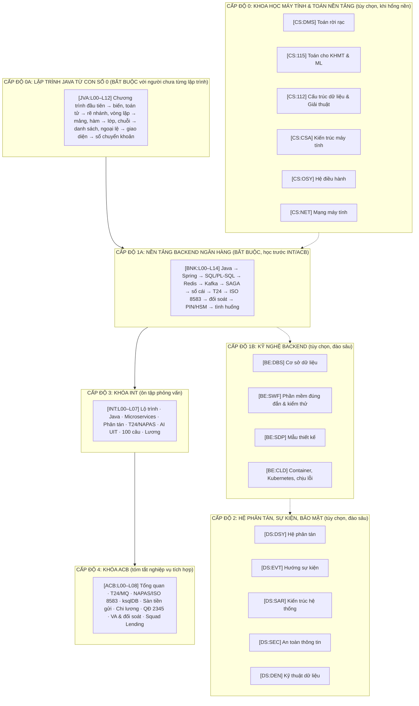

# HỆ THỐNG MÃ ĐỊNH DANH & MỤC LỤC ĐIỀU HƯỚNG TỔNG THỂ TOÀN BỘ CHƯƠNG TRÌNH
## MASTER CURRICULUM INDEX: TỪ CON SỐ 0 ĐẾN KỸ SƯ TÍCH HỢP NGÂN HÀNG CẤP CAO

> **Mục tiêu**: một nơi duy nhất tra cứu mã khóa (`CS:xxx`, `BE:xxx`, `DS:xxx`, `BNK:Lxx`, `INT:Lxx`, `ACB:Lxx`), giáo án, đặc tả, video, phụ đề và mục lục chương, kèm số đo kiểm chứng được.
> **Nguồn số liệu**: số bài đếm từ `lessons/<khóa>/L*_*.yaml` và `out/<KHÓA>/L*/L*.mp4`; thời lượng bằng `ffprobe`; "Đặc tả khớp video" so `spec_sha256` trong `build_report.json` với đặc tả hiện tại (`tools/lv.py spec_digest`). Bảng video ở Mục 4–6 sinh tự động bằng script, không gõ tay. Lần đo gần nhất ghi ở cuối mỗi bảng và trong `HANDOVER_INTERVIEW.md` Mục 9.
> **Thư viện**: 656 bài học (643 + 13 bài JVA thêm 2026-11-08; cộng 5 video mẫu `out/DEMO/`). Bản đồ toàn bộ: [`SOURCE_CODE_VIDEO_MAP.md`](file:///D:/research-video/interview/SOURCE_CODE_VIDEO_MAP.md).
> **Quy tắc trung thực**: số liệu trong bài là ví dụ minh họa hoặc mục tiêu thiết kế trừ khi ghi nguồn; xem [`README.md`](file:///D:/research-video/interview/README.md) Mục 3.

---

## BẢN ĐỒ TỔNG QUAN CÁC CẤP ĐỘ NĂNG LỰC

**Đường học tối thiểu cho người mất gốc**: JVA L00 → L12 → BNK L00 → L14 → INT L00 → L07 → ACB L00 → L08 → ngân hàng 100 câu. Các khóa Cấp độ 0, 1B, 2 dùng khi một câu hỏi lộ ra lỗ hổng nền.

---

## 1. CẤP ĐỘ 0: KHOA HỌC MÁY TÍNH & TOÁN NỀN TẢNG

| Mã môn | Tên khóa học | Số bài (đã dựng) | Nội dung thật (theo tên bài) | Lộ trình |
|:---:|:---|:---:|:---|:---:|
| `CS:DMS` | Toán rời rạc | 21 | Logic mệnh đề và lượng từ, chứng minh, quy nạp, tập hợp/hàm/quan hệ, tổ hợp, số học mô-đun và RSA, đồ thị, cây | [`dms.yaml`](file:///D:/research-video/curriculum/dms.yaml) |
| `CS:115` | Toán cho KHMT và Học máy | 46 | Vector, ma trận, trị riêng, đạo hàm/gradient, tối ưu (GD, Adam), xác suất, MLE/MAP, hồi quy, phân loại, mạng nơ-ron, SVD/PCA, học tăng cường (mở rộng) | [`cs115.yaml`](file:///D:/research-video/curriculum/cs115.yaml) |
| `CS:112` | Cấu trúc Dữ liệu và Giải thuật | 30 | Big-O, mảng/danh sách, cây AVL, bảng băm, đống, đồ thị, chia để trị, quy hoạch động, Dijkstra, cây khung, P/NP (cây B: DBS Bài 8) | [`cs112.yaml`](file:///D:/research-video/curriculum/cs112.yaml) |
| `CS:CSA` | Kiến trúc Máy tính | 17 | Biểu diễn số, IEEE 754, ALU, hợp ngữ, đường ống lệnh, cache, bộ nhớ ảo/TLB, ngắt và DMA | [`csa.yaml`](file:///D:/research-video/curriculum/csa.yaml) |
| `CS:OSY` | Hệ điều hành | 16 | Tiến trình/luồng, lập lịch, vùng găng, khóa/semaphore, bế tắc, phân trang, hệ thống tệp | [`osy.yaml`](file:///D:/research-video/curriculum/osy.yaml) |
| `CS:NET` | Mạng máy tính | 16 | Phân tầng, trễ/thông lượng, IPv4/CIDR, định tuyến, TCP bắt tay ba bước, cửa sổ trượt, tắc nghẽn, DNS/HTTP, chuỗi tin cậy TLS | [`net.yaml`](file:///D:/research-video/curriculum/net.yaml) |

---

## 1A. CẤP ĐỘ 0A: LẬP TRÌNH JAVA TỪ CON SỐ 0 — KHÓA JVA (BẮT BUỘC VỚI NGƯỜI CHƯA TỪNG LẬP TRÌNH)

*Thêm ngày 2026-11-08 vì thư viện không có khóa lập trình nhập môn. 13 bài `depth: full`; **mọi chương trình Java trên màn hình được biên dịch và chạy thật** bằng JDK 22 trên máy (`audit/jva/verify_jva.py`, so từng dòng in ra và nguyên văn dòng báo lỗi). Lộ trình: [`curriculum/jva.yaml`](file:///D:/research-video/curriculum/jva.yaml). Cài JDK 21 trở lên rồi gõ lại từng chương trình theo bài.*

<!-- BEGIN:JVA -->
| Mã bài | Bài học | Đặc tả (YAML) | Video | Phụ đề | Chapters | Thời lượng | Giọng | Đặc tả khớp video | sha256 (12) |
|:---:|:---|:---|:---|:---|:---|:---:|:---:|:---:|:---|
| **`JVA:L00`** | Chương trình đầu tiên: mã nguồn, biên dịch và máy ảo Java | [`L00_chuong_trinh_dau_tien.yaml`](file:///D:/research-video/lessons/jva/L00_chuong_trinh_dau_tien.yaml) | [`L00.mp4`](file:///D:/research-video/out/JVA/L00/L00.mp4) | [`.srt`](file:///D:/research-video/out/JVA/L00/L00.srt) | [`chapters`](file:///D:/research-video/out/JVA/L00/chapters.txt) | 8:43 | NamMinh | có | `686868bb2d30` |
| **`JVA:L01`** | Biến và kiểu dữ liệu | [`L01_bien_va_kieu_du_lieu.yaml`](file:///D:/research-video/lessons/jva/L01_bien_va_kieu_du_lieu.yaml) | [`L01.mp4`](file:///D:/research-video/out/JVA/L01/L01.mp4) | [`.srt`](file:///D:/research-video/out/JVA/L01/L01.srt) | [`chapters`](file:///D:/research-video/out/JVA/L01/chapters.txt) | 9:03 | NamMinh | có | `76448a00318c` |
| **`JVA:L02`** | Toán tử và biểu thức | [`L02_toan_tu_va_bieu_thuc.yaml`](file:///D:/research-video/lessons/jva/L02_toan_tu_va_bieu_thuc.yaml) | [`L02.mp4`](file:///D:/research-video/out/JVA/L02/L02.mp4) | [`.srt`](file:///D:/research-video/out/JVA/L02/L02.srt) | [`chapters`](file:///D:/research-video/out/JVA/L02/chapters.txt) | 8:60 | NamMinh | có | `db5056d18fb4` |
| **`JVA:L03`** | Rẽ nhánh: nếu, nếu không, và chọn theo trường hợp | [`L03_re_nhanh.yaml`](file:///D:/research-video/lessons/jva/L03_re_nhanh.yaml) | [`L03.mp4`](file:///D:/research-video/out/JVA/L03/L03.mp4) | [`.srt`](file:///D:/research-video/out/JVA/L03/L03.srt) | [`chapters`](file:///D:/research-video/out/JVA/L03/chapters.txt) | 8:25 | NamMinh | có | `73a922f9b180` |
| **`JVA:L04`** | Vòng lặp | [`L04_vong_lap.yaml`](file:///D:/research-video/lessons/jva/L04_vong_lap.yaml) | [`L04.mp4`](file:///D:/research-video/out/JVA/L04/L04.mp4) | [`.srt`](file:///D:/research-video/out/JVA/L04/L04.srt) | [`chapters`](file:///D:/research-video/out/JVA/L04/chapters.txt) | 8:44 | NamMinh | có | `8ca02bee8929` |
| **`JVA:L05`** | Mảng: nhiều giá trị cùng kiểu dưới một tên | [`L05_mang.yaml`](file:///D:/research-video/lessons/jva/L05_mang.yaml) | [`L05.mp4`](file:///D:/research-video/out/JVA/L05/L05.mp4) | [`.srt`](file:///D:/research-video/out/JVA/L05/L05.srt) | [`chapters`](file:///D:/research-video/out/JVA/L05/chapters.txt) | 8:00 | NamMinh | có | `859e504a76d5` |
| **`JVA:L06`** | Phương thức (hàm): viết một lần, gọi nhiều nơi | [`L06_phuong_thuc.yaml`](file:///D:/research-video/lessons/jva/L06_phuong_thuc.yaml) | [`L06.mp4`](file:///D:/research-video/out/JVA/L06/L06.mp4) | [`.srt`](file:///D:/research-video/out/JVA/L06/L06.srt) | [`chapters`](file:///D:/research-video/out/JVA/L06/chapters.txt) | 8:18 | NamMinh | có | `7e8228ed0436` |
| **`JVA:L07`** | Lớp và đối tượng: tài khoản tự giữ luật của mình | [`L07_lop_doi_tuong.yaml`](file:///D:/research-video/lessons/jva/L07_lop_doi_tuong.yaml) | [`L07.mp4`](file:///D:/research-video/out/JVA/L07/L07.mp4) | [`.srt`](file:///D:/research-video/out/JVA/L07/L07.srt) | [`chapters`](file:///D:/research-video/out/JVA/L07/chapters.txt) | 8:20 | NamMinh | có | `b20910ce9317` |
| **`JVA:L08`** | Chuỗi: cắt, so sánh và định dạng dữ liệu chữ | [`L08_chuoi.yaml`](file:///D:/research-video/lessons/jva/L08_chuoi.yaml) | [`L08.mp4`](file:///D:/research-video/out/JVA/L08/L08.mp4) | [`.srt`](file:///D:/research-video/out/JVA/L08/L08.srt) | [`chapters`](file:///D:/research-video/out/JVA/L08/chapters.txt) | 8:24 | NamMinh | có | `1b68d8b3b57d` |
| **`JVA:L09`** | Danh sách và bản đồ | [`L09_danh_sach_va_ban_do.yaml`](file:///D:/research-video/lessons/jva/L09_danh_sach_va_ban_do.yaml) | [`L09.mp4`](file:///D:/research-video/out/JVA/L09/L09.mp4) | [`.srt`](file:///D:/research-video/out/JVA/L09/L09.srt) | [`chapters`](file:///D:/research-video/out/JVA/L09/chapters.txt) | 8:43 | NamMinh | có | `e5b68038f902` |
| **`JVA:L10`** | Ngoại lệ: ném, bắt và đọc dấu vết lỗi | [`L10_ngoai_le.yaml`](file:///D:/research-video/lessons/jva/L10_ngoai_le.yaml) | [`L10.mp4`](file:///D:/research-video/out/JVA/L10/L10.mp4) | [`.srt`](file:///D:/research-video/out/JVA/L10/L10.srt) | [`chapters`](file:///D:/research-video/out/JVA/L10/chapters.txt) | 9:06 | NamMinh | có | `90eb5bbf3520` |
| **`JVA:L11`** | Kế thừa, giao diện, đa hình; bản ghi và kiểu liệt kê | [`L11_giao_dien_ban_ghi_liet_ke.yaml`](file:///D:/research-video/lessons/jva/L11_giao_dien_ban_ghi_liet_ke.yaml) | [`L11.mp4`](file:///D:/research-video/out/JVA/L11/L11.mp4) | [`.srt`](file:///D:/research-video/out/JVA/L11/L11.srt) | [`chapters`](file:///D:/research-video/out/JVA/L11/chapters.txt) | 8:44 | NamMinh | có | `370352f2bd31` |
| **`JVA:L12`** | Tình huống chuyên gia: sổ chuyển khoản nhỏ | [`L12_so_chuyen_khoan.yaml`](file:///D:/research-video/lessons/jva/L12_so_chuyen_khoan.yaml) | [`L12.mp4`](file:///D:/research-video/out/JVA/L12/L12.mp4) | [`.srt`](file:///D:/research-video/out/JVA/L12/L12.srt) | [`chapters`](file:///D:/research-video/out/JVA/L12/chapters.txt) | 9:58 | NamMinh | có | `eb2804af2889` |

*Tổng JVA: **113.45 phút** (13 video, ffprobe).*
<!-- END:JVA -->

---

## 2. CẤP ĐỘ 1A: NỀN TẢNG BACKEND NGÂN HÀNG — KHÓA BNK (BẮT BUỘC)

*15 bài `depth: full` cho người mất gốc: ôn nền, hình cơ chế, suy luận có làm thử bằng số, lỗi thường gặp, câu hỏi tự kiểm có đáp án. Số liệu trong bài được kiểm bằng `audit/bnk/verify_bnk.py`. Lộ trình: [`curriculum/bnk.yaml`](file:///D:/research-video/curriculum/bnk.yaml). Bài nào trả lời câu hỏi nào: `HANDOVER_INTERVIEW.md` Mục 4D.*

<!-- BEGIN:BNK -->
| Mã bài | Bài học | Đặc tả (YAML) | Video | Phụ đề | Chapters | Thời lượng | Giọng | Đặc tả khớp video | sha256 (12) |
|:---:|:---|:---|:---|:---|:---|:---:|:---:|:---:|:---|
| **`BNK:L00`** | Java hiện đại: bộ nhớ, đối tượng và bộ thu gom rác | [`L00_java_bo_nho_gc.yaml`](file:///D:/research-video/lessons/bnk/L00_java_bo_nho_gc.yaml) | [`L00.mp4`](file:///D:/research-video/out/BNK/L00/L00.mp4) | [`.srt`](file:///D:/research-video/out/BNK/L00/L00.srt) | [`chapters`](file:///D:/research-video/out/BNK/L00/chapters.txt) | 8:41 | NamMinh | có | `c0e69a8a5378` |
| **`BNK:L01`** | Đa luồng, khoá và luồng ảo Java 21 | [`L01_da_luong_khoa_luong_ao.yaml`](file:///D:/research-video/lessons/bnk/L01_da_luong_khoa_luong_ao.yaml) | [`L01.mp4`](file:///D:/research-video/out/BNK/L01/L01.mp4) | [`.srt`](file:///D:/research-video/out/BNK/L01/L01.srt) | [`chapters`](file:///D:/research-video/out/BNK/L01/chapters.txt) | 8:08 | NamMinh | có | `0f341b067a6e` |
| **`BNK:L02`** | Spring Boot: bean, proxy và giao dịch | [`L02_spring_boot_proxy_giao_dich.yaml`](file:///D:/research-video/lessons/bnk/L02_spring_boot_proxy_giao_dich.yaml) | [`L02.mp4`](file:///D:/research-video/out/BNK/L02/L02.mp4) | [`.srt`](file:///D:/research-video/out/BNK/L02/L02.srt) | [`chapters`](file:///D:/research-video/out/BNK/L02/chapters.txt) | 8:47 | NamMinh | có | `2e920592dc3c` |
| **`BNK:L03`** | REST API và khoá lũy đẳng | [`L03_rest_api_khoa_luy_dang.yaml`](file:///D:/research-video/lessons/bnk/L03_rest_api_khoa_luy_dang.yaml) | [`L03.mp4`](file:///D:/research-video/out/BNK/L03/L03.mp4) | [`.srt`](file:///D:/research-video/out/BNK/L03/L03.srt) | [`chapters`](file:///D:/research-video/out/BNK/L03/chapters.txt) | 7:20 | NamMinh | có | `bbd6173db63a` |
| **`BNK:L04`** | SQL, chỉ mục và kế hoạch thực thi | [`L04_sql_chi_muc_ke_hoach.yaml`](file:///D:/research-video/lessons/bnk/L04_sql_chi_muc_ke_hoach.yaml) | [`L04.mp4`](file:///D:/research-video/out/BNK/L04/L04.mp4) | [`.srt`](file:///D:/research-video/out/BNK/L04/L04.srt) | [`chapters`](file:///D:/research-video/out/BNK/L04/chapters.txt) | 7:25 | NamMinh | có | `aafe304da803` |
| **`BNK:L05`** | PL/SQL, khoá hàng và bế tắc ORA-00060 | [`L05_plsql_khoa_hang_deadlock.yaml`](file:///D:/research-video/lessons/bnk/L05_plsql_khoa_hang_deadlock.yaml) | [`L05.mp4`](file:///D:/research-video/out/BNK/L05/L05.mp4) | [`.srt`](file:///D:/research-video/out/BNK/L05/L05.srt) | [`chapters`](file:///D:/research-video/out/BNK/L05/chapters.txt) | 9:01 | NamMinh | có | `5233da1f6a66` |
| **`BNK:L06`** | Redis, bộ đệm và khoá phân tán | [`L06_redis_cache_khoa_phan_tan.yaml`](file:///D:/research-video/lessons/bnk/L06_redis_cache_khoa_phan_tan.yaml) | [`L06.mp4`](file:///D:/research-video/out/BNK/L06/L06.mp4) | [`.srt`](file:///D:/research-video/out/BNK/L06/L06.srt) | [`chapters`](file:///D:/research-video/out/BNK/L06/chapters.txt) | 8:30 | NamMinh | có | `c346b8be27ed` |
| **`BNK:L07`** | Kafka: phân vùng, offset, chia lại và số lần xử lý | [`L07_kafka_partition_offset.yaml`](file:///D:/research-video/lessons/bnk/L07_kafka_partition_offset.yaml) | [`L07.mp4`](file:///D:/research-video/out/BNK/L07/L07.mp4) | [`.srt`](file:///D:/research-video/out/BNK/L07/L07.srt) | [`chapters`](file:///D:/research-video/out/BNK/L07/chapters.txt) | 8:07 | NamMinh | có | `4666d80c2c7d` |
| **`BNK:L08`** | SAGA và Transactional Outbox | [`L08_saga_transactional_outbox.yaml`](file:///D:/research-video/lessons/bnk/L08_saga_transactional_outbox.yaml) | [`L08.mp4`](file:///D:/research-video/out/BNK/L08/L08.mp4) | [`.srt`](file:///D:/research-video/out/BNK/L08/L08.srt) | [`chapters`](file:///D:/research-video/out/BNK/L08/chapters.txt) | 7:34 | NamMinh | có | `ee0ec4180bc2` |
| **`BNK:L09`** | Sổ cái bút toán kép và kiểm cân đối | [`L09_so_cai_but_toan_kep.yaml`](file:///D:/research-video/lessons/bnk/L09_so_cai_but_toan_kep.yaml) | [`L09.mp4`](file:///D:/research-video/out/BNK/L09/L09.mp4) | [`.srt`](file:///D:/research-video/out/BNK/L09/L09.srt) | [`chapters`](file:///D:/research-video/out/BNK/L09/chapters.txt) | 7:34 | NamMinh | có | `be583515b58e` |
| **`BNK:L10`** | Lõi ngân hàng T24: OFS, IBM MQ và mã tương quan | [`L10_t24_ofs_ibm_mq_tuong_quan.yaml`](file:///D:/research-video/lessons/bnk/L10_t24_ofs_ibm_mq_tuong_quan.yaml) | [`L10.mp4`](file:///D:/research-video/out/BNK/L10/L10.mp4) | [`.srt`](file:///D:/research-video/out/BNK/L10/L10.srt) | [`chapters`](file:///D:/research-video/out/BNK/L10/chapters.txt) | 8:30 | NamMinh | có | `43d5f6e270fc` |
| **`BNK:L11`** | ISO 8583: bản đồ bit và cấu trúc bản tin | [`L11_iso_8583_ban_do_bit.yaml`](file:///D:/research-video/lessons/bnk/L11_iso_8583_ban_do_bit.yaml) | [`L11.mp4`](file:///D:/research-video/out/BNK/L11/L11.mp4) | [`.srt`](file:///D:/research-video/out/BNK/L11/L11.srt) | [`chapters`](file:///D:/research-video/out/BNK/L11/chapters.txt) | 9:33 | NamMinh | có | `2a83732a8bce` |
| **`BNK:L12`** | Chuyển mạch liên ngân hàng và đối soát hai bên | [`L12_napas_247_doi_soat.yaml`](file:///D:/research-video/lessons/bnk/L12_napas_247_doi_soat.yaml) | [`L12.mp4`](file:///D:/research-video/out/BNK/L12/L12.mp4) | [`.srt`](file:///D:/research-video/out/BNK/L12/L12.srt) | [`chapters`](file:///D:/research-video/out/BNK/L12/chapters.txt) | 8:48 | NamMinh | có | `8adafabcf999` |
| **`BNK:L13`** | Bảo mật thanh toán: khối PIN, HSM, MAC và sinh trắc học | [`L13_bao_mat_thanh_toan_pin_hsm.yaml`](file:///D:/research-video/lessons/bnk/L13_bao_mat_thanh_toan_pin_hsm.yaml) | [`L13.mp4`](file:///D:/research-video/out/BNK/L13/L13.mp4) | [`.srt`](file:///D:/research-video/out/BNK/L13/L13.srt) | [`chapters`](file:///D:/research-video/out/BNK/L13/chapters.txt) | 9:25 | NamMinh | có | `bd169b543cce` |
| **`BNK:L14`** | Tình huống giả định: từ triệu chứng tới thiết kế tốt hơn | [`L14_tinh_huong_tru_tien_hai_lan.yaml`](file:///D:/research-video/lessons/bnk/L14_tinh_huong_tru_tien_hai_lan.yaml) | [`L14.mp4`](file:///D:/research-video/out/BNK/L14/L14.mp4) | [`.srt`](file:///D:/research-video/out/BNK/L14/L14.srt) | [`chapters`](file:///D:/research-video/out/BNK/L14/chapters.txt) | 9:03 | NamMinh | có | `5b26cd4c30a7` |

*Tổng BNK: **126.45 phút** (15 video, ffprobe).*
<!-- END:BNK -->

---

## 3. CẤP ĐỘ 1B VÀ 2: KỸ NGHỆ BACKEND, HỆ PHÂN TÁN, BẢO MẬT (ĐÀO SÂU, TÙY CHỌN)

| Mã môn | Tên khóa học | Số bài | Nội dung thật (theo tên bài) | Chưa có trong khóa | Lộ trình |
|:---:|:---|:---:|:---|:---|:---:|
| `BE:DBS` | Cơ sở Dữ liệu | 18 | Mô hình quan hệ, SQL, chuẩn hoá, chỉ mục B+ và băm, thuật toán nối, ACID, khóa hai pha và bế tắc, WAL, mức cô lập | PL/SQL, khóa hàng Oracle, MVCC (xem BNK L04–L05) | [`dbs.yaml`](file:///D:/research-video/curriculum/dbs.yaml) |
| `BE:SWF` | Phần mềm đúng đắn | 14 | Tiền/hậu điều kiện, bất biến, kiểm thử phân hoạch/biên, độ phủ, kiểm thử dựa trên tính chất, đồng thời | Kiểm thử tích hợp, TDD như một quy trình | [`swf.yaml`](file:///D:/research-video/curriculum/swf.yaml) |
| `BE:SDP` | Mẫu Thiết kế | 18 | SOLID, Factory/Builder/Adapter/Decorator/Strategy/Observer/State, tái cấu trúc, thiết kế API | Clean Architecture | [`sdp.yaml`](file:///D:/research-video/curriculum/sdp.yaml) |
| `BE:CLD` | Microservices & Kubernetes | 16 | Container, Kubernetes, xếp lịch Pod, tự co giãn, canary, hết giờ/thử lại/cầu dao ngắt, quan sát, SLO, saga | Spring Boot, REST (xem BNK L02–L03) | [`cld.yaml`](file:///D:/research-video/curriculum/cld.yaml) |
| `DS:DSY` | Hệ Phân tán | 16 | Đồng hồ Lamport/vector, sao chép, CAP và đánh đổi độ trễ–nhất quán, đồng thuận đa số, băm nhất quán, 2PC, ngữ nghĩa giao nhận | — | [`dsy.yaml`](file:///D:/research-video/curriculum/dsy.yaml) |
| `DS:EVT` | Hướng sự kiện | 12 | Lược đồ sự kiện, consumer lũy đẳng và DLQ, thứ tự theo khóa, event sourcing, CQRS, saga, nối luồng, áp lực ngược | Rebalance, idempotent producer (xem BNK L07) | [`evt.yaml`](file:///D:/research-video/curriculum/evt.yaml) |
| `DS:SAR` | Kiến trúc Hệ thống | 14 | Thuộc tính chất lượng, ADR, ước lượng, cache, bản sao đọc và phân mảnh, sẵn sàng, giới hạn tốc độ, hàng đợi, lũy đẳng, đa vùng | Cầu dao ngắt (xem CLD Bài 4) | [`sar.yaml`](file:///D:/research-video/curriculum/sar.yaml) |
| `DS:SEC` | An toàn Thông tin | 16 | Mô hình mối đe dọa, mật khẩu, MFA, phân quyền, phiên/CSRF, lỗ hổng chèn, mã hoá đối xứng, MAC, chứng chỉ/TLS, ứng phó sự cố | JWT, OAuth2/OIDC, mTLS, HSM (HSM: xem BNK L13) | [`sec.yaml`](file:///D:/research-video/curriculum/sec.yaml) |
| `DS:DEN` | Kỹ thuật Dữ liệu | 15 | Hàng/cột, cây LSM và B, các loại kho NoSQL, chỉ mục ngược, nhật ký phân vùng, xử lý luồng có trạng thái, CDC và outbox, kho dữ liệu | Kafka Connect, Debezium chi tiết | [`den.yaml`](file:///D:/research-video/curriculum/den.yaml) |

---

## 4. CẤP ĐỘ 3: KHÓA INT — ÔN TẬP PHỎNG VẤN

*Mỗi video có hai tên trùng byte trong `interview/video/` (`0x_tên.mp4` và `INT_L0x.mp4`) và bản gốc ở `out/INT/L0x/`.*

<!-- BEGIN:INT -->
| Mã bài | Giáo án | Đặc tả (YAML) | Video | Phụ đề | Chapters | Thời lượng | Giọng | Đặc tả khớp video | sha256 (12) |
|:---:|:---|:---|:---|:---|:---|:---:|:---:|:---:|:---|
| **`INT:L00`** | [`00_overview_roadmap.md`](file:///D:/research-video/interview/00_overview_roadmap.md) | [`L00_overview_zero_to_senior.yaml`](file:///D:/research-video/lessons/int/L00_overview_zero_to_senior.yaml) | [`00_overview_roadmap.mp4`](file:///D:/research-video/interview/video/00_overview_roadmap.mp4) | [`.srt`](file:///D:/research-video/interview/video/00_overview_roadmap.srt) | [`chapters`](file:///D:/research-video/interview/video/00_overview_roadmap_chapters.txt) | 8:05 | NamMinh | có | `2062f9dc1704` |
| **`INT:L01`** | [`01_foundation_cs_java.md`](file:///D:/research-video/interview/01_foundation_cs_java.md) | [`L01_foundation_cs_java.yaml`](file:///D:/research-video/lessons/int/L01_foundation_cs_java.yaml) | [`01_foundation_cs_java.mp4`](file:///D:/research-video/interview/video/01_foundation_cs_java.mp4) | [`.srt`](file:///D:/research-video/interview/video/01_foundation_cs_java.srt) | [`chapters`](file:///D:/research-video/interview/video/01_foundation_cs_java_chapters.txt) | 8:03 | NamMinh | có | `51920cf3c137` |
| **`INT:L02`** | [`02_backend_microservices.md`](file:///D:/research-video/interview/02_backend_microservices.md) | [`L02_backend_microservices.yaml`](file:///D:/research-video/lessons/int/L02_backend_microservices.yaml) | [`02_backend_microservices.mp4`](file:///D:/research-video/interview/video/02_backend_microservices.mp4) | [`.srt`](file:///D:/research-video/interview/video/02_backend_microservices.srt) | [`chapters`](file:///D:/research-video/interview/video/02_backend_microservices_chapters.txt) | 7:16 | NamMinh | có | `afdd5c0f9715` |
| **`INT:L03`** | [`03_distributed_systems_senior.md`](file:///D:/research-video/interview/03_distributed_systems_senior.md) | [`L03_distributed_systems_senior.yaml`](file:///D:/research-video/lessons/int/L03_distributed_systems_senior.yaml) | [`03_distributed_systems_senior.mp4`](file:///D:/research-video/interview/video/03_distributed_systems_senior.mp4) | [`.srt`](file:///D:/research-video/interview/video/03_distributed_systems_senior.srt) | [`chapters`](file:///D:/research-video/interview/video/03_distributed_systems_senior_chapters.txt) | 8:01 | NamMinh | có | `a70b913093fa` |
| **`INT:L04`** | [`04_banking_domain_t24_napas.md`](file:///D:/research-video/interview/04_banking_domain_t24_napas.md) | [`L04_banking_domain_t24_napas.yaml`](file:///D:/research-video/lessons/int/L04_banking_domain_t24_napas.yaml) | [`04_banking_domain_t24_napas.mp4`](file:///D:/research-video/interview/video/04_banking_domain_t24_napas.mp4) | [`.srt`](file:///D:/research-video/interview/video/04_banking_domain_t24_napas.srt) | [`chapters`](file:///D:/research-video/interview/video/04_banking_domain_t24_napas_chapters.txt) | 10:32 | NamMinh | có | `edbc28ef1d07` |
| **`INT:L05`** | [`05_uit_ai_banking_multiplier.md`](file:///D:/research-video/interview/05_uit_ai_banking_multiplier.md) | [`L05_uit_ai_banking_multiplier.yaml`](file:///D:/research-video/lessons/int/L05_uit_ai_banking_multiplier.yaml) | [`05_uit_ai_banking_multiplier.mp4`](file:///D:/research-video/interview/video/05_uit_ai_banking_multiplier.mp4) | [`.srt`](file:///D:/research-video/interview/video/05_uit_ai_banking_multiplier.srt) | [`chapters`](file:///D:/research-video/interview/video/05_uit_ai_banking_multiplier_chapters.txt) | 7:20 | NamMinh | có | `fe778cf10194` |
| **`INT:L06`** | [`06_interview_qa_bank_100.md`](file:///D:/research-video/interview/06_interview_qa_bank_100.md) | [`L06_interview_qa_bank_100.yaml`](file:///D:/research-video/lessons/int/L06_interview_qa_bank_100.yaml) | [`06_interview_qa_bank_100.mp4`](file:///D:/research-video/interview/video/06_interview_qa_bank_100.mp4) | [`.srt`](file:///D:/research-video/interview/video/06_interview_qa_bank_100.srt) | [`chapters`](file:///D:/research-video/interview/video/06_interview_qa_bank_100_chapters.txt) | 6:22 | NamMinh | có | `8c3c6ddcc233` |
| **`INT:L07`** | [`07_salary_negotiation_50m_gross.md`](file:///D:/research-video/interview/07_salary_negotiation_50m_gross.md) | [`L07_salary_negotiation_50m_gross.yaml`](file:///D:/research-video/lessons/int/L07_salary_negotiation_50m_gross.yaml) | [`07_salary_negotiation_50m_gross.mp4`](file:///D:/research-video/interview/video/07_salary_negotiation_50m_gross.mp4) | [`.srt`](file:///D:/research-video/interview/video/07_salary_negotiation_50m_gross.srt) | [`chapters`](file:///D:/research-video/interview/video/07_salary_negotiation_50m_gross_chapters.txt) | 5:49 | NamMinh | có | `44157fb3e582` |

*Tổng INT: **61.48 phút** (8 video, ffprobe).*
<!-- END:INT -->

---

## 5. CẤP ĐỘ 4: KHÓA ACB — TÓM TẮT NGHIỆP VỤ TÍCH HỢP NGÂN HÀNG

*Bản gốc ở `out/ACB/L0x/`, bản sao ở `interview/video/`. Đây là bài tóm tắt cho người đã học BNK, không phải bài nền. Tên "ACB" là đích ứng tuyển; nội dung mô tả cách tích hợp ngân hàng nói chung, **không phải** tài liệu nội bộ của ACB, và JD không nêu ACB dùng T24.*

<!-- BEGIN:ACB -->
| Mã bài | Chuyên đề | Đặc tả (YAML) | Video | Phụ đề | Chapters | Thời lượng | Giọng | Đặc tả khớp video | sha256 (12) |
|:---:|:---|:---|:---|:---|:---|:---:|:---:|:---:|:---|
| **`ACB:L00`** | Cẩm nang Phỏng vấn Tích hợp Ngân hàng: Từ Mất gốc đến Senior | [`L00_phong_van_tich_hop_acb.yaml`](file:///D:/research-video/lessons/acb/L00_phong_van_tich_hop_acb.yaml) | [`L00.mp4`](file:///D:/research-video/interview/video/L00.mp4) | [`.srt`](file:///D:/research-video/interview/video/L00.srt) | [`chapters`](file:///D:/research-video/interview/video/chapters.txt) | 6:58 | NamMinh | có | `f25b90ce4cf6` |
| **`ACB:L01`** | Tích hợp Core Banking Temenos T24: Bản tin OFS và IBM MQ | [`L01_tich_hop_core_t24_ibm_mq.yaml`](file:///D:/research-video/lessons/acb/L01_tich_hop_core_t24_ibm_mq.yaml) | [`L01.mp4`](file:///D:/research-video/interview/video/L01.mp4) | [`.srt`](file:///D:/research-video/interview/video/L01.srt) | [`chapters`](file:///D:/research-video/interview/video/chapters_L01.txt) | 6:38 | NamMinh | có | `8d4ad7808790` |
| **`ACB:L02`** | Chuyển mạch Thanh toán Liên ngân hàng NAPAS 247: ISO 8583 và Socket TCP | [`L02_chuyen_mach_napas_iso8583.yaml`](file:///D:/research-video/lessons/acb/L02_chuyen_mach_napas_iso8583.yaml) | [`L02.mp4`](file:///D:/research-video/interview/video/L02.mp4) | [`.srt`](file:///D:/research-video/interview/video/L02.srt) | [`chapters`](file:///D:/research-video/interview/video/chapters_L02.txt) | 7:57 | NamMinh | có | `001a546453c3` |
| **`ACB:L03`** | Kiến trúc Streaming với ksqlDB và Kafka: Omnichannel Notification Hub | [`L03_streaming_ksqldb_notification_hub.yaml`](file:///D:/research-video/lessons/acb/L03_streaming_ksqldb_notification_hub.yaml) | [`L03.mp4`](file:///D:/research-video/interview/video/L03.mp4) | [`.srt`](file:///D:/research-video/interview/video/L03.srt) | [`chapters`](file:///D:/research-video/interview/video/chapters_L03.txt) | 6:45 | NamMinh | có | `bad0e420088a` |
| **`ACB:L04`** | Sàn Chuyển nhượng Hợp đồng Tiền gửi: Khóa Lạc quan và Máy Trạng thái T24 | [`L04_san_chuyen_nhuong_hop_dong_tien_gui.yaml`](file:///D:/research-video/lessons/acb/L04_san_chuyen_nhuong_hop_dong_tien_gui.yaml) | [`L04.mp4`](file:///D:/research-video/interview/video/L04.mp4) | [`.srt`](file:///D:/research-video/interview/video/L04.srt) | [`chapters`](file:///D:/research-video/interview/video/chapters_L04.txt) | 6:47 | NamMinh | có | `3a485179b6e9` |
| **`ACB:L05`** | Cổng Chi lương theo lô Doanh nghiệp và Sao kê Divide-and-Conquer | [`L05_cong_chi_luong_va_sao_ke_divide_conquer.yaml`](file:///D:/research-video/lessons/acb/L05_cong_chi_luong_va_sao_ke_divide_conquer.yaml) | [`L05.mp4`](file:///D:/research-video/interview/video/L05.mp4) | [`.srt`](file:///D:/research-video/interview/video/L05.srt) | [`chapters`](file:///D:/research-video/interview/video/chapters_L05.txt) | 8:21 | NamMinh | có | `4c2e7800bef8` |
| **`ACB:L06`** | Xác thực Sinh trắc học Quyết định 2345 và Bảo mật Giao dịch Trực tuyến | [`L06_sinh_trac_hoc_qd2345_va_bao_mat_ngan_hang.yaml`](file:///D:/research-video/lessons/acb/L06_sinh_trac_hoc_qd2345_va_bao_mat_ngan_hang.yaml) | [`L06.mp4`](file:///D:/research-video/interview/video/L06.mp4) | [`.srt`](file:///D:/research-video/interview/video/L06.srt) | [`chapters`](file:///D:/research-video/interview/video/chapters_L06.txt) | 6:23 | NamMinh | có | `ac3583bc13b8` |
| **`ACB:L07`** | Thu hộ qua Tài khoản Định danh và Đối soát 3 Bên | [`L07_tai_khoan_dinh_danh_va_doi_soat_ba_ben.yaml`](file:///D:/research-video/lessons/acb/L07_tai_khoan_dinh_danh_va_doi_soat_ba_ben.yaml) | [`L07.mp4`](file:///D:/research-video/interview/video/L07.mp4) | [`.srt`](file:///D:/research-video/interview/video/L07.srt) | [`chapters`](file:///D:/research-video/interview/video/chapters_L07.txt) | 7:18 | NamMinh | có | `2228b9241bca` |
| **`ACB:L08`** | Tín dụng Squad Lending: Thấu chi Sổ tiết kiệm, Lương và Cổng CIC | [`L08_squad_lending_tich_hop_cic_giai_ngan.yaml`](file:///D:/research-video/lessons/acb/L08_squad_lending_tich_hop_cic_giai_ngan.yaml) | [`L08.mp4`](file:///D:/research-video/interview/video/L08.mp4) | [`.srt`](file:///D:/research-video/interview/video/L08.srt) | [`chapters`](file:///D:/research-video/interview/video/chapters_L08.txt) | 7:07 | NamMinh | có | `043844930229` |

*Tổng ACB: **64.23 phút** (9 video, ffprobe).*
<!-- END:ACB -->

---

## 6. HỒ SƠ ỨNG VIÊN, BẰNG UIT VÀ ĐÀM PHÁN

1. **CV**:
   - Bản nguồn Markdown: [`PHAM-MINH-DUC-SENIOR-INTEGRATION-CV.md`](file:///D:/research-video/resources/job/PHAM-MINH-DUC-SENIOR-INTEGRATION-CV.md)
   - Bản PDF 2 trang A4: [`PHAM-MINH-DUC-SENIOR-INTEGRATION-CV.pdf`](file:///D:/research-video/resources/job/PHAM-MINH-DUC-SENIOR-INTEGRATION-CV.pdf), dựng bằng [`build_cv_pdf.py`](file:///D:/research-video/resources/job/build_cv_pdf.py). Lưu ý: PDF được dựng từ HTML nằm trong script, không từ tệp `.md`; sửa nội dung thì sửa **cả hai** rồi chạy lại script.
   - Đã kiểm (2026-11-08): không còn định danh nội bộ (`odb.*`, `AZ.ACCOUNT`, `fpt-esign-adapter`, `los-adapter/igen`), không còn số liệu không nguồn; bằng UIT ghi *expected November 2026*.
2. **Bằng Cử nhân AI tại UIT** (dự kiến tốt nghiệp 11/2026): [`05_uit_ai_banking_multiplier.md`](file:///D:/research-video/interview/05_uit_ai_banking_multiplier.md). Ba ý tưởng ứng dụng (phát hiện bất thường ONNX, định tuyến Multi-Armed Bandit, đối soát ngữ nghĩa) là **ý tưởng thiết kế / nguyên mẫu học thuật**, không phải hệ thống đã vận hành. Tên môn học phải đối chiếu bảng điểm thật (BN-0028).
3. **Đàm phán**: [`07_salary_negotiation_50m_gross.md`](file:///D:/research-video/interview/07_salary_negotiation_50m_gross.md). Gói năm nếu đạt 50M gross: 50 × (13 + 1…4) = **700 – 850 triệu** (tin tuyển dụng ACB: lương tháng 13 cố định, thưởng 1–4 tháng tùy xếp loại; lương ghi "Thương lượng"). Nói đúng thu nhập hiện tại; mốc công tác phải khớp sổ BHXH.

---

## 7. MA TRẬN ĐỐI CHIẾU: DÒNG CV ↔ BÀI HỌC ↔ CÂU HỎI ↔ LUẬN CỨ

*Mỗi dòng CV có bài học và câu hỏi để luyện. Cột cuối là luận cứ kỹ thuật đã rà soát 2026-11-08; mọi ngưỡng chính sách (LTV, DTI, spread) là của ngân hàng, không nêu con số nếu không có nguồn.*

| STT | Dòng nội dung trên CV | Bài & Video | Giáo án / Đặc tả | Câu hỏi | Luận cứ kỹ thuật |
|:---:|:---|:---:|:---|:---:|:---|
| **1** | **Thấu chi cầm cố sổ tiết kiệm & thấu chi lương** (phong tỏa 2 pha trên T24, hạn mức theo LTV, lãi spread, tự giải tỏa khi tất toán) | `BNK:L10` `ACB:L08` `ACB:L04` `INT:L04` | [`04_banking_domain_t24_napas.md`](file:///D:/research-video/interview/04_banking_domain_t24_napas.md), [`L08`](file:///D:/research-video/lessons/acb/L08_squad_lending_tich_hop_cic_giai_ngan.yaml), [`L04`](file:///D:/research-video/lessons/acb/L04_san_chuyen_nhuong_hop_dong_tien_gui.yaml) | 82, 83, 85, 89 | Phong tỏa (lien/hold) qua bản tin OFS tới T24; hạn mức = tỉ lệ cấp vốn × giá trị sổ theo chính sách ngân hàng; thứ tự đúng: phong tỏa → ký hợp đồng → cấp hạn mức CASA → khách tự dùng hạn mức; giải tỏa khi tất toán. |
| **2** | **Vay trên hạn mức thẻ, thẻ ảo, ký số Cloud CA** | `ACB:L08` `ACB:L06` `INT:L04` | `04_…md`, [`L06`](file:///D:/research-video/lessons/acb/L06_sinh_trac_hoc_qd2345_va_bao_mat_ngan_hang.yaml) | 79, 84, 86 | Ký số từ xa theo Luật Giao dịch điện tử 2023 và Nghị định 23/2025/NĐ-CP (thay NĐ 130/2018); dấu thời gian do dịch vụ TSA cấp, không do OTP; xác thực khuôn mặt là biện pháp xác thực người ký theo chính sách ngân hàng; QĐ 2345 điều chỉnh giao dịch thanh toán, không điều chỉnh việc ký hợp đồng. |
| **3** | **Client CIC B2B & phân nhóm nợ** | `ACB:L08` `INT:L04` | `04_…md`, `L08` | 81, 82, 89 | Phân nhóm nợ theo **Thông tư 31/2024/TT-NHNN** (thay TT 11/2021 từ 01/07/2024): Nhóm 1 quá hạn dưới 10 ngày; Nhóm 2: 10–90; Nhóm 3: 91–180; Nhóm 4: 181–360; Nhóm 5: trên 360 ngày (nguồn thứ cấp: cafef.vn 21/07/2026, hethongphapluat.com, truy cập 2026-11-10, chưa đối chiếu được nguyên văn Điều 10). $DTI = \frac{\text{nghĩa vụ trả nợ hàng tháng}}{\text{thu nhập hàng tháng}}$, định nghĩa thu nhập (gộp hay ròng) và ngưỡng theo chính sách ngân hàng. Kênh kết nối CIC: theo hợp đồng dịch vụ của CIC (mTLS/VPN chưa có nguồn trong `hub-system-graph.md`). |
| **4** | **Giải ngân lũy đẳng & thu nợ từng phần** | `BNK:L03` `BNK:L06` `BNK:L08` `ACB:L08` `INT:L03` | [`03_distributed_systems_senior.md`](file:///D:/research-video/interview/03_distributed_systems_senior.md), `L08` | 35, 71, 87, 88, 90 | `SET loan:disb:{app_id} <token> NX EX 300` chỉ là lớp chặn sớm; tính đúng cuối cùng do ràng buộc UNIQUE/trạng thái trong DB (khóa Redis không bảo đảm loại trừ tuyệt đối khi GC pause/failover). Timeout = kết quả chưa rõ: không xóa khóa, tra soát trước khi bù trừ SAGA. Trích nợ từng phần không làm âm CASA; phần còn thiếu vẫn tính ngày quá hạn. |
| **5** | **T24 qua IBM MQ (phối hợp)** | `BNK:L10` `ACB:L01` `INT:L04` | `04_…md`, [`L01`](file:///D:/research-video/lessons/acb/L01_tich_hop_core_t24_ibm_mq.yaml) | 14, 52, 68 | Bản tin OFS là chuỗi phân cách dấu phẩy `APPLICATION,VERSION/FUNCTION/PROCESS,USER/PASSWORD/COMPANY,ID,FIELD:MV:SV=VALUE`; dạng XML chỉ có qua adapter (OCB dùng OFS XML qua adapter của phòng Tích hợp). Request-reply theo `JMSCorrelationID`; phản hồi T24 có chỉ báo 1 / −1 / −2 / −3. Khung adapter Vert.x do phòng Tích hợp xây dựng. |
| **6** | **NAPAS 247 (phối hợp với đội Switch)** | `BNK:L11` `BNK:L12` `BNK:L13` `ACB:L02` `INT:L04` | `04_…md`, [`L02`](file:///D:/research-video/lessons/acb/L02_chuyen_mach_napas_iso8583.yaml) | 66, 67, 80 | ISO 8583: bitmap chính 64 bit, bit 1 bật thì có bitmap phụ (trường 65–128); MTI 0200/0210 tài chính, 0400 yêu cầu đảo, 0420 thông báo đảo (lặp 0421 đến khi nhận 0430). Khối PIN chỉ có ở giao dịch thẻ; HSM *dịch* khối PIN, không giải mã ra ngoài: `CA` TPK→ZPK, `CC` ZPK→ZPK, `JE`/`JC` ZPK/TPK→LMK; ZMK chỉ để trao đổi ZPK. Đặc tả bản tin NAPAS 247 hiện hành cần kiểm với tài liệu NAPAS (hệ thống ACH của NAPAS dùng ISO 20022). Cổng, socket, HSM do đội Switch vận hành. |
| **7** | **Kafka/ksqlDB, Notification Hub (phối hợp nền tảng)** | `BNK:L07` `ACB:L03` `ACB:L05` `INT:L03` | `03_…md`, [`L03`](file:///D:/research-video/lessons/acb/L03_streaming_ksqldb_notification_hub.yaml), [`L05`](file:///D:/research-video/lessons/acb/L05_cong_chi_luong_va_sao_ke_divide_conquer.yaml) | 47, 48, 53, 54, 55, 74, 75 | Exactly-once trong phạm vi Kafka (producer giao dịch + `isolation.level=read_committed`); ra ngoài Kafka vẫn cần consumer lũy đẳng. Stream vs Table trong ksqlDB, state store RocksDB. Cụm Kafka do đội Nền tảng Dữ liệu quản trị; ứng viên viết UDF và consumer. |
| **8** | **Sàn chuyển nhượng hợp đồng tiền gửi & Virtual Account** | `BNK:L09` `BNK:L12` `ACB:L04` `ACB:L07` | `L04`, [`L07`](file:///D:/research-video/lessons/acb/L07_tai_khoan_dinh_danh_va_doi_soat_ba_ben.yaml) | 60, 69, 70, 77, 78 | Khóa lạc quan bằng cột `version`/`last_access` (`UPDATE … WHERE version = :v`, 0 dòng = xung đột); đối soát hai/ba bên bằng sắp xếp rồi trộn hai con trỏ $O(N + M)$ sau khi sắp xếp. Đây là luồng ứng viên *biết* qua hệ thống chung, không ghi là sở hữu trên CV. |
| **9** | **Oracle 19c & ORA-00060** | `BNK:L04` `BNK:L05` `INT:L03` `BE:DBS` | `03_…md`, [`dbs.yaml`](file:///D:/research-video/curriculum/dbs.yaml) | 45, 56, 57, 58, 61, 63, 75 | Chống chu trình chờ bằng **một thứ tự khóa toàn cục**: khóa từng tài khoản bằng câu lệnh riêng theo khóa tăng dần (`SELECT … WHERE account_no = :min FOR UPDATE`, rồi `:max`). Oracle **không bảo đảm** khóa theo thứ tự của `ORDER BY … FOR UPDATE`. Thêm index cho cột khóa ngoại (thiếu index thì xóa/sửa khóa chính bảng cha sẽ khóa TM mức S trên bảng con). Giảm mạnh, không "triệt tiêu 100%": vẫn có thể bế tắc do ITL, bitmap index, luồng không theo cùng thứ tự. |
| **10** | **Nguyên mẫu AI (dự án học thuật UIT) & QĐ 2345** | `BNK:L13` `ACB:L06` `INT:L05` | [`05_uit_ai_banking_multiplier.md`](file:///D:/research-video/interview/05_uit_ai_banking_multiplier.md), `L06` | 73, 79, 92 | Isolation Forest xuất ONNX, chạy bằng ONNX Runtime (Java API) — nguyên mẫu học thuật, không phải production. QĐ 2345/QĐ-NHNN (ban hành 18/12/2023, hiệu lực 01/07/2024): xác thực sinh trắc học với giao dịch chuyển tiền trực tuyến **trên** 10 triệu/lần hoặc làm tổng trong ngày vượt 20 triệu; so khớp với mẫu sinh trắc đã lưu tại ngân hàng (đã đối chiếu chip CCCD/VNeID khi đăng ký). |
| **11** | **Kinh nghiệm trước OCB** (Sutrix 2019–2021, freelance 2022, Grooo cho Mirae Asset Finance 2022–2023) | `INT:L01` `INT:L02` `BNK:L00–L03` | [`01_foundation_cs_java.md`](file:///D:/research-video/interview/01_foundation_cs_java.md), [`02_backend_microservices.md`](file:///D:/research-video/interview/02_backend_microservices.md) | 71, 72 (nền: 1–20) | Phân định vai trò theo thời gian: ở Sutrix/Grooo là Software Engineer lập trình module; ở OCB là Chuyên viên chính trong Squad Lending. Chứng chỉ Adobe Certified Expert và việc quản trị AWS chỉ nói nếu có bằng chứng. |
| **12** | **Học vấn**: Cử nhân AI UIT (06/2025 – 11/2026, *dự kiến*), Cao đẳng FPT Polytechnic (2016–2019) | `INT:L05` | `05_…md`, [`L05`](file:///D:/research-video/lessons/int/L05_uit_ai_banking_multiplier.yaml) | 73 | "Đang học liên thông Cử nhân AI tại UIT, dự kiến tốt nghiệp 11/2026" — không nói "đã tốt nghiệp". JD Software Engineer của ACB yêu cầu tốt nghiệp đại học: chuẩn bị giấy xác nhận sinh viên/lịch tốt nghiệp. |
| **13** | **Người tham chiếu** (anh Phan Anh Tuấn, quản lý trực tiếp tại OCB; anh Quan Quốc Bảo, ACB, quen qua mạng lưới chuyên môn) | `INT:L06` | [`06_interview_qa_bank_100.md`](file:///D:/research-video/interview/06_interview_qa_bank_100.md) | 76 | Chỉ nêu tên khi người đó **đã đồng ý**; nói đúng quan hệ; không đoán hay dàn dựng nhận xét của họ; không dùng quan hệ với lãnh đạo ACB để gây áp lực. |
| **14** | **Đề xuất 50M gross** | `INT:L07` | [`07_salary_negotiation_50m_gross.md`](file:///D:/research-video/interview/07_salary_negotiation_50m_gross.md), [`L07`](file:///D:/research-video/lessons/int/L07_salary_negotiation_50m_gross.yaml) | 96–100 | Mục tiêu đề xuất dựa trên phạm vi công việc và bằng chứng năng lực thật; nói đúng lương hiện tại (hoặc lịch sự từ chối nêu), không khai sai lịch sử lương/BHXH; không hứa SLA hay "không bao giờ có sự cố". |

---

## 8. ĐỐI CHIẾU VỚI JD ACB: CHỦ ĐỀ CHƯA CÓ BÀI

*Nguồn: `resources/job/JD.md` (tin Software Engineer trên acbjobs.com.vn và các tin liên quan). Những chủ đề JD nêu nhưng thư viện chưa có bài riêng — đọc tài liệu hãng hoặc đáp án trong ngân hàng câu hỏi:*

| Nhóm | Chủ đề JD | Tình trạng trong thư viện |
|:---|:---|:---|
| Cơ sở dữ liệu | MS SQL Server, Couchbase, Elasticsearch; tính năng Oracle mới (Sharding, Advanced Queuing, In-Memory, JSON) | Chưa có bài |
| API | Swagger/OpenAPI, gRPC | Chưa có bài (gRPC chỉ có đáp án Câu 38) |
| Hạ tầng | Kubernetes vận hành, GitLab CI | CLD, DVO có nguyên lý, chưa có thao tác cụ thể |
| Bảo mật | JWT, OAuth2/OIDC, mTLS | Chỉ có đáp án trong ngân hàng câu hỏi (Câu 28, 31) |
| Nghiệp vụ | Thanh toán quốc tế (SWIFT), ngoại tệ, ví điện tử, thuế điện tử | Chưa có bài |
| Kafka nâng cao | Kafka Streams/ksqlDB, Schema Registry, log compaction | Chỉ có trong INT/ACB và đáp án Câu 48, 53–55 |
