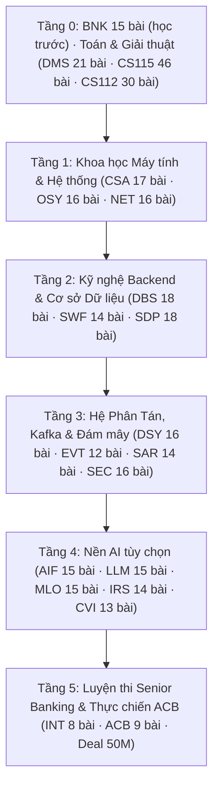

# HƯỚNG DẪN ĐIỀU HƯỚNG & DANH MỤC 643 VIDEO SẴN CÓ TRONG MÃ NGUỒN
## SOURCE CODE VIDEO LIBRARY & COMPREHENSIVE LEARNING ROADMAP

> **Tổng quan kho tài nguyên**: Kho mã nguồn `D:\research-video` hiện sở hữu **643 video bài học Full HD 1080p** (cộng 5 video mẫu `out/DEMO/`, tổng 648 tệp mp4; đo 2026-11-08) (kèm phụ đề Tiếng Việt `.srt`, mục lục phân đoạn `chapters.txt`, báo cáo kiểm định chất lượng âm thanh `asr_report.md` và giao diện xem trước `preview.html`).  
> **Mục tiêu**: Hướng dẫn người học (từ người mới bắt đầu từ con số 0, người mất gốc, đến kỹ sư đang chuẩn bị phỏng vấn Senior Banking 50M gross) cách tra cứu, định vị và mở xem trực tiếp từng video ngay trong cây thư mục `out/`.


> **Cập nhật 2026-11-08 (chiều)**: thêm khóa **JVA** 13 bài (lập trình Java từ con số 0) → 656 bài học; 300 bài của 16 khóa nền tảng đã được đọc kiểm nội dung và sửa (xem `HANDOVER_INTERVIEW.md` Mục 10).
> **Lưu ý đo lại 2026-11-08**: có 643 video bài học (628 bài đo ngày 2026-11-07 cộng 15 bài khóa BNK thêm ngày 2026-11-08; mỗi bài một tệp mp4 và một tệp đặc tả). Thư mục `out/DEMO/` có thêm 5 video mẫu, không tính là bài học.
> **Khoảng trống kiến thức**: đo ngày 2026-11-07 (ngoài INT/ACB không có bài về Spring Boot, PL/SQL, luồng ảo Java 21, ISO 8583, NAPAS; Redis nhắc 1 lần, T24 nhắc 2 lần). **Đã xử lý một phần ngày 2026-11-08 bằng khóa BNK** (`out/BNK/L00` đến `L14`, 115,16 phút sau lần dựng lại ngày 2026-11-09; người chưa từng lập trình học khóa JVA trước: `out/JVA/L00` đến `L12`, 107,11 phút): Java và GC, đa luồng và luồng ảo, Spring, REST và khoá lũy đẳng, SQL và chỉ mục, PL/SQL và bế tắc, Redis, Kafka, SAGA và Outbox, sổ cái, T24 và IBM MQ, ISO 8583, đối soát, bảo mật thanh toán, tình huống giả định. Còn thiếu các chủ đề ghi ở Mục 8 của `HANDOVER_INTERVIEW.md`.

---

## 1. CẤU TRÚC KHO LƯU TRỮ VIDEO TRONG MÃ NGUỒN

Tất cả các video đã được biên dịch hoàn thiện và phân cấp khoa học theo quy tắc chuẩn mực:

```text
D:\research-video\
├── curriculum\            <-- Đặc tả lộ trình tổng thể và yêu cầu tiên quyết (*.yaml, TRACKS.md, ROADMAP.md)
├── lessons\               <-- Mã nguồn kịch bản chi tiết của từng bài học (*.yaml)
│   ├── cs112\
│   ├── dbs\
│   ├── int\
│   └── acb\
└── out\                   <-- NƠI CHỨA 643 VIDEO BÀI HỌC (+5 VIDEO DEMO)
    ├── <COURSE_CODE>\     <-- Mã khoá học viết hoa (ví dụ: CS112, DBS, DSY, INT, ACB)
    │   └── Lxx\           <-- Mã bài học (ví dụ: L00, L01, L02...)
    │       ├── Lxx.mp4    <-- Tệp VIDEO bài giảng Full HD 1080p (H.264 + AAC)
    │       ├── Lxx.srt    <-- Phụ đề Tiếng Việt chuẩn phát thanh
    │       ├── chapters.txt  <-- Mục lục phân đoạn thời gian (Timestamps)
    │       ├── preview.html  <-- Trang web xem trước toàn bộ khung hình bài học
    │       └── asr_report.md <-- Báo cáo đối soát kiểm định phát âm tự động
```

---

## 2. LỘ TRÌNH 6 TẦNG NĂNG LỰC TỪ CON SỐ 0 ĐẾN SENIOR BANKING 50M GROSS

Để một người mới bắt đầu hoặc người mất gốc có thể làm chủ hoàn toàn kiến thức và tự tin deal mức lương **50,000,000 VND Gross/tháng** tại ACB, hãy học theo thứ tự 6 tầng dưới đây:



---

### TẦNG 0: NỀN TẢNG TOÁN HỌC & GIẢI THUẬT (DÀNH CHO NGƯỜI MỚI / MẤT GỐC)
*Mục tiêu: Xóa bỏ hoàn toàn mất gốc toán và tư duy thuật toán, hiểu bản chất bộ nhớ và độ phức tạp tính toán.*

| Mã khóa | Tên khóa học | Số video | Thư mục video trong mã nguồn | Trọng tâm bài học then chốt |
|:---:|:---|:---:|:---|:---|
| **JVA** | Lập trình Java từ con số 0 (chương trình đầu tiên, biến, toán tử, rẽ nhánh, vòng lặp, mảng, hàm, lớp, chuỗi, danh sách/bản đồ, ngoại lệ, giao diện, sổ chuyển khoản) | 13 videos | [`D:/research-video/out/JVA/`](file:///D:/research-video/out/JVA/) | Học ĐẦU TIÊN nếu chưa từng lập trình; mọi chương trình trong bài được javac/java chạy thật (`audit/jva/verify_jva.py`) |
| **BNK** | Nền tảng Backend Ngân hàng cho người mất gốc (Java, đa luồng, Spring, REST, SQL, PL/SQL, Redis, Kafka, SAGA, sổ cái, T24, ISO 8583, đối soát, bảo mật thanh toán) | 15 videos | [`D:/research-video/out/BNK/`](file:///D:/research-video/out/BNK/) | Học TRƯỚC khóa INT/ACB; số liệu trong bài có script kiểm; xem `HANDOVER_INTERVIEW.md` Mục 4D |
| **DMS** | Toán rời rạc (Discrete Mathematics) | 21 videos | [`D:/research-video/out/DMS/`](file:///D:/research-video/out/DMS/) | Logic mệnh đề và lượng từ, các kiểu chứng minh, quy nạp, quan hệ, tổ hợp, số học mô-đun và RSA, đồ thị, cây |
| **CS115** | Toán cho KHMT & Học máy | 46 videos | [`D:/research-video/out/CS115/`](file:///D:/research-video/out/CS115/) | Đại số tuyến tính, ma trận biến đổi, giải tích đa biến, xác suất thống kê |
| **CS112** | Cấu trúc Dữ liệu & Giải thuật | 30 videos | [`D:/research-video/out/CS112/`](file:///D:/research-video/out/CS112/) | Big-O, mảng/danh sách, ngăn xếp/hàng đợi, cây AVL, bảng băm và đống, đồ thị, chia để trị, quy hoạch động, Dijkstra, cây khung (cây B: xem DBS Bài 8; chưa có bài cây đỏ đen) |
| **RBM** | Toán cho Robot & Động học | 18 videos | [`D:/research-video/out/RBM/`](file:///D:/research-video/out/RBM/) | Phép quay, quaternion, tọa độ thuần nhất, động học thuận/ngược, lọc Kalman, A* (khóa robot, không bắt buộc cho phỏng vấn ngân hàng) |

---

### TẦNG 1: KHOA HỌC MÁY TÍNH LÕI & HỆ THỐNG
*Mục tiêu: Hiểu rõ mã nguồn chạy trên phần cứng như thế nào, cơ chế CPU Cache, luồng và giao thức mạng.*

| Mã khóa | Tên khóa học | Số video | Thư mục video trong mã nguồn | Trọng tâm bài học then chốt |
|:---:|:---|:---:|:---|:---|
| **CSA** | Kiến trúc Máy tính & Hệ thống | 17 videos | [`D:/research-video/out/CSA/`](file:///D:/research-video/out/CSA/) | Biểu diễn số, IEEE 754, ALU, hợp ngữ, đường ống lệnh, phân cấp bộ nhớ và cache, bộ nhớ ảo/TLB, ngắt và DMA |
| **OSY** | Hệ điều hành (Operating Systems) | 16 videos | [`D:/research-video/out/OSY/`](file:///D:/research-video/out/OSY/) | Tiến trình và luồng, lập lịch CPU, vùng găng, khóa/semaphore, bế tắc (Coffman, nhà băng), phân trang, thay trang, hệ thống tệp |
| **NET** | Mạng máy tính & Giao thức | 16 videos | [`D:/research-video/out/NET/`](file:///D:/research-video/out/NET/) | Phân tầng, trễ và thông lượng, IPv4/CIDR, định tuyến, TCP bắt tay ba bước, cửa sổ trượt, tắc nghẽn, DNS/HTTP, chuỗi tin cậy TLS (chưa có bài lập trình socket) |
| **TOC** | Lý thuyết Tính toán | 15 videos | [`D:/research-video/out/TOC/`](file:///D:/research-video/out/TOC/) | DFA/NFA, biểu thức chính quy, văn phạm phi ngữ cảnh, ôtômat đẩy xuống, máy Turing, bài toán dừng |
| **PLC** | Ngôn ngữ Lập trình & Trình dịch | 14 videos | [`D:/research-video/out/PLC/`](file:///D:/research-video/out/PLC/) | Pha biên dịch, phân tích từ vựng/cú pháp, kiểu và suy luận kiểu, bao đóng, quản lý bộ nhớ ngăn xếp/đống và đếm tham chiếu |
| **PAR** | Xử lý Song song & GPU | 14 videos | [`D:/research-video/out/PAR/`](file:///D:/research-video/out/PAR/) | Amdahl/Gustafson, tranh chấp dữ liệu và phép toán nguyên tử, cân bằng tải, vector hoá, roofline, mô hình GPU |

---

### TẦNG 2: KỸ NGHỆ BACKEND DOANH NGHIỆP & CƠ SỞ DỮ LIỆU
*Mục tiêu: Thiết kế phần mềm đúng đắn chuẩn ngân hàng, tối ưu hóa câu lệnh SQL và quản trị giao dịch ACID.*

| Mã khóa | Tên khóa học | Số video | Thư mục video trong mã nguồn | Trọng tâm bài học then chốt |
|:---:|:---|:---:|:---|:---|
| **DBS** | Cơ sở Dữ liệu & Lưu trữ | 18 videos | [`D:/research-video/out/DBS/`](file:///D:/research-video/out/DBS/) | Mô hình quan hệ, SQL, chuẩn hoá, chỉ mục B+ và băm, thuật toán nối, ACID, khóa hai pha và bế tắc, WAL, mức cô lập (PL/SQL và khóa hàng Oracle: xem BNK L04–L05) |
| **SWF** | Phần mềm Đúng đắn & Kiểm thử | 14 videos | [`D:/research-video/out/SWF/`](file:///D:/research-video/out/SWF/) | Tiền/hậu điều kiện, bất biến vòng lặp, kiểm thử phân hoạch và biên, độ phủ, kiểm thử dựa trên tính chất, đồng thời và bế tắc |
| **SDP** | Mẫu Thiết kế Phần mềm | 18 videos | [`D:/research-video/out/SDP/`](file:///D:/research-video/out/SDP/) | Hàm và xử lý lỗi, đóng gói, SOLID, mẫu GoF (Factory, Builder, Adapter, Decorator, Strategy, Observer, State), tái cấu trúc, thiết kế API |
| **CLD** | Microservices & Kubernetes | 16 videos | [`D:/research-video/out/CLD/`](file:///D:/research-video/out/CLD/) | Container, Kubernetes và xếp lịch Pod, tự co giãn, triển khai canary/xanh–lam, chịu lỗi (hết giờ, thử lại, cầu dao ngắt), quan sát, SLO, saga (Spring/REST: xem BNK L02–L03) |
| **DVO** | DevOps & CI/CD Pipeline | 14 videos | [`D:/research-video/out/DVO/`](file:///D:/research-video/out/DVO/) | Nhánh và CI, phiên bản ngữ nghĩa, hạ tầng dạng mã, phát hành tiệm tiến (canary, cờ tính năng), chỉ số DORA, cảnh báo, bảo mật đường ống |

---

### TẦNG 3: HỆ THỐNG PHÂN TÁN, DỮ LIỆU LUỒNG & BẢO MẬT
*Mục tiêu: Nắm vững tư duy phân tán cấp cao, kiến trúc hướng sự kiện Kafka và mã hóa bảo mật ngân hàng.*

| Mã khóa | Tên khóa học | Số video | Thư mục video trong mã nguồn | Trọng tâm bài học then chốt |
|:---:|:---|:---:|:---|:---|
| **DSY** | Hệ thống Phân tán (Distributed Systems) | 16 videos | [`D:/research-video/out/DSY/`](file:///D:/research-video/out/DSY/) | Đồng hồ Lamport/vector, sao chép và đại biểu, CAP và đánh đổi độ trễ–nhất quán, đồng thuận đa số và bầu thủ lĩnh, phân mảnh và băm nhất quán, 2PC, ngữ nghĩa giao nhận |
| **EVT** | Kiến trúc Hướng Sự kiện & Kafka | 12 videos | [`D:/research-video/out/EVT/`](file:///D:/research-video/out/EVT/) | Lược đồ sự kiện, consumer lũy đẳng và DLQ, thứ tự theo khóa phân vùng, event sourcing, CQRS, saga, nối luồng, áp lực ngược (offset/rebalance: xem BNK L07) |
| **SAR** | Kiến trúc Hệ thống Lớn | 14 videos | [`D:/research-video/out/SAR/`](file:///D:/research-video/out/SAR/) | Thuộc tính chất lượng, ADR, ước lượng, bộ nhớ đệm, bản sao đọc và phân mảnh, độ sẵn sàng, giới hạn tốc độ và giảm tải, hàng đợi, lũy đẳng, đa vùng |
| **SEC** | An toàn Thông tin & Mật mã học | 16 videos | [`D:/research-video/out/SEC/`](file:///D:/research-video/out/SEC/) | Mô hình hoá mối đe dọa, lưu mật khẩu, MFA, phân quyền, phiên và CSRF, lỗ hổng chèn, chế độ mã hoá đối xứng, MAC, chứng chỉ và TLS, ứng phó sự cố (chưa có bài JWT, OAuth2/OIDC, HSM: xem BNK L13 cho HSM) |
| **DEN** | Kỹ thuật Dữ liệu & Xử lý Luồng | 15 videos | [`D:/research-video/out/DEN/`](file:///D:/research-video/out/DEN/) | Hàng và cột, cây LSM và cây B, kho khóa–giá trị/cột rộng/đồ thị, chỉ mục ngược, nhật ký phân vùng, xử lý luồng có trạng thái, CDC và hộp thư đi, kho dữ liệu, xử lý lô (chưa có bài Kafka Connect) |

---

### TẦNG 4: BỘ NHÂN CÔNG NGHỆ UIT AI (THE UIT AI MULTIPLIER)
*Mục tiêu: Trang bị vũ khí công nghệ khác biệt (Unfair Advantage) để tạo thặng dư giá trị vượt trội khi phỏng vấn.*

| Mã khóa | Tên khóa học | Số video | Thư mục video trong mã nguồn | Trọng tâm bài học then chốt |
|:---:|:---|:---|:---|:---|
| **AIF** | Nền tảng Trí tuệ Nhân tạo | 15 videos | [`D:/research-video/out/AIF/`](file:///D:/research-video/out/AIF/) | Tìm kiếm, A* và hàm đánh giá, thoả ràng buộc, trò chơi đối kháng, MCTS/UCB1, logic, lập kế hoạch, mạng Bayes (Gradient Descent: xem CS115 Bài 9) |
| **LLM** | Mô hình Ngôn ngữ Lớn (LLM) | 15 videos | [`D:/research-video/out/LLM/`](file:///D:/research-video/out/LLM/) | n-gram, BPE, vector nhúng và cosin, Transformer giải mã, huấn luyện trước, sinh văn bản, LoRA, căn chỉnh, đánh giá, RAG |
| **MLO** | Vận hành Học máy (MLOps) | 15 videos | [`D:/research-video/out/MLO/`](file:///D:/research-video/out/MLO/) | Vòng đời mô hình, tái lập, kho đặc trưng, phục vụ mô hình và độ trễ, phát hành an toàn, giám sát trôi dữ liệu, hiệu chuẩn, lượng tử hoá (chưa có bài riêng về ONNX Runtime) |
| **IRS** | Truy hồi Thông tin & Gợi ý | 14 videos | [`D:/research-video/out/IRS/`](file:///D:/research-video/out/IRS/) | Đo chất lượng truy hồi, TF-IDF và cosin, truy hồi dày và ANN, truy hồi lai, học xếp hạng, hệ gợi ý (ứng dụng vào đối soát là ý tưởng của chuyên đề INT 05, không có bài riêng) |
| **CVI** | Thị giác Máy tính | 13 videos | [`D:/research-video/out/CVI/`](file:///D:/research-video/out/CVI/) | Ảnh số, tích chập, hiệu chuẩn camera, đặc trưng và RANSAC, mạng tích chập, phát hiện và phân đoạn đối tượng, độ bền khi dịch chuyển miền (chưa có bài nhận diện khuôn mặt/liveness hay QĐ 2345: xem BNK L13) |

---

### TẦNG 5: KHÓA LUYỆN THI SENIOR BANKING (INT) & THỰC CHIẾN ACB (ACB)
*Mục tiêu: Trực tiếp chinh phục phòng phỏng vấn ACB, gỡ nút thắt hợp đồng và chốt deal lương 50M gross.*

#### Khóa INT: Khung Năng lực Phỏng vấn & Lợi thế AI (8 bài Full HD)
- Lưu trữ tại: [`D:/research-video/out/INT/`](file:///D:/research-video/out/INT/) và [`D:/research-video/interview/video/`](file:///D:/research-video/interview/video/)

| Mã bài | Video MP4 | Giáo án Markdown | Trọng tâm chuyên sâu |
|:---:|:---|:---|:---|
| **`INT:L00`** | [`00_overview_roadmap.mp4`](file:///D:/research-video/interview/video/00_overview_roadmap.mp4) | [`00_overview_roadmap.md`](file:///D:/research-video/interview/00_overview_roadmap.md) | Khung Năng lực Phỏng vấn: Từ Con số 0 đến Deal 50M Gross |
| **`INT:L01`** | [`01_foundation_cs_java.mp4`](file:///D:/research-video/interview/video/01_foundation_cs_java.mp4) | [`01_foundation_cs_java.md`](file:///D:/research-video/interview/01_foundation_cs_java.md) | Khoa học Máy tính, Java 21, JVM Memory Model & Virtual Threads |
| **`INT:L02`** | [`02_backend_microservices.mp4`](file:///D:/research-video/interview/video/02_backend_microservices.mp4) | [`02_backend_microservices.md`](file:///D:/research-video/interview/02_backend_microservices.md) | Kỹ nghệ Microservices, Spring Boot 3, REST RFC 9457 (thay RFC 7807) & Redis |
| **`INT:L03`** | [`03_distributed_systems_senior.mp4`](file:///D:/research-video/interview/video/03_distributed_systems_senior.mp4) | [`03_distributed_systems_senior.md`](file:///D:/research-video/interview/03_distributed_systems_senior.md) | Hệ Phân Tán, SAGA Orchestration, Kafka EOS & Oracle 19c Tuning |
| **`INT:L04`** | [`04_banking_domain_t24_napas.mp4`](file:///D:/research-video/interview/video/04_banking_domain_t24_napas.mp4) | [`04_banking_domain_t24_napas.md`](file:///D:/research-video/interview/04_banking_domain_t24_napas.md) | Nghiệp vụ Core T24, Chuyển mạch NAPAS 247 & 6 Trụ cột Squad Lending |
| **`INT:L05`** | [`05_uit_ai_banking_multiplier.mp4`](file:///D:/research-video/interview/video/05_uit_ai_banking_multiplier.mp4) | [`05_uit_ai_banking_multiplier.md`](file:///D:/research-video/interview/05_uit_ai_banking_multiplier.md) | Biến Văn bằng Cử nhân UIT AI thành Bộ nhân Năng lực Ngân hàng |
| **`INT:L06`** | [`06_interview_qa_bank_100.mp4`](file:///D:/research-video/interview/video/06_interview_qa_bank_100.mp4) | [`06_interview_qa_bank_100.md`](file:///D:/research-video/interview/06_interview_qa_bank_100.md) | 100 câu hỏi phỏng vấn và khung kể sự cố STAR |
| **`INT:L07`** | [`07_salary_negotiation_50m_gross.mp4`](file:///D:/research-video/interview/video/07_salary_negotiation_50m_gross.mp4) | [`07_salary_negotiation_50m_gross.md`](file:///D:/research-video/interview/07_salary_negotiation_50m_gross.md) | Đàm phán lương: đề xuất 50M gross có căn cứ và trung thực |

#### Khóa ACB: Tinh hoa Kỹ thuật Tích hợp Ngân hàng ACB (9 bài Full HD)
- Lưu trữ tại: [`D:/research-video/out/ACB/`](file:///D:/research-video/out/ACB/) và [`D:/research-video/interview/video/`](file:///D:/research-video/interview/video/)

| Mã bài | Video MP4 | Đặc tả chuẩn YAML | Trọng tâm tích hợp ACB |
|:---:|:---|:---|:---|
| **`ACB:L00`** | [`L00.mp4`](file:///D:/research-video/interview/video/L00.mp4) | [`L00_phong_van_tich_hop_acb.yaml`](file:///D:/research-video/lessons/acb/L00_phong_van_tich_hop_acb.yaml) | Cẩm nang Phỏng vấn Tích hợp Ngân hàng ACB: Tổng quan Kiến trúc |
| **`ACB:L01`** | [`L01.mp4`](file:///D:/research-video/interview/video/L01.mp4) | [`L01_tich_hop_core_t24_ibm_mq.yaml`](file:///D:/research-video/lessons/acb/L01_tich_hop_core_t24_ibm_mq.yaml) | Tích hợp Core Banking Temenos T24: Bản tin OFS XML và IBM MQ |
| **`ACB:L02`** | [`L02.mp4`](file:///D:/research-video/interview/video/L02.mp4) | [`L02_chuyen_mach_napas_iso8583.yaml`](file:///D:/research-video/lessons/acb/L02_chuyen_mach_napas_iso8583.yaml) | Chuyển mạch Thanh toán Liên ngân hàng NAPAS 247: ISO 8583 & TCP |
| **`ACB:L03`** | [`L03.mp4`](file:///D:/research-video/interview/video/L03.mp4) | [`L03_streaming_ksqldb_notification_hub.yaml`](file:///D:/research-video/lessons/acb/L03_streaming_ksqldb_notification_hub.yaml) | Kiến trúc Streaming với ksqlDB và Kafka: Omnichannel Notification Hub |
| **`ACB:L04`** | [`L04.mp4`](file:///D:/research-video/interview/video/L04.mp4) | [`L04_san_chuyen_nhuong_hop_dong_tien_gui.yaml`](file:///D:/research-video/lessons/acb/L04_san_chuyen_nhuong_hop_dong_tien_gui.yaml) | Sàn Chuyển nhượng Hợp đồng Tiền gửi: Khóa Lạc quan & Sổ cái T24 |
| **`ACB:L05`** | [`L05.mp4`](file:///D:/research-video/interview/video/L05.mp4) | [`L05_cong_chi_luong_va_sao_ke_divide_conquer.yaml`](file:///D:/research-video/lessons/acb/L05_cong_chi_luong_va_sao_ke_divide_conquer.yaml) | Cổng Chi lương Doanh nghiệp theo lô & Sao kê Divide-and-Conquer |
| **`ACB:L06`** | [`L06.mp4`](file:///D:/research-video/interview/video/L06.mp4) | [`L06_sinh_trac_hoc_qd2345_va_bao_mat_ngan_hang.yaml`](file:///D:/research-video/lessons/acb/L06_sinh_trac_hoc_qd2345_va_bao_mat_ngan_hang.yaml) | Xác thực Sinh trắc học Quyết định 2345 & Bảo mật Ngân hàng Mở |
| **`ACB:L07`** | [`L07.mp4`](file:///D:/research-video/interview/video/L07.mp4) | [`L07_tai_khoan_dinh_danh_va_doi_soat_ba_ben.yaml`](file:///D:/research-video/lessons/acb/L07_tai_khoan_dinh_danh_va_doi_soat_ba_ben.yaml) | Thu hộ qua Tài khoản Định danh (Virtual Account) & Đối soát 3 bên EOD |
| **`ACB:L08`** | [`L08.mp4`](file:///D:/research-video/interview/video/L08.mp4) | [`L08_squad_lending_tich_hop_cic_giai_ngan.yaml`](file:///D:/research-video/lessons/acb/L08_squad_lending_tich_hop_cic_giai_ngan.yaml) | Tín dụng Squad Lending: Thấu chi Sổ tiết kiệm, Lương & Cổng CIC |

---

## 3. CÁCH TÌM KIẾM VÀ MỞ XEM VIDEO TRỰC TIẾP

### 3.1. Mở video bằng Trình phát Phương tiện (VLC / Windows Media Player)
Bạn chỉ cần nhấp vào bất kỳ đường dẫn tệp nào bên trên hoặc điều hướng trong Windows File Explorer:
- Đường dẫn thư mục toàn bộ video: `D:\research-video\out\`
- Đường dẫn video phỏng vấn tổng hợp: `D:\research-video\interview\video\`

### 3.2. Mở xem trước toàn bộ Slide trên Trình duyệt Web
Nếu muốn đọc lướt nội dung bài học mà không cần mở video, hãy nhấp đúp vào tệp `preview.html` trong bất kỳ thư mục bài học nào.  
*Ví dụ*:
- Xem trước bài Cấu trúc dữ liệu: [`D:/research-video/out/CS112/L01/preview.html`](file:///D:/research-video/out/CS112/L01/preview.html)
- Xem trước bài Core T24: [`D:/research-video/out/ACB/L01/preview.html`](file:///D:/research-video/out/ACB/L01/preview.html)

### 3.3. Xem mục lục phân đoạn và thời gian (Timestamps)
Mỗi bài học đều có tệp `chapters.txt` ghi rõ mốc thời gian của từng phần (Hook, Cơ chế, Công thức toán, Câu hỏi kiểm tra, Tổng kết), giúp bạn nhảy cóc đến đúng phần kiến thức cần ôn luyện mà không mất thời gian tìm kiếm.
