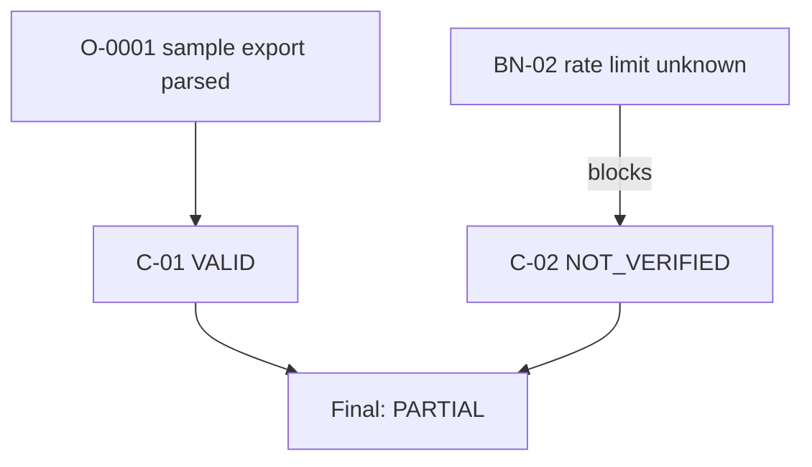

# Knowledge graph EGW-EXAMPLE-001 | 20260101_000000
<!-- Template: copy, rename with your reference code and timestamp, replace the example text. Formats: the File formats section of the handoff reference. -->

## Claims
| Claim | Basis | validity | Grounded in | Depends on |
|---|---|---|---|---|
| C-01 Example: the sample export parses and its row count matches the header | OBSERVED | VALID | O-0001 | BN-01 closed |
| C-02 Example: the batch job stays inside the provider's rate limit | INFERRED | NOT_VERIFIED | - | BN-02 open |

## DAG

## Staleness and invariants
- Acyclic: edges run from evidence or bottleneck to claim, and from claim to Final.
- Every VALID claim is grounded in at least one VALID record.
- When a file a record depends on changes, mark that record STALE and then every record that lists it.
