# KNOWLEDGE GRAPH: ACB SENIOR INTEGRATION RECRUITMENT & BANKING DOMAIN CURRICULUM
> Reference Code: `acb` · Timestamp: `2026-11-07_0010` · Protocol: Evidence-Gated Work (EGW) · Status: 100% VALID / CLOSED

```mermaid
flowchart TD
    %% Observations
    O1["O-0001: 356 Microservices in Hub System Graph (VALID)"] --> C1["C-0001: OCB Architecture Ground Truth (VALID)"]
    O2["O-0002: T24 OFS XML via IBM MQ (VALID)"] --> C2["C-0002: Core Banking Integration Engine (VALID)"]
    O3["O-0003: NAPAS 247 ISO 8583 TCP Sockets (VALID)"] --> C3["C-0003: Interbank Switch Gateway (VALID)"]
    O4["O-0004: Confluent ksqlDB 480+ Topics & UDFs (VALID)"] --> C4["C-0004: Event Streaming Backbone (VALID)"]
    O5["O-0005: Deposit Contract Secondary Market Go Fiber (VALID)"] --> C5["C-0005: Secondary Trading Marketplace (VALID)"]
    O6["O-0006: Decision 2345 Biometrics & VNeID (VALID)"] --> C6["C-0006: Regulatory Biometric Face Auth (VALID)"]
    O7["O-0007: Candidate Profile Pham Minh Duc (VALID)"] --> C7["C-0007: Senior Candidate Credibility 50M Gross (VALID)"]
    O8["O-0008: Missing 07_salary_negotiation_50m_gross.md (RESOLVED)"] --> BN10["BN-0010: Missing Negotiation Script (CLOSED)"]
    O9["O-0009: Curriculum L00-L03 Rendered 1080p (VALID)"] --> C8["C-0008: Pedagogical Foundation Pass (VALID)"]
    O10["O-0010: Request to expand L04-L06 for Newcomers & Seniors (RESOLVED)"] --> BN11["BN-0011: Expand Banking Domain Curriculum & Video (CLOSED)"]
    O11["O-0011: Add References Phan Anh Tuan & Quan Quoc Bao to CV & QA (RESOLVED)"] --> BN12["BN-0012: References Integration CV & QA (CLOSED)"]
    O12["O-0012: Virtual Account & 3-Way Reconciliation Spec & Video L07 (RESOLVED)"] --> BN13["BN-0013: Virtual Account Hub & EOD Reconciliation (CLOSED)"]
    O13["O-0013: Candidate DOB 20/09/1996 & Retail Lending Overdraft Focus (VALID)"] --> C7
    O14["O-0014: Retail Lending & Overdraft Ecosystem in Hub Graph: Deposit Overdraft, Payroll Overdraft, Card Loan, Cloud CA (VALID)"] --> C1
    O15["O-0015: L08 Squad Lending Overdraft & CIC Spec & Video 1080p 265.6s (PASS)"] --> BN14["BN-0014: Double Disbursement, Deposit Pledge & CIC Stale Cache (CLOSED)"]

    %% Contract Bottlenecks (All Closed)
    C2 --> BN01["BN-0001: T24 OFS Timeout Isolation (CLOSED)"]
    C3 --> BN02["BN-0002: NAPAS Packet Replay & Double Debiting (CLOSED)"]
    C1 --> BN03["BN-0003: SAGA Billing Compensation (CLOSED)"]
    C5 --> BN04["BN-0004: Contract Transfer Race Condition & T24 Rollback (CLOSED)"]
    C1 --> BN05["BN-0005: Oracle Payroll Deadlock ORA-00060 (CLOSED)"]
    C7 --> BN06["BN-0006: Experience Perception vs 50M Ceiling (CLOSED)"]
    C7 --> BN07["BN-0007: UIT AI Degree Backend Multiplier (CLOSED)"]
    C4 --> BN08["BN-0008: Statement Hub Divide-and-Conquer I/O (CLOSED)"]
    C6 --> BN09["BN-0009: Biometric 2345 SAGA Pre-condition (CLOSED)"]
    C7 --> BN12
    C1 --> BN13
    C1 --> BN14

    %% Artifacts
    BN10 --> A1["A-0001: 07_salary_negotiation_50m_gross.md (VALID)"]
    BN07 --> A2["A-0002: 05_uit_ai_banking_multiplier.md (VALID)"]
    BN04 --> A3["A-0003: L04 Deposit Secondary Trading Spec & Video (VALID)"]
    BN05 --> A4["A-0004: L05 Batch Payroll & Statement Hub Spec & Video (VALID)"]
    BN09 --> A5["A-0005: L06 Biometric 2345 & Security Spec & Video (VALID)"]
    BN11 --> A6["A-0006: curriculum/acb.yaml L00-L08 (VALID)"]
    BN11 --> A7["A-0007: tools/registry/lexicon_vi.ACB.yaml (VALID)"]
    BN12 --> A9["A-0009: CV PDF 2 Pages & QA Reference Check (VALID)"]
    BN13 --> A10["A-0010: L07 Virtual Account & 3-Way Recon Spec & Video (VALID)"]
    BN14 --> A11["A-0011: L08 Squad Lending & CIC Spec & Video (VALID)"]
    A3 & A4 & A5 & A9 & A10 & A11 --> A8["A-0008: interview/HANDOVER_INTERVIEW.md (VALID)"]


```

## 1. BẢNG QUAN SÁT THỰC NGHIỆM (OBSERVATIONS)

| Mã ID | Trích xuất nguồn (Source) | Bằng chứng thực nghiệm (Observed Evidence) | Trạng thái |
|:---|:---|:---|:---:|
| **O-0001** | `resources/job/hub-system-graph.md` L25-45 | 356 logical services, 270 MCS nodes, 90 OMNI nodes, 4,180 API catalog entries, 778 DB resources. | OBSERVED (VALID) |
| **O-0002** | `resources/job/hub-system-graph.md` L138 | `t24-adapter::vertx` kết nối IBM MQ gửi nhận bản tin OFS XML bất đồng bộ. | OBSERVED (VALID) |
| **O-0003** | `resources/job/hub-system-graph.md` L93-107 | `napas-gateway-v2`, `napas-acq`, `napas-iss` chạy ISO 8583 MTI 0200/0210 qua TCP Sockets. | OBSERVED (VALID) |
| **O-0004** | `resources/job/hub-system-graph.md` L71-79 | `mcs-ksqldb` có 486 topics, kstream divide-and-conquer cho statement hub và notification hub. | OBSERVED (VALID) |
| **O-0005** | `resources/job/hub-system-graph.md` L221, 39061 | `contract-transfer` viết bằng Go Fiber, kết nối PostgreSQL và T24 Term Deposit API. | OBSERVED (VALID) |
| **O-0006** | `resources/job/hub-system-graph.md` L64 | `bio-authentication-service` xác thực khuôn mặt sinh trắc học theo Quyết định 2345/QĐ-NHNN. | OBSERVED (VALID) |
| **O-0007** | `resources/job/build_cv_pdf.py` & `CV.md` | Hồ sơ Phạm Minh Đức: 3+ năm Chuyên viên chính OCB, FPT Poly + UIT AI (Jun 2025 – Nov 2026), CV đúng 2 trang A4. | OBSERVED (VALID) |
| **O-0008** | `interview/` Directory Listing | Thiếu file `07_salary_negotiation_50m_gross.md` và file `05` đang đặt tên `05_ai_applied_banking.md`. | RESOLVED (CLOSED) |
| **O-0009** | `tools/lv.py verify` L00-L03 | 4 bài L00, L01, L02, L03 đã render thành công 1080p, verify duration PASS, ASR sạch. | OBSERVED (VALID) |
| **O-0010** | User Request (2026-11-07) | Yêu cầu rà soát chi tiết, xử lý contract bottleneck chuẩn xác, mở rộng giáo án và video cho người mới/mất gốc vững vàng senior banking. | COMPLETED (CLOSED) |
| **O-0011** | User Request (2026-11-07) | Xác thực rõ: Phan Anh Tuấn (Phó phòng Ứng dụng Tích Hợp OCB - sếp trực tiếp) & Quan Quốc Bảo (hiện tại ở ACB). | OBSERVED (VALID) |
| **O-0012** | `tools/lv.py verify` L07 | Bài L07 Thu hộ Virtual Account & Đối soát 3 bên EOD đã render 1080p, duration 228.9s PASS. | OBSERVED (VALID) |
| **O-0013** | User Request (2026-11-07) | Ứng viên sinh 20/09/1996, chuyên môn sâu Squad Lending & Cổng CIC tại OCB; bỏ link LinkedIn và GitHub cá nhân để bảo mật thông tin ngân hàng. | OBSERVED (VALID) |
| **O-0014** | `resources/job/hub-system-graph.md` L932-985 | Hệ sinh thái Tín dụng `odb.retail.lending-integration-service`: Thấu chi cầm cố sổ tiết kiệm (T24 AZ & account-locked-events), Thấu chi lương tín chấp (Batch Payroll Whitelist), Vay thẻ tín dụng, Ký số FPT Cloud CA, Cổng CIC B2B mTLS. | OBSERVED (VALID) |
| **O-0015** | `tools/lv.py verify` L08 | Bài L08 Tín dụng Squad Lending (Thấu chi Sổ tiết kiệm, Lương và Cổng CIC) đã render 1080p, duration 265.6s PASS (`streams=True → PASS`). | OBSERVED (VALID) |

---

## 2. ĐĂNG KÝ NÚT THẮT HỢP ĐỒNG (CONTRACT BOTTLENECKS REGISTER - 100% CLOSED)

| ID | Điểm chưa xác định / Chưa kiểm chứng | Phần việc phụ thuộc | Bằng chứng còn thiếu | Hệ quả rủi ro | Quy trình nghiệm thu (Resolution Test) | Trạng thái |
|:---|:---|:---|:---|:---|:---|:---:|
| **BN-0001** | T24 OFS timeout làm treo connection pool | L01, CV, Phỏng vấn kỹ thuật | Mô hình Connection Pool và timeout handler | Treo nghẽn HTTP thread của microservice | Test mô hình Request-Reply với `JMSCorrelationID` qua IBM MQ + Outbox + Quét đối soát | **CLOSED** (`L01.mp4` PASS) |
| **BN-0002** | Xung đột gói tin NAPAS 247 và trừ tiền kép | L02, CV, Cổng thanh toán | Cơ chế khử trùng lặp phân tán | Khách hàng bị trừ tiền 2 lần khi mạng timeout | Test Redis `SET dedup:napas:<transId> NX EX 60` kết hợp unique DB constraint | **CLOSED** (`L02.mp4` PASS) |
| **BN-0003** | Điểm nghẽn bồi hoàn SAGA khi đối tác sập | Chuyên đề 03, Phỏng vấn SAGA | Cơ chế khôi phục trạng thái SAGA | Treo luồng thanh toán hóa đơn | PostgreSQL SAGA state machine + Kafka DLQ + bù trừ tự động | **CLOSED** (`03_distributed_systems`) |
| **BN-0004** | Tranh chấp chuyển nhượng hợp đồng tiền gửi | L04, Kiến trúc sàn giao dịch | Khóa lạc quan và ánh xạ mã lỗi T24 | Bán một sổ tiết kiệm cho 2 người; treo vốn | `UPDATE ... WHERE last_access = $5` + xử lý lỗi `04\|05\|999\|1014-1018` chuyển HOLD/REVERT | **CLOSED** (`L04.mp4` PASS) |
| **BN-0005** | Deadlock Oracle Stored Procedure (ORA-00060) | L05, Batch Payroll | Thứ tự khóa hàng trong PL/SQL | Sập tiến trình chi lương 10,000 nhân viên | `ORDER BY account_no ASC FOR UPDATE` + `BULK COLLECT` & `FORALL` | **CLOSED** (`L05.mp4` PASS) |
| **BN-0006** | Định kiến 3 năm kinh nghiệm so với 50M Gross | Phỏng vấn HR, Deal lương | Chiến lược chứng minh năng lực | Bị ép lương xuống 35–40M | Kịch bản đàm phán 3 vòng theo công thức Giá trị ROI trong `07_salary_negotiation_50m_gross.md` | **CLOSED** (Deliverable Valid) |
| **BN-0007** | Bằng Cử nhân AI tại UIT có bị xem là lệch pha? | Phỏng vấn kỹ thuật & văn hóa | Ma trận ánh xạ 38 môn học UIT AI | Bị nghi ngờ năng lực backend thuần túy | Chứng minh cấp số nhân: Anomaly Detection ONNX <5ms, MAB Routing, Vector Matching | **CLOSED** (`05_uit_ai_banking_multiplier.md`) |
| **BN-0008** | Truy vấn sao kê tài khoản lớn gây nghẽn I/O Core | L05, Statement Hub | Kiến trúc phân vùng và tính lũy kế | Sập database ODS khi doanh nghiệp xuất sao kê | Kafka Streams Divide-and-Conquer chunking theo ngày + Parallel Workers | **CLOSED** (`L05.mp4` PASS) |
| **BN-0009** | Độ trễ cổng sinh trắc học QĐ 2345 vượt ngân sách | L06, Biometric Gateway | Kiến trúc pre-condition gate | Quá thời gian quy định thanh toán (< 1.5s) | SDK Liveness Detection + mTLS/VPN BCA + SAGA Pre-condition Gate | **CLOSED** (`L06.mp4` PASS) |
| **BN-0010** | Thiếu file `07_salary_negotiation_50m_gross.md` | Bộ tài liệu phỏng vấn | File chưa có trên đĩa | Ứng viên lúng túng khi deal lương vòng cuối | Khởi tạo đầy đủ file `07` với kịch bản đàm phán 3 vòng thực chiến 50M | **CLOSED** (Deliverable Valid) |
| **BN-0011** | Thiếu giáo án & video L04, L05, L06 cho ACB | Khóa học ACB hoàn chỉnh | File spec YAML và video render | Chưa hoàn thành yêu cầu mở rộng giáo án/video | Soạn thảo YAML chuẩn, lint 0 lỗi, render video 1080p bằng Piper TTS + Playwright | **CLOSED** (7/7 Videos PASS) |
| **BN-0012** | Chuẩn hóa thông tin người tham chiếu: Phan Anh Tuấn (Phó phòng Ứng dụng Tích Hợp OCB) & Quan Quốc Bảo (ACB) | CV ATS, Q&A Phỏng vấn | Chưa có chức danh Phó phòng của sếp Tuấn và vị trí của anh Bảo tại ACB | Bị điểm trừ uy tín hồ sơ khi HR ACB kiểm tra chéo | Thêm mục References chuẩn xác vào `build_cv_pdf.py` (2 trang A4 PASS), `CV.md`, và Câu 76 trong `06_interview_qa_bank_100.md` | **CLOSED** (Verified 2 pages) |
| **BN-0013** | Nghẽn xử lý Thu hộ Virtual Account & Đối soát 3 bên EOD | L07, Khóa học ACB | Chưa có giáo án & video bài giảng chuyên sâu | Doanh nghiệp đối tác bị gạch nợ lặp hoặc treo đối soát cuối ngày | Soạn L07 chuẩn stem full, lint 0 lỗi, render video 1080p, thuật toán Two-Pointer Merge O(N) | **CLOSED** (`L07.mp4` PASS) |
| **BN-0014** | Rủi ro Giải ngân trùng lặp (Double Disbursement), thất thoát rút sổ tiết kiệm đang cầm cố, và nợ xấu do Cache CIC quá hạn | L08, Squad Lending & Overdraft Products | Cơ chế phong tỏa 2 pha trên Core T24 + Khóa phân tán Redis `SET loan:disb:{app_id} 1 NX EX 300` + TTL cache CIC tối đa 15 ngày + Partial Debit thu nợ CASA | Thất thoát tài chính nghiêm trọng cho ngân hàng | Soạn L08 chuẩn stem full, lint 0 lỗi, render video 1080p, verify 265.6s PASS | **CLOSED** (`L08.mp4` PASS) |
| **BN-0015** | Toàn cảnh Hệ sinh thái Squad Lending & Tích hợp Ngân hàng lõi (không chỉ CIC mà bao gồm Thấu chi Lương, Thấu chi Sổ tiết kiệm, Cầm cố Sổ có bên liên quan, Vay trên Hạn mức Thẻ, Mở Thẻ ảo, Ký số Cloud CA và Thu nợ Partial Debit) | OMNI-BFF `odb.retail.lending-integration-service`, Core T24, Cards, FPT E-Sign, ECM | Kết nối 106 resources, 34 APIC, 17 direct MCS; phong tỏa `AZ.ACCOUNT`, hạch toán `OCBIIB.ODLN.UNSE.INPUT`, `OCBIIB.ODLOAN.ROLL`, mô phỏng `loan-on-credit-card/simulate` | Hiểu sai phạm vi chuyên môn ứng viên (chỉ làm CIC thay vì toàn bộ Lending Hub) | Cập nhật toàn diện CV 2 trang A4, Section 1.2 trong `04_banking_domain_t24_napas.md`, bổ sung liên hoàn Câu 81–90 trong `06_interview_qa_bank_100.md` | **CLOSED** (100% Grounded in `hub-system-graph.md`) |
